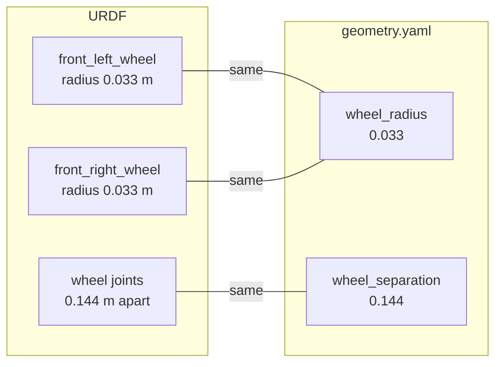

# Testing and CI

Every pull request and every push to the default branch runs automated checks with [GitHub Actions](https://docs.github.com/actions). A PR is only merged when they pass.

## diffbot

| Workflow | File | What it checks |
|:---------|:-----|:---------------|
| CI | [`.github/workflows/diffbot_ci_action.yml`]({{ diffbot_repo_url }}/.github/workflows/diffbot_ci_action.yml) | Builds and tests all catkin packages with [industrial_ci](https://github.com/ros-industrial/industrial_ci), against ROS Noetic packages from the ROS `testing` and `main` repositories (one job each) |
| Firmware | [`.github/workflows/firmware.yml`]({{ diffbot_repo_url }}/.github/workflows/firmware.yml) | Builds the Teensy firmware in [`diffbot_firmware`](https://github.com/ros-mobile-robots/diffbot/tree/noetic-devel/diffbot_firmware) with [PlatformIO](https://platformio.org/), once for each board in its [`platformio.ini`]({{ diffbot_repo_url }}/diffbot_firmware/platformio.ini): `teensy40` (Teensy 4.0) and `teensy31` (Teensy 3.1/3.2) |
| Dev container | [`.github/workflows/devcontainer.yml`]({{ diffbot_repo_url }}/.github/workflows/devcontainer.yml) | Builds the [dev container](dev-container.md) image, creates the container (which builds the workspace), then builds and runs the tests in it |
| Robot container | [`.github/workflows/robot_container.yml`]({{ diffbot_repo_url }}/.github/workflows/robot_container.yml) | Builds the [robot image](../processing_units/robot-container/index.md) when it or its packages change, natively on GitHub's arm64 and amd64 runners. It checks the settings template and runs the image's smoke test without hardware, in the image and through Docker Compose |

### industrial_ci

industrial_ci starts a ROS Docker image, installs the packages' dependencies with rosdep, builds the workspace with catkin and runs the tests. The workflow runs it twice: with ROS packages from the `main` repository, which users install, and from `testing`, where new package versions appear first ([ROS testing repository](http://wiki.ros.org/ShadowRepository)).

The [simulation test](simulation-test.md) also drives Remo, whose model `remo_description` isn't a released ROS package, so rosdep can't install it. `UPSTREAM_WORKSPACE: diffbot_dev.repos` in the workflow makes industrial_ci clone the repositories in this [vcstool](https://github.com/dirk-thomas/vcstool) file, the same [source dependencies](../packages/packages-setup.md#source-dependencies) that the [dev container](dev-container.md) imports. industrial_ci builds them first, in an upstream workspace, then builds the diffbot packages on top of it and runs only their tests ([workspace management](https://github.com/ros-industrial/industrial_ci/blob/master/doc/index.rst#workspace-management)).

[ccache](https://ccache.dev/) speeds up the C++ builds. The workflow stores its cache with `actions/cache`. The cache key contains the run ID, so each successful run saves a new cache, and `restore-keys` loads the newest one at the start of the next run.

### Dev container workflow

[`devcontainers/ci`](https://github.com/devcontainers/ci) creates the container exactly as VS Code or the Dev Container CLI would, including [`setup.sh`]({{ diffbot_repo_url }}/.devcontainer/noetic/setup.sh), which builds the workspace. Then it runs:

```console
catkin build --catkin-make-args run_tests
catkin_test_results build
```

So a broken Dockerfile, a missing dependency or a failing build shows up in the PR, not on a developer's machine weeks later.

### Tests

Only `diffbot_gazebo` registers catkin tests so far: the simulation test and the geometry test below. The robot image has a smoke test of its own. So for most changes the checks prove that everything builds, and a pull request describes how it was tested, for example in the simulation or on the robot. Unit tests for the firmware on the PC ([diffbot#158](https://github.com/ros-mobile-robots/diffbot/issues/158)) and tests for `diffbot_base` without the robot ([diffbot#114](https://github.com/ros-mobile-robots/diffbot/issues/114)) are planned.

#### Simulation test

[`diffbot_gazebo`]({{ diffbot_repo_url }}/diffbot_gazebo) drives DiffBot and Remo in Gazebo and checks where they went, with the robot's odometry and its true pose. Both workflows run it on every pull request. [Simulation Test](simulation-test.md) explains what it checks, how Gazebo and ros_control work together in it, and how to run it and add checks.

#### Geometry test

Each robot's wheel radius and wheel separation are written down twice, in its URDF and in the controller's `geometry.yaml`. [`test_geometry_consistency.py`]({{ diffbot_repo_url }}/diffbot_gazebo/test/test_geometry_consistency.py) checks that they agree, for both robots, without Gazebo. It asks roslaunch which parameters the simulation's and the real robot's launch files set (`roslaunch --dump-params`), and compares the drive wheels' collision radius and the distance between their joints in the URDF with the controller's values. For Remo, these are the values it compares:



The radii are the wheels' collision spheres. The separation is the straight-line distance between the two wheel joints' positions in the URDF's root frame, `base_footprint`: `front_left_wheel_joint` is at y = 0.072 m and `front_right_wheel_joint` at y = −0.072 m, with the same x and z. xacro computes these values from the description package's YAML files, for Remo `front_wheel.yaml` and `base.yaml` in remo_description. A difference of up to 0.1 mm passes.

The test also checks the wheel joints that the controller names in [`diffbot_control.yaml`]({{ diffbot_repo_url }}/diffbot_control/config/diffbot_control.yaml):

- `left_wheel` and `right_wheel` are continuous joints in the URDF.
- Each one's single-joint transmission starts with a velocity interface. Gazebo gives the controller the transmission's first interface, and skips a transmission with more than one joint.
- The hardware interface's `joints` are the same two, the left one first, because the real robot's `diffbot_base` treats the first one as the left motor.

The simulation test would only notice large differences. Neither test can show that the URDF matches the real wheels. That needs a measurement on the robot ([diffbot#138](https://github.com/ros-mobile-robots/diffbot/issues/138)).

??? example "The controller's values, and the parameters that roslaunch reports"
    **The controller's values:** each robot's `geometry.yaml` sets them for `diff_drive_controller`. Its comment says where the URDF has the same values.

    === "DiffBot"

        ```yaml title="diffbot_control/config/diffbot/geometry.yaml"
        --8<-- "{{ geometry_src_raw }}/diffbot_control/config/diffbot/geometry.yaml"
        ```

    === "Remo"

        ```yaml title="diffbot_control/config/remo/geometry.yaml"
        --8<-- "{{ geometry_src_raw }}/diffbot_control/config/remo/geometry.yaml"
        ```

    **What roslaunch reports:** `roslaunch --dump-params` reads a launch file and the files it includes, and prints the parameters that it would set, without starting a node. The test reads six of them, highlighted below. For the geometry, it reads `robot_description`, the robot description generated by [xacro](../robot-description.md), which expands the model's XML macros, and `wheel_radius` and `wheel_separation` from `geometry.yaml`. For the joints, it reads the controller's `left_wheel` and `right_wheel`, and the hardware interface's `joints`.

    The outputs below are Remo's, checked in the [dev container](dev-container.md) with diffbot [`c00651e`](https://github.com/ros-mobile-robots/diffbot/commit/c00651e) (`noetic-devel`) and remo_description 2.0.0. Remo's `robot_description` has 912 lines, so it's cut after its first characters here. With `model:=diffbot`, the wheel radius is 0.0333 m and the wheel separation is 0.138 m.

    === "Real robot"

        On the robot, [`diffbot.launch`]({{ diffbot_repo_url }}/diffbot_base/launch/diffbot.launch) loads the URDF and `geometry.yaml` for the hardware interface and the controllers:

        ```console hl_lines="6 7 8 25 38 47 48 51"
        $ roslaunch --dump-params diffbot_base diffbot.launch model:=remo
        /diffbot/debug/base_controller: true
        /diffbot/debug/hardware_interface: false
        /diffbot/encoder_resolution: 542
        /diffbot/gain: 1.0
        /diffbot/hardware_interface/joints:
        - front_left_wheel_joint
        - front_right_wheel_joint
        /diffbot/joint_state_controller/extra_joints:
        - effort: 0.0
          name: rear_caster_rotation_joint
          position: 0.01
          velocity: 0.0
        - effort: 0.0
          name: rear_caster_wheel_joint
          position: 0.01
          velocity: 0.0
        /diffbot/joint_state_controller/publish_rate: 50
        /diffbot/joint_state_controller/type: joint_state_controller/JointStateController
        /diffbot/mobile_base_controller/angular/z/has_acceleration_limits: true
        /diffbot/mobile_base_controller/angular/z/has_velocity_limits: true
        /diffbot/mobile_base_controller/angular/z/max_acceleration: 6.0
        /diffbot/mobile_base_controller/angular/z/max_velocity: 8.0
        /diffbot/mobile_base_controller/base_frame_id: base_footprint
        /diffbot/mobile_base_controller/left_wheel: front_left_wheel_joint
        /diffbot/mobile_base_controller/linear/x/has_acceleration_limits: true
        /diffbot/mobile_base_controller/linear/x/has_velocity_limits: true
        /diffbot/mobile_base_controller/linear/x/max_acceleration: 0.6
        /diffbot/mobile_base_controller/linear/x/max_velocity: 0.3
        /diffbot/mobile_base_controller/pose_covariance_diagonal:
        - 0.001
        - 0.001
        - 0.001
        - 0.001
        - 0.001
        - 0.03
        /diffbot/mobile_base_controller/publish_rate: 50
        /diffbot/mobile_base_controller/right_wheel: front_right_wheel_joint
        /diffbot/mobile_base_controller/twist_covariance_diagonal:
        - 0.001
        - 0.001
        - 0.001
        - 0.001
        - 0.001
        - 0.03
        /diffbot/mobile_base_controller/type: diff_drive_controller/DiffDriveController
        /diffbot/mobile_base_controller/wheel_radius: 0.033
        /diffbot/mobile_base_controller/wheel_separation: 0.144
        /diffbot/motor_constant: 1.0
        /diffbot/pwm_limit: 1.0
        /diffbot/robot_description: "<?xml version=\"1.0\" ?>\n<!-- …
        /diffbot/trim: 0.0
        ```

    === "Simulation"

        In the simulation, two launch files share the work. [`diffbot_view.launch`]({{ diffbot_repo_url }}/diffbot_gazebo/launch/diffbot_view.launch) loads the URDF for Gazebo, and [`diffbot_control.launch`]({{ diffbot_repo_url }}/diffbot_control/launch/diffbot_control.launch) loads `geometry.yaml`. The test combines their parameters:

        ```console hl_lines="2 16 17 18 35 48 57 58"
        $ roslaunch --dump-params diffbot_gazebo diffbot_view.launch model:=remo
        /diffbot/robot_description: "<?xml version=\"1.0\" ?>\n<!-- …
        /gazebo/enable_ros_network: true
        /use_sim_time: true
        $ roslaunch --dump-params diffbot_control diffbot_control.launch model:=remo rqt_robot_steering:=false
        /diffbot/gazebo_ros_control/pid_gains/front_left_wheel_joint/antiwindup: true
        /diffbot/gazebo_ros_control/pid_gains/front_left_wheel_joint/d: 0.0
        /diffbot/gazebo_ros_control/pid_gains/front_left_wheel_joint/i: 0.6
        /diffbot/gazebo_ros_control/pid_gains/front_left_wheel_joint/i_clamp: 0.05
        /diffbot/gazebo_ros_control/pid_gains/front_left_wheel_joint/p: 0.03
        /diffbot/gazebo_ros_control/pid_gains/front_right_wheel_joint/antiwindup: true
        /diffbot/gazebo_ros_control/pid_gains/front_right_wheel_joint/d: 0.0
        /diffbot/gazebo_ros_control/pid_gains/front_right_wheel_joint/i: 0.6
        /diffbot/gazebo_ros_control/pid_gains/front_right_wheel_joint/i_clamp: 0.05
        /diffbot/gazebo_ros_control/pid_gains/front_right_wheel_joint/p: 0.03
        /diffbot/hardware_interface/joints:
        - front_left_wheel_joint
        - front_right_wheel_joint
        /diffbot/joint_state_controller/extra_joints:
        - effort: 0.0
          name: rear_caster_rotation_joint
          position: 0.01
          velocity: 0.0
        - effort: 0.0
          name: rear_caster_wheel_joint
          position: 0.01
          velocity: 0.0
        /diffbot/joint_state_controller/publish_rate: 50
        /diffbot/joint_state_controller/type: joint_state_controller/JointStateController
        /diffbot/mobile_base_controller/angular/z/has_acceleration_limits: true
        /diffbot/mobile_base_controller/angular/z/has_velocity_limits: true
        /diffbot/mobile_base_controller/angular/z/max_acceleration: 6.0
        /diffbot/mobile_base_controller/angular/z/max_velocity: 8.0
        /diffbot/mobile_base_controller/base_frame_id: base_footprint
        /diffbot/mobile_base_controller/left_wheel: front_left_wheel_joint
        /diffbot/mobile_base_controller/linear/x/has_acceleration_limits: true
        /diffbot/mobile_base_controller/linear/x/has_velocity_limits: true
        /diffbot/mobile_base_controller/linear/x/max_acceleration: 0.6
        /diffbot/mobile_base_controller/linear/x/max_velocity: 0.3
        /diffbot/mobile_base_controller/pose_covariance_diagonal:
        - 0.001
        - 0.001
        - 0.001
        - 0.001
        - 0.001
        - 0.03
        /diffbot/mobile_base_controller/publish_rate: 50
        /diffbot/mobile_base_controller/right_wheel: front_right_wheel_joint
        /diffbot/mobile_base_controller/twist_covariance_diagonal:
        - 0.001
        - 0.001
        - 0.001
        - 0.001
        - 0.001
        - 0.03
        /diffbot/mobile_base_controller/type: diff_drive_controller/DiffDriveController
        /diffbot/mobile_base_controller/wheel_radius: 0.033
        /diffbot/mobile_base_controller/wheel_separation: 0.144
        ```

#### Robot container smoke test

The [robot image](../processing_units/robot-container/image.md#how-its-tested) is checked without hardware: its packages and programs, the robot models, the launch files, and Remo's bringup with both controllers running. Whether the robot drives with it needs a test on the robot ([diffbot#109](https://github.com/ros-mobile-robots/diffbot/issues/109)).

### GitHub Actions versions

The workflows use the latest major versions of the GitHub actions, which run on Node 24. GitHub retires old versions: in 2026 the CI workflow failed before building anything because `actions/cache@v2` had been switched off ([GitHub notice](https://github.blog/changelog/2024-12-05-notice-of-upcoming-releases-and-breaking-changes-for-github-actions/)), and Node 20 actions were retired in September 2026 ([GitHub changelog](https://github.blog/changelog/2026-09-23-node-20-is-no-longer-available-in-github-actions/)). When a check fails during "Set up job", an outdated action is the likely cause.

### Writing tests and debugging

- **Tests:** ROS 1 packages use [gtest](https://github.com/google/googletest) for C++ unit tests and [rostest](http://wiki.ros.org/rostest) for tests that start ROS nodes. [Ros-Test-Example](https://github.com/steup/Ros-Test-Example) shows both in a catkin workspace ([slides](https://github.com/steup/Ros-Test-Example/blob/master/src/cars/doc/slides/slides.pdf)). catkin-tools explains [building and running tests](https://catkin-tools.readthedocs.io/en/latest/verbs/catkin_build.html#building-and-running-tests).
- **Debugging:** a debugger can only stop at breakpoints in a workspace built with debug symbols:

    ```console
    catkin build --save-config --cmake-args -DCMAKE_BUILD_TYPE=Debug
    ```

    See the [catkin-tools cheat sheet](https://catkin-tools.readthedocs.io/en/latest/cheat_sheet.html) for more.

### Running the checks locally

- **Workspace build and tests:** in the [dev container](dev-container.md), in `~/catkin_ws`, run the two commands from the [dev container workflow](#dev-container-workflow) above.
- **Firmware:** build it on the host, not in the [ROS container](dev-container.md): the current PlatformIO Teensy tools need a newer C library (glibc 2.34 or later) than Ubuntu 20.04 has. In our test, the Teensy tool `teensy_size` stopped with a missing `GLIBC_2.34` in the ROS container. CI builds on Ubuntu 24.04, and the steps below were tested on Ubuntu 24.04 (WSL 2) with Python 3.12 and PlatformIO 6.2. From the diffbot folder:

    ```console
    sudo apt install python3-venv
    python3 -m venv ~/.venvs/platformio
    ~/.venvs/platformio/bin/pip install platformio
    cd diffbot_firmware
    ~/.venvs/platformio/bin/pio run
    ```

    `pio run` builds the Teensy 4.0, the default environment; `pio run -e teensy31` builds the Teensy 3.1/3.2.

## This documentation site

| Workflow | File | What it does |
|:---------|:-----|:-------------|
| Documentation CI | [`.github/workflows/ci.yml`]({{ docs_repo_url }}/.github/workflows/ci.yml) | Builds the site with `mkdocs build --strict`, which fails on any warning ([strict mode](https://www.mkdocs.org/user-guide/configuration/#strict)), such as a broken link or anchor ([link validation](https://www.mkdocs.org/user-guide/configuration/#validation)). On a push to `main` it also publishes the site to the `gh-pages` branch, which GitHub Pages serves at ros-mobile-robots.com. |
| Lint | [`.github/workflows/lint.yml`]({{ docs_repo_url }}/.github/workflows/lint.yml) | Checks the spelling with [codespell](https://github.com/codespell-project/codespell); its settings are in [`.codespellrc`]({{ docs_repo_url }}/.codespellrc). |
| PR preview | [`.github/workflows/preview.yml`]({{ docs_repo_url }}/.github/workflows/preview.yml) | Builds each pull request from a branch in this repository and publishes it at `https://ros-mobile-robots.com/pr-preview/pr-<number>/`, so changes can be checked on the real site before merging. The preview is removed when the PR is closed. Pull requests from forks get no preview, only the build and spelling checks. |

To build the site locally:

```console
pip install -r requirements.txt
mkdocs serve
```
