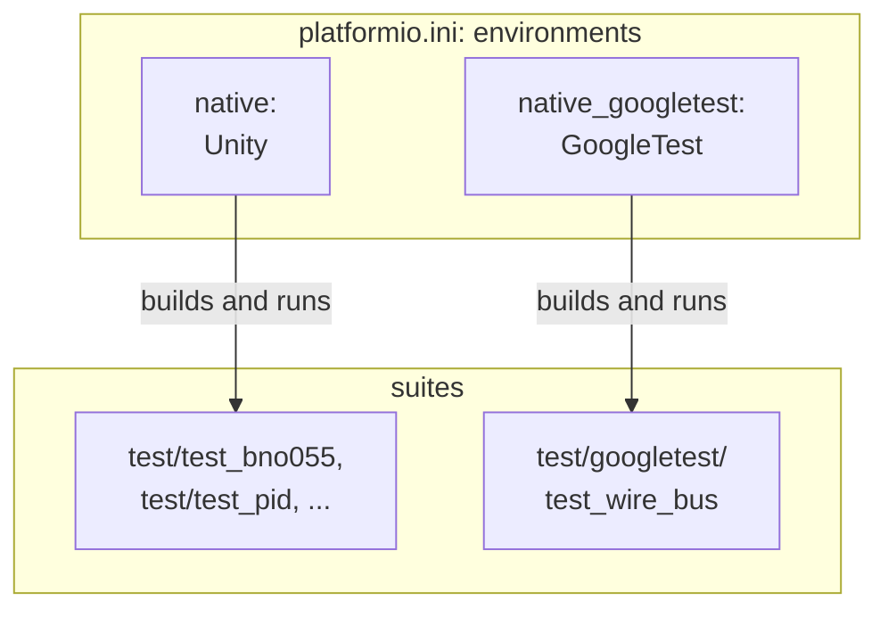

# Firmware Unit Tests

A unit test runs one small part of the code with chosen inputs and checks the result. The unit tests of the Teensy firmware run on the PC, without a Teensy. The tested code talks to stand-ins for the hardware and for the ROS connection, which the tests call fakes. [PlatformIO](https://platformio.org/), the tool that builds the firmware, also compiles each test suite into a program for the PC and runs that program ([PlatformIO's unit testing](https://docs.platformio.org/en/latest/advanced/unit-testing/index.html)). A test suite is one folder of tests in [`diffbot_firmware/test`](https://github.com/ros-mobile-robots/diffbot/tree/noetic-devel/diffbot_firmware/test).

The suites are written with two test frameworks, Unity and GoogleTest. A test framework is the library that provides the checks and reports which tests passed. This page explains why the firmware uses two, how PlatformIO keeps their suites apart, how to run the suites and how to write a new one. CI runs all of them on every pull request ([Firmware unit tests](ci.md#firmware-unit-tests) on the Testing and CI page).

## Two test frameworks

| | [Unity](https://github.com/ThrowTheSwitch/Unity) | [GoogleTest](https://google.github.io/googletest/) |
|:--|:--|:--|
| **Language** | C | C++ |
| **Runs on** | The PC and microcontrollers ([Unity in PlatformIO](https://docs.platformio.org/en/latest/advanced/unit-testing/frameworks/unity.html)) | The PC. For microcontrollers, PlatformIO offers it on ESP boards only, so not on a Teensy ([GoogleTest in PlatformIO](https://docs.platformio.org/en/latest/advanced/unit-testing/frameworks/googletest.html)) |

- **Unity:** a small framework for C, made for microcontrollers. A test that has to run on the Teensy itself needs it. Its suites are the folders `test/test_<name>/` of `diffbot_firmware`, and the PlatformIO environment `native` runs them on the PC. The three suites of the rosserial code are written with Unity, and so are the suites of the BNO055 driver, the command timeout, the PID controller and the wheel control.
- **GoogleTest:** a C++ framework for the PC. Its suites are the folders `test/googletest/test_<name>/`, and the PlatformIO environment `native_googletest` runs them. Tests that share a setup put that setup into a fixture. A test that has to run with several values is written once and runs once per value, and a failure names the value. GoogleTest also finds the tests by itself, while a Unity suite lists each test by hand. ROS uses GoogleTest for its C++ tests too, in ROS 1 ([gtest](http://wiki.ros.org/gtest) on the ROS wiki) and in ROS 2 ([Writing Basic Tests with C++ with GTest](https://docs.ros.org/en/jazzy/Tutorials/Intermediate/Testing/Cpp.html)).

A new test of the firmware's core is a GoogleTest suite. The core is the logic that includes no Arduino and no rosserial header ([Ports and adapters]({{ diffbot_repo_url }}/diffbot_firmware/README.md#ports-and-adapters) in the firmware's README). A Unity suite of the core moves to GoogleTest when its code changes.

`test/googletest` holds one suite, `test_wire_bus`. It tests the firmware's I2C bus code, which builds on the PC too, because the Wire library is a template argument of that code. The section [Write a GoogleTest suite](#write-a-googletest-suite) walks through the suite.

## How PlatformIO keeps the suites apart

A PlatformIO environment is a section of [`platformio.ini`]({{ firmware_tests_src_url }}/diffbot_firmware/platformio.ini) that says what to build and how. One environment builds its suites with one framework. So the firmware has an environment for each framework, and each suite's folder decides which environment runs it:



PlatformIO takes every folder below `test` whose name starts with `test_` as a suite, and names the suite by its path: `test_pid`, or `googletest/test_wire_bus` ([Test Hierarchy](https://docs.platformio.org/en/latest/advanced/unit-testing/structure/hierarchy.html)). The settings `test_filter` and `test_ignore` compare patterns with that path. The first excerpt shows the setting that all environments share, [lines 14–22]({{ firmware_tests_src_url }}/diffbot_firmware/platformio.ini#L14-L22) of `platformio.ini`:

```ini title="platformio.ini: the shared setting" linenums="14"
--8<-- "{{ firmware_tests_src_raw }}/diffbot_firmware/platformio.ini:14:22"
```

The options of the section `[env]` hold for every environment that doesn't set them itself ([Common `[env]`](https://docs.platformio.org/en/latest/projectconf/sections/env/index.html#common-env)). So the two Teensy environments and `native` ignore every suite below `test/googletest`.

The second excerpt shows the two environments for the PC, [lines 49–88]({{ firmware_tests_src_url }}/diffbot_firmware/platformio.ini#L49-L88):

```ini title="platformio.ini: the two environments for the PC" linenums="49"
--8<-- "{{ firmware_tests_src_raw }}/diffbot_firmware/platformio.ini:49:88"
```

- **`platform = native`:** both environments build programs for the PC ([PlatformIO's native platform](https://docs.platformio.org/en/latest/platforms/native.html)).
- **`test_framework`:** `unity` or `googletest`. PlatformIO downloads the framework's library and reads the test program's output in that framework's format.
- **`test_filter`:** the suites that the environment runs. `native` lists its Unity suites by name. `native_googletest` takes every suite below `test/googletest`, so a new GoogleTest suite needs no change of this file.
- **`test_ignore`:** `native_googletest` sets its own value, `test_*`, which matches the Unity suites and replaces the shared `googletest/*`.
- **`lib_deps`:** `native` gets the rosserial library, which three of its suites use. `native_googletest` gets GoogleTest in one exact version, 1.17.0, so that every PC and CI build the tests with the same GoogleTest. The environment has no rosserial library: a GoogleTest suite that includes a rosserial header doesn't build.
- **`build_flags`:** `${env:native.build_flags}` takes the value of `native`, so both environments compile as C++17 with the same warnings ([interpolation of values](https://docs.platformio.org/en/latest/projectconf/interpolation.html)).

A `--filter` on the command line replaces the environment's `test_filter`, but not its `test_ignore`. So a call that names a suite for the wrong environment builds nothing with the wrong framework: `pio test -e native --filter "googletest/*"` runs no suite. PlatformIO then reports `0 test cases` and no error.

## Run the tests

Run the tests in the [firmware container](firmware-container.md), on your PC, from the root folder of your diffbot clone. It needs only Docker. This command runs both environments, as CI does:

```console
.docker/firmware/run.sh pio test -e native -e native_googletest
```

The first run downloads what the tests need from PlatformIO's registry, so it needs the internet. The libraries Unity, rosserial and GoogleTest are part of that download and land in `diffbot_firmware/.pio/libdeps`. Later runs work without the internet.

With PlatformIO installed on your PC instead, in the virtual environment that [Firmware Container](firmware-container.md) sets up, call that environment's `pio` in the folder `diffbot_firmware`: `~/.venvs/platformio/bin/pio test -e native -e native_googletest`. That route needs a C++17 compiler on the PC. It wasn't tested with the GoogleTest environment.

To run one environment, name only that one. To run one suite, add `--filter` with the suite's path below `test`:

```console
.docker/firmware/run.sh pio test -e native
.docker/firmware/run.sh pio test -e native_googletest
.docker/firmware/run.sh pio test -e native --filter test_pid
.docker/firmware/run.sh pio test -e native_googletest --filter googletest/test_wire_bus
```

PlatformIO lists every test with its result, and a summary at the end. The GoogleTest suite's part and the summary:

```console
Processing googletest/test_wire_bus in native_googletest environment
--------------------------------------------------------------------------------
Building...
Testing...
WireBusTest.WriteRegisterSendsRegisterAndValue	[PASSED]
WireBusTest.WriteRegisterFailsWhenTheAddressIsNotAcknowledged	[PASSED]
WireBusTest.ReadRegistersUsesARepeatedStart	[PASSED]
WireBusTest.ReadRegistersFailsWhenTheRegisterWriteFails	[PASSED]
ShortReads/WireBusShortReadTest.ReadRegistersFailsAndDrainsTheBytes/ReportedShortAllBytesThere	[PASSED]
ShortReads/WireBusShortReadTest.ReadRegistersFailsAndDrainsTheBytes/BothShort	[PASSED]
ShortReads/WireBusShortReadTest.ReadRegistersFailsAndDrainsTheBytes/ReportedInFullOneByteMissing	[PASSED]
ShortReads/WireBusShortReadTest.ReadRegistersFailsAndDrainsTheBytes/ReportedOneShortAllBytesThere	[PASSED]
---- native_googletest:googletest/test_wire_bus [PASSED] Took 2.64 seconds ----

=================================== SUMMARY ===================================
Environment        Test                               Status    Duration
-----------------  ---------------------------------  --------  ------------
native             test_imu_publisher                 PASSED    00:00:00.749
native             test_command_timeout               PASSED    00:00:00.550
native             test_synced_node_handle            PASSED    00:00:00.597
native             test_bno055                        PASSED    00:00:00.576
native             test_ros_wheel_command_subscriber  PASSED    00:00:00.609
native             test_pid                           PASSED    00:00:00.561
native             test_wheel_control                 PASSED    00:00:00.595
native_googletest  googletest/test_wire_bus           PASSED    00:00:02.643
================= 97 test cases: 97 succeeded in 00:00:06.879 =================
```

### When a test fails

With `-v`, PlatformIO also prints the framework's own output. The next lines come from a run with a mistake built into the tested code on purpose: `readRegisters()` compared the reported count with the received bytes instead of with the requested length. One of the four short reads then passes as a complete read:

```console
[ RUN      ] ShortReads/WireBusShortReadTest.ReadRegistersFailsAndDrainsTheBytes/BothShort
test/googletest/test_wire_bus/test_wire_bus.cpp:156: Failure
Value of: bus_.readRegisters(DEVICE_ADDRESS, READ_REGISTER, data.data(), data.size())
  Actual: true
Expected: false

[  FAILED  ] ShortReads/WireBusShortReadTest.ReadRegistersFailsAndDrainsTheBytes/BothShort, where GetParam() = requestFrom() reports 4 bytes, 4 bytes arrive (0 ms)
```

- **The check that failed:** its file and line, the expression, its value and the expected value.
- **The test's name:** the name ends with the case, `BothShort`, and the case's values follow `where GetParam() =`. The other three cases ran too, and passed.

After the tests of a suite with a failure, PlatformIO 6.2.0 in the firmware container prints `Program received signal SIGHUP (Hangup)` and gives the suite the status `ERRORED`. In such a run, no signal was sent. The test program ends with the exit status 1 when a test fails, and PlatformIO reads a nonzero status as a signal's number ([`raise_for_status()`](https://github.com/platformio/platformio-core/blob/v6.2.0/platformio/test/runners/readers/native.py#L116-L128) in PlatformIO 6.2.0). Signal 1 is SIGHUP. A Unity suite with one failed test shows the same line.

## Write a GoogleTest suite

[`test_wire_bus.cpp`]({{ firmware_tests_src_url }}/diffbot_firmware/test/googletest/test_wire_bus/test_wire_bus.cpp) is the pattern for a new suite. It tests `WireBusT` ([`wire_bus.h`]({{ firmware_tests_src_url }}/diffbot_firmware/lib/imu/wire_bus.h)), the class that carries out the BNO055 driver's I2C transfers with Arduino's Wire library ([How the firmware reads it](../packages/imu/driver-bno055.md#how-the-firmware-reads-it) on the IMU page). In the suite, the class `FakeWire` stands in for the Wire library. `FakeWire` records the bytes that `WireBusT` sends, and returns the results that a test chooses.

The steps for a new suite, with the wire bus suite's code for each:

1. **A folder and a file:** create `diffbot_firmware/test/googletest/test_<name>/test_<name>.cpp`. The environment `native_googletest` finds the suite by its folder. The file includes `<gtest/gtest.h>` and the header of the code that it tests. A suite that uses a fake from [`test/fakes`](https://github.com/ros-mobile-robots/diffbot/tree/noetic-devel/diffbot_firmware/test/fakes) includes that fake as `"../../fakes/<file>"`.

2. **A fixture for what the tests share:** a fixture is a class with the objects that every test of a group needs. The fixture `WireBusTest` holds a `FakeWire` and a `WireBusT` on it, [lines 77–84]({{ firmware_tests_src_url }}/diffbot_firmware/test/googletest/test_wire_bus/test_wire_bus.cpp#L77-L84):

    ```cpp title="test_wire_bus.cpp: the fixture" linenums="77"
    --8<-- "{{ firmware_tests_src_raw }}/diffbot_firmware/test/googletest/test_wire_bus/test_wire_bus.cpp:77:84"
    ```

    GoogleTest creates a new `WireBusTest` object for each test ([Test Fixtures](https://google.github.io/googletest/primer.html#same-data-multiple-tests) in GoogleTest's primer). So each test starts with an empty `wire_`, and the order of the tests doesn't matter.

3. **One test for one behavior:** `TEST_F` defines a test that uses a fixture. Its first argument is the fixture, its second the test's name. The two tests of `writeRegister()` are [lines 86–98]({{ firmware_tests_src_url }}/diffbot_firmware/test/googletest/test_wire_bus/test_wire_bus.cpp#L86-L98):

    ```cpp title="test_wire_bus.cpp: two tests" linenums="86"
    --8<-- "{{ firmware_tests_src_raw }}/diffbot_firmware/test/googletest/test_wire_bus/test_wire_bus.cpp:86:98"
    ```

    - **The name:** it says the subject, the result and the condition: `writeRegister()` fails when the address is not acknowledged. That is the project's rule for test names ([AGENTS.md]({{ diffbot_repo_url }}/AGENTS.md) of the diffbot repository). GoogleTest's names have no underscores ([GoogleTest's FAQ](https://google.github.io/googletest/faq.html#why-should-test-suite-names-and-test-names-not-contain-underscore)), so each word starts with a capital letter.
    - **The members:** `wire_` and `bus_` are the fixture's. The first test calls `writeRegister()` and then compares `wire_.sent`, the bytes that `FakeWire` recorded, with the register and the value.
    - **The values:** they have names, which the top of the file defines: `DEVICE_ADDRESS`, `WRITTEN_REGISTER`, `WRITTEN_VALUE` and `ADDRESS_NOT_ACKNOWLEDGED`.
    - **The checks:** they start with `EXPECT_`. A failed `EXPECT_` check marks the test as failed and lets the test go on, so one run shows every failed check. A failed `ASSERT_` check returns from the function that it is in. In a test's body, that ends the test, for a check whose failure makes the rest pointless ([Assertions](https://google.github.io/googletest/primer.html#assertions) in the primer).

4. **A parameterized test for several values:** a read can come back short in four ways. They are four cases of one behavior: `readRegisters()` fails and drains the bytes. A parameterized test is written once and runs once per case. The type `ShortRead` describes a case, and the fixture `WireBusShortReadTest` adds the case to `WireBusTest`, [lines 121–145]({{ firmware_tests_src_url }}/diffbot_firmware/test/googletest/test_wire_bus/test_wire_bus.cpp#L121-L145):

    ```cpp title="test_wire_bus.cpp: the type of a case and the fixture" linenums="121"
    --8<-- "{{ firmware_tests_src_raw }}/diffbot_firmware/test/googletest/test_wire_bus/test_wire_bus.cpp:121:145"
    ```

    `TEST_P` defines the test, and `INSTANTIATE_TEST_SUITE_P` lists the cases, [lines 147–170]({{ firmware_tests_src_url }}/diffbot_firmware/test/googletest/test_wire_bus/test_wire_bus.cpp#L147-L170):

    ```cpp title="test_wire_bus.cpp: the parameterized test and its cases" linenums="147"
    --8<-- "{{ firmware_tests_src_raw }}/diffbot_firmware/test/googletest/test_wire_bus/test_wire_bus.cpp:147:170"
    ```

    - **`GetParam()`:** it returns the case of the current run. The test passes the case's two counts to `wire_`, calls `readRegisters()`, and checks the result and that `wire_.available()` is 0.
    - **`::testing::Values(…)`:** it holds the four cases. Their counts come from `SAMPLE_LENGTH_BYTES` and `COUNT_AFTER_FAILED_BUS_ACQUISITION`.
    - **The last argument:** it turns a case into the end of the test's name, such as `BothShort` ([names for the cases](https://google.github.io/googletest/advanced.html#specifying-names-for-value-parameterized-test-parameters) in GoogleTest's advanced guide).
    - **`operator<<`:** it writes a case as text. GoogleTest prints that text after `where GetParam() =` when the case fails ([how GoogleTest prints values](https://google.github.io/googletest/advanced.html#teaching-googletest-how-to-print-your-values)).

    Written as a loop inside one Unity test, the cases would end at the first one that fails. Unity's message would name the line of the check, and not the case.

5. **`main()` at the end:** PlatformIO's GoogleTest library comes without a `main()` function ([GoogleTest in PlatformIO](https://docs.platformio.org/en/latest/advanced/unit-testing/frameworks/googletest.html)), so each suite has its own, [lines 172–179]({{ firmware_tests_src_url }}/diffbot_firmware/test/googletest/test_wire_bus/test_wire_bus.cpp#L172-L179):

    ```cpp title="test_wire_bus.cpp: main()" linenums="172"
    --8<-- "{{ firmware_tests_src_raw }}/diffbot_firmware/test/googletest/test_wire_bus/test_wire_bus.cpp:172:179"
    ```

    `InitGoogleTest()` comes first: it reads the options that GoogleTest takes from the command line, and it has to run before the tests ([Writing the main() Function](https://google.github.io/googletest/primer.html#writing-the-main-function) in the primer). Then `RUN_ALL_TESTS()` runs every `TEST_F` and `TEST_P` of the file. In a Unity suite, a test runs only if `main()` names it in a `RUN_TEST` line.

    `main()` returns `RUN_ALL_TESTS()`'s result as the program's exit status, which is 1 when anything failed. The example on PlatformIO's page returns 0 and leaves the result to the output that PlatformIO reads. In our check with PlatformIO 6.2.0, a failure outside a test's body, in a fixture's `SetUpTestSuite()`, then ended with `pio test` reporting success. With the exit status 1, the run fails.

6. **See the test fail once:** a test that also passes with wrong code checks nothing. So change the tested code on purpose, run the suite, read the failure, and undo the change. For example, without the loop that drains the bytes in `readRegisters()`, all four short-read cases fail at the check of `wire_.available()`.

7. **Run both environments:** before the pull request, with the command of [Run the tests](#run-the-tests).
