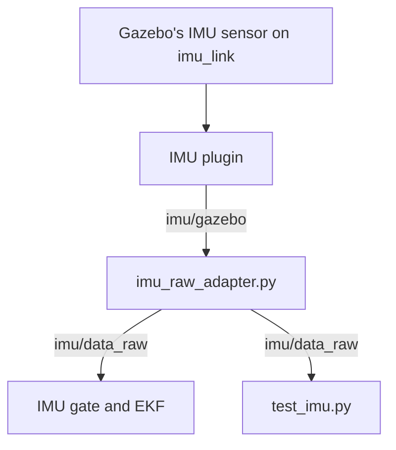

# Simulated IMU

In the simulation, DiffBot and Remo publish the same IMU topic as the real robot's firmware: `/diffbot/imu/data_raw`, at 50 Hz, with the angular velocity and the acceleration but without an orientation. So the [EKF](../packages/imu/robot_localization.md) gets the same input in Gazebo as on the robot. [Simulation](../diffbot_gazebo.md#inertial-measurement-unit-imu) gives the overview. This page goes through the code behind the simulated IMU, in four parts:

1. [The model](#1-the-model): how `imu_link` defines the IMU's position and orientation on the robot, and how Gazebo simulates angular velocity and acceleration measurements at that position.
2. [The adapter](#2-the-adapter): a small node that removes the orientation from Gazebo's message, so it matches the message that the real robot's firmware publishes.
3. [The plugin](#3-the-plugin): the Gazebo plugin that publishes the sensor's values, and why the robots use a copy of gazebo_plugins' plugin.
4. [The test](#4-the-test): what `test_imu.py` checks, and what it can't show.



The topics are in the `/diffbot` namespace, for both robots. The IMU gate is a node, `imu_gate.py`, that checks each IMU sample before passing it to the EKF. It rejects samples that are too old, repeated or invalid ([The IMU gate](../packages/imu/robot_localization.md#the-imu-gate)). The gate and the EKF run only with `ekf:=true` ([Running it](../packages/imu/robot_localization.md#running-it)).

!!! info "Reading the code"

    - The excerpts show one fixed revision of diffbot's source, with their comments. Their line numbers match the original files.
    - The link above each excerpt opens that revision and those lines on GitHub.

For the real IMU, see [what the firmware publishes](../packages/imu/driver-bno055.md#what-the-firmware-publishes), the [bench checks](../packages/imu/driver-bno055.md#bench-checks), and [Remo's measured mounting](../diffbot_gazebo.md#inertial-measurement-unit-imu).

## 1. The model

### The macro `imu_sensor`

Both robots' models add the IMU with a [xacro](http://wiki.ros.org/xacro) macro called `imu_sensor`: DiffBot's in [`common_sensors.xacro`]({{ imu_sim_src_url }}/diffbot_description/urdf/include/common_sensors.xacro#L191-L258), Remo's in [remo_description's file of the same name](https://github.com/ros-mobile-robots/remo_description/blob/2.5.0/urdf/include/common_sensors.xacro#L211). A xacro macro is a template: each call expands it into URDF elements. DiffBot's macro has three parts:

- **The link `imu_link`**, the sensor's own frame, with a small box for the board: 27 × 20 × 4 mm and 3 g, from [`sensors.yaml`]({{ imu_sim_src_url }}/diffbot_description/config/diffbot/sensors.yaml#L16-L26). Its visual, collision and inertia elements describe that box ([lines 208–234]({{ imu_sim_src_url }}/diffbot_description/urdf/include/common_sensors.xacro#L208-L234)).
- **The joint** that fixes `imu_link` on the robot.
- **The Gazebo sensor** that measures at `imu_link`.

The joint and the sensor, [`common_sensors.xacro`, lines 236–257]({{ imu_sim_src_url }}/diffbot_description/urdf/include/common_sensors.xacro#L236-L257):

```xml title="common_sensors.xacro: imu_joint and the Gazebo sensor" linenums="236" hl_lines="4 11"
--8<-- "{{ imu_sim_src_raw }}/diffbot_description/urdf/include/common_sensors.xacro:236:257"
```

- **The joint** is `fixed`: `imu_link` moves with its parent link, as the board moves with the robot. The joint's `<origin>` is the board's position and rotation on the parent link. The macro doesn't write the origin itself. The parameter `*origin` ([line 204]({{ imu_sim_src_url }}/diffbot_description/urdf/include/common_sensors.xacro#L204)) takes an `<origin>` element from the call, and `xacro:insert_block` puts that element here.
- **`<gazebo reference="imu_link">`** holds what only Gazebo reads. URDF tools ignore it. When Gazebo converts the URDF, it places the sensor at `imu_link`'s position and rotation. The converted model has no `imu_link`, though: Gazebo merges links that are joined by fixed joints into one link, and the sensor keeps its pose in the link that remains. For DiffBot that's `base_footprint`, as `gz sdf -p` shows ([Troubleshooting](../diffbot_gazebo.md#troubleshooting)). `imu_link` stays the frame that ROS uses: the plugin writes it into each message, and `robot_state_publisher` publishes its transform from the URDF. `type="imu"` is Gazebo's IMU sensor. It measures the link's angular velocity and acceleration. The acceleration includes gravity, as a real accelerometer's does: at rest, the upward axis reads about +9.8 m/s². The box at the top of [IMU (BNO055)](../packages/imu/driver-bno055.md) explains why. `update_rate` makes the sensor measure 50 times per second, the firmware's rate.
- **The plugin** turns the sensor's values into ROS messages. `filename` names its library, `libdiffbot_gazebo_ros_imu_sensor.so` ([part 3](#3-the-plugin)). Its parameters:
    - `robotNamespace` and `topicName` give the topic `/diffbot/imu/gazebo`.
    - `frameName` becomes the message's `header.frame_id`, `imu_link`.
    - `updateRateHZ` is the plugin's own limit: at most 50 messages per second.
    - `gaussianNoise` is the standard deviation of the random noise that the plugin adds to every value: 0.005, in rad/s for the angular velocity and in m/s² for the acceleration. It's a simulation setting, not the BNO055's measured noise. The plugin puts its square, 2.5 · 10⁻⁵, on the diagonal of each covariance.
    - The last three parameters don't change what reaches `/diffbot/imu/data_raw`. The plugin reads `xyzOffset` but doesn't use it. `rpyOffset` and `initialOrientationAsReference` affect only the orientation, which the adapter removes ([part 2](#2-the-adapter)). Where the sensor sits and how it's turned comes from the joint's origin.

### The call in DiffBot's model

[`diffbot.urdf.xacro`, lines 80–82]({{ imu_sim_src_url }}/diffbot_description/urdf/diffbot.urdf.xacro#L80-L82):

```xml title="diffbot.urdf.xacro: the IMU" linenums="80"
--8<-- "{{ imu_sim_src_raw }}/diffbot_description/urdf/diffbot.urdf.xacro:80:82"
```

The call puts the IMU on `chassis_link` and passes the sensor properties from `sensors.yaml`. Between its tags, it writes the `<origin>` element that the macro inserts into the joint. `$(arg imu_xyz)` and `$(arg imu_rpy)` are xacro arguments, declared at the top of the file with their defaults ([lines 4–10]({{ imu_sim_src_url }}/diffbot_description/urdf/diffbot.urdf.xacro#L4-L10)): 0.01 m above `chassis_link`'s origin, not rotated. DiffBot's mounting isn't measured yet, so these defaults are placeholders. You can override them when you expand the model, for example `xacro diffbot.urdf.xacro imu_xyz:='0 0 0.02'`.

### The plugin's library in Remo's model

DiffBot's macro names the plugin's library itself ([line 246]({{ imu_sim_src_url }}/diffbot_description/urdf/include/common_sensors.xacro#L246)). Remo's model, from remo_description 2.5.0 on, takes the library's name as the xacro argument `imu_plugin` instead. The argument's default is gazebo_plugins' own library ([`remo.urdf.xacro`, lines 29–36](https://github.com/ros-mobile-robots/remo_description/blob/2.5.0/urdf/remo.urdf.xacro#L29-L36)), and the model passes it to its macro ([lines 211–216](https://github.com/ros-mobile-robots/remo_description/blob/2.5.0/urdf/remo.urdf.xacro#L211-L216)). The diffbot repository's simulation sets the argument when it expands the model, [`diffbot_view.launch`, lines 6–11]({{ imu_sim_src_url }}/diffbot_gazebo/launch/diffbot_view.launch#L6-L11):

```xml title="diffbot_view.launch: the command that expands the model" linenums="6" hl_lines="6"
--8<-- "{{ imu_sim_src_raw }}/diffbot_gazebo/launch/diffbot_view.launch:6:11"
```

`urdf_file` is the xacro command for the selected robot's model. It passes `imu_plugin:=libdiffbot_gazebo_ros_imu_sensor.so` to both models. Remo's model uses the value as the plugin's `filename`. DiffBot's model doesn't declare `imu_plugin`, and xacro ignores the argument. So both robots load the same plugin in this simulation, and Remo's model still works on its own, with its default library.

## 2. The adapter

Gazebo's plugin publishes a complete `sensor_msgs/Imu` message, with an orientation. The robot's firmware publishes no orientation: it reads only the BNO055's angular velocity and acceleration, because the EKF fuses only the yaw rate ([What the firmware publishes](../packages/imu/driver-bno055.md#what-the-firmware-publishes)). [`imu_raw_adapter.py`]({{ imu_sim_src_url }}/diffbot_gazebo/scripts/imu_raw_adapter.py) makes the simulated message match the firmware's. `diffbot_view.launch` starts it in the `diffbot` namespace ([line 39]({{ imu_sim_src_url }}/diffbot_gazebo/launch/diffbot_view.launch#L39)), so its relative topic names become `/diffbot/imu/gazebo` and `/diffbot/imu/data_raw`. [Lines 16–36]({{ imu_sim_src_url }}/diffbot_gazebo/scripts/imu_raw_adapter.py#L16-L36):

```python title="imu_raw_adapter.py" linenums="16" hl_lines="4 5 16 17 18 19 20"
--8<-- "{{ imu_sim_src_raw }}/diffbot_gazebo/scripts/imu_raw_adapter.py:16:36"
```

- **How a field is marked unavailable.** A `sensor_msgs/Imu` message always has an orientation field. To say that a field holds no data, the [message definition](https://github.com/ros/common_msgs/blob/noetic-devel/sensor_msgs/msg/Imu.msg) and [REP 145](https://www.ros.org/reps/rep-0145.html#topics), the ROS convention for IMU drivers, set the first element of the field's covariance to −1. A node that reads the message should check that element and ignore the field. `ORIENTATION_UNAVAILABLE` is such a covariance: −1, then eight zeros, the 3 × 3 matrix row by row.
- **A convention, not a rule to drop the orientation.** REP 145 doesn't ask an IMU driver to leave out the orientation. A driver whose sensor estimates an orientation can publish it on `imu/data`. The firmware's topic, `imu/data_raw`, is REP 145's name for the accelerometer's and the gyroscope's data alone.
- **The callback** sets the quaternion's four values to 0 and the orientation covariance to a copy of the constant. `list()` makes the copy, so that the messages don't share the constant's list. Then the callback publishes the same message object.
- **What stays:** the header with its stamp and frame, the angular velocity, the acceleration and their covariances. The stamp is the simulation time at which Gazebo's sensor measured. The adapter doesn't stamp the message again: the [IMU gate](../packages/imu/robot_localization.md#the-imu-gate) in front of the EKF checks how old each sample is, and a new stamp would hide a delay.

## 3. The plugin

### What the plugin does

`libdiffbot_gazebo_ros_imu_sensor.so` is built from the package [`diffbot_gazebo_plugins`]({{ imu_sim_src_url }}/diffbot_gazebo_plugins). Its source, [`gazebo_ros_imu_sensor.cpp`]({{ imu_sim_src_url }}/diffbot_gazebo_plugins/src/gazebo_ros_imu_sensor.cpp), is a copy of the IMU sensor plugin from [gazebo_plugins 2.9.3](https://github.com/ros-simulation/gazebo_ros_pkgs/blob/2.9.3/gazebo_plugins/src/gazebo_ros_imu_sensor.cpp), the version that the dev container installs. The copy has the same parameters and publishes the same message.

`Load()` connects `UpdateChild()` to Gazebo's world update event ([lines 121–122]({{ imu_sim_src_url }}/diffbot_gazebo_plugins/src/gazebo_ros_imu_sensor.cpp#L121-L122)). So Gazebo's **physics thread**, the thread that steps the simulation, calls `UpdateChild()` at the start of every simulation step. `UpdateChild()` goes on at most 50 times per second of the sensor's time and returns right away otherwise. It fills and publishes a message only while the topic has a subscriber ([lines 127–134]({{ imu_sim_src_url }}/diffbot_gazebo_plugins/src/gazebo_ros_imu_sensor.cpp#L127-L134)). In the simulation, the adapter always subscribes to `imu/gazebo`. The end of the message, [lines 167–175]({{ imu_sim_src_url }}/diffbot_gazebo_plugins/src/gazebo_ros_imu_sensor.cpp#L167-L175):

```cpp title="gazebo_ros_imu_sensor.cpp: the end of UpdateChild()" linenums="167" hl_lines="7 8 9"
--8<-- "{{ imu_sim_src_raw }}/diffbot_gazebo_plugins/src/gazebo_ros_imu_sensor.cpp:167:175"
```

The stamp is the sensor's last update time, in simulation time. In gazebo_plugins' original, `publish()` is followed by `ros::spinOnce()` (the same block in 2.9.3, [lines 137–151](https://github.com/ros-simulation/gazebo_ros_pkgs/blob/2.9.3/gazebo_plugins/src/gazebo_ros_imu_sensor.cpp#L137-L151), with `ros::spinOnce()` in line 150). The copy leaves that call out, as its comment says. The plugin's parameters, its message and its computations are the same as in the original.

### Why the copy doesn't spin

Two kinds of threads in the Gazebo server matter here:

- **Gazebo's physics thread** steps the simulation. In every step, it calls the plugins' update functions: the IMU plugin's `UpdateChild()`, and `gazebo_ros_control`'s, which calls the controller manager's `update()` ([`gazebo_ros_control_plugin.cpp`, line 251](https://github.com/ros-simulation/gazebo_ros_pkgs/blob/2.9.3/gazebo_ros_control/src/gazebo_ros_control_plugin.cpp#L251)). `update()` runs the controllers ([What runs in the simulation](simulation-test.md#what-runs-in-the-simulation)).
- **ROS's spinner threads** run the **callbacks**: the functions that ROS runs for an incoming message or service request. Incoming messages and service requests wait in ROS's global callback queue until a thread runs their callback. This includes the requests to the controller manager's services. Gazebo's ROS interface, `gazebo_ros_api_plugin`, starts one spinner thread per CPU core ([`gazebo_ros_api_plugin.cpp`, line 148](https://github.com/ros-simulation/gazebo_ros_pkgs/blob/2.9.3/gazebo_ros/src/gazebo_ros_api_plugin.cpp#L148)).

The controller spawner from [`diffbot_control.launch`]({{ imu_sim_src_url }}/diffbot_control/launch/diffbot_control.launch#L23-L25) loads and starts the controllers with two of the controller manager's services, `load_controller` and `switch_controller`. Their callbacks don't change the running controllers themselves. They hand the change to `update()` and wait until `update()` has taken it ([`controller_manager.cpp`, lines 352–359](https://github.com/ros-controls/ros_control/blob/0.20.0/controller_manager/src/controller_manager.cpp#L352-L359) and [612–630](https://github.com/ros-controls/ros_control/blob/0.20.0/controller_manager/src/controller_manager.cpp#L612-L630)). `switch_controller` takes a timeout, but the spawner passes 0, which means no limit ([`spawner`, line 212](https://github.com/ros-controls/ros_control/blob/0.20.0/controller_manager/scripts/spawner#L212)). A spinner thread can wait there: the physics thread goes on with the next step and calls `update()`, which takes the change. Then the callback returns, and the spawner gets its answer.

[`ros::spinOnce()`](http://wiki.ros.org/roscpp/Overview/Callbacks%20and%20Spinning#Single-threaded_Spinning) runs the callbacks that wait in the global queue at that moment, in the thread that calls it. In the original's `UpdateChild()`, that's the physics thread. When one of the spawner's requests is waiting just then, before a spinner thread has taken it:

1. The physics thread runs the service's callback, inside `UpdateChild()`.
2. The callback hands its change to `update()` and waits.
3. `update()` runs only in the physics thread, and the physics thread is busy waiting in the callback. It waits for itself.
4. The simulation step never ends. The simulation's clock stops for good, and the spawner's call never returns.

The copy runs no callbacks in the physics thread. It needs no spinning of its own, because it only publishes. The spinner threads run every callback, including the controller manager's services, and the physics thread keeps calling `update()`. With the original, the stall depends on timing, so it hits only some starts of the simulation. [diffbot#185](https://github.com/ros-mobile-robots/diffbot/issues/185) has the diagnosis, the stalled simulations' backtraces, and how many starts stalled with the original and with the copy.

#### Why not just wait?

The deadlock comes from the physics thread running a callback that waits for the physics thread. Other ideas don't remove that dependency:

- **A delay, or starting Gazebo paused.** A delay at the start might change which thread takes the spawner's request, but it doesn't remove the unsafe path. Starting Gazebo paused doesn't help either, because starting the controllers needs `update()`, and later requests to the controller manager can take the same path.
- **A condition variable.** The callback already waits. Waiting on a condition variable instead of polling would still block the physics thread, which is the only thread that can run `update()`.
- **A timeout.** `switch_controller` has an escape: with a positive timeout, its callback returns a failure about a second after the timeout ([`controller_manager.cpp`, lines 612–636](https://github.com/ros-controls/ros_control/blob/0.20.0/controller_manager/src/controller_manager.cpp#L612-L636)). The spawner passes 0, which turns that escape off. `load_controller` has no timeout at all. And a failed switch wouldn't start the controllers anyway.
- **A separate queue for the controller manager**, served by a thread of its own, would also keep the callbacks out of the physics thread. It changes how `gazebo_ros_control` sets up the controller manager, though, which passes it an ordinary node handle on the global queue ([`gazebo_ros_control_plugin.cpp`, lines 149–150](https://github.com/ros-simulation/gazebo_ros_pkgs/blob/2.9.3/gazebo_ros_control/src/gazebo_ros_control_plugin.cpp#L149-L150)).

The IMU plugin only publishes, so it has no callbacks of its own to run. Leaving out `ros::spinOnce()` is the smallest change that keeps the physics thread out of the queue. The installed plugin can't be changed in place, so the robots load a copy.

### The copy's other changes

The [change notice]({{ imu_sim_src_url }}/diffbot_gazebo_plugins/src/gazebo_ros_imu_sensor.cpp#L17-L33) at the top of the file lists every change. Apart from the missing `ros::spinOnce()`, they don't change what the plugin does:

- The class is in the namespace `diffbot_gazebo_plugins`. So a Gazebo process that loads both libraries can't mix up this class with gazebo_plugins' class of the same name ([the header's notice]({{ imu_sim_src_url }}/diffbot_gazebo_plugins/include/diffbot_gazebo_plugins/gazebo_ros_imu_sensor.h#L17-L25)).
- The optional profiler calls are left out. This package doesn't enable them.
- The lines are at most 99 characters long, and the file includes the header of every name it uses.

The source is under the Apache License 2.0, as the original is. The copy keeps the original's notices, and the package installs the license's text ([`package.xml`]({{ imu_sim_src_url }}/diffbot_gazebo_plugins/package.xml), [`CMakeLists.txt`]({{ imu_sim_src_url }}/diffbot_gazebo_plugins/CMakeLists.txt)). Gazebo looks for the library's file name on `GAZEBO_PLUGIN_PATH` and then on `LD_LIBRARY_PATH`. The workspace's `setup.bash` puts the workspace's library folder on `LD_LIBRARY_PATH` ([the comment in `CMakeLists.txt`]({{ imu_sim_src_url }}/diffbot_gazebo_plugins/CMakeLists.txt#L23-L25)).

## 4. The test

[`test_imu.py`]({{ imu_sim_src_url }}/diffbot_gazebo/test/test_imu.py) checks `/diffbot/imu/data_raw` as the EKF and the firmware expect it. Both simulation test files run it as a test node of its own, `imu_diffbot` and `imu_remo` ([`sim_drive_diffbot.test`, lines 27–29]({{ imu_sim_src_url }}/diffbot_gazebo/test/sim_drive_diffbot.test#L27-L29)). So rostest starts Gazebo and the robot again for this test node, as for the other test nodes ([The test file](simulation-test.md#1-the-test-file)). [Run it](simulation-test.md#run-it) and [Read the results](simulation-test.md#read-the-results) on Simulation Test show how to run the tests and where their results are.

### The constants

[Lines 22–48]({{ imu_sim_src_url }}/diffbot_gazebo/test/test_imu.py#L22-L48):

```python title="test_imu.py: the constants" linenums="22"
--8<-- "{{ imu_sim_src_raw }}/diffbot_gazebo/test/test_imu.py:22:48"
```

The comments say what each number is. Mind the clocks: `STARTUP_TIMEOUT` and `POLL_INTERVAL` are seconds of wall time, the computer's clock. `SETTLE`, `SPEED_UP` and `MEASURE` are seconds of simulation time, Gazebo's clock ([Wall time and simulation time](#wall-time-and-simulation-time)).

### Waiting until the robot can drive

unittest calls `setUp()` before each test method. [Lines 53–65]({{ imu_sim_src_url }}/diffbot_gazebo/test/test_imu.py#L53-L65):

```python title="test_imu.py: setUp()" linenums="53"
--8<-- "{{ imu_sim_src_raw }}/diffbot_gazebo/test/test_imu.py:53:65"
```

- The subscriber appends each IMU message to `self.messages`, in one of rospy's background threads. The publisher sends velocity commands to the drive controller.
- `rospy.wait_for_message()` waits for the first IMU message. It comes early: Gazebo's sensor and the adapter publish soon after the robot is in the simulation.
- **An IMU message doesn't mean that the robot can drive.** The controller spawner starts the drive controller, `mobile_base_controller`, later ([The launch file](simulation-test.md#2-the-launch-file)). So `setUp()` waits for the controller's first odometry message, which shows that the controller runs.
- **A running controller can still miss the first commands.** ROS connects a publisher and a subscriber only after both exist, and a message published before the connection is lost. `get_num_connections()` counts the subscribers connected to the test's publisher. The loop waits until the drive controller has connected, at most `STARTUP_TIMEOUT`.

### The test at rest

[Lines 67–97]({{ imu_sim_src_url }}/diffbot_gazebo/test/test_imu.py#L67-L97):

```python title="test_imu.py: collect() and the test at rest" linenums="67"
--8<-- "{{ imu_sim_src_raw }}/diffbot_gazebo/test/test_imu.py:67:97"
```

`collect()` empties the list, sleeps for `seconds` of simulation time, and returns a copy of the messages that arrived meanwhile. The test stops the robot with `Twist()`, a command with all velocities 0, waits `SETTLE`, 1 s, for the robot to stand still, and collects 2 s of messages. unittest runs the test methods in [alphabetical order](https://docs.python.org/3/library/unittest.html#unittest.TestLoader.sortTestMethodsUsing), so the left turn test runs first, and the robot may still be braking when this test starts. Then come the checks:

| Check | Expected | Why |
|:--|:--|:--|
| Rate, lines 77–80 | More than 45 Hz, 0.9 × 50 Hz | The firmware publishes at 50 Hz, and the EKF runs at that rate |
| Stamps, lines 81–83 | Each later than the one before | The [IMU gate](../packages/imu/robot_localization.md#the-imu-gate) drops a sample that isn't later than the last one it passed on |
| Frame, line 85 | `imu_link` | The EKF looks up this frame to turn the yaw rate into the robot's frame |
| Orientation, lines 86–87 | `orientation_covariance[0]` is −1 | The firmware's message marks the orientation unavailable ([part 2](#2-the-adapter)) |
| Values, lines 88–89 | `angular_velocity.z` and `linear_acceleration.z` are finite: not NaN, not infinite | The IMU gate drops samples with values that aren't finite |
| Yaw rate's variance, lines 90–93 | `angular_velocity_covariance[8]` is positive and finite | Element 8 is the z-z element, the yaw rate's variance. The EKF weighs the yaw rate with it, and the gate drops samples without a positive, finite variance |
| Gravity, lines 94–97 | The average `linear_acceleration.z` within 9.81 ± 0.5 m/s² | At rest, the upward axis reads gravity. An IMU frame upside down reads about −9.81 m/s², a plugin that leaves gravity out about 0 |

### The left turn

[Lines 99–117]({{ imu_sim_src_url }}/diffbot_gazebo/test/test_imu.py#L99-L117):

```python title="test_imu.py: the left turn" linenums="99"
--8<-- "{{ imu_sim_src_raw }}/diffbot_gazebo/test/test_imu.py:99:117"
```

- The test commands a turn on the spot at `TURN_RATE`, 0.5 rad/s, and repeats the command 20 times per second. The drive controller stops the robot when no command arrives for 0.5 s.
- The first loop gives the robot `SPEED_UP`, 1 s, to reach the turn rate. Then the test empties the list, keeps turning for `MEASURE`, 2 s, and keeps the messages of that time. After the loop, the test stops the robot.
- The check: the average `angular_velocity.z` within 0.5 ± 0.15 rad/s. A left turn, counterclockwise seen from above, is positive about the upward z axis ([REP 103](https://www.ros.org/reps/rep-0103.html)). So the check fails when the IMU's frame is upside down, or when the IMU doesn't measure the turn.

### Wall time and simulation time

The startup waits and the measurements use different clocks:

- **The startup waits** in `setUp()` use wall time: `rospy.wait_for_message()` measures its `timeout` with the computer's clock ([rospy's source](https://github.com/ros/ros_comm/blob/1.17.4/clients/rospy/src/rospy/client.py#L413-L420)), and the loop uses `time.monotonic()`. These waits have to end even when the simulation's clock doesn't run, for example when Gazebo hasn't started yet. Each of the three waits has its own limit of `STARTUP_TIMEOUT`, 60 s. When no IMU message or no odometry comes in time, `rospy.wait_for_message()` raises an exception, and the test reports an error. When the drive controller doesn't connect in time, `assertLess()` fails, and the test reports a failure. Independently of these limits, rostest stops the whole test node after its `time-limit` of 120 s ([`sim_drive_diffbot.test`, line 29]({{ imu_sim_src_url }}/diffbot_gazebo/test/sim_drive_diffbot.test#L29)).
- **The measurements** use simulation time: `rospy.sleep()`, `rospy.Time.now()` and `rospy.Rate` follow Gazebo's clock ([The launch file](simulation-test.md#2-the-launch-file)). So `MEASURE` always covers 2 s of simulated motion, about 100 IMU messages at 50 Hz, however fast the computer runs the simulation.

### What the test can't show

The test checks the simulated IMU in one start of the simulation. A pass doesn't show that the stall from [part 3](#why-the-copy-doesnt-spin) can't happen. With the original plugin, the stall needs a spawner request in the queue at the moment that the plugin spins, and most starts pass without it. A stalled start ends with an error in `setUp()`, because no odometry comes. A longer `STARTUP_TIMEOUT` wouldn't help, because a stopped clock doesn't start again. The counts of many starts with and without the copy are in [diffbot#185](https://github.com/ros-mobile-robots/diffbot/issues/185).

The test checks only the upward axis, so it doesn't see a wrong rotation about that axis, such as a missing −90° in Remo's `imu_rpy`. It also says nothing about the real BNO055. The real sensor's noise, bias and mounting are checked on the robot, in the [bench checks](../packages/imu/driver-bno055.md#bench-checks).
