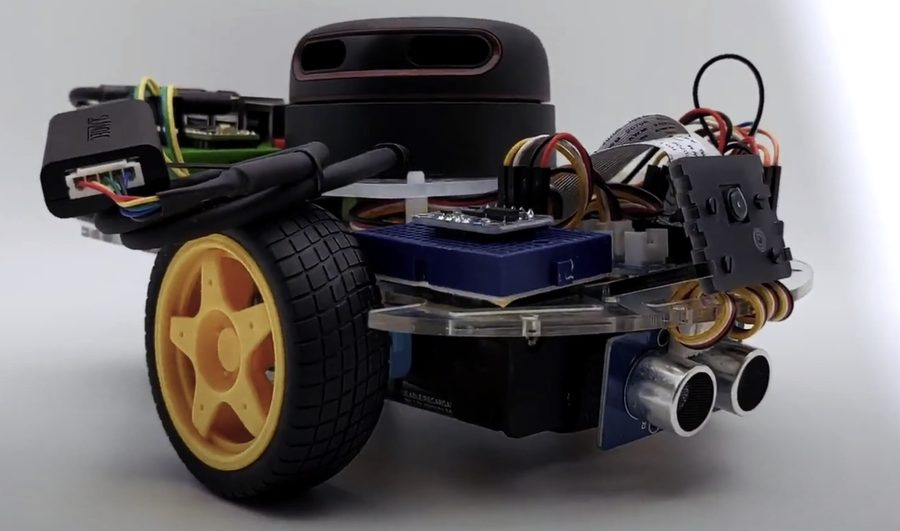
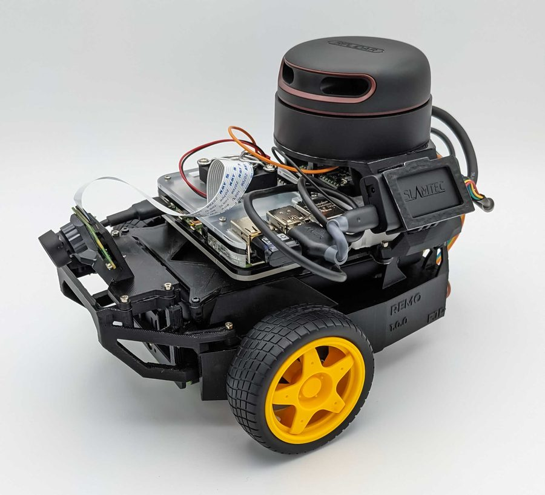

# Getting Started

This page takes you from a new PC to a driving robot. The steps are the same for both robots, because they share their code in the [diffbot](https://github.com/ros-mobile-robots/diffbot) repository, and both run [ROS 1 Noetic](https://wiki.ros.org/noetic):

<div class="grid cards robot-cards" markdown>

-   

    __DiffBot__: your own two- or four-wheeled differential drive robot.

-   

    __Remo__: a modular platform based on NVIDIA's JetBot, with a 3D printed frame.

</div>

[Hardware](../hardware/index.md) describes both robots and what you need to build them.

The steps below build on each other. The first three set up your PC and run the robot in simulation, without any hardware. The real robot continues with step 4, and your PC is then already prepared for it. [Go to step 1](#1-set-up-your-pc).

!!! tip "Quick start, if Docker and VS Code are already set up"
    In a Linux terminal, or on Windows in the Ubuntu in WSL 2:

    ```console
    git clone https://github.com/ros-mobile-robots/diffbot.git
    code diffbot
    ```

    In VS Code, choose **Reopen in Container**; the first start takes a few minutes. Then, in a terminal in VS Code, start the simulation:

    ```console
    roslaunch diffbot_control diffbot.launch
    ```

    If something is missing, follow the steps below.

## Simulation

### :material-laptop:{ aria-hidden="true" } 1. Set up your PC

<a id="operating-system"></a>Linux, or Windows with WSL 2, and Docker: see [Set Up Your PC](set-up-your-pc.md).

### :material-source-repository:{ aria-hidden="true" } 2. Get the code

<a id="git"></a>Install Git and clone diffbot: see [Git and GitHub](git-and-github.md).

### :material-play-circle-outline:{ aria-hidden="true" } 3. Run the simulation

The dev container has ROS Noetic, Gazebo and RViz, and builds the workspace: see [Use the Dev Container](../development/dev-container.md). With that, your PC is also ready for the real robot.

## Real robot

### :material-tools:{ aria-hidden="true" } 4. Build the robot

The [Components](../components.md) to buy, and for Remo the [hardware setup](../hardware/index.md): 3D printing, electronics and assembly.

### :material-developer-board:{ aria-hidden="true" } 5. Set up the robot's computer

<a id="remote-control"></a>The robot's computer is a Raspberry Pi 4 B:

1. [Raspberry Pi Setup](../processing_units/rpi-setup.md): Ubuntu Server 20.04, and SSH so you can log in from your PC.
2. [ROS Setup](../processing_units/ros-setup.md): ROS Noetic and catkin tools.
3. [Hardware Interfaces](../processing_units/hardware-interfaces.md): USB, GPIO and I2C for the motor driver and the sensors.
4. [Packages Setup](../packages/packages-setup.md): install Git, clone diffbot, and build the workspace with its dependencies.

[Jetson Nano Setup](../processing_units/jetson-nano-setup.md) describes an older setup with Ubuntu 18.04 and ROS Melodic.

### :material-chip:{ aria-hidden="true" } 6. Flash the microcontroller

The [microcontroller](../processing_units/teensy-mcu.md), a Teensy, drives the motors and reads the encoders.

### :material-lan-connect:{ aria-hidden="true" } 7. Connect your PC and the robot

See [ROS Network Setup](../processing_units/ros-network-setup.md).

### :material-robot:{ aria-hidden="true" } 8. Drive the robot

Bring up the hardware, then map and navigate, as described in the diffbot README under [Navigating and Mapping on the real Robot](https://github.com/ros-mobile-robots/diffbot#navigating-and-mapping-on-the-real-robot).

## What you need

| | Simulation | Real robot |
|:--|:--|:--|
| **PC** | Linux, for example Ubuntu 24.04; or Windows 10 build 19044 or later, or Windows 11, with WSL 2 | The same. With Windows, connecting to the robot needs Windows 11 22H2 or later ([why](set-up-your-pc.md#real-robot-from-windows-with-wsl-2-optional)) |
| **Robot** | – | DiffBot or Remo parts, a Raspberry Pi 4 B and a Teensy, see [Components](../components.md) |
| **3D printing** | – | For Remo: a 3D printer with a build volume of about 15×15×15 cm, or a print service. The STL files come from the [Gumroad download](../hardware_setup/3D_print.md) or [Remo Insiders](../insiders/index.md#remo-stl-files) |

??? note "ROS on your PC without the container"
    If you prefer to install ROS directly on an Ubuntu 20.04 PC: [ROS Setup](../processing_units/ros-setup.md), then [Packages Setup](../packages/packages-setup.md). The dev container is the recommended way, because it sets up the same environment for everyone.
