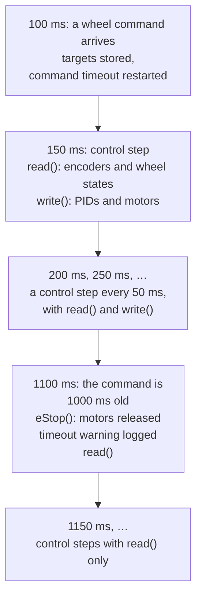
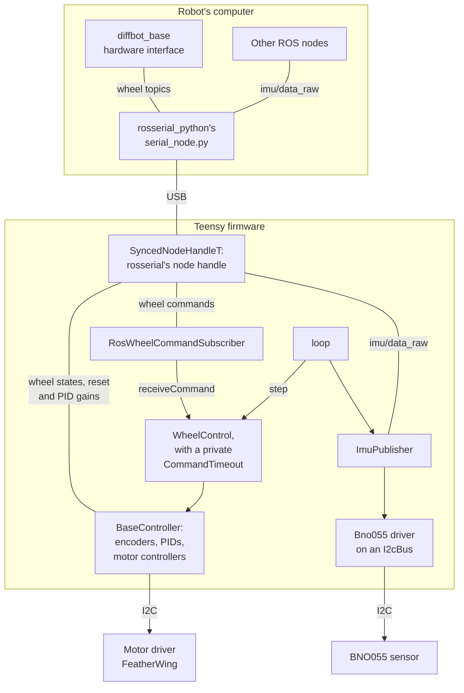

# DiffBot Base Package - Low Level Approach

[DiffBot Base](index.md) introduces the two parts of the base controller. This
page explains both: first the low-level firmware on the Teensy, then the
high-level hardware interface on the robot's computer.

## Implementing the low-level base controller for Remo

!!! info "Firmware excerpts"
    The firmware excerpts on this page, the code blocks with a file name and
    line numbers, show the firmware at the diffbot commit that this page pins.
    The link before each excerpt opens the same lines on GitHub.

### A wheel command's way through the firmware

The robot's computer sends the Teensy wheel commands, about ten per second. Each
command holds the target speed of each wheel, in rad/s. The firmware stores the
targets, drives the motors toward them in a control step every 50 ms, and
releases the motors when no new command comes. The figure follows one command
that arrives when the Teensy's clock shows 100 ms, with no command after it. The
control period is 50 ms and the command timeout 1000 ms, as on the robot.



The unit test
[`test_wheel_control`]({{ low_level_src_url }}/diffbot_firmware/test/test_wheel_control/test_wheel_control.cpp)
checks two of these moments with the same times: the control step at 150 ms
reads and writes, and the step at 1100 ms releases the motors before it logs.
The steps every 50 ms in between are drawn as the firmware runs them on the
robot. There, the release comes at the first check at or after 1100 ms, which
is later when a pass of the firmware's loop takes long.

1. **100 ms, a command arrives:** [`RosWheelCommandSubscriber`](#a-wheel-command-arrives) receives the
   command and hands it to `WheelControl::receiveCommand()`. The two target
   speeds go to [`BaseController`](#the-firmwares-design), and the command timeout starts again. Nothing
   drives the motors yet.
2. **150 ms, a control step:** [`loop()`](#the-loop-excerpt) runs a control step every 50 ms. The
   step reads the encoders with [`read()`](#the-step-excerpt) and publishes the wheel states for the
   robot's computer. Then `write()` lets the two PIDs compute the motor outputs
   from the targets and sets the motors.
3. **From 200 ms on:** the control steps repeat every 50 ms, with the same
   targets.
4. **1100 ms, the command is 1000 ms old:** `step()` finds that the command
   has expired. [`eStop()`](#when-a-command-is-too-old) sets the targets and both motor outputs to
   zero, which releases the motors, and then the firmware logs the timeout. The
   unit test checks this order of calls: [`eStop log read`](#the-unit-tests).
5. **After that:** the control steps only read and publish the wheel states.
   So the robot's computer keeps seeing the wheels' speeds while they coast to
   a stop. A new valid command lets the control steps drive again.

On the robot, the hardware interface sends a command every 100 ms, also while
the robot stands still, with zero speeds. Every valid command restarts the
timeout when the Teensy processes it, one with zero speeds too. A message that
the subscriber drops, for example one with a single speed, doesn't. So the
timeout tells whether valid commands still reach the Teensy, not whether the
robot should move. On the robot, it expires when the commands stop, for
example when the [`diffbot_base`](#ros-control-high-level-hardware-interface-for-a-differential-drive-robot) node stops.

The next section compares this stop with a loss of power on the bench. The
sections after it follow the same path through the code: the
[project and its libraries](#the-firmware-project-and-its-libraries),
[how `main.cpp` connects the parts](#connecting-the-firmware-in-maincpp),
[the command timeout](#the-command-timeout) and
[the timing with the Teensy's clock](#timing-with-the-teensys-clock).
The last one shows the firmware's design.

### Two kinds of stop

A bench test on Remo's Teensy 4.0, with the wheels off the ground, shows how the
command timeout differs from a loss of power
([the bench results in diffbot#169](https://github.com/ros-mobile-robots/diffbot/issues/169#issuecomment-6661807745)):

- **The wheel commands stop:** With the USB cable connected and the wheels
  driving, `rosnode kill /diffbot/diffbot_base` stopped the hardware interface,
  the node that sends the wheel commands. The Teensy logged
  [`Wheel command timeout: motors stopped`]({{ low_level_src_url }}/diffbot_firmware/src/main.cpp#L46) once, 0.92 s after the node
  stopped. The timeout counts from the last command that the Teensy processed,
  and that command's time wasn't logged. A command that arrived about 80 ms
  before the node stopped explains the 0.92 s, with a command every 100 ms. The
  next debug sample showed a motor output of zero, and the wheels came to rest
  about 0.4 s after the warning.
- **The Teensy loses its power:** On Remo, the Teensy gets its power over the USB
  cable from the Raspberry Pi, and the Teensy's 3.3 V supplies the logic of the
  motor driver. Pulling the USB cable while driving stopped the wheels at once
  ([section 8 of the bench checklist](https://github.com/ros-mobile-robots/diffbot/issues/169)).
  The motor driver lost its logic power together with the Teensy. The command
  timeout played no part in this stop.

So pulling the Teensy's USB cable tests the power wiring, not the command
timeout. To test the timeout, stop the node that sends the wheel commands and
keep the Teensy powered.

### The firmware project and its libraries

The firmware is a [PlatformIO](https://platformio.org/) project in the
[`diffbot_firmware`]({{ low_level_src_url }}/diffbot_firmware) folder of the diffbot repository.
PlatformIO builds Arduino code for the Teensy and uploads it to the board. It
runs as an extension of Visual Studio Code, which opens the folder as a
PlatformIO project because the folder contains `platformio.ini`, or from the
command line, as in the [firmware container](../../development/firmware-container.md).
`platformio.ini` lists the libraries that the firmware needs, here for Remo's
Teensy 4.0, [lines 30–37]({{ low_level_src_url }}/diffbot_firmware/platformio.ini#L30-L37):

```ini title="platformio.ini: Remo's Teensy 4.0" linenums="30"
--8<-- "{{ low_level_src_raw }}/diffbot_firmware/platformio.ini:30:37"
```

The firmware talks to the robot's computer with
[rosserial](../../processing_units/teensy-mcu.md#other-boards-such-as-an-arduino), drives the motors
with Adafruit's [Motor Shield V2 library](https://learn.adafruit.com/adafruit-stepper-dc-motor-featherwing/library-reference) and uses
[`Wire`](https://www.pjrc.com/teensy/td_libs_Wire.html) for the I2C bus that the motor driver and
the IMU share.

[`diffbot_base_config.h`]({{ low_level_src_url }}/diffbot_firmware/lib/config/diffbot_base_config.h) holds Remo's settings, which the firmware is built with:

- **Encoder pins:** the Teensy's pins for the encoders' Hall effect sensors.
- **Motor terminals:** the Adafruit motor driver can drive four DC motors. For
  the cable routing, Remo uses terminals [`M4`]({{ low_level_src_url }}/diffbot_firmware/lib/config/diffbot_base_config.h#L20) and [`M3`]({{ low_level_src_url }}/diffbot_firmware/lib/config/diffbot_base_config.h#L21) for the left and the
  right motor.
- **PID:** the gains of the two wheel PIDs, explained on [PID Controllers](pid.md).
- **Motor output range:** [`PWM_MIN`]({{ low_level_src_url }}/diffbot_firmware/lib/config/diffbot_base_config.h#L80) and [`PWM_MAX`]({{ low_level_src_url }}/diffbot_firmware/lib/config/diffbot_base_config.h#L79), −255 and 255.
- **Update rates:** how often the control step and the debug output run,
  explained in [Timing with the Teensy's clock](#timing-with-the-teensys-clock).
- **Command timeout:** [`COMMAND_TIMEOUT_MS`](#the-command-timeout), how long the firmware drives the
  motors without a new wheel command.
- **IMU:** the BNO055's address and the IMU publisher's settings in
  [`IMU_PUBLISHER_CONFIG`](../imu/driver-bno055.md#what-the-firmware-publishes), for example `enabled` false for a robot without
  an IMU.

The firmware's own libraries are in the [`lib`]({{ low_level_src_url }}/diffbot_firmware/lib) folder:

| Library | What it holds |
|:--|:--|
| [`base_controller`]({{ low_level_src_url }}/diffbot_firmware/lib/base_controller) | [`BaseController`](#the-firmwares-design): the encoders, the two PIDs and the motor controllers, and the rosserial topics for the wheel states, the encoders' reset and the PIDs' gains |
| [`motor_controller_interface`]({{ low_level_src_url }}/diffbot_firmware/lib/motor_controller_interface) | [`MotorControllerIntf`](#connecting-the-firmware-in-maincpp), the interface through which `BaseController` sets a motor's speed, whatever the motor driver |
| [`motor_controllers`]({{ low_level_src_url }}/diffbot_firmware/lib/motor_controllers) | `AdafruitMotorController`, that interface for the Adafruit FeatherWing, one object per motor |
| [`encoder`]({{ low_level_src_url }}/diffbot_firmware/lib/encoder) | [`diffbot::Encoder`](#the-encoders-speed), based on PJRC's [Encoder library](https://www.pjrc.com/teensy/td_libs_Encoder.html): the ticks of a quadrature encoder, and the wheel's angle and speed |
| [`pid`]({{ low_level_src_url }}/diffbot_firmware/lib/pid) | `diffbot::PID`, which computes a motor output from the speed error |
| [`command_timeout`]({{ low_level_src_url }}/diffbot_firmware/lib/command_timeout) | [`CommandTimeout`](#when-a-command-is-too-old), which decides when the last wheel command is too old |
| [`wheel_control`]({{ low_level_src_url }}/diffbot_firmware/lib/wheel_control) | [`WheelControl`](#the-step-excerpt), which drives the wheels only while the commands are new, and `WheelCommand`, a command's two target speeds |
| [`ros_wheel_commands`]({{ low_level_src_url }}/diffbot_firmware/lib/ros_wheel_commands) | [`RosWheelCommandSubscriber`](#a-wheel-command-arrives), which receives the wheel commands over rosserial |
| [`imu`]({{ low_level_src_url }}/diffbot_firmware/lib/imu) | the BNO055's driver and publisher, the I2C bus, and the node handle that tells when its clock is synchronized, explained on [IMU (BNO055)](../imu/driver-bno055.md) |

### Connecting the firmware in main.cpp

[`main.cpp`]({{ low_level_src_url }}/diffbot_firmware/src/main.cpp) creates the firmware's objects, connects them in `setup()`
and runs the scheduled work in [`loop()`](#the-loop-excerpt). The file has only a few global objects,
so the parts can be tested on their own. In the order of the file:

1. **The node handle:** other classes, such as [`BaseController`](#the-firmwares-design), use the global
   ROS node handle to publish and subscribe. Its
   [`ros::NodeHandle::now()`](https://github.com/frankjoshua/rosserial_arduino_lib/blob/0.9.1/src/ros/node_handle.h#L354-L383) gives the ROS time for time stamps. Time
   intervals come from the Teensy's own clock instead, as
   [Timing with the Teensy's clock](#timing-with-the-teensys-clock) explains,
   [lines 20–22]({{ low_level_src_url }}/diffbot_firmware/src/main.cpp#L20-L22):

    ```cpp title="main.cpp: the node handle" linenums="20"
    --8<-- "{{ low_level_src_raw }}/diffbot_firmware/src/main.cpp:20:22"
    ```

    [`SyncedNodeHandleT`]({{ low_level_src_url }}/diffbot_firmware/lib/imu/synced_node_handle.h#L10-L33) is [rosserial](../../processing_units/teensy-mcu.md#other-boards-such-as-an-arduino)'s node handle with one addition: it tells
    when its clock is synchronized with the robot's computer. The IMU publisher
    waits for that before it stamps its messages.

2. **The motor controllers:** two `AdafruitMotorController` objects, one per
   motor, [lines 26–27]({{ low_level_src_url }}/diffbot_firmware/src/main.cpp#L26-L27):

    ```cpp title="main.cpp: the motor controllers" linenums="26"
    --8<-- "{{ low_level_src_raw }}/diffbot_firmware/src/main.cpp:26:27"
    ```

    `AdafruitMotorController` implements the abstract class
    [`MotorControllerIntf`]({{ low_level_src_url }}/diffbot_firmware/lib/motor_controller_interface/motor_controller_interface.h#L10-L36), whose
    [`setSpeed(int value)`]({{ low_level_src_url }}/diffbot_firmware/lib/motor_controller_interface/motor_controller_interface.h#L21-L31) is all that `BaseController` calls
    to drive a motor. So another motor driver needs only another class that
    implements this interface. `AdafruitMotorController` reaches the motor driver
    through Adafruit's
    [`Adafruit_MotorShield`](https://github.com/adafruit/Adafruit_Motor_Shield_V2_Library/blob/1.1.4/Adafruit_MotorShield.h#L89-L110) class and gets one of its DC
    motors with [`getMotor(motor_num)`](https://github.com/adafruit/Adafruit_Motor_Shield_V2_Library/blob/1.1.4/Adafruit_MotorShield.cpp#L119-L157).
    [`AdafruitMotorController::setSpeed()`]({{ low_level_src_url }}/diffbot_firmware/lib/motor_controllers/adafruit_feather_wing/adafruit_feather_wing.cpp#L16-L36) turns a value from −255 to 255,
    the range of [`PWM_MIN`]({{ low_level_src_url }}/diffbot_firmware/lib/config/diffbot_base_config.h#L80) and [`PWM_MAX`]({{ low_level_src_url }}/diffbot_firmware/lib/config/diffbot_base_config.h#L79), into a direction and a speed. Zero
    releases the motor.

3. **The base controller:** `BaseController` holds most of the firmware's
   logic, [line 29]({{ low_level_src_url }}/diffbot_firmware/src/main.cpp#L29-L29):

    ```cpp title="main.cpp: the base controller" linenums="29"
    --8<-- "{{ low_level_src_raw }}/diffbot_firmware/src/main.cpp:29:29"
    ```

    `BaseController` is a template class. Its parameters are the motor
    controller's type, [`TMotorController`]({{ low_level_src_url }}/diffbot_firmware/lib/base_controller/base_controller.h#L70), here
    `AdafruitMotorController`, and the motor driver's type, `TMotorDriver`, here
    `Adafruit_MotorShield`. Its constructor takes the node handle and the two
    motor controllers. It holds two [`diffbot::Encoder`](#the-encoders-speed) objects
    and two [`diffbot::PID`]({{ low_level_src_url }}/diffbot_firmware/lib/pid/pid.h#L6-L30) controllers, which compute each motor's
    output from the difference between the target and the measured wheel speed.

4. **The wheel control:** the next objects are in an
   [anonymous namespace](https://en.cppreference.com/cpp/language/namespace#Unnamed_namespaces),
   which makes them private to `main.cpp`, [lines 31–67]({{ low_level_src_url }}/diffbot_firmware/src/main.cpp#L31-L67):

    ```cpp title="main.cpp: the wheel control" linenums="31" hl_lines="33 34 36"
    --8<-- "{{ low_level_src_raw }}/diffbot_firmware/src/main.cpp:31:67"
    ```

    - `ArduinoClock` gives the Teensy's clock, `millis()` and `micros()`, to the
      parts that need it. The unit tests replace it with a fake clock.
    - `RosTimeoutLogger` sends the timeout warning to the robot's computer with
      [`nh.logwarn()`](https://github.com/frankjoshua/rosserial_arduino_lib/blob/0.9.1/src/ros/node_handle.h#L510-L530). [`WheelControl`](#the-step-excerpt) calls this logger after it has
      stopped the motors.
    - `WHEEL_CONTROL_CONFIG` holds the wheel control's two times: the command
      timeout, [`COMMAND_TIMEOUT_MS`](#the-command-timeout), and the control period, 50 ms at an
      [`UPDATE_RATE_CONTROL`](#the-command-timeout-and-the-control-step) of 20 Hz. [`static_assert`](https://en.cppreference.com/w/cpp/language/static_assert) checks, when the firmware
      is compiled, that both times are longer than zero.
    - `wheel_control`, a `WheelControl`, gets the base controller, the times and
      the logger.
    - `wheel_commands`, a [`RosWheelCommandSubscriber`](#a-wheel-command-arrives), receives the wheel
      commands and passes each valid one on to `wheel_control`, with its arrival
      time from `wheel_clock`.

    [`decltype(base_controller)`](https://en.cppreference.com/w/cpp/language/decltype) stands for the base controller's type, so that
    the long template type doesn't have to be written again. C++ creates these
    global objects in the order in which they appear in the file. So each object
    gets references only to objects that already exist: `wheel_control` to
    `base_controller`, and `wheel_commands` to `wheel_control`.

5. **The IMU:** the IMU shares the motor driver's I2C bus,
   [lines 69–74]({{ low_level_src_url }}/diffbot_firmware/src/main.cpp#L69-L74):

    ```cpp title="main.cpp: the IMU" linenums="69"
    --8<-- "{{ low_level_src_raw }}/diffbot_firmware/src/main.cpp:69:74"
    ```

    `wire_bus`, `imu` and `imu_publisher` read the BNO055 and publish
    [`imu/data_raw`](../imu/driver-bno055.md#what-the-firmware-publishes), explained on [IMU (BNO055)](../imu/driver-bno055.md). The IMU
    publisher takes its time from `ArduinoClock` too.

6. **The debug output:** `publishDebugIfDue()` logs the encoder readings, the
   motor commands and the PIDs' state when debugging is on,
   [lines 76–89]({{ low_level_src_url }}/diffbot_firmware/src/main.cpp#L76-L89):

    <a id="the-debug-excerpt"></a>

    ```cpp title="main.cpp: publishDebugIfDue()" linenums="76"
    --8<-- "{{ low_level_src_raw }}/diffbot_firmware/src/main.cpp:76:89"
    ```

    Debugging is on when the ROS parameter [`/diffbot/debug/base_controller`]({{ low_level_src_url }}/diffbot_firmware/lib/base_controller/base_controller.h#L401) is
    true. [`BaseController::init()`]({{ low_level_src_url }}/diffbot_firmware/lib/base_controller/base_controller.h#L388-L414) reads it at the start. Then the function logs
    every 200 ms, at an [`UPDATE_RATE_DEBUG`](#the-time-stamps) of 5 Hz.

`BaseController` communicates with the hardware interface on the robot's
computer, [`DiffBotHWInterface`](#ros-control-high-level-hardware-interface-for-a-differential-drive-robot), through ROS publishers and subscribers.
[`BaseController::setup()`]({{ low_level_src_url }}/diffbot_firmware/lib/base_controller/base_controller.h#L360-L386) sets them up, and `BaseController::init()` reads
parameters from the ROS parameter server, such as the encoder resolution and
the wheel radius. `setup()` in `main.cpp` calls both and sets the motor driver's
PWM frequency, [lines 93–117]({{ low_level_src_url }}/diffbot_firmware/src/main.cpp#L93-L117):

```cpp title="main.cpp: setup()" linenums="93" hl_lines="15 16 17"
--8<-- "{{ low_level_src_raw }}/diffbot_firmware/src/main.cpp:93:117"
```

[`wheel_commands.subscribe(nh)`]({{ low_level_src_url }}/diffbot_firmware/lib/ros_wheel_commands/ros_wheel_command_subscriber.h#L64-L73) registers the wheel command subscriber. With the
IMU enabled, [`imu_publisher.advertise()`]({{ low_level_src_url }}/diffbot_firmware/lib/imu/imu_publisher.h#L59-L64) registers the `imu/data_raw` publisher.
Both come before `base_controller.setup()`, which starts rosserial and calls
[`spinOnce()`](https://github.com/frankjoshua/rosserial_arduino_lib/blob/0.9.1/src/ros/node_handle.h#L187-L334) while waiting for the robot's computer. When [`serial_node.py`]({{ low_level_src_url }}/diffbot_firmware/src/main.cpp#L95-L104)
requests the Teensy's topics over USB, `spinOnce()` answers with the publishers
and subscribers registered so far. After sending that answer, rosserial marks
the connection ready and `base_controller.setup()` can finish. The computer
forwards wheel commands only for a subscriber in that answer.
[`Wire.begin()`](https://docs.arduino.cc/language-reference/en/functions/communication/wire/begin/)
starts the I2C bus for the motor driver and the IMU.

The subscriber comes first for the command timeout, too. `BaseController::setup()`
and `init()` already receive messages while they wait for the connection and
read the parameters. Wheel commands that arrive then reach `wheel_control`
already, as [When a command is too old](#when-a-command-is-too-old) explains.

The motor controllers' [`begin(uint16_t freq)`]({{ low_level_src_url }}/diffbot_firmware/lib/motor_controllers/adafruit_feather_wing/adafruit_feather_wing.h#L43-L49) has to be called in
`setup()` itself, because `MotorControllerIntf` has no `begin()` or `setup()`.
Such a function would tie the interface to motor drivers that need one.

After `setup()`, `loop()` reads the sensors and writes the motors, at the rates
set in [`diffbot_base_config.h`]({{ low_level_src_url }}/diffbot_firmware/lib/config/diffbot_base_config.h#L30-L34). Each pass of `loop()` runs four parts, one after
the other:

1. `loop()` reads the Teensy's clock, `millis()`, as [`now_ms`]({{ low_level_src_url }}/diffbot_firmware/src/main.cpp#L123) and hands it to
   `wheel_control.step()`.
2. [`imu_publisher.update()`](#the-imu-update) takes no time from `loop()`. With the IMU enabled,
   it reads `millis()` itself, a second reading in the same pass, after
   `wheel_control.step()` has returned.
3. `publishDebugIfDue()` gets the same `now_ms` as the wheel control's step.
4. `nh.spinOnce()` handles the messages that have arrived over USB.

The `loop()` function shows these four parts in this order, [lines 120–136]({{ low_level_src_url }}/diffbot_firmware/src/main.cpp#L120-L136):

<a id="the-loop-excerpt"></a>

```cpp title="main.cpp: loop()" linenums="120" hl_lines="4 7 9 16"
--8<-- "{{ low_level_src_raw }}/diffbot_firmware/src/main.cpp:120:136"
```

`wheel_control.step()`, in [`wheel_control.h`]({{ low_level_src_url }}/diffbot_firmware/lib/wheel_control/wheel_control.h), first checks the
command timeout in the private `stopWhenCommandExpires()`, then runs the
control step when it's due, [lines 85–109]({{ low_level_src_url }}/diffbot_firmware/lib/wheel_control/wheel_control.h#L85-L109):

<a id="the-step-excerpt"></a>

```cpp title="wheel_control.h: step() and stopWhenCommandExpires()" linenums="85" hl_lines="4 5 8 20"
--8<-- "{{ low_level_src_raw }}/diffbot_firmware/lib/wheel_control/wheel_control.h:85:109"
```

The control step takes these steps at the control rate:

1. [`BaseController::read()`]({{ low_level_src_url }}/diffbot_firmware/lib/base_controller/base_controller.h#L447-L467) reads the encoders and publishes the wheel
   states for `DiffBotHWInterface`, on the [`measured_joint_states`](#the-measured-joint-states) topic of message
   type [`sensor_msgs::JointState`](https://docs.ros.org/en/noetic/api/sensor_msgs/html/msg/JointState.html). `step()` calls `read()` also while the
   wheel commands are too old, so the robot's computer keeps getting the wheel
   states.
2. In [`BaseController::write()`]({{ low_level_src_url }}/diffbot_firmware/lib/base_controller/base_controller.h#L470-L489), the PIDs compute the motor outputs from the
   speed error, the difference between the target and the measured wheel
   speed, and the motor controllers set the motors. The targets come from the
   last wheel command. `step()` calls `write()` only while the last command is
   new, that is, while `timedOut()` is false.
3. `step()` stores the current time in `last_control_ms_`, so that the next
   step comes one control period later.

Before the control step, on every pass, `stopWhenCommandExpires()` checks the
command timeout, also when no control step is due.

<a id="the-imu-update"></a>

After the wheel control's step comes the IMU, unless `enabled` is false in
`IMU_PUBLISHER_CONFIG`.
`ImuPublisher::update()` takes its own reading of the Teensy's clock,
[`Clock::millis()`]({{ low_level_src_url }}/diffbot_firmware/src/main.cpp#L38), which is `millis()` on the robot, [lines 100–112]({{ low_level_src_url }}/diffbot_firmware/lib/imu/imu_publisher.h#L100-L112):

```cpp title="imu_publisher.h: update()" linenums="100" hl_lines="6 8 10 12"
--8<-- "{{ low_level_src_raw }}/diffbot_firmware/lib/imu/imu_publisher.h:100:112"
```

Because `update()` reads the clock after `wheel_control.step()` has returned,
its `now_ms` is later than the `now_ms` of `loop()` when the wheel control's
step took long, for example while a log message waited for the USB connection.
With this reading, [`takeSamplingSlot()`]({{ low_level_src_url }}/diffbot_firmware/lib/imu/imu_publisher.h#L161-L171) plans a sample every 20 ms, 50 times
per second. The publisher reads a sample with [`readAndPublishSample()`]({{ low_level_src_url }}/diffbot_firmware/lib/imu/imu_publisher.h#L173-L192) and
publishes it on `imu/data_raw` only while the BNO055 is ready
([`Bno055::READY`]({{ low_level_src_url }}/diffbot_firmware/lib/imu/bno055.h#L83)) and the clock is synchronized with the robot's computer
([`nh_.timeSynced()`]({{ low_level_src_url }}/diffbot_firmware/lib/imu/synced_node_handle.h#L51)). A failed read isn't published, and neither is a sample
whose read took longer than its time budget, 10 ms. The budget is checked after
the read, so a slow read still makes the pass longer.
`publishDebugIfDue()` then logs when debugging is on,
with the `now_ms` of `loop()`. Finally, `nh.spinOnce()` reads the serial data
that has arrived and calls the matching subscriber's callback when it decodes a
valid message for a subscribed topic, for example the wheel commands' callback.
`nh.spinOnce()` comes last, after the wheel control's step, for a reason that
[When the counters wrap](#when-the-counters-wrap) explains.

### The command timeout

When the robot's computer stops sending wheel commands while the Teensy keeps
running, the firmware stops the motors. That happens, for example, when the
[`diffbot_base`](#ros-control-high-level-hardware-interface-for-a-differential-drive-robot) node stops. The
hardware interface on the robot's computer publishes the wheel commands in
[`DiffBotHWInterface::write()`](#the-write-excerpt), once per pass of
its control loop. That loop aims at 10 passes per second
([`ros::Rate rate(10.0)`]({{ low_level_src_url }}/diffbot_base/src/diffbot_base.cpp#L27-L27)), and it sends commands also
while the robot stands, with zero speeds. [`COMMAND_TIMEOUT_MS`]({{ low_level_src_url }}/diffbot_firmware/lib/config/diffbot_base_config.h#L39) is 1000 ms in
[`diffbot_base_config.h`]({{ low_level_src_url }}/diffbot_firmware/lib/config/diffbot_base_config.h#L36-L39), so the firmware stops after
about ten missed commands.

#### A wheel command arrives

[`RosWheelCommandSubscriber`]({{ low_level_src_url }}/diffbot_firmware/lib/ros_wheel_commands/ros_wheel_command_subscriber.h#L48-L58), in [`ros_wheel_command_subscriber.h`]({{ low_level_src_url }}/diffbot_firmware/lib/ros_wheel_commands/ros_wheel_command_subscriber.h),
subscribes to [`wheel_cmd_velocities`]({{ low_level_src_url }}/diffbot_firmware/lib/ros_wheel_commands/ros_wheel_command_subscriber.h#L53-L57). For each message, [rosserial](../../processing_units/teensy-mcu.md#other-boards-such-as-an-arduino) calls its
`commandCallback()` from [`nh.spinOnce()`](https://github.com/frankjoshua/rosserial_arduino_lib/blob/0.9.1/src/ros/node_handle.h#L187-L334), [lines 76–85]({{ low_level_src_url }}/diffbot_firmware/lib/ros_wheel_commands/ros_wheel_command_subscriber.h#L76-L85):

```cpp title="ros_wheel_command_subscriber.h: a wheel command arrives" linenums="76" hl_lines="4 7 9"
--8<-- "{{ low_level_src_raw }}/diffbot_firmware/lib/ros_wheel_commands/ros_wheel_command_subscriber.h:76:85"
```

- **Only valid messages:** A valid message has exactly two values, the left and
  the right wheel's target speed in rad/s, and both are finite numbers, not
  infinity or NaN ("not a number"). The callback drops any other message. A dropped
  message changes neither the targets nor the command timeout, so broken
  messages can't keep the motors driving.
- **The arrival time:** The time of a command comes from the Teensy's clock,
  [`millis()`](#timing-with-the-teensys-clock) when the callback runs, not from the time stamp in the message's
  header. The timeout measures how long ago a command arrived on the Teensy.
  The header's stamp is ROS time from the robot's computer, which jumps when
  that computer's clock is corrected.
- **Zero speeds:** Every valid command counts, also one with zero speeds. While
  the bringup runs, a robot that stands still keeps getting commands and doesn't
  time out.
  So the timeout doesn't tell how old the last velocity command on [`cmd_vel`](../imu/robot_localization.md#how-it-fits-together) is.
  When `cmd_vel` stops,
  `diff_drive_controller` requests
  zero velocity after its [`cmd_vel_timeout`](https://github.com/ros-controls/ros_controllers/blob/c2348e85abf35cf33cf654a84d61db206abe9a73/diff_drive_controller/src/diff_drive_controller.cpp#L237-L239), [0.5 s by default](https://github.com/ros-controls/ros_controllers/blob/c2348e85abf35cf33cf654a84d61db206abe9a73/diff_drive_controller/src/diff_drive_controller.cpp#L149-L159).
  The controller's [`update()`](https://github.com/ros-controls/ros_controllers/blob/c2348e85abf35cf33cf654a84d61db206abe9a73/diff_drive_controller/src/diff_drive_controller.cpp#L461-L499) then applies the
  acceleration limits, which [`diffbot_control.yaml`]({{ low_level_src_url }}/diffbot_control/config/diffbot_control.yaml#L43-L54)
  turns on. The acceleration limits can make the wheel commands take several passes of
  the hardware interface's loop to reach zero. The hardware interface keeps
  sending wheel commands throughout.

The callback passes a valid command on to `WheelControl::receiveCommand()`,
[lines 76–83]({{ low_level_src_url }}/diffbot_firmware/lib/wheel_control/wheel_control.h#L76-L83):

```cpp title="wheel_control.h: receiveCommand()" linenums="76"
--8<-- "{{ low_level_src_raw }}/diffbot_firmware/lib/wheel_control/wheel_control.h:76:83"
```

`receiveCommand()` hands the two target speeds to the base controller with
[`setWheelTargets()`]({{ low_level_src_url }}/diffbot_firmware/lib/base_controller/base_controller.h#L241-L248), which only stores them for the next
[`write()`](#the-step-excerpt): no PID computation, no motor output and no time keeping. Then
`receiveCommand()` tells its [`CommandTimeout`](#when-a-command-is-too-old) that a command arrived.
`receiveCommand()` doesn't drive the motors. Whether the next control step
drives depends on the command's age when `step()` checks it.

#### When a command is too old

`CommandTimeout` decides when the last command is too old, [lines 24–52]({{ low_level_src_url }}/diffbot_firmware/lib/command_timeout/command_timeout.h#L24-L52):

<a id="the-command-timeout-excerpt"></a>

```cpp title="command_timeout.h: CommandTimeout" linenums="24" hl_lines="11 19 28"
--8<-- "{{ low_level_src_raw }}/diffbot_firmware/lib/command_timeout/command_timeout.h:24:52"
```

- **A new command:** [`receiveCommand()`](#a-wheel-command-arrives) calls
  [`commandArrived()`]({{ low_level_src_url }}/diffbot_firmware/lib/command_timeout/command_timeout.h#L29-L35) for every valid command. `commandArrived()` stores the
  arrival time and ends a timeout. So only a new command ends a timeout, not a
  comparison of times. After about 49.7 days, [`millis()`](#timing-with-the-teensys-clock) returns to zero, and an
  old arrival time could look new again
  ([When the counters wrap](#when-the-counters-wrap)).
- **The timeout:** [`update()`]({{ low_level_src_url }}/diffbot_firmware/lib/command_timeout/command_timeout.h#L37-L43) times out once the last command is [`timeout_ms_`]({{ low_level_src_url }}/diffbot_firmware/lib/command_timeout/command_timeout.h#L49)
  old, 1000 ms on the robot. From then on, `CommandTimeout` stays timed out until the next
  command arrives. `update()` doesn't stop anything itself. It only changes what
  [`timedOut()`]({{ low_level_src_url }}/diffbot_firmware/lib/command_timeout/command_timeout.h#L45-L46) answers.
- **The start:** `CommandTimeout` starts timed out ([`timed_out_`]({{ low_level_src_url }}/diffbot_firmware/lib/command_timeout/command_timeout.h#L51) is `true`), so
  the motors aren't driven before the first command arrives.

[`WheelControl`]({{ low_level_src_url }}/diffbot_firmware/lib/wheel_control/wheel_control.h#L24-L61) acts on the moment when that answer changes. On every pass,
[`step()`](#the-step-excerpt) first calls `stopWhenCommandExpires()`, in the
step excerpt above. `stopWhenCommandExpires()` notes what
`timedOut()` answers, calls `update()` and asks again. Only on the first pass
that finds the command expired, when the answer changes from false to true,
`stopWhenCommandExpires()` stops the motors with `eStop()` and then logs the
timeout. A delayed loop can find the expiry later than the deadline. So the
motors are stopped and the timeout is logged once per timeout, not on every
pass. The private `stopWhenCommandExpires()` keeps the timeout's stop and log
together, in that order.

- **Before the first command:** `timedOut()` is true before and after `update()`.
  So nothing is stopped and no warning is logged. `step()` only reads the wheel
  states.
- **Commands during the setup:** rosserial processes commands while
  [`base_controller.init()`]({{ low_level_src_url }}/diffbot_firmware/lib/base_controller/base_controller.h#L388-L414) waits for the parameters' replies. The first control
  step runs after the motor controllers are initialized and checks the age of
  the last valid command like any later step. If that command has expired, the
  first step releases the motors and logs the timeout before either PID computes
  a motor output, even if the motors haven't been driven yet. With commands
  arriving regularly and a prompt setup, no timeout warning is expected at the
  start.

`eStop()` is the base controller's stop, [lines 491–502]({{ low_level_src_url }}/diffbot_firmware/lib/base_controller/base_controller.h#L491-L502):

```cpp title="base_controller.h: eStop()" linenums="491"
--8<-- "{{ low_level_src_raw }}/diffbot_firmware/lib/base_controller/base_controller.h:491:502"
```

`eStop()` sets both target wheel velocities to zero, resets both PIDs, so that no
stored error drives the motors later, and sets both motors to zero. On the
Adafruit FeatherWing, zero releases a motor, so the wheels coast without
braking. Only then the firmware logs the timeout, because sending the log
message can wait for the USB connection. The control step keeps reading and
publishing the wheel states.

A new valid command ends the timeout. The next scheduled control step drives
again if that command is still less than 1000 ms old when `step()` checks it.
The PIDs start from the state cleared by `eStop()`.

So the motors are released at the first check at which the last valid command
that the Teensy has processed is at least 1000 ms old. This age isn't the time
at which the wheels stand still.
[`loop()`](#the-loop-excerpt) runs its parts one after the other, and each part has to return before
the next one runs. A part that blocks, for example a log message that waits for
the USB connection or a slow I2C read, delays the next check. After the
release, the wheels coast until friction stops them. So three moments follow
each other: the commands stop, the firmware releases the motors, and the wheels
come to rest.

Two cases aren't covered yet. A firmware that hangs never reaches the next
check, and the motor driver keeps its last output. And nothing bounds how late
a slow pass of `loop()` makes the release.
[diffbot#190](https://github.com/ros-mobile-robots/diffbot/issues/190) plans a hardware watchdog, a second
check of the command's age right before the motor write, and bench
measurements of the time until the motors are released and until the wheels
rest.

#### The unit tests

Unit tests on the PC check the timeout, the wheel control, the subscriber and the
PID's reset ([`test_pid.cpp`]({{ low_level_src_url }}/diffbot_firmware/test/test_pid/test_pid.cpp)), in the
[firmware container](../../development/firmware-container.md):
`.docker/firmware/run.sh pio test -e native`.

- [`test_command_timeout`]({{ low_level_src_url }}/diffbot_firmware/test/test_command_timeout/test_command_timeout.cpp) checks [`CommandTimeout`](#when-a-command-is-too-old)
  alone, for example that a timeout stays until the next command, also after
  [`millis()`](#timing-with-the-teensys-clock) has returned to zero.
- [`test_wheel_control`]({{ low_level_src_url }}/diffbot_firmware/test/test_wheel_control/test_wheel_control.cpp) checks [`WheelControl`](#the-step-excerpt). The tests call
  [`receiveCommand()`](#a-wheel-command-arrives) and `step()` and put two fakes in place of the base
  controller and the timeout logger. The fake controller,
  [`FakeBaseController`]({{ low_level_src_url }}/diffbot_firmware/test/fakes/fake_base_controller.h#L16-L61), supplies the four functions that `WheelControl` calls,
  `setWheelTargets()`, `read()`, `write()` and `eStop()`, with no encoders, PIDs
  or motors behind them. Each call adds its name to a text, the trace, for
  example [`eStop log read`]({{ low_level_src_url }}/diffbot_firmware/test/test_wheel_control/test_wheel_control.cpp#L73). The fake timeout log,
  [`FakeTimeoutLog`]({{ low_level_src_url }}/diffbot_firmware/test/fakes/fake_base_controller.h#L63-L74), adds `log` to the same trace and records the motor output
  at that moment. So a test can check the order of the calls, that no `write()`
  comes while the command is too old, and that the fake controller's motor
  output was already zero when the warning was logged. The tests check how
  `WheelControl` uses the controller, not the real `eStop()`, whose body is
  shown above. Why `WheelControl` accepts the fakes is explained in
  [Ports and adapters](#ports-and-adapters).
- [`test_ros_wheel_command_subscriber`]({{ low_level_src_url }}/diffbot_firmware/test/test_ros_wheel_command_subscriber/test_ros_wheel_command_subscriber.cpp) sends messages
  through rosserial's real parser, with a fake serial port. It checks, for
  example, that the subscriber passes the two values on with the Teensy's time,
  not with the header's stamp, and that a dropped message doesn't refresh the
  timeout.

The IMU driver's tests use the same idea one level lower: a fake I2C bus,
[`FakeBno055Bus`]({{ low_level_src_url }}/diffbot_firmware/test/fakes/fake_bno055.h#L13-L16) in [`fake_bno055.h`]({{ low_level_src_url }}/diffbot_firmware/test/fakes/fake_bno055.h), stands in for the BNO055.

### Timing with the Teensy's clock

The firmware measures three kinds of elapsed time for the wheels: whether 50 ms
have passed since the last control step, whether 1 s has passed since the last
wheel command, and how long the encoders took since their last reading. It takes all
three from the Teensy's own counters.
[`millis()`](https://docs.arduino.cc/language-reference/en/functions/time/millis/)
counts the milliseconds since the Teensy started, for the control step and the
command's age, and also for the IMU's samples and the debug output.
[`micros()`](https://docs.arduino.cc/language-reference/en/functions/time/micros/)
counts microseconds, for the encoders' speed. A correction of the Raspberry Pi's
clock doesn't change these counters.

#### The time stamps

Each part keeps the [`millis()`](#timing-with-the-teensys-clock) readings that it needs:

- [`CommandTimeout`](#when-a-command-is-too-old) keeps the arrival time of the last valid wheel command,
  [`last_command_ms_`]({{ low_level_src_url }}/diffbot_firmware/lib/command_timeout/command_timeout.h#L50), in the [`CommandTimeout` excerpt](#the-command-timeout-excerpt)
  above.
- [`WheelControl`](#the-step-excerpt) keeps the time of the last control step, [`last_control_ms_`]({{ low_level_src_url }}/diffbot_firmware/lib/wheel_control/wheel_control.h#L115-L116).
  `last_control_ms_` starts at zero, so the first control step is due 50 ms
  after the Teensy started. The setup takes longer, so the first pass of
  [`loop()`](#the-loop-excerpt) already runs a control step. Wheel commands don't move this schedule.
- [`ImuPublisher`](#the-imu-update) keeps the time of its last sampling slot in [`sampled_ms_`]({{ low_level_src_url }}/diffbot_firmware/lib/imu/imu_publisher.h#L96).
  This time moves on also when no sample is read or published.
- [`BaseController`](#the-firmwares-design) keeps the time of the last debug output in the `debug` field of
  [`LastUpdateTime`]({{ low_level_src_url }}/diffbot_firmware/lib/base_controller/base_controller.h#L158-L173). [`publishDebugIfDue()`](#the-debug-excerpt) compares it with
  [`now_ms`]({{ low_level_src_url }}/diffbot_firmware/src/main.cpp#L123) and, when debugging is on, logs once 200 ms have passed, at an
  [`UPDATE_RATE_DEBUG`]({{ low_level_src_url }}/diffbot_firmware/lib/config/diffbot_base_config.h#L34) of 5 Hz.

#### The command timeout and the control step

The [`loop()` excerpt](#the-loop-excerpt) above reads the counter at the start of
each pass, as [`now_ms`]({{ low_level_src_url }}/diffbot_firmware/src/main.cpp#L123), and [`wheel_control.step(now_ms)`]({{ low_level_src_url }}/diffbot_firmware/lib/wheel_control/wheel_control.h#L86-L95) compares it with these
times:

- **The command timeout:** It comes first, on every pass. [`CommandTimeout::update()`]({{ low_level_src_url }}/diffbot_firmware/lib/command_timeout/command_timeout.h#L37-L43)
  compares the age of the last wheel command with [`COMMAND_TIMEOUT_MS`]({{ low_level_src_url }}/diffbot_firmware/lib/config/diffbot_base_config.h#L39), 1000 ms.
- **The control step:** It runs when at least [`control_period_ms_`]({{ low_level_src_url }}/diffbot_firmware/lib/wheel_control/wheel_control.h#L89-L90) milliseconds
  have passed since the last one. [`WHEEL_CONTROL_CONFIG`]({{ low_level_src_url }}/diffbot_firmware/src/main.cpp#L54-L57) in [`main.cpp`](#connecting-the-firmware-in-maincpp) sets the period
  to [`1000.0 / UPDATE_RATE_CONTROL`]({{ low_level_src_url }}/diffbot_firmware/src/main.cpp#L56), in whole milliseconds.
  With [`UPDATE_RATE_CONTROL`]({{ low_level_src_url }}/diffbot_firmware/lib/config/diffbot_base_config.h#L30) set to 20 (Hz), that's 50 ms. The step
  records its time in [`last_control_ms_`]({{ low_level_src_url }}/diffbot_firmware/lib/wheel_control/wheel_control.h#L94). So the firmware runs at most 20 steps
  per second. Work that blocks the loop, for example a slow serial transfer,
  makes a step late. A late step doesn't make up for the steps that it missed.

#### The encoders' speed

Each control step reads both encoders. `Encoder::jointState()` returns the
wheel's angle in rad and its speed in rad/s, in a
[`JointState`]({{ low_level_src_url }}/diffbot_firmware/lib/encoder/encoder_diffbot.h#L15-L19). It divides the angle that the
wheel turned by the time since its last reading, [lines 14–39]({{ low_level_src_url }}/diffbot_firmware/lib/encoder/encoder_diffbot.cpp#L14-L39):

<a id="the-encoder-excerpt"></a>

```cpp title="encoder_diffbot.cpp: angle and speed" linenums="14" hl_lines="8 11"
--8<-- "{{ low_level_src_raw }}/diffbot_firmware/lib/encoder/encoder_diffbot.cpp:14:39"
```

`dts` is the time since the last reading in seconds, from
[`micros()`](#timing-with-the-teensys-clock), and `angular_velocity_` is the wheel's
speed in radians per second, although a comment in the code mentions RPM.

#### When the counters wrap

[`millis()`](https://docs.arduino.cc/language-reference/en/functions/time/millis/) and [`micros()`](https://docs.arduino.cc/language-reference/en/functions/time/micros/) return 32-bit unsigned integers. After 2³² counts they
return to zero: 2³² ms (4,294,967,296 ms) is about 49.7 days, and 2³² µs about
71.6 minutes. Arduino's reference pages for `millis()` and `micros()` round these
to about 50 days and 70 minutes. The differences are computed with
[`uint32_t`](https://en.cppreference.com/w/c/types/integer), so [`now_ms - last_control_ms_`]({{ low_level_src_url }}/diffbot_firmware/lib/wheel_control/wheel_control.h#L89) still gives the right number of milliseconds
across that return to zero, as long as the two readings are less than one
counter cycle apart and come from the same run of the firmware.

That's also why only a new command ends the command timeout. Once timed out,
[`CommandTimeout`]({{ low_level_src_url }}/diffbot_firmware/lib/command_timeout/command_timeout.h#L39-L43) doesn't compare the times again. So an old arrival time can't
look new after the counter has gone around.

For example, a command arrives at `millis()` 100 and times out at 1100. Then
no command arrives for about 49.7 days, for example because the hardware
interface on the robot's computer was stopped, until the clock reads 100 again.
That reading alone doesn't make the old command new: 100 − 100 would give an
age of 0, but `CommandTimeout` stays timed out. A new command that arrives at
that moment does start a new timeout, because the wheel commands' callback
reports every arrival to `CommandTimeout`.

The same subtraction is why [`nh.spinOnce()`]({{ low_level_src_url }}/diffbot_firmware/src/main.cpp#L132-L135) comes last in [`loop()`](#the-loop-excerpt). `loop()`
reads [`now_ms`]({{ low_level_src_url }}/diffbot_firmware/src/main.cpp#L123) at the start of the pass, and the wheel commands' callback reads
`millis()` again when a command arrives. If the callbacks ran between reading
`now_ms` and the step, a command could arrive later than `now_ms`. Then
[`now_ms - last_command_ms_`]({{ low_level_src_url }}/diffbot_firmware/lib/command_timeout/command_timeout.h#L41) wouldn't be negative, but almost a whole counter
cycle, about 49.7 days, and the step would take the new command as too old.
With `nh.spinOnce()` last, the next pass reads a new `now_ms` after the
command arrived.

??? warning "Pitfalls when measuring time on a microcontroller"
    - **Intervals without ROS time:** Don't measure intervals with ROS time. On the Teensy, [`nh.now()`](https://github.com/frankjoshua/rosserial_arduino_lib/blob/0.9.1/src/ros/node_handle.h#L354-L383)
      returns ROS time, which [rosserial](../../processing_units/teensy-mcu.md#other-boards-such-as-an-arduino) synchronizes with the robot's computer.
      When that computer's clock is corrected, ROS time can jump. A jump backward
      makes a control step or the command timeout wait too long. A jump forward
      makes a recent command look too old. Clock corrections on the robot's
      computer don't change the Teensy's counters.
    - **Units and types:** Check the unit and type of every time value. Storing 0.05 s in an
      integer field for whole seconds truncates it to 0, and a check against 0
      passes on every pass of the loop. Keep intervals in milliseconds or
      microseconds.
    - **The step rate:** The step rate is part of the controller. The PID controller adds up
      the error once per step, without the time between steps. At another rate,
      the same gains make the wheels respond differently. Tune the gains at the
      rate that the firmware runs.
      [diffbot#168](https://github.com/ros-mobile-robots/diffbot/issues/168) makes the wheel PID independent of the loop rate.

### The firmware's design

The diagram shows the firmware's parts and how they connect. A solid arrow
points from a part to the part it uses. A line without an arrow is a message
connection, and the messages can go either way or both ways. On a narrow
screen, the diagram scrolls sideways.

<div class="wide-diagram" markdown>



</div>

The wheel commands from the robot's computer arrive at [`RosWheelCommandSubscriber`](#a-wheel-command-arrives), which passes each valid one on to [`WheelControl`](#the-step-excerpt). `WheelControl` decides when [`BaseController`]({{ low_level_src_url }}/diffbot_firmware/lib/base_controller/base_controller.h#L24-L71) drives the motors. For that, it keeps a [`CommandTimeout`](#when-a-command-is-too-old), which no other part can reach. [`loop()`](#the-loop-excerpt) calls `WheelControl`'s step on every pass. `BaseController` holds the encoders, the two PIDs and the motor controllers. It also keeps the other [rosserial](../../processing_units/teensy-mcu.md#other-boards-such-as-an-arduino) topics: the wheel states for the robot's computer, the encoders' reset and the PIDs' gains. The IMU's parts are separate: the driver reaches the sensor only through [`I2cBus`]({{ low_level_src_url }}/diffbot_firmware/lib/imu/i2c_bus.h#L9-L31), so the unit tests replace the bus with a fake one.

#### Ports and adapters

[`WheelControl`](#the-step-excerpt) and [`CommandTimeout`](#when-a-command-is-too-old) run in the unit tests on a PC because they follow a pattern from Alistair Cockburn, [ports and adapters](https://alistair.cockburn.us/hexagonal-architecture/), also called hexagonal architecture. It separates the logic from the libraries and the hardware:

- The **core** contains the logic to test. `WheelControl` and `CommandTimeout` are plain C++ and include no Arduino, rosserial or vendor library headers.
- A **port** defines an interaction across the core's boundary: the functions, their arguments and their required behavior.
- An **adapter** connects a port to a particular environment, such as ROS, Arduino, a motor driver or a test.

There are two kinds of ports. They differ in who calls whom:

| | Primary port | Secondary port |
|:--|:--|:--|
| Who calls the functions | an adapter | the core |
| Who implements the functions | the core | an adapter |
| Other names | driving, inbound | driven, outbound |

For `WheelControl`, these are the ports and their adapters:

- **Primary ports:** [`receiveCommand()`](#a-wheel-command-arrives) and `step()`. `RosWheelCommandSubscriber` calls `receiveCommand()` from its callback, and [`loop()`](#the-loop-excerpt) calls `step()`.
- **Secondary ports:** [`Controller`]({{ low_level_src_url }}/diffbot_firmware/lib/wheel_control/wheel_control.h#L45-L57), the four functions `setWheelTargets()`, `read()`, `write()` and `eStop()`, and `LogTimeout`, the logger's call operator. On the robot, [`BaseController`](#the-firmwares-design) and `RosTimeoutLogger` implement them. In the [unit tests](#the-unit-tests), `FakeBaseController` and `FakeTimeoutLog` do.

`Controller` and `LogTimeout` are hard to see in the code, because no class has these names. Each is a template parameter of `WheelControl`, and `WheelControl`'s class comment ([lines 27–51]({{ low_level_src_url }}/diffbot_firmware/lib/wheel_control/wheel_control.h#L27-L51)) says what each port has to do. The compiler checks that the type used has the functions and argument types that `WheelControl` calls, but not that the functions behave as the port requires. [`I2cBus`]({{ low_level_src_url }}/diffbot_firmware/lib/imu/i2c_bus.h#L9-L31), a port of the IMU driver, is an abstract class instead.

`BaseController` still mixes control logic with hardware access and calls Arduino functions such as [`millis()`](#timing-with-the-teensys-clock) directly. [diffbot#148](https://github.com/ros-mobile-robots/diffbot/issues/148) plans to move the rest of the firmware into such a core, with a versioned serial protocol in place of rosserial, and with [diffbot#165](https://github.com/ros-mobile-robots/diffbot/issues/165) for the IMU sampler and [diffbot#166](https://github.com/ros-mobile-robots/diffbot/issues/166) for the settings.

??? info "Comparison with ros_control on the robot's computer"
    On the robot's computer, [ros_control](../../development/simulation-test.md#what-runs-in-the-simulation) separates the controllers from the hardware in a similar way, although it doesn't use these words. [`diff_drive_controller`](https://github.com/ros-controls/ros_controllers/blob/c2348e85abf35cf33cf654a84d61db206abe9a73/diff_drive_controller/src/diff_drive_controller.cpp) works on wheel joint handles, which a hardware interface registers: [`DiffBotHWInterface`](#ros-control-high-level-hardware-interface-for-a-differential-drive-robot) on the robot, [`DefaultRobotHWSim`](https://github.com/ros-simulation/gazebo_ros_pkgs/blob/cd9cc952402375be5f274f39b29399c4087aa839/gazebo_ros_control/include/gazebo_ros_control/default_robot_hw_sim.h) in Gazebo. Both derive from `RobotHW`, which lets the controller manager find the joint interfaces. So the same controller runs on the robot and in the simulation, as `WheelControl` runs on the Teensy and in the unit tests. The separation is weaker, though: the controller and its manager still depend on ROS, while `WheelControl` needs only C++.

    An outer loop transfers the states and commands. On the robot, [`diffbot_base.cpp`]({{ low_level_src_url }}/diffbot_base/src/diffbot_base.cpp) calls `read()`, updates the controller manager and calls `write()`. In Gazebo, the [plugin](https://github.com/ros-simulation/gazebo_ros_pkgs/blob/cd9cc952402375be5f274f39b29399c4087aa839/gazebo_ros_control/src/gazebo_ros_control_plugin.cpp) calls `readSim()`, updates the manager and calls `writeSim()`. The simulation path ends in Gazebo and doesn't send commands to the Teensy.

The next section describes the other end of the USB cable: the hardware
interface on the robot's computer.

## ROS Control high-level hardware interface for a differential drive robot

The [ros_control](../../development/simulation-test.md#what-runs-in-the-simulation) meta package contains the
hardware interface class [`hardware_interface::RobotHW`](https://docs.ros.org/en/noetic/api/hardware_interface/html/c++/classhardware__interface_1_1RobotHW.html), which needs to be
implemented to leverage many available controllers from the [`ros_controllers`](https://github.com/ros-controls/ros_controllers/tree/0.22.0)
meta package. The [`diffbot_base`]({{ low_level_src_url }}/diffbot_base/src/diffbot_base.cpp) node creates the hardware interface and runs
its control loop:

1. The `diffbot_base` node includes the [`diffbot_hw_interface.h`]({{ low_level_src_url }}/diffbot_base/include/diffbot_base/diffbot_hw_interface.h) header, as well
   as the [`controller_manager`](https://github.com/ros-controls/ros_control/tree/0.20.0/controller_manager), defined in [`controller_manager.h`](https://github.com/ros-controls/ros_control/blob/0.20.0/controller_manager/include/controller_manager/controller_manager.h), to create the
   control loop (read, update, write):

    ```cpp
    #include <ros/ros.h>
    #include <diffbot_base/diffbot_hw_interface.h>
    #include <controller_manager/controller_manager.h>
    ```

2. The node's [main function]({{ low_level_src_url }}/diffbot_base/src/diffbot_base.cpp#L5-L17) creates the ROS node handle and the
   hardware interface ([`diffbot_base::DiffBotHWInterface`]({{ low_level_src_url }}/diffbot_base/include/diffbot_base/diffbot_hw_interface.h#L31-L32)), and passes the
   hardware interface to the `controller_manager`, which gets access to its resources:

    ```cpp
    ros::NodeHandle nh;
    diffbot_base::DiffBotHWInterface diffBot(nh);
    controller_manager::ControllerManager cm(&diffBot);
    ```

3. A separate thread services the ROS callbacks, because service callbacks
   could block the control loop:

    ```cpp
    ros::AsyncSpinner spinner(1);
    spinner.start();
    ```

4. The control loop of the high-level hardware interface runs at 10 Hz on
   Remo:

    ```cpp
    ros::Time prev_time = ros::Time::now();
    ros::Rate rate(10.0); rate.sleep(); // 10 Hz rate
    ```

5. Each pass of the node's `while` loop computes the control period from the
   system time:

    ```cpp
    while (ros::ok()) {
      const ros::Time time = ros::Time::now();
      const ros::Duration period = time - prev_time;
      prev_time = time;
      ...
    ```

6. Then the pass runs the control loop's steps: read, update and write. The
   [`read()`]({{ low_level_src_url }}/diffbot_base/src/diffbot_hw_interface.cpp#L136-L161) method is here to get sensor values, while [`write()`]({{ low_level_src_url }}/diffbot_base/src/diffbot_hw_interface.cpp#L163-L262) writes commands
   that were computed by [`diff_drive_controller`](../imu/robot_localization.md#how-it-fits-together) during the [`update()`]({{ low_level_src_url }}/diffbot_base/src/diffbot_base.cpp#L43) step:

    ```cpp
      ...
      diffBot.read(time, period);
      cm.update(time, period);
      diffBot.write(time, period);
      ...
    ```

7. These steps keep getting repeated with the specified rate using
   [`rate.sleep()`](https://docs.ros.org/en/noetic/api/rostime/html/classros_1_1Rate.html).

`diffbot_base::DiffBotHWInterface` derives from `hardware_interface::RobotHW`.
It registers the hardware and implements the `read()` and `write()` methods
that the control loop above calls.

The constructor of the `diffbot_base::DiffBotHWInterface` class is used to get
parameters from the parameter server, such as the `diff_drive_controller`
configuration from the [`diffbot_control`](../../diffbot_control.md) package. Inside the constructor, the
wheel command publisher and measured joint state subscriber are initialized.
Another publisher is [`pub_reset_encoders_`]({{ low_level_src_url }}/diffbot_base/include/diffbot_base/diffbot_hw_interface.h#L215-L217). In
[`isReceivingMeasuredJointStates`]({{ low_level_src_url }}/diffbot_base/src/diffbot_hw_interface.cpp#L264-L290), the hardware interface waits up to ten seconds for
a publisher of the measured joint states. Then it sends a request to reset the encoder ticks
through `pub_reset_encoders_`, also when the wait ended without a publisher.

During initialization, the class creates instances of
[`JointStateHandle`](https://docs.ros.org/en/noetic/api/hardware_interface/html/c++/classhardware__interface_1_1JointStateHandle.html) classes (used only for reading) and [`JointHandle`](https://docs.ros.org/en/noetic/api/hardware_interface/html/c++/classhardware__interface_1_1JointHandle.html) classes
(used for read, and write access) for each controllable joint and register them
with the [`JointStateInterface`](https://docs.ros.org/en/noetic/api/hardware_interface/html/c++/classhardware__interface_1_1JointStateInterface.html) and [`VelocityJointInterface`](https://docs.ros.org/en/noetic/api/hardware_interface/html/c++/classhardware__interface_1_1VelocityJointInterface.html) interfaces,
respectively. This enables the `controller_manager` to manage access for joint
resources of multiple controllers. Remo uses `DiffDriveController` and
`JointStateController`:

```cpp
for (unsigned int i = 0; i < num_joints_; i++) {
    hardware_interface::JointStateHandle joint_state_handle(joint_names_[i], &joint_positions_[i], &joint_velocities_[i], &joint_efforts_[i]);
    joint_state_interface_.registerHandle(joint_state_handle);

    hardware_interface::JointHandle joint_handle(joint_state_handle, &joint_velocity_commands_[i]);
    velocity_joint_interface_.registerHandle(joint_handle); 
}
```

The last step that is needed to initialize the hardware resources is to register
the `JointStateInterface` and the `VelocityJointInterface` interfaces with the
robot hardware interface itself, thereby grouping the interfaces together to
represent Remo robot in software:

```cpp
registerInterface(&joint_state_interface_);
registerInterface(&velocity_joint_interface_);
```

<a id="the-measured-joint-states"></a>

Now that the hardware joint resources are registered and the controller manager
knows about them, it’s possible to call the `read()` and `write()` methods of
the hardware interface. The controller manager update happens in between the
read and write steps. Remo subscribes to the [`measured_joint_states`]({{ low_level_src_url }}/diffbot_base/src/diffbot_hw_interface.cpp#L69) topic,
published by the low-level base controller. The received messages on this topic
are stored in the [`measured_joint_states_`]({{ low_level_src_url }}/diffbot_base/include/diffbot_base/diffbot_hw_interface.h#L227) array of type
[`diffbot_base::JointState`]({{ low_level_src_url }}/diffbot_base/include/diffbot_base/diffbot_hw_interface.h#L25-L29) using the [`measuredJointStatesCallback`]({{ low_level_src_url }}/diffbot_base/src/diffbot_hw_interface.cpp#L367-L377) method, and
are relevant in the `read()` method:

1. The `read()` method updates the joint values with the latest measurements
   from the encoders, the angular positions (rad) and velocities (rad/s) that
   the Teensy sent on `measured_joint_states`,
   [lines 136–148]({{ low_level_src_url }}/diffbot_base/src/diffbot_hw_interface.cpp#L136-L148):

    ```cpp title="diffbot_hw_interface.cpp: read()" linenums="136"
    --8<-- "{{ low_level_src_raw }}/diffbot_base/src/diffbot_hw_interface.cpp:136:148"
    ```

    The rest of `read()` only logs the values when debugging is on.

2. The final step of the control loop is the `write()` method. It publishes the
   angular wheel velocity commands that `diff_drive_controller` computed for each
   joint, in one message on [`wheel_cmd_velocities`](#a-wheel-command-arrives),
   [lines 163–186]({{ low_level_src_url }}/diffbot_base/src/diffbot_hw_interface.cpp#L163-L186):

    <a id="the-write-excerpt"></a>

    ```cpp title="diffbot_hw_interface.cpp: write(), the wheel commands" linenums="163" hl_lines="8 9 12 13 18 21 24"
    --8<-- "{{ low_level_src_raw }}/diffbot_base/src/diffbot_hw_interface.cpp:163:186"
    ```

    `write()` takes these steps:

    1. It scales each joint's command in [`joint_velocity_commands_`]({{ low_level_src_url }}/diffbot_base/src/diffbot_hw_interface.cpp#L174-L175) with the
       [gain / trim model](pid.md#gain-trim-model): [`gain_`]({{ low_level_src_url }}/diffbot_base/src/diffbot_hw_interface.cpp#L170-L171) plus `trim_` for the
       right wheel, `gain_` minus `trim_` for the left wheel, each divided by
       `motor_constant_`. The three values come from
       [`base.yaml`]({{ low_level_src_url }}/diffbot_base/config/base.yaml#L6-L8).
       With a gain of 1.0, a trim of 0.0 and a motor constant of 1.0, the
       commands pass unchanged.
    2. It stamps the message [`wheel_cmd_msg`]({{ low_level_src_url }}/diffbot_base/src/diffbot_hw_interface.cpp#L179-L180) with [`ros::Time::now()`](https://github.com/ros/roscpp_core/blob/0.7.3/rostime/include/ros/time.h#L187-L191), the ROS
       time of the robot's computer. The Teensy doesn't use this stamp: it takes
       a command's arrival time from its own clock.
    3. It appends the left and then the right wheel's command, in rad/s, and
       publishes the message.

    The rest of `write()` publishes motor values on [`motor_left`]({{ low_level_src_url }}/diffbot_base/src/diffbot_hw_interface.cpp#L59) and
    [`motor_right`]({{ low_level_src_url }}/diffbot_base/src/diffbot_hw_interface.cpp#L60) for another kind of motor driver node, and logs when
    debugging is on. The Teensy doesn't subscribe to these topics.

This concludes the important parts of the `DiffBotHWInterface` class and enables
Remo to satisfy the requirements to work with the ROS Navigation Stack. In the
next section shows how to bring up the robot hardware and how the started
nodes interact with each other.
