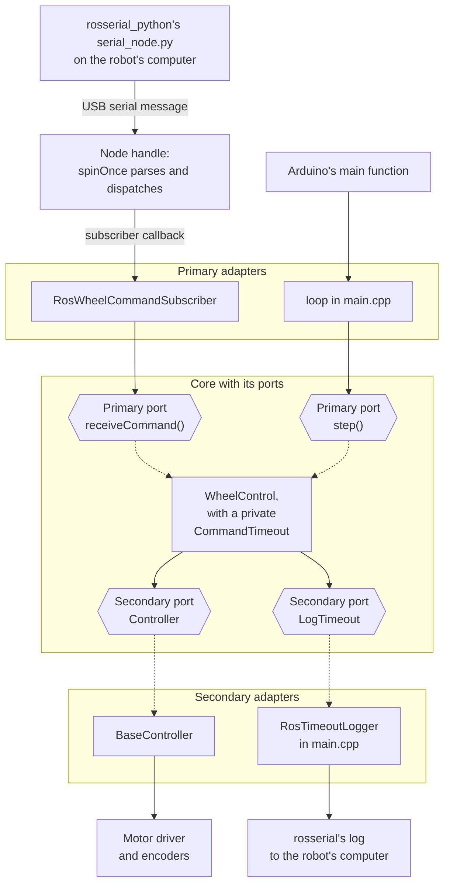
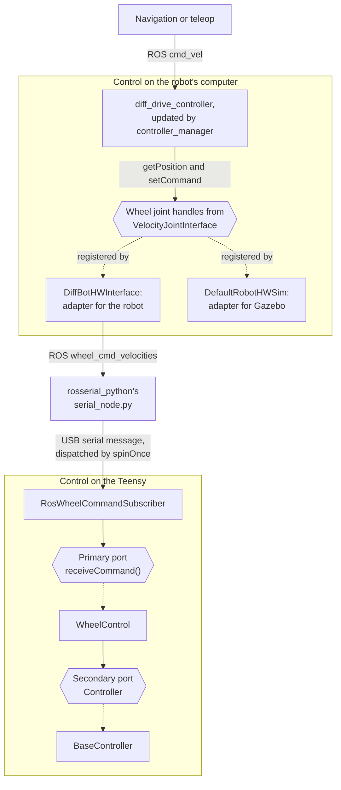

# DiffBot Base Package - Low Level Approach

Having explained the two components of the base
controller in [DiffBot Base](index.md), the low-level firmware is implemented first, followed by the high-level hardware, detailed in the next section.

## Implementing the low-level base controller for Remo

!!! info "Firmware excerpts"
    The firmware excerpts on this page, the code blocks with a file name and
    line numbers, show the firmware at the diffbot commit that this page pins.
    The link before each excerpt opens the same lines on GitHub.

The low-level base controller is implemented on the Teensy microcontroller using
[PlatformIO](https://platformio.org/). The programming language in PlatformIO is
the same as Arduino (based on Wiring) and it is available as a plugin for the
Visual Studio Code editor. On the development PC, we can flash the robot
firmware to the board with this plugin. We will get the firmware code from the
[`diffbot_firmware`](https://github.com/ros-mobile-robots/diffbot/tree/noetic-devel/diffbot_firmware)
folder of the diffbot repository. Opening this folder in Visual Studio Code will recognize it as a
PlatformIO workspace because it contains the `platformio.ini` file. This file
defines the required dependencies and makes it straightforward to flash the
firmware to the Teensy board after compilation. Inside this file, the used
libraries are listed, here for Remo's Teensy 4.0, [lines 30–37]({{ low_level_src_url }}/diffbot_firmware/platformio.ini#L30-L37):

```ini title="platformio.ini: Remo's Teensy 4.0" linenums="30"
--8<-- "{{ low_level_src_raw }}/diffbot_firmware/platformio.ini:30:37"
```

As you can see, the firmware depends on `rosserial`, the `Adafruit Motor Shield
V2` library, and `Wire`, an I2C library. PlatformIO allows using custom
libraries defined in the local `./lib` folder, which are developed in this
section.

The firmware is used to read from the wheel encoders and the IMU, and
receive wheel velocity commands from the high-level
`hardware_interface::RobotHW` class, discussed in the next section. The
following code snippets are part of the low-level base controller’s `main.cpp`
file and show the used libraries, found in
`diffbot_firmware`, in the `lib` and `src` folders. `src`
contains `main.cpp` consisting of the `setup()` and `loop()` functions, common
to every Arduino sketch and starts off by including the following headers, [lines 1–9]({{ low_level_src_url }}/diffbot_firmware/src/main.cpp#L1-L9):

```cpp title="main.cpp: Arduino, ROS, Wire and Remo's configuration" linenums="1"
--8<-- "{{ low_level_src_raw }}/diffbot_firmware/src/main.cpp:1:9"
```

`stdint.h` declares integer types of a fixed size, such as `uint32_t`, and
`Arduino.h` declares Arduino's functions, such as `millis()`. The
`IWYU pragma: keep` comments tell
[include checkers](https://include-what-you-use.org/) to retain these public
Arduino and Wire headers. Besides the ROS header file and
[`Wire`](https://www.pjrc.com/teensy/td_libs_Wire.html), the I2C library for
the motor driver and the IMU, `main.cpp` includes definitions specific to Remo,
which are defined in the `diffbot_base_config.h` header. It contains constant parameter
values such as the following:

- Encoder pins: Defines to which pins on the Teensy microcontroller the Hall
  effect sensors are connected.
- Motor I2C address and pins: The Adafruit motor driver can drive four DC
  motors. Due to cable management, motor terminals `M4` and `M3` are used for
  the left and right motors, respectively.
- PID: The tuned constants for both PID controllers of `base_controller`.
- PWM_MAX and PWM_MIN: The minimum and maximum possible PWM values that can be
  sent to the motor driver.
- Update rates: Defines how often functions of `base_controller` are executed.
  For example, the control portion of the low-level base controller code reads
  encoder values and writes motor commands at a specific rate.
- Command timeout: `COMMAND_TIMEOUT_MS`, how long the firmware drives the motors
  without a new wheel command, explained in [The command timeout](#the-command-timeout).
- IMU: the BNO055's address (`IMU_BNO055_ADDRESS`) and the IMU publisher's
  settings (`IMU_PUBLISHER_CONFIG`), for example `enabled` false for a robot
  without an IMU, explained on [IMU (BNO055)](../imu/driver-bno055.md).

After including Remo-specific definitions, next follows the custom libraries in
the `lib` folder, [lines 10–17]({{ low_level_src_url }}/diffbot_firmware/src/main.cpp#L10-L17):

```cpp title="main.cpp: the libraries from lib" linenums="10"
--8<-- "{{ low_level_src_raw }}/diffbot_firmware/src/main.cpp:10:17"
```

These include directives and the libraries that get included with them are
introduced next:

- `base_controller`: Defines the `BaseController` template class, defined in the
  `base_controller.h` header, and acts as the main class to manage the two
  motors, including each motor’s encoder, and communicate with the high-level
  hardware interface.
- `motor_controller_intf`: This library is indirectly included with
  `adafruit_feather_wing.h` and defines an abstract base class, named
  `MotorControllerIntf`. It is a generic interface used to operate a single
  motor using arbitrary motor drivers. It is meant to be implemented by other
  specific motor controller subclasses and therefore avoids changing code in
  classes that know the `MotorControllerIntf` interface and call its
  `setSpeed(int value)` method, such as done by `BaseController`. The only
  requirement for this to work is for a subclass to inherit from this
  `MotorControllerIntf` interface and implement the `setSpeed(int value)` class
  method.
- `adafruit_feather_wing`: This library, in the `motor_controllers` folder,
  implements the `MotorControllerIntf` abstract interface class and defines a
  concrete motor controller. For Remo, the motor controller is defined in the
  `AdafruitMotorController` class. This class has access to the motor driver
  board and serves to operate the speed of a single motor, which is why two
  instances are created in the `main.cpp` file.
- `encoder`: This library is used in the `BaseController` class and is based on
  `Encoder.h` from https://www.pjrc.com/teensy/td_libs_Encoder.html that allows
  reading encoder tick counts from quadrature encoders, like the DG01D-E motors
  consist of. The encoder library also provides a method `jointState()` to
  directly obtain the joint state, which is returned by this method in the
  `JointState` struct, that consists of the measured angular position (rad) and
  angular velocity (rad/s) of the wheel joints, [lines 14–39]({{ low_level_src_url }}/diffbot_firmware/lib/encoder/encoder_diffbot.cpp#L14-L39):

    <a id="the-encoder-excerpt"></a>

    ```cpp title="encoder_diffbot.cpp: angle and speed" linenums="14" hl_lines="8 11"
    --8<-- "{{ low_level_src_raw }}/diffbot_firmware/lib/encoder/encoder_diffbot.cpp:14:39"
    ```

    The time between two calls comes from the Teensy's own clock,
    [`micros()`](https://docs.arduino.cc/language-reference/en/functions/time/micros/),
    in microseconds since the board started, for the reason explained in the
    [`loop()` section](#timing-with-the-teensys-clock) below.

- `pid`: Defines a PID controller to compute PWM signals based on the velocity
  error between measured and commanded angular wheel joint velocities. For more
  infos about PIDs and the tuning sections refer to [PID Controllers](pid.md)
- `command_timeout`: `CommandTimeout`, in [`command_timeout.h`]({{ low_level_src_url }}/diffbot_firmware/lib/command_timeout/command_timeout.h), decides when
  the last wheel command from the robot's computer is too old, explained in
  [The command timeout](#the-command-timeout).
- `wheel_control`: `WheelControl`, in [`wheel_control.h`]({{ low_level_src_url }}/diffbot_firmware/lib/wheel_control/wheel_control.h), drives the wheels
  only while the wheel commands are new. It keeps a `CommandTimeout` for that.
  `RosWheelCommandSubscriber`, in [`ros_wheel_command_subscriber.h`]({{ low_level_src_url }}/diffbot_firmware/lib/ros_wheel_commands/ros_wheel_command_subscriber.h),
  receives the wheel commands and passes each valid one on to `WheelControl`,
  as a `WheelCommand`, which holds the two wheels' target speeds
  ([`wheel_command.h`]({{ low_level_src_url }}/diffbot_firmware/lib/wheel_control/wheel_command.h)).
- `imu`: The BNO055's driver ([`bno055.h`]({{ low_level_src_url }}/diffbot_firmware/lib/imu/bno055.h)) and publisher
  ([`imu_publisher.h`]({{ low_level_src_url }}/diffbot_firmware/lib/imu/imu_publisher.h)), with the I2C bus ([`wire_bus.h`]({{ low_level_src_url }}/diffbot_firmware/lib/imu/wire_bus.h))
  and the node handle's clock synchronization ([`synced_node_handle.h`]({{ low_level_src_url }}/diffbot_firmware/lib/imu/synced_node_handle.h)),
  explained on [IMU (BNO055)](../imu/driver-bno055.md).


### The firmware's parts

The diagrams show the firmware's parts and how they connect, first as they are, then as diffbot#148 plans them. In them, a solid arrow points from a part to the part it uses. A dashed arrow points from an adapter to the interface it implements. A line without an arrow is a message connection, and the messages can go either way or both ways.

=== "Today"

    <div class="wide-diagram" markdown>

    ```mermaid
    graph TB
      subgraph PI [Robot's computer]
        HW[diffbot_base<br/>hardware interface]
        ROS[Other ROS nodes]
        SN[rosserial_python's<br/>serial_node.py]
      end
      subgraph TEENSY [Teensy firmware]
        NH[SyncedNodeHandleT:<br/>rosserial's node handle]
        SUB[RosWheelCommandSubscriber]
        WC[WheelControl,<br/>with a private<br/>CommandTimeout]
        BC[BaseController:<br/>encoders, PIDs,<br/>motor controllers]
        LOOP[loop]
        IP[ImuPublisher]
        BNO[Bno055 driver<br/>on an I2cBus]
      end
      FW[Motor driver<br/>FeatherWing]
      IMU[BNO055 sensor]
      HW ---|wheel topics| SN
      ROS ---|imu/data_raw| SN
      SN ---|USB| NH
      NH ---|wheel states, reset<br/>and PID gains| BC
      NH ---|wheel commands| SUB
      SUB -->|receiveCommand| WC
      WC --> BC
      LOOP -->|step| WC
      LOOP --> IP
      NH ---|imu/data_raw| IP
      IP --> BNO
      BC -->|I2C| FW
      BNO -->|I2C| IMU
    ```

    </div>

    The wheel commands from the robot's computer arrive at `RosWheelCommandSubscriber`, which passes each valid one on to `WheelControl`. `WheelControl` decides when `BaseController` drives the motors. For that, it keeps a `CommandTimeout`, which no other part can reach. `loop()` calls `WheelControl`'s step on every pass. `BaseController` holds the encoders, the two PIDs and the motor controllers. It also keeps the other rosserial topics: the wheel states for the robot's computer, the encoders' reset and the PIDs' gains. The IMU's parts are separate: the driver reaches the sensor only through `I2cBus`, so the unit tests replace the bus with a fake one.

=== "Planned"

    <div class="wide-diagram" markdown>

    ```mermaid
    graph TB
      subgraph PI [Robot's computer]
        HWI[Hardware interface:<br/>joints bound<br/>to channels]
      end
      subgraph TEENSY [Teensy firmware]
        W[Board wiring:<br/>one file<br/>per board]
        CORE[Portable core:<br/>states, wheel control,<br/>PID, command timeout,<br/>IMU sampler,<br/>typed settings]
        PORTS[Device interfaces:<br/>link, motor output,<br/>encoder, I2C bus,<br/>clock]
        ADAPT[Teensy adapters:<br/>serial protocol,<br/>motor drivers,<br/>encoders, Wire,<br/>millis]
      end
      HWI ----|USB| ADAPT
      W --> CORE
      W --> ADAPT
      CORE --> PORTS
      ADAPT -.->|implement| PORTS
    ```

    </div>

    Over USB, a versioned serial protocol replaces rosserial. Messages carry one record per channel. Each record includes the channel ID. The hardware interface maps each joint name to a channel ID. The core sees the hardware only through the device interfaces, which the Teensy adapters implement. So the unit tests on the PC replace the adapters with stand-ins. The board wiring creates the adapters and hands them to the core. [diffbot#148](https://github.com/ros-mobile-robots/diffbot/issues/148) plans this in steps, with [diffbot#165](https://github.com/ros-mobile-robots/diffbot/issues/165) for the IMU sampler and [diffbot#166](https://github.com/ros-mobile-robots/diffbot/issues/166) for the settings.

    `WheelControl` and `CommandTimeout` are parts of such a core already. They are plain C++ without Arduino or rosserial, and their unit tests run on the PC. `RosWheelCommandSubscriber` is a primary adapter: it connects rosserial to `WheelControl`. The planned serial protocol replaces this adapter. Most of the firmware still has to move: `BaseController` holds the encoders, the PIDs, the motor controllers and the other rosserial topics, and it calls Arduino functions such as `millis()` directly.

### Ports and adapters

These parts follow a pattern from Alistair Cockburn, [ports and adapters](https://alistair.cockburn.us/hexagonal-architecture/), also called hexagonal architecture. It separates the logic from the libraries and the hardware, so that a unit test can run the logic on a PC.

- The **core** contains the logic that we want to test independently. The firmware's portable core includes no Arduino, rosserial or vendor library headers.
- A **port** defines an interaction across the core's boundary: the functions, their arguments and their required behavior. A port can be ordinary public functions, such as `WheelControl`'s `receiveCommand()` and `step()`. A secondary port can also be an abstract class, such as `I2cBus`, or requirements on a template argument, such as `Controller`.
- An **adapter** connects a port to a particular environment, such as ROS, Arduino, a motor driver or a test harness.

There are two kinds of ports. They differ in who calls whom:

| | Primary port | Secondary port |
|:--|:--|:--|
| Who calls the functions | an adapter | the core |
| Who implements the functions | the core | an adapter |
| Other names | driving, inbound | driven, outbound |

So the core and the adapters both implement ports, but different ones. The core implements the primary ports and calls the secondary ones. An adapter calls a primary port or implements a secondary one.

The diagram follows a wheel command from top to bottom. Solid arrows show function calls or labelled message transfers. Dashed arrows lead from a port to the code that implements it. The arrows don't show C++ include dependencies. On a narrow screen, the diagrams on this page scroll sideways.

<div class="wide-diagram" markdown>





</div>

`loop()` calls the node handle's `spinOnce()` last on each pass, and rosserial also calls it during the setup, so the subscriber's callback runs inside these calls. `WheelControl` names neither `RosWheelCommandSubscriber` nor `BaseController`. Its class comment ([lines 27–51]({{ low_level_src_url }}/diffbot_firmware/lib/wheel_control/wheel_control.h#L27-L51)) only says what the ports have to do. `main.cpp` creates the objects and connects them. That's why the unit tests can supply `FakeBaseController` and `FakeTimeoutLog` for the secondary ports, and call `receiveCommand()` and `step()` themselves. `BaseController` still contains control logic as well as hardware access, which [diffbot#148](https://github.com/ros-mobile-robots/diffbot/issues/148) separates.

The ports `Controller` and `LogTimeout` are hard to see in the code, because no class has these names. Each is a template parameter of `WheelControl`. The compiler checks that the type used has the functions and argument types that `WheelControl` calls, but not that the functions behave as the port requires. `I2cBus`, a port of the IMU driver, is an abstract class instead, and diffbot#148 decides per port which form to use. Many adapters start with the technology they connect, such as `RosWheelCommandSubscriber` and `AdafruitMotorController`. That's a tendency, not a rule that identifies every adapter.

### Comparison with ros_control

For the wheel-command path, two separate application boundaries are useful: control on the robot's computer and control on the Teensy. The two communicate through rosserial. This is a choice of viewpoint, not a rule that each processor has exactly one hexagon: Cockburn's article describes choosing an application boundary and substituting adapters.

On the robot's computer, ros_control separates controllers from hardware through registered joint interfaces. That is a useful comparison with ports and adapters, although ros_control doesn't use these words. The controller and its manager still depend on ROS, so this isn't the same degree of isolation as the firmware's portable `WheelControl`.

<div class="wide-diagram" markdown>





</div>

`DiffBotHWInterface` and `DefaultRobotHWSim` register the wheel joint interfaces that [`diff_drive_controller`](https://github.com/ros-controls/ros_controllers/blob/c2348e85abf35cf33cf654a84d61db206abe9a73/diff_drive_controller/src/diff_drive_controller.cpp) uses. `DiffBotHWInterface` derives from `RobotHW`. [`DefaultRobotHWSim`](https://github.com/ros-simulation/gazebo_ros_pkgs/blob/noetic-devel/gazebo_ros_control/include/gazebo_ros_control/default_robot_hw_sim.h) derives from [`RobotHWSim`](https://github.com/ros-simulation/gazebo_ros_pkgs/blob/noetic-devel/gazebo_ros_control/include/gazebo_ros_control/robot_hw_sim.h), which also derives from `RobotHW`. `RobotHW` lets the controller manager find those interfaces.

An outer loop transfers the states and commands. On the robot, [`diffbot_base.cpp`]({{ low_level_src_url }}/diffbot_base/src/diffbot_base.cpp) calls `read()`, updates the controller manager, and calls `write()`. In Gazebo, the [plugin](https://github.com/ros-simulation/gazebo_ros_pkgs/blob/noetic-devel/gazebo_ros_control/src/gazebo_ros_control_plugin.cpp) calls `readSim()`, updates the manager, and calls `writeSim()`. The controller uses the registered handles in either environment. The simulation path ends in Gazebo and doesn't send commands to the Teensy.

The diagram shows the wheel-command path. Feedback travels separately: `BaseController` publishes `measured_joint_states`, and `DiffBotHWInterface` receives those messages for the controller's next update.

### Connecting the firmware in main.cpp

`main.cpp` constructs the controllers, the command subscriber and the IMU
publisher. `setup()` initializes their connections, and `loop()` runs the
scheduled work. The file has only a few global objects, which keeps the code
organized and makes it possible to test the individual components. The main
code is explained next:

1. First, we define the global ROS node handle, which is referenced in other
   classes, such as BaseController, where it is needed to publish and
   subscribe. Its `ros::NodeHandle::now()` provides ROS time for time stamps.
   The time between updates comes from the Teensy's own clock, as the
   [`loop()` section](#timing-with-the-teensys-clock) below explains,
   [lines 20–22]({{ low_level_src_url }}/diffbot_firmware/src/main.cpp#L20-L22):

    ```cpp title="main.cpp: the node handle" linenums="20"
    --8<-- "{{ low_level_src_raw }}/diffbot_firmware/src/main.cpp:20:22"
    ```

    `SyncedNodeHandleT`, in [`synced_node_handle.h`]({{ low_level_src_url }}/diffbot_firmware/lib/imu/synced_node_handle.h),
    is rosserial's node handle with one addition: it tells when its clock is
    synchronized with the robot's computer. The IMU publisher waits for that
    before it stamps its messages.

2. For convenience and to keep the code organized, we declare that we want to
   use the `diffbot` namespace, where the libraries of the base controller are
   declared, [line 24]({{ low_level_src_url }}/diffbot_firmware/src/main.cpp#L24-L24):

    ```cpp title="main.cpp: the namespace" linenums="24"
    --8<-- "{{ low_level_src_raw }}/diffbot_firmware/src/main.cpp:24:24"
    ```

3. Next, we define two concrete motor controllers of type
   `AdafruitMotorController` found in the `motor_controllers` library,
   [lines 26–27]({{ low_level_src_url }}/diffbot_firmware/src/main.cpp#L26-L27):

    ```cpp title="main.cpp: the motor controllers" linenums="26"
    --8<-- "{{ low_level_src_raw }}/diffbot_firmware/src/main.cpp:26:27"
    ```

    This class inherits from the abstract base class `MotorControllerIntf`,
    explained above. It knows how to connect to the Adafruit motor driver using its
    open source `Adafruit_MotorShield` library
    (https://learn.adafruit.com/adafruit-stepper-dc-motor-featherwing/library-reference)
    and how to get a C++ pointer to one of its DC motors (`getMotor(motor_num)`).
    Depending on the integer input value to `AdafruitMotorController::setSpeed(int
    value)`, the DC motor is commanded to rotate in a certain direction and at a
    specified speed. For Remo, the range is between –255 and 255, specified by the
    `PWM_MAX` and `PWM_MIN` identifiers.

4. The next class that is defined globally inside main is `BaseController`,
   which incorporates most of the main logic of this low-level base controller,
   [line 29]({{ low_level_src_url }}/diffbot_firmware/src/main.cpp#L29-L29):

    ```cpp title="main.cpp: the base controller" linenums="29"
    --8<-- "{{ low_level_src_raw }}/diffbot_firmware/src/main.cpp:29:29"
    ```

    As you can see, it is a template class that accepts different kinds of motor
    controllers (`TMotorController`, which equals `AdafruitMotorController` in the
    case of Remo) that operate on different motor drivers (`TMotorDriver`, which
    equals `Adafruit_MotorShield`), using the `MotorControllerIntf` interface as
    explained previously. The `BaseController` constructor takes a reference to the
    globally defined ROS node handle and the two motor controllers to let it set the
    commanded speeds computed through two separate PID controllers, one for each
    wheel.

    In addition to setting up pointers to the motor controllers, the
    `BaseController` class initializes two instances of type `diffbot::Encoder`. Its
    measured joint state, returned from `diffbot::Encoder::jointState()`, is used
    together with the commanded wheel joint velocities in the `diffbot::PID`
    controllers to compute the velocity error and output an appropriate PWM signal
    for the motors.

5. Next come the objects of the wheel control, in an
   [anonymous namespace](https://en.cppreference.com/cpp/language/namespace#Unnamed_namespaces),
   which makes them private to `main.cpp`, [lines 31–67]({{ low_level_src_url }}/diffbot_firmware/src/main.cpp#L31-L67):

    ```cpp title="main.cpp: the wheel control" linenums="31" hl_lines="33 34 36"
    --8<-- "{{ low_level_src_raw }}/diffbot_firmware/src/main.cpp:31:67"
    ```

    - `ArduinoClock` gives the Teensy's clock, `millis()` and `micros()`, to the
      parts that need it. The unit tests replace it with a fake clock.
    - `RosTimeoutLogger` sends the timeout warning to the robot's computer with
      `nh.logwarn()`. After stopping the motors, `WheelControl` calls this
      logger.
    - `WHEEL_CONTROL_CONFIG` holds the wheel control's two times: the command
      timeout, `COMMAND_TIMEOUT_MS`, and the control period, 50 ms at an
      `UPDATE_RATE_CONTROL` of 20 Hz. `static_assert` checks, when the firmware
      is compiled, that both times are longer than zero.
    - `wheel_control`, a `WheelControl`, drives the wheels only while the wheel
      commands are new. It gets the base controller, the times and the logger.
    - `wheel_commands`, a `RosWheelCommandSubscriber`, receives the wheel
      commands and passes each valid one on to `wheel_control`, with its arrival
      time from `wheel_clock`.

    `decltype(base_controller)` stands for the base controller's type, so that
    the long template type doesn't have to be written again. C++ creates these
    global objects in the order in which they appear in the file. So each object
    gets references only to objects that already exist: `wheel_control` to
    `base_controller`, and `wheel_commands` to `wheel_control`.
    [The command timeout](#the-command-timeout) explains how they work together.

6. The IMU, which shares the motor driver's I2C bus, [lines 69–74]({{ low_level_src_url }}/diffbot_firmware/src/main.cpp#L69-L74):

    ```cpp title="main.cpp: the IMU" linenums="69"
    --8<-- "{{ low_level_src_raw }}/diffbot_firmware/src/main.cpp:69:74"
    ```

    `wire_bus`, `imu` and `imu_publisher` read the BNO055 and publish
    `imu/data_raw`, explained on [IMU (BNO055)](../imu/driver-bno055.md). The IMU
    publisher takes its time from `ArduinoClock` too.

7. Last, `publishDebugIfDue()`, which logs the encoder readings, the motor
   commands and the PIDs' state when debugging is on, [lines 76–89]({{ low_level_src_url }}/diffbot_firmware/src/main.cpp#L76-L89):

    <a id="the-debug-excerpt"></a>

    ```cpp title="main.cpp: publishDebugIfDue()" linenums="76"
    --8<-- "{{ low_level_src_raw }}/diffbot_firmware/src/main.cpp:76:89"
    ```

    Debugging is on when the ROS parameter `/diffbot/debug/base_controller` is
    true. `BaseController::init()` reads it at the start. Then the function logs
    every 200 ms, at an `UPDATE_RATE_DEBUG` of 5 Hz, as
    [The time stamps](#the-time-stamps) explains.

After defining the global instances, the firmware’s `setup()` function is
discussed next. The low-level BaseController class communicates with the
high-level interface `DiffBotHWInterface` using ROS publishers and subscribers.
These are set up in the `BaseController::setup()` method, which is called in the
`setup()` function of `main.cpp`. In addition to that, the
`BaseController::init()` method is here to read parameters stored on the ROS
parameter server, such as the encoder resolution and the wheel radius.
Besides initializing `BaseController`, `setup()` sets the motor driver's PWM
frequency, [lines 93–117]({{ low_level_src_url }}/diffbot_firmware/src/main.cpp#L93-L117):

```cpp title="main.cpp: setup()" linenums="93" hl_lines="15 16 17"
--8<-- "{{ low_level_src_raw }}/diffbot_firmware/src/main.cpp:93:117"
```

`wheel_commands.subscribe(nh)` registers the wheel command subscriber. With the
IMU enabled, `imu_publisher.advertise()` registers the `imu/data_raw` publisher.
Both come before `base_controller.setup()`, which starts rosserial and calls
`spinOnce()` while waiting for the robot's computer. When `serial_node.py`
requests the Teensy's topics over USB, `spinOnce()` answers with the publishers
and subscribers registered so far. After sending that answer, rosserial marks
the connection ready and `base_controller.setup()` can finish. The computer
forwards wheel commands only for a subscriber in that answer. `Wire.begin()`
starts the I2C bus for the motor driver and the IMU.

The subscriber comes first for the command timeout, too. [`BaseController::setup()`]({{ low_level_src_url }}/diffbot_firmware/lib/base_controller/base_controller.h#L360-L386)
and [`init()`]({{ low_level_src_url }}/diffbot_firmware/lib/base_controller/base_controller.h#L388-L414) already receive messages while they wait for the
connection and read the parameters. Wheel commands that arrive then reach
`wheel_control` already, and the first `loop()` handles them like any other
command, as explained in [The command timeout](#the-command-timeout).

The `begin(uint16_t freq)` method of the motor controllers has to be called
explicitly in the main `setup()` function because `MotorControllerIntf` doesn't
provide a `begin()` or `setup()` method in its interface. This is a design
choice that, when added, would make the `MotorControllerIntf` less generic.

After the `setup()` function follows the `loop()` function, to read from sensors
and write to actuators, which happens at specific rates, defined in the
`diffbot_base_config.h` header. `loop()` reads the Teensy's clock once per
pass, as `now_ms`, and hands the time to the parts that run on a schedule,
[lines 120–136]({{ low_level_src_url }}/diffbot_firmware/src/main.cpp#L120-L136):

<a id="the-loop-excerpt"></a>

```cpp title="main.cpp: loop()" linenums="120" hl_lines="4 7 16"
--8<-- "{{ low_level_src_raw }}/diffbot_firmware/src/main.cpp:120:136"
```

`wheel_control.step()`, in [`wheel_control.h`]({{ low_level_src_url }}/diffbot_firmware/lib/wheel_control/wheel_control.h), first checks the
command timeout in the private `stopWhenCommandExpires()`, then runs the
control step when it's due, [lines 85–109]({{ low_level_src_url }}/diffbot_firmware/lib/wheel_control/wheel_control.h#L85-L109):

<a id="the-step-excerpt"></a>

```cpp title="wheel_control.h: step() and stopWhenCommandExpires()" linenums="85" hl_lines="4 5 8 20"
--8<-- "{{ low_level_src_raw }}/diffbot_firmware/lib/wheel_control/wheel_control.h:85:109"
```

The following steps of the control step happen continuously at the control rate:

1. Encoder sensor values are read through the `BaseController::read()` method
   and the data is published inside this method for the high-level
   `DiffbotHWInterface` class, on the `measured_joint_states` topic of message
   type `sensor_msgs::JointState`. `step()` calls `read()` also while the
   wheel commands are too old, so the robot's computer keeps getting the wheel
   states.
2. In `BaseController::write()`, the PIDs compute the motor PWM signals from the
   velocity error, the difference between the target and the measured wheel
   speed, and the motor speeds are set with the two motor controllers. The
   targets come from the last wheel command, as
   [A wheel command arrives](#a-wheel-command-arrives) explains. `step()` calls
   `write()` only while the last command is new, that is, while `timedOut()`
   is false.
3. To keep calling these methods at the desired control rate, `step()` stores
   the current time in `last_control_ms_`.

Before the control step, on every pass, `stopWhenCommandExpires()` checks the
command timeout, also when no control step is due.
[The command timeout](#the-command-timeout) below explains it.

After the wheel control's step comes the IMU, unless `enabled` is false in
`IMU_PUBLISHER_CONFIG` ([IMU (BNO055)](../imu/driver-bno055.md)). With the IMU
enabled, `imu_publisher.update()` ([lines 100–112]({{ low_level_src_url }}/diffbot_firmware/lib/imu/imu_publisher.h#L100-L112)) plans a sample
every 20 ms, 50 times per second. The publisher reads a sample and publishes it
on `imu/data_raw` only while the BNO055 is ready and the clock is synchronized
with the robot's computer. A failed read isn't published, and neither is a
sample whose read took longer than its time budget, 10 ms.
[`publishDebugIfDue()`](#the-debug-excerpt) logs when
debugging is on. Finally, `nh.spinOnce()` reads the serial data that has
arrived and calls the matching subscriber's callback when it decodes a valid
message for a subscribed topic, for example the wheel commands' callback.
`nh.spinOnce()` comes last, after the wheel control's step, for a reason that
[When the counters wrap](#when-the-counters-wrap) explains.

### The command timeout

When the robot's computer stops sending wheel commands, for example because the
bringup stopped or the USB connection broke, the firmware stops the motors. The
hardware interface on the robot's computer publishes the wheel commands in
[`DiffBotHWInterface::write()`]({{ low_level_src_url }}/diffbot_base/src/diffbot_hw_interface.cpp#L163-L186), once per pass of
its control loop. That loop aims at 10 passes per second
([`ros::Rate rate(10.0)`]({{ low_level_src_url }}/diffbot_base/src/diffbot_base.cpp#L27-L27)), and it sends commands also
while the robot stands, with zero speeds. `COMMAND_TIMEOUT_MS` is 1000 ms in
[`diffbot_base_config.h`]({{ low_level_src_url }}/diffbot_firmware/lib/config/diffbot_base_config.h#L36-L39), so the firmware stops after
about ten missed commands.

#### A wheel command arrives

`RosWheelCommandSubscriber`, in [`ros_wheel_command_subscriber.h`]({{ low_level_src_url }}/diffbot_firmware/lib/ros_wheel_commands/ros_wheel_command_subscriber.h),
subscribes to `wheel_cmd_velocities`. For each message, rosserial calls its
`commandCallback()` from `nh.spinOnce()`, [lines 76–85]({{ low_level_src_url }}/diffbot_firmware/lib/ros_wheel_commands/ros_wheel_command_subscriber.h#L76-L85):

```cpp title="ros_wheel_command_subscriber.h: a wheel command arrives" linenums="76" hl_lines="4 7 9"
--8<-- "{{ low_level_src_raw }}/diffbot_firmware/lib/ros_wheel_commands/ros_wheel_command_subscriber.h:76:85"
```

- **Only a valid message counts.** It has exactly two values, the left and the
  right wheel's target speed in rad/s, and both are finite numbers, not infinity
  or NaN ("not a number"). The callback drops any other message. A dropped
  message changes neither the targets nor the command timeout, so broken
  messages can't keep the motors driving.
- **The arrival time comes from the Teensy's clock,** `millis()` when the callback
  runs, not from the time stamp in the message's header. The timeout measures
  how long ago a command arrived on the Teensy. The header's stamp is ROS time
  from the robot's computer, which jumps when that computer's clock is corrected,
  as [Timing with the Teensy's clock](#timing-with-the-teensys-clock) explains.
- **Every valid command counts, also one with zero speeds.** While the bringup
  runs, a robot that stands still keeps getting commands and doesn't time out.
  So the timeout doesn't tell how old the last velocity command on `cmd_vel` is.
  When `cmd_vel` stops,
  [`diff_drive_controller`](http://wiki.ros.org/diff_drive_controller) requests
  zero velocity after its `cmd_vel_timeout`, [0.5 s by default](https://github.com/ros-controls/ros_controllers/blob/c2348e85abf35cf33cf654a84d61db206abe9a73/diff_drive_controller/src/diff_drive_controller.cpp#L149-L159).
  The controller's [`update()`](https://github.com/ros-controls/ros_controllers/blob/c2348e85abf35cf33cf654a84d61db206abe9a73/diff_drive_controller/src/diff_drive_controller.cpp#L461-L499) then applies the
  acceleration limits, which [`diffbot_control.yaml`]({{ low_level_src_url }}/diffbot_control/config/diffbot_control.yaml#L43-L54)
  turns on. The acceleration limits can make the wheel commands take several passes of
  the hardware interface's loop to reach zero. The hardware interface keeps
  sending wheel commands throughout.

The callback passes a valid command on to `WheelControl::receiveCommand()`,
[lines 76–83]({{ low_level_src_url }}/diffbot_firmware/lib/wheel_control/wheel_control.h#L76-L83):

```cpp title="wheel_control.h: receiveCommand()" linenums="76"
--8<-- "{{ low_level_src_raw }}/diffbot_firmware/lib/wheel_control/wheel_control.h:76:83"
```

`receiveCommand()` hands the two target speeds to the base controller and tells
its `CommandTimeout` that a command arrived. `receiveCommand()` doesn't drive
the motors. The next scheduled control step drives only if the command is
still less than 1000 ms old when `step()` checks the timeout. Wheel commands
reach `BaseController` only through `setWheelTargets()`, [lines 241–248]({{ low_level_src_url }}/diffbot_firmware/lib/base_controller/base_controller.h#L241-L248):

```cpp title="base_controller.h: setWheelTargets()" linenums="241"
--8<-- "{{ low_level_src_raw }}/diffbot_firmware/lib/base_controller/base_controller.h:241:248"
```

`setWheelTargets()` stores the two speeds for the next `write()` and does nothing
else: no PID computation, no motor output and no time keeping.

#### When a command is too old

`CommandTimeout` decides when the last command is too old, [lines 24–52]({{ low_level_src_url }}/diffbot_firmware/lib/command_timeout/command_timeout.h#L24-L52):

<a id="the-command-timeout-excerpt"></a>

```cpp title="command_timeout.h: CommandTimeout" linenums="24" hl_lines="11 19 28"
--8<-- "{{ low_level_src_raw }}/diffbot_firmware/lib/command_timeout/command_timeout.h:24:52"
```

- **Each command starts the timeout again.** `receiveCommand()` calls
  `commandArrived()` for every valid command. `commandArrived()` stores the
  arrival time and ends a timeout. So only a new command ends a timeout, not a
  comparison of times. After about 49.7 days, `millis()` returns to zero, and an
  old arrival time could look new again
  ([When the counters wrap](#when-the-counters-wrap)).
- **`update()` times out once the last command is `timeout_ms_` old,** 1000 ms on
  the robot. From then on, `CommandTimeout` stays timed out until the next
  command arrives. `update()` doesn't stop anything itself. It only changes what
  `timedOut()` answers.
- **It starts timed out** (`timed_out_` is `true`), so the motors aren't driven
  before the first command arrives.

`WheelControl` acts on the moment when that answer changes. On every pass,
`step()` first calls `stopWhenCommandExpires()`, in the
[step excerpt](#the-step-excerpt) above. `stopWhenCommandExpires()` notes what
`timedOut()` answers, calls `update()` and asks again. Only on the first pass
that finds the command expired, when the answer changes from false to true,
`stopWhenCommandExpires()` stops the motors with `eStop()` and then logs the
timeout. A delayed loop can find the expiry later than the deadline. So the
motors are stopped and the timeout is logged once per timeout, not on every
pass. The private `stopWhenCommandExpires()` keeps the timeout's stop and log
together, in that order.

- **Before the first command,** `timedOut()` is true before and after `update()`.
  So nothing is stopped and no warning is logged. `step()` only reads the wheel
  states.
- **Commands can arrive during the setup.** rosserial processes them while
  `base_controller.init()` waits for the parameters' replies. The first control
  step runs after the motor controllers are initialized and checks how old the
  last valid command is. If it's less than 1000 ms old, that command allows
  driving when the control step is due. Otherwise the first step releases the
  motors and logs the timeout before either PID computes a motor output, even if
  the motors haven't been driven yet. A new valid command allows driving at the
  next scheduled control step, if the command is still less than 1000 ms old
  when `step()` checks the timeout. With commands arriving regularly and a prompt setup, no timeout
  warning is expected at the start.

`eStop()` is the base controller's stop, [lines 491–502]({{ low_level_src_url }}/diffbot_firmware/lib/base_controller/base_controller.h#L491-L502):

```cpp title="base_controller.h: eStop()" linenums="491"
--8<-- "{{ low_level_src_raw }}/diffbot_firmware/lib/base_controller/base_controller.h:491:502"
```

`eStop()` sets both target wheel velocities to zero, resets both PIDs, so that no
stored error drives the motors later, and sets both motors to zero. On the
Adafruit FeatherWing, zero releases a motor ([setSpeed()]({{ low_level_src_url }}/diffbot_firmware/lib/motor_controllers/adafruit_feather_wing/adafruit_feather_wing.cpp#L16-L36)), so the
wheels coast without braking.
Only then the firmware logs the timeout, because sending the log message can
wait for the USB connection. The control step keeps reading and publishing the
wheel states. A new valid command restarts the timeout. Driving resumes at the
next scheduled control step only if that command is still less than 1000 ms old
when `step()` checks the timeout. The PIDs start from the state cleared by
`eStop()`.

So 1000 ms is when the firmware stops driving, not an exact time or a stopping
distance. `loop()` runs its parts one after the other, and each part has to
return before the next one runs. A part that blocks, for example a log message
that waits for the USB connection, delays the next check. The firmware stops the
motors on the first pass that finds the command too old. After that, the wheels
coast until friction stops them.

#### The unit tests

Unit tests on the PC check the timeout, the wheel control, the subscriber and the
PID's reset ([`test_pid.cpp`]({{ low_level_src_url }}/diffbot_firmware/test/test_pid/test_pid.cpp)), in the
[firmware container](../../development/firmware-container.md):
`.docker/firmware/run.sh pio test -e native`.

- [`test_command_timeout`]({{ low_level_src_url }}/diffbot_firmware/test/test_command_timeout/test_command_timeout.cpp) checks `CommandTimeout`
  alone, for example that a timeout stays until the next command, also after
  `millis()` has returned to zero.
- [`test_wheel_control`]({{ low_level_src_url }}/diffbot_firmware/test/test_wheel_control/test_wheel_control.cpp) checks `WheelControl` with fakes.
  `WheelControl`'s class comment ([lines 27–51]({{ low_level_src_url }}/diffbot_firmware/lib/wheel_control/wheel_control.h#L27-L51)) describes its ports, the
  functions and behavior through which the class interacts with other code.
  The primary ports are `receiveCommand()` and `step()`, called by other code
  to use `WheelControl`. The secondary ports are the functions `WheelControl`
  calls: the controller's `setWheelTargets()`, `read()`, `write()` and `eStop()`,
  and the timeout logger's call operator. The tests call the primary ports and
  supply `FakeBaseController` and `FakeTimeoutLog` as implementations of the
  secondary ports. The port contracts stay the same.

    The fake controller, `FakeBaseController` in
    [`fake_base_controller.h`]({{ low_level_src_url }}/diffbot_firmware/test/fakes/fake_base_controller.h#L16-L74), supplies the four functions,
    with no encoders, PIDs or motors behind them. Each call adds its name to a
    text, the trace, for example `eStop log read`. The fake timeout log,
    `FakeTimeoutLog`, adds `log` to the same trace and records the motor output
    at that moment. So a test can check the order of the calls, that no `write()`
    comes while the command is too old, and that the fake controller's motor
    output was already zero when the warning was logged. This works because `WheelControl` is a template:
    the fake only needs functions with the names and arguments that
    `WheelControl` uses, and doesn't derive from `BaseController`. The tests check
    how `WheelControl` uses the controller, not the real `eStop()`, whose body is
    shown above.
- [`test_ros_wheel_command_subscriber`]({{ low_level_src_url }}/diffbot_firmware/test/test_ros_wheel_command_subscriber/test_ros_wheel_command_subscriber.cpp) sends messages
  through rosserial's real parser, with a fake serial port. It checks, for
  example, that the subscriber passes the two values on with the Teensy's time,
  not with the header's stamp, and that a dropped message doesn't refresh the
  timeout.

The IMU driver's tests use the same idea one level lower: a fake I2C bus,
`FakeBno055Bus` in [`fake_bno055.h`]({{ low_level_src_url }}/diffbot_firmware/test/fakes/fake_bno055.h), stands in for the BNO055.

### Timing with the Teensy's clock

The firmware measures three kinds of elapsed time for the wheels: whether 50 ms
have passed since the last control step, whether 1 s has passed since the last
wheel command, and how long the encoders took since their last reading. It takes all
three from the Teensy's own counters.
[`millis()`](https://docs.arduino.cc/language-reference/en/functions/time/millis/)
counts the milliseconds since the Teensy started, for the control step and the
command's age, and also for the IMU's samples and the debug output.
[`micros()`](https://docs.arduino.cc/language-reference/en/functions/time/micros/)
counts microseconds, for the encoders' speed. A correction of the Raspberry Pi's
clock doesn't change these counters.

#### The time stamps

Each part keeps the `millis()` readings that it needs:

- `CommandTimeout` keeps the arrival time of the last valid wheel command,
  `last_command_ms_`, in the [`CommandTimeout` excerpt](#the-command-timeout-excerpt)
  above.
- `WheelControl` keeps the time of the last control step, `last_control_ms_`, in
  the [step excerpt](#the-step-excerpt) above. `last_control_ms_` starts at zero,
  so the first control step is due 50 ms after the Teensy started
  ([lines 115–116]({{ low_level_src_url }}/diffbot_firmware/lib/wheel_control/wheel_control.h#L115-L116)). The setup takes longer, so the first pass of
  `loop()` already runs a control step. Wheel commands don't move this schedule.
- `ImuPublisher` keeps the time of its last sampling slot in `sampled_ms_`
  ([`takeSamplingSlot()`]({{ low_level_src_url }}/diffbot_firmware/lib/imu/imu_publisher.h#L161-L171)). This time moves on
  also when no sample is read or published.
- `BaseController` keeps the time of the last debug output in `LastUpdateTime`,
  [lines 158–173]({{ low_level_src_url }}/diffbot_firmware/lib/base_controller/base_controller.h#L158-L173):

```cpp title="base_controller.h: the time stamps" linenums="158"
--8<-- "{{ low_level_src_raw }}/diffbot_firmware/lib/base_controller/base_controller.h:158:173"
```

[`publishDebugIfDue()`](#the-debug-excerpt) compares `now_ms` with `debug`. When
debugging is on, it logs once 200 ms have passed, at an `UPDATE_RATE_DEBUG` of 5 Hz. The `imu` field gets its
start value but isn't used. When the `BaseController` is created, both fields get
the same reading ([line 348]({{ low_level_src_url }}/diffbot_firmware/lib/base_controller/base_controller.h#L348-L348)).

#### The command timeout and the control step

The [`loop()` excerpt](#the-loop-excerpt) above reads the counter once per pass, as
`now_ms`, and `wheel_control.step(now_ms)` compares it with these times:

- **The command timeout** comes first, on every pass. `CommandTimeout::update()`
  compares the age of the last wheel command with `COMMAND_TIMEOUT_MS`, 1000 ms.
- **The control step** runs when at least `control_period_ms_` milliseconds have
  passed since the last one. `WHEEL_CONTROL_CONFIG` in `main.cpp` sets the period
  to `1000.0 / UPDATE_RATE_CONTROL`, in whole milliseconds ([lines 49–59]({{ low_level_src_url }}/diffbot_firmware/src/main.cpp#L49-L59)).
  With `UPDATE_RATE_CONTROL` set to 20 (Hz) in
  [`diffbot_base_config.h`]({{ low_level_src_url }}/diffbot_firmware/lib/config/diffbot_base_config.h#L30-L30), that's 50 ms. The step
  records its time in `last_control_ms_`. So the firmware runs at most 20 steps
  per second. Work that blocks the loop, for example a slow serial transfer,
  makes a step late. A late step doesn't make up for the steps that it missed.

#### The encoders' speed

Each control step reads both encoders. `Encoder::jointState()`, in the
[encoder excerpt](#the-encoder-excerpt) above, divides the angle that the wheel
turned by the time since its last reading, from `micros()`. `dts` is that time
in seconds, and `angular_velocity_` is the wheel's speed in
radians per second, although a comment in the code mentions RPM.

#### When the counters wrap

`millis()` and `micros()` return 32-bit unsigned integers. After 2³² counts they
return to zero: 2³² ms (4,294,967,296 ms) is about 49.7 days, and 2³² µs about
71.6 minutes. Arduino's reference pages for `millis()` and `micros()` round these
to about 50 days and 70 minutes. The differences are computed with
`uint32_t`, so `now_ms - last_control_ms_` still gives the right number of milliseconds
across that return to zero, as long as the two readings are less than one
counter cycle apart and come from the same run of the firmware.

That's also why only a new command ends the command timeout. Once timed out,
`CommandTimeout` doesn't compare the times again. So an old arrival time can't
look new after the counter has gone around.

For example, a command arrives at `millis()` 100 and times out at 1100. Then
no command arrives for about 49.7 days, for example because the hardware
interface on the robot's computer was stopped, until the clock reads 100 again.
That reading alone doesn't make the old command new: 100 − 100 would give an
age of 0, but `CommandTimeout` stays timed out. A new command that arrives at
that moment does start a new timeout, because the wheel commands' callback
reports every arrival to `CommandTimeout`.

The same subtraction is why `nh.spinOnce()` comes last in `loop()`. `loop()`
reads `now_ms` at the start of the pass, and the wheel commands' callback reads
`millis()` again when a command arrives. If the callbacks ran between reading
`now_ms` and the step, a command could arrive later than `now_ms`. Then
`now_ms - last_command_ms_` wouldn't be negative, but almost a whole counter
cycle, about 49.7 days, and the step would take the new command as too old.
With `nh.spinOnce()` last, the next pass reads a new `now_ms` after the
command arrived.

??? warning "Pitfalls when measuring time on a microcontroller"
    - **Don't measure intervals with ROS time.** On the Teensy, `nh.now()`
      returns ROS time, which rosserial synchronizes with the robot's computer.
      When that computer's clock is corrected, ROS time can jump. A jump backward
      makes a control step or the command timeout wait too long. A jump forward
      makes a recent command look too old. Clock corrections on the robot's
      computer don't change the Teensy's counters.
    - **Check the unit and type of every time value.** Storing 0.05 s in an
      integer field for whole seconds truncates it to 0, and a check against 0
      passes on every pass of the loop. Keep intervals in milliseconds or
      microseconds.
    - **The step rate is part of the controller.** The PID controller adds up
      the error once per step. At another rate, the same gains make the wheels
      respond differently. Tune the gains at the rate that the firmware runs.

This describes the low-level base controller. For more details and the complete
library code, please refer to the [`diffbot_firmware`](https://github.com/ros-mobile-robots/diffbot/tree/noetic-devel/diffbot_firmware)
folder.

In the following section, the `diffbot::DiffBotHWInterface` class is described.


## ROS Control high-level hardware interface for a differential drive robot

The [ros_control](http://wiki.ros.org/ros_control) meta package contains the
hardware interface class `hardware_interface::RobotHW`, which needs to be
implemented to leverage many available controllers from the `ros_controllers`
meta package. First, we’ll look at the `diffbot_base` node that instantiates and
uses the hardware interface:

1. The `diffbot_base` node includes the `diffbot_hw_interface.h` header, as well
   as the `controller_manager`, defined in `controller_manager.h`, to create the
   control loop (read, update, write):

    ```cpp
    #include <ros/ros.h>
    #include <diffbot_base/diffbot_hw_interface.h>
    #include <controller_manager/controller_manager.h>
    ```

2. Inside the main function of this `diffbot_base` node, we define the ROS node
   handle, the hardware interface (`diffbot_base::DiffBotHWInterface`), and pass
   it to the `controller_manager`, so that it has access to its resources:

    ```cpp
    ros::NodeHandle nh;
    diffbot_base::DiffBotHWInterface diffBot(nh);
    controller_manager::ControllerManager cm(&diffBot);
    ```

3. Next, set up a separate thread that will be used to service ROS callbacks.
   This runs the ROS loop in a separate thread as service callbacks can block
   the control loop:

    ```cpp
    ros::AsyncSpinner spinner(1);
    spinner.start();
    ```

4. Then define at which rate the control loop of the high-level hardware
   interface should run. For Remo, we choose 10 Hz:

    ```cpp
    ros::Time prev_time = ros::Time::now();
    ros::Rate rate(10.0); rate.sleep(); // 10 Hz rate
    ```

5. Inside the blocking while loop of the `diffbot_base` node, we do basic
   bookkeeping to get the system time to compute the control period:

    ```cpp
    while (ros::ok()) {
      const ros::Time time = ros::Time::now();
      const ros::Duration period = time - prev_time;
      prev_time = time;
      ...
    ```

6. Next, we execute the control loop steps: read, update, and write. The
   `read()` method is here to get sensor values, while `write()` writes commands
   that were computed by `diff_drive_controller` during the `update()` step:

    ```cpp
      ...
      diffBot.read(time, period);
      cm.update(time, period);
      diffBot.write(time, period);
      ...
    ```

7. These steps keep getting repeated with the specified rate using
   `rate.sleep()`.

After having defined the code that runs the main control loop of the
`diffbot_base` node, we’ll take a look at the implementation of
`diffbot::DiffBotHWInterface`, which is a child class of
`hardware_interface::RobotHW`. With it, we register the hardware and implement
the `read()` and `write()` methods, used above in the control loop.

The constructor of the `diffbot::DiffBotHWInterface` class is used to get
parameters from the parameter server, such as the `diff_drive_controller`
configuration from the `diffbot_control` package. Inside the constructor, the
wheel command publisher and measured joint state subscriber are initialized.
Another publisher is `pub_reset_encoders_`, which is used in the
`isReceivingMeasuredJointStates` method to reset the encoder ticks to zero after
receiving measured joint states from the low-level base controller.

After constructing `DiffBotHWInterface`, we create instances of
`JointStateHandles` classes (used only for reading) and `JointHandle` classes
(used for read, and write access) for each controllable joint and register them
with the `JointStateInterface` and `VelocityJointInterface` interfaces,
respectively. This enables the `controller_manager` to manage access for joint
resources of multiple controllers. Remo uses `DiffDriveController` and
`JointStateController`:

```cpp
for (unsigned int i = 0; i < num_joints_; i++) {
    hardware_interface::JointStateHandle joint_state_handle(joint_names_[i], &joint_positions_[i], &joint_velocities_[i], &joint_efforts_[i]);
    joint_state_interface_.registerHandle(joint_state_handle);

    hardware_interface::JointHandle joint_handle(joint_state_handle, &joint_velocity_commands_[i]);
    velocity_joint_interface_.registerHandle(joint_handle); 
}
```

The last step that is needed to initialize the hardware resources is to register
the `JointStateInterface` and the `VelocityJointInterface` interfaces with the
robot hardware interface itself, thereby grouping the interfaces together to
represent Remo robot in software:

```cpp
registerInterface(&joint_state_interface_);
registerInterface(&velocity_joint_interface_);
```

Now that the hardware joint resources are registered and the controller manager
knows about them, it’s possible to call the `read()` and `write()` methods of
the hardware interface. The controller manager update happens in between the
read and write steps. Remo subscribes to the `measured_joint_states` topic,
published by the low-level base controller. The received messages on this topic
are stored in the `measured_joint_states_ array` of type
`diffbot_base::JointState` using the `measuredJointStateCallback` method, and
are relevant in the `read()` method:

1. The `read()` method is here to update the measured joint values with the current sensor readings from the encoders – angular positions (rad) and velocities (rad/s):

    ```cpp
    void DiffBotHWInterface::read() {
        for (std::size_t i = 0; i < num_joints_; ++i) {
        joint_positions[i] = measured_joint_states[i].angular_position;
        joint_velocity[i] = measured_joint_states[i].angular_velocity;
    }
    ```

2. The final step of the control loop is to call the `write()` method of the `DiffBotHWInterface` class to publish the angular wheel velocity commands of each joint, computed by `diff_drive_controller`:

    ```cpp
    void DiffBotHWInterface::write() {
        diffbot_msgs::WheelsCmdStamped wheel_cmd_msg;
        for (int i = 0; i < NUM_JOINTS; ++i) {
            wheel_cmd_msg.wheels_cmd.angular_velocities.joint.push_back(joint_velocity_commands_[i]); 
        }
        pub_wheel_cmd_velocities_.publish(wheel_cmd_msg); 
    }
    ```

In this method, it would be possible to correct for steering offsets due to
model imperfections and slight differences in the wheel radii. See [gain / trim
model](pid.md#gain-trim-model).

This concludes the important parts of the `DiffBotHWInterface` class and enables
Remo to satisfy the requirements to work with the ROS Navigation Stack. In the
next section, we’ll look at how to bring up the robot hardware and how the
started nodes interact with each other.
