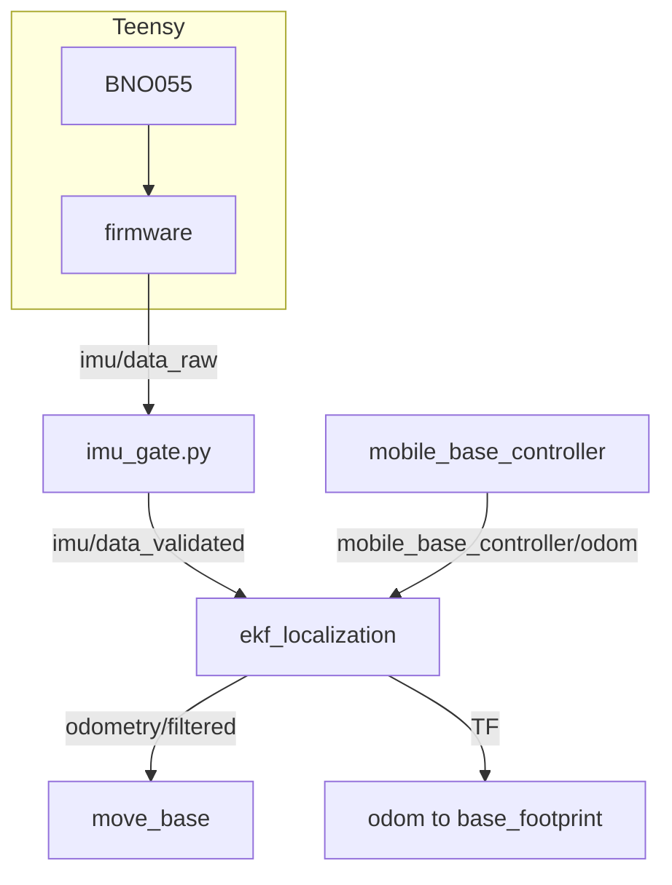

# Localization: Wheel Odometry and IMU (EKF)

DiffBot and Remo estimate how far they drove and turned from their wheels: the drive controller turns the wheel encoders' angles into **odometry**, a pose and a velocity in the `odom` frame. The wheels' estimate of turning is the weaker part. A wheel that slips, or a wheel separation that is a little off in the configuration, makes the estimated turn too small or too large, and the error in the heading grows into an error in the position the further the robot drives.

The IMU's gyroscope measures the turn directly: its **yaw rate**, the angular velocity about the upward axis, doesn't depend on the wheels. With `ekf:=true`, an **extended Kalman filter (EKF)** from the [`robot_localization`](http://docs.ros.org/en/noetic/api/robot_localization/html/index.html) package combines both: it takes the forward speed from the wheels and the turn mostly from the gyroscope, because the gyroscope's variance is far smaller. The filter publishes the result as `/diffbot/odometry/filtered` and as the transform `odom → base_footprint`, which navigation and RViz use.

!!! warning "Not tested on the robot yet"
    The EKF runs in the simulation and in the tests below. On the robot, the IMU's mounting, its axes and its noise still have to be checked ([bench checks](driver-bno055.md#bench-checks)), and the variances and time limits below are starting values, not measurements.

## How it fits together

The topics are in the `/diffbot` namespace, for example `/diffbot/imu/data_raw`.

- The **firmware** reads the BNO055 on the Teensy and publishes `/diffbot/imu/data_raw` at 50 Hz ([IMU (BNO055)](driver-bno055.md)). In the simulation, Gazebo's IMU sensor and a small adapter publish the same topic ([Simulation](../../diffbot_gazebo.md#inertial-measurement-unit-imu)).
- The **IMU gate**, [`imu_gate.py`]({{ diffbot_repo_url }}/diffbot_control/scripts/imu_gate.py), passes on only the samples the EKF can use, on `/diffbot/imu/data_validated`; [the gate](#the-imu-gate) below explains why.
- The **drive controller**, `mobile_base_controller` ([diff_drive_controller](http://wiki.ros.org/diff_drive_controller)), publishes the wheel odometry as before. With the EKF on, it no longer publishes the transform `odom → base_footprint`: two nodes publishing the same transform would make the robot's pose jump between their two estimates.
- The **EKF**, `/diffbot/ekf_localization`, fuses the two and publishes the filtered odometry and the transform.

[`ekf.launch`]({{ diffbot_repo_url }}/diffbot_control/launch/ekf.launch) in `diffbot_control` starts the gate and the EKF, for the robot and the simulation alike.

## Running it

The `ekf` argument switches it on; it's off by default. Pass it to the launch file you start:

| Where | Command |
|:--|:--|
| On the robot | `roslaunch diffbot_bringup bringup.launch model:=remo ekf:=true` (or `bringup_with_laser.launch`) |
| In the simulation | `roslaunch diffbot_gazebo diffbot.launch model:=remo ekf:=true` |
| Simulation with navigation | `roslaunch diffbot_navigation diffbot.launch model:=remo ekf:=true` |
| Navigation on the development PC, for a robot that runs with the EKF | `roslaunch diffbot_navigation diffbot_hw.launch model:=remo ekf:=true` |

The launch files that load the drive controller's configuration ([`diffbot_base/launch/diffbot.launch`]({{ diffbot_repo_url }}/diffbot_base/launch/diffbot.launch) on the robot, [`diffbot_control.launch`]({{ diffbot_repo_url }}/diffbot_control/launch/diffbot_control.launch) in the simulation) set the controller's `enable_odom_tf` parameter, `false` with the EKF and `true` without it, and include `ekf.launch` with the EKF. They set it both ways because a value stays on the ROS parameter server after a launch ends: the next launch would otherwise keep the controller's transform off. With `ekf:=true`, the planners ([`move_base.launch`]({{ diffbot_repo_url }}/diffbot_navigation/launch/move_base.launch) and move_base_flex's) read `/diffbot/odometry/filtered` instead of the controller's odometry, so that their velocities and the transform come from the same estimate.

To see what the filter does, compare the two odometries while the robot turns, for example in RViz with two Odometry displays, or with `rostopic echo /diffbot/odometry/filtered/twist/twist/angular` next to `/diffbot/mobile_base_controller/odom`'s.

## What the filter fuses

[`ekf.yaml`]({{ diffbot_repo_url }}/diffbot_control/config/ekf.yaml) configures the filter. Each input has a list of 15 booleans that says which of its values the filter uses: position x, y, z, the angles roll, pitch, yaw, their velocities, and the accelerations ([configuring robot_localization](http://docs.ros.org/en/noetic/api/robot_localization/html/configuring_robot_localization.html)).

| Input | Topic | Fused | Not fused, and why |
|:--|:--|:--|:--|
| Wheel odometry | `mobile_base_controller/odom` | forward speed vx, sideways speed vy (always 0), yaw rate | its pose: the controller computes it from the same velocities, so fusing it too would count the wheels twice |
| IMU | `imu/data_validated` | yaw rate | its acceleration, which would need its bias removed first; it has no orientation (the firmware leaves it out) |

The sideways speed is 0 for a differential drive robot, which can't move sideways; fusing it keeps the estimate from drifting sideways. How much the filter trusts each value comes from the variances in the messages: the controller's `twist_covariance_diagonal` in [`diffbot_control.yaml`]({{ diffbot_repo_url }}/diffbot_control/config/diffbot_control.yaml) gives the wheels' yaw rate 0.03 (rad/s)², the firmware gives the gyroscope 4 · 10⁻⁴ (rad/s)². With these, the filter's yaw rate lies close to the gyroscope's.

Other settings: `two_d_mode` keeps z, roll and pitch at 0 for a robot on a flat floor; `world_frame` is `odom`, so the estimate is continuous, without the jumps of a map-based localization such as amcl, which publishes `map → odom` itself; `frequency` is 50 Hz, the rate of both inputs.

## The IMU gate

The EKF only checks that the stamps of one topic don't go back. A sample that arrives late, or one with the same stamp as the one before, it fuses as if it were current: it corrects its present estimate with it. A sample that sat in a buffer would then count as the robot's yaw rate now. The gate in front of the EKF passes a sample on, unchanged and with its stamp, only if

- the ROS clock runs (in the simulation, Gazebo's `/clock`),
- its frame is `imu_link`, which the EKF needs to turn the measured rate into the robot's frame with TF,
- its values are finite, and its angular velocity has finite, positive variances,
- it is at most `max_age` old (0.1 s, five samples at 50 Hz) and at most `max_future` ahead of the ROS clock (0.02 s, one sample),
- and it is later than the last sample the gate passed on.

It never gives an old sample a new stamp. When the ROS clock goes back, as when Gazebo's world is reset, the order check starts over from the new time. The two time limits are starting values: the delay of the robot's USB link and rosserial isn't measured yet.

The gate's counts are on `/diagnostics`, apart from the EKF's own: how many samples it passed on, how many it dropped and why, and an error when nothing passed in the last second, or since the clock last went back. `rosrun rqt_robot_monitor rqt_robot_monitor` shows them.

## How it's tested

Three tests in CI check the EKF without the robot ([Testing and CI](../../development/ci.md#tests)):

- **On a stepped clock:** [`ekf_synthetic.test`]({{ diffbot_repo_url }}/diffbot_control/test/ekf_synthetic.test) starts `ekf.launch` with DiffBot's URDF for the IMU's frame. The test publishes the simulated clock itself and advances it 20 ms at a time: it publishes a step's inputs, waits until the gate's output has arrived and a little longer, moves the clock on, and waits for the filter's output, each wait with a time limit. These bounded waits reduce how much the results depend on the computer's speed, although they can't prove that the filter received each input before the clock moved. The wheels report 0.4 rad/s, as with a wheel separation that is too large, and the IMU 0.5 rad/s: the estimate is 0.499 rad/s. Then IMU samples that are 0.5 s old, from the future, repeated or out of order, all reporting 2.0 rad/s: the gate drops them, and the estimate stays with the valid samples, or goes to the wheels' 0.4 rad/s when only old samples come. After the clock goes back, the filter starts over. The gate's counts on `/diagnostics` have to match the samples the test sent.
- **In Gazebo:** [`sim_ekf_diffbot.test`]({{ diffbot_repo_url }}/diffbot_gazebo/test/sim_ekf_diffbot.test) and [`sim_ekf_remo.test`]({{ diffbot_repo_url }}/diffbot_gazebo/test/sim_ekf_remo.test) give the drive controller a wheel separation 25 % larger than the robot's. The controller then turns the robot 25 % more than commanded, while its odometry reports the commanded turn. In a 3 s left turn, DiffBot turned 1.847 rad, its odometry said 1.478 rad and the EKF 1.848 rad; Remo 1.876, 1.501 and 1.875 rad. The test also checks that only the EKF publishes `odom → base_footprint`.
- **The switch:** [`test_ekf_switch.py`]({{ diffbot_repo_url }}/diffbot_gazebo/test/test_ekf_switch.py) reads the launch files with roslaunch's loader, without starting them, and checks both positions of `ekf`: which nodes start, `enable_odom_tf`, and which odometry the planners read.

What these tests don't show: how the real gyroscope behaves (its noise and bias, how it's mounted), the delays on the robot, and whether the filter helps on the floor. The [floor odometry test](https://github.com/ros-mobile-robots/diffbot/issues/138) will measure that on Remo.

## Limits

- **A clock that goes back:** in the simulation, the filter starts over (`reset_on_time_jump`); robot_localization does that only with simulated time. On the robot, after the computer's clock goes back, the filter ignores each input until its stamps are newer than its last ones again.
- **The variances and time limits** are starting values; the [bench checks](driver-bno055.md#bench-checks) give measured ones.
- **The pose drifts** over time, as any odometry: the gyroscope helps with the heading, but nothing corrects the position. A map-based localization such as amcl corrects it in the `map` frame.
