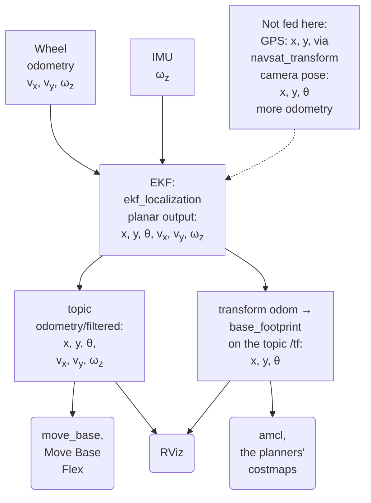
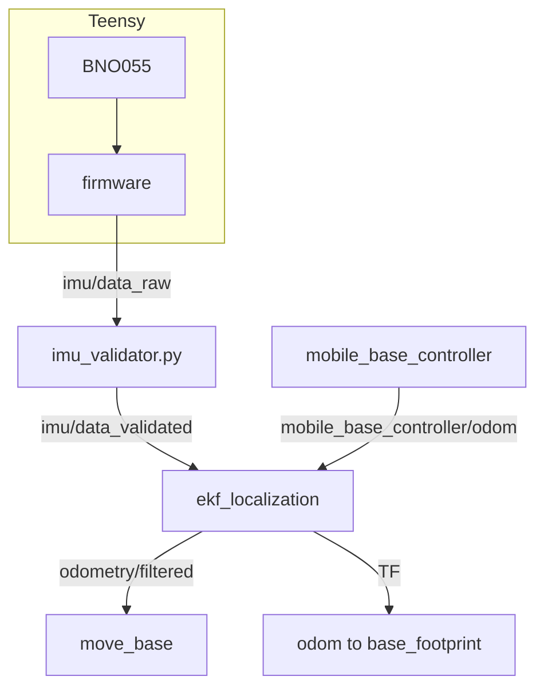

# Localization: Wheel Odometry and IMU (EKF)

DiffBot and Remo estimate how far they drove and turned from their wheels: the drive controller turns the wheel encoders' angles into **odometry**, a pose in the `odom` frame and a velocity in the robot's own frame, `base_footprint`. The pose is the position $x$, $y$ and the heading $\theta$. The velocity is the forward speed $v_x$ and the **yaw rate** $\omega_z$, the angular velocity about the upward axis. [REP 105's `odom` frame](https://www.ros.org/reps/rep-0105.html#odom) is ROS's convention for such a frame: the robot's pose in it changes smoothly, without jumps, but drifts over time. The wheels' estimate of turning is the weaker part. A wheel that slips, or a wheel separation that is a little off in the configuration, makes the estimated turn too small or too large, and the error in the heading $\theta$ grows into an error in the position the further the robot drives.

The IMU's gyroscope measures the turn directly: its yaw rate $\omega_z$ doesn't depend on the wheels. With `ekf:=true`, an **extended Kalman filter (EKF)** from the [`robot_localization`](http://docs.ros.org/en/noetic/api/robot_localization/html/index.html) package combines both: it takes the forward speed $v_x$ from the wheels and the yaw rate $\omega_z$ mostly from the gyroscope, because the gyroscope's variance $\sigma^2$ is far smaller. A variance says how far a value's errors spread. The smaller the variance, the more the filter trusts the value. The filter publishes its estimate on the topic `/diffbot/odometry/filtered` and as the transform `odom → base_footprint` on the topic `/tf`, which navigation and RViz use.

!!! warning "Not tested on the robot yet"
    The EKF runs in the simulation and in the tests below. On Remo, the IMU's rate, axes and noise passed the [bench checks](driver-bno055.md#bench-checks), but the EKF itself hasn't run on a robot yet. Remo's URDF model in remo_description includes the IMU's checked position and orientation ([bench checks](driver-bno055.md#bench-checks)). DiffBot uses the same BNO055, but its mounting and the firmware still need checking on DiffBot. The variances that the firmware and the drive controller publish on the robot, and the IMU sample validator's time limits, are starting values, not measurements.

## What goes in and what comes out

The figure shows what the filter gets, what the filter publishes and who uses that. Each box names its values with their symbols: the position $x$, $y$, the heading $\theta$, the forward speed $v_x$, the sideways speed $v_y$ and the yaw rate $\omega_z$.



The same as vectors, with the symbols of [the filter's state](#the-filters-state). $\mathbf{z}$ stands for a measurement and $\hat{\mathbf{x}}$ for the filter's estimate.

The wheel odometry's measurement is the three velocities that the filter fuses from one odometry message:

$$
\mathbf{z}_\text{wheels} = (\,v_x,\ v_y,\ \omega_z\,)
$$

The IMU's measurement is the yaw rate of one validated sample:

$$
\mathbf{z}_\text{IMU} = (\,\omega_z\,)
$$

The estimate that the filter publishes is the robot's pose in the `odom` frame and its velocities in the frame `base_footprint`. These six values can differ from 0. [`two_d_mode`](#what-two_d_mode-does) keeps the other values of the published message at 0:

$$
\hat{\mathbf{x}}_\text{published} = (\,x,\ y,\ \theta,\ v_x,\ v_y,\ \omega_z\,)
$$

- **In, on DiffBot and Remo:** two measurements. The wheel odometry gives the forward speed $v_x$ and the yaw rate $\omega_z$ that the drive controller computes from the wheel encoders, and the sideways speed $v_y$, which the controller sets to 0 for a differential drive. The IMU gives the yaw rate $\omega_z$ that its gyroscope measures. [What the filter fuses](#what-the-filter-fuses) says why the filter takes these values and no others.
- **In, possible but not fed here:** robot_localization can fuse any number of inputs of four kinds, which are odometry, poses, velocities and IMUs ([preparing the sensor data](http://docs.ros.org/en/noetic/api/robot_localization/html/preparing_sensor_data.html)). Examples are a GPS position $x$, $y$, which its [`navsat_transform_node`](http://docs.ros.org/en/noetic/api/robot_localization/html/integrating_gps.html) converts first, a pose $x$, $y$, $\theta$ from a camera, a second IMU, and more odometry, for example visual odometry. On DiffBot and Remo, the filter gets none of these.
- **The estimate:** robot_localization's state has 15 values: the position, the orientation, their velocities and the linear acceleration, each in three dimensions. [`two_d_mode`](#what-two_d_mode-does) keeps the height, roll, pitch, their velocities and the vertical acceleration at 0, for a robot on a flat floor. Of what remains, the filter publishes $x$, $y$, $\theta$, $v_x$, $v_y$ and $\omega_z$.
- **Out:** the filter publishes its estimate in two forms. The topic `/diffbot/odometry/filtered` carries a [`nav_msgs/Odometry`](http://docs.ros.org/en/noetic/api/nav_msgs/html/msg/Odometry.html) message: the pose $x$, $y$, $\theta$ in the `odom` frame, the velocities $v_x$, $v_y$, $\omega_z$ in the robot's frame `base_footprint`, and their covariances. The transform `odom → base_footprint` on the topic `/tf` carries the same pose.
- **Who uses it:** with `ekf:=true`, the planners `move_base` and Move Base Flex read the robot's velocity from the odometry topic. RViz can show the topic with an Odometry display. The transform reaches everything that works with TF: RViz, amcl, which localizes the robot on a map, and the planners' costmaps.

## How it fits together

The second figure shows the same flow as the ROS nodes and topics of DiffBot and Remo.



The topics are in the `/diffbot` namespace, for example `/diffbot/imu/data_raw`.

- The **firmware** reads the BNO055 on the Teensy and publishes `/diffbot/imu/data_raw` at 50 Hz, as [IMU: Bosch BNO055](driver-bno055.md) explains. In the simulation, Gazebo's IMU sensor and a small adapter publish the same topic, as [IMU: Simulation](simulation/index.md) explains.
- The **IMU sample validator**, [`imu_validator.py`]({{ diffbot_repo_url }}/diffbot_control/scripts/imu_validator.py), subscribes to `/diffbot/imu/data_raw`. It checks each sample against what this EKF configuration needs and forwards the valid samples, unchanged, on `/diffbot/imu/data_validated`. [Why the EKF needs the IMU sample validator](#the-imu-sample-validator) lists its checks.
- The **drive controller**, `mobile_base_controller` ([diff_drive_controller](http://wiki.ros.org/diff_drive_controller)), publishes the wheel odometry. With the EKF on, it doesn't publish the transform `odom → base_footprint`: two nodes publishing the same transform would make the robot's pose jump between their two estimates.
- The **EKF**, `/diffbot/ekf_localization`, subscribes to `/diffbot/imu/data_validated` and to the wheel odometry. It fuses the two and publishes the filtered odometry and the transform.

[`ekf.launch`]({{ diffbot_repo_url }}/diffbot_control/launch/ekf.launch) in `diffbot_control` starts the validator and the EKF, for the robot and the simulation alike.

## Running it

The `ekf` argument switches the EKF on. The EKF is off by default. Pass `ekf:=true` to the launch file you start:

| Where | Command |
|:--|:--|
| On the robot, when you start the bringup yourself | `roslaunch diffbot_bringup bringup.launch model:=remo ekf:=true` (or [`bringup_with_laser.launch`]({{ diffbot_repo_url }}/diffbot_bringup/launch/bringup_with_laser.launch)) |
| In the simulation | `roslaunch diffbot_gazebo diffbot.launch model:=remo ekf:=true` |
| Simulation with navigation | `roslaunch diffbot_navigation diffbot.launch model:=remo ekf:=true` |
| Navigation on the development PC, for a robot that runs with the EKF | `roslaunch diffbot_navigation diffbot_hw.launch model:=remo ekf:=true` |

### Which launch file starts what

A `roslaunch` command names one launch file. roslaunch reads that file and every file that it includes with the [`<include>` tag](http://wiki.ros.org/roslaunch/XML/include), directly or through another included file. It starts the nodes that these files declare. A node is a running ROS program. A file can pass arguments such as `ekf` to a file that it includes. Starting an included file on its own doesn't read the file that includes it.

The two figures show which launch file includes which, and which file declares which node. They don't show the order in which the nodes start. The pill-shaped box is your command. A rectangle is a launch file, written as its package and its file name. A rounded rectangle names the node or the two nodes that a file starts. A thick arrow is an include that passes `ekf` to the included file.

**On the robot**, when you start the bringup yourself, you start one of the two bringup files. This command is for Remo. For DiffBot, use `model:=diffbot`:

```console
roslaunch diffbot_bringup bringup.launch model:=remo ekf:=true
```

!!! note "With the robot container"
    In the [robot container](../../processing_units/robot-container/usage.md), Docker Compose starts `bringup.launch` for you, without `ekf`, as the `bringup` service's command in [`compose.yaml`]({{ diffbot_repo_url }}/.docker/robot/compose.yaml) says. So `robot_state_publisher` runs there and the EKF is off. The container's settings have no switch for the EKF. Don't start a second bringup by hand next to the container's.

The figure shows which files this command reads and which nodes they start:


The figure leaves out the other nodes. [`minimal.launch`]({{ diffbot_repo_url }}/diffbot_bringup/launch/minimal.launch) also starts rosserial, the connection to the Teensy. [`diffbot_base/launch/diffbot.launch`]({{ diffbot_repo_url }}/diffbot_base/launch/diffbot.launch) also starts the hardware interface `diffbot_base`, which runs the drive controller. `bringup_with_laser.launch` does the same as [`bringup.launch`]({{ diffbot_repo_url }}/diffbot_bringup/launch/bringup.launch) and also starts the lidar.

`minimal.launch` takes the `ekf` argument because the bringup files pass `ekf` through `minimal.launch`. Starting `minimal.launch` on its own with `ekf:=true` doesn't read the bringup file, so nothing starts `robot_state_publisher`. Without another publisher that provides the transform between `imu_link` and `base_footprint`, the EKF can't use the IMU's samples, and its estimate follows the wheels.

**In the simulation**, you start `diffbot_gazebo`'s `diffbot.launch`:

```console
roslaunch diffbot_gazebo diffbot.launch model:=remo ekf:=true
```

The figure shows which files this command reads and which nodes they start:


This figure leaves out the other nodes too. [`diffbot_gazebo/launch/diffbot.launch`]({{ diffbot_repo_url }}/diffbot_gazebo/launch/diffbot.launch) also includes [`diffbot_view.launch`]({{ diffbot_repo_url }}/diffbot_gazebo/launch/diffbot_view.launch), which starts Gazebo through gazebo_ros's `empty_world.launch`. Gazebo runs the drive controller.

What the file at the end of the thick arrows does with `ekf`: on the robot, that file is `diffbot_base/launch/diffbot.launch`. In the simulation, that file is [`diffbot_control.launch`]({{ diffbot_repo_url }}/diffbot_control/launch/diffbot_control.launch). Each of these two launch files loads the drive controller's configuration and does two things with its `ekf` value:

1. The file sets the controller's `enable_odom_tf` parameter to `false` with the EKF and to `true` without it. The file writes the value in both cases because a value stays on the ROS parameter server as long as the ROS master runs. Without the `true`, a launch without the EKF after one with the EKF would keep the controller's transform off.
2. The file includes [`ekf.launch`]({{ diffbot_repo_url }}/diffbot_control/launch/ekf.launch), which starts the validator and the EKF, only if `ekf` is true.

Why the EKF needs `robot_state_publisher`, the orange node: `robot_state_publisher` publishes the transforms of the joints in the robot's model, the URDF. From them, TF gets the transform between the IMU's frame `imu_link` and `base_footprint`. The EKF needs this transform to turn the IMU's yaw rate into the robot's frame.

The navigation launch files pass `ekf` on in the same way. [`diffbot_navigation/launch/diffbot.launch`]({{ diffbot_repo_url }}/diffbot_navigation/launch/diffbot.launch) includes `diffbot_gazebo`'s `diffbot.launch` and [`move_base.launch`]({{ diffbot_repo_url }}/diffbot_navigation/launch/move_base.launch) and passes `ekf` to both. With `ekf:=true`, the planners in `move_base.launch` and in Move Base Flex's [`move_base.launch.xml`]({{ diffbot_repo_url }}/diffbot_mbf/launch/includes/move_base.launch.xml) read `/diffbot/odometry/filtered` instead of the controller's odometry, so that their velocities and the transform come from the same estimate. [`diffbot_hw.launch`]({{ diffbot_repo_url }}/diffbot_navigation/launch/diffbot_hw.launch) starts no EKF. Its `ekf` argument only selects the odometry that the planner reads, for a robot whose bringup runs with `ekf:=true`.

To see what the filter does, compare the two odometries while the robot turns, for example in RViz with two Odometry displays, or with `rostopic echo /diffbot/odometry/filtered/twist/twist/angular` next to `/diffbot/mobile_base_controller/odom`'s.

## What the filter fuses

[`ekf.yaml`]({{ diffbot_repo_url }}/diffbot_control/config/ekf.yaml) configures the filter. For each input, a list of 15 booleans says which values of the input's messages the filter fuses: `odom0_config` for the wheel odometry and `imu0_config` for the IMU. To **fuse** a value means that the filter corrects its estimate of one variable with the measured value. How far the estimate moves towards the measurement depends on two uncertainties: the measurement's variance $\sigma^2$ and the uncertainty of the filter's own estimate. The smaller the measurement's variance is next to the estimate's uncertainty, the closer the estimate moves to the measurement.

### The filter's state

The 15 booleans stand for the 15 variables that robot_localization's filter estimates, its **state** $\mathbf{x}$:

$$
\mathbf{x} = (\,x,\ y,\ z,\ \text{roll},\ \text{pitch},\ \theta,\ v_x,\ v_y,\ v_z,\ \omega_x,\ \omega_y,\ \omega_z,\ a_x,\ a_y,\ a_z\,)
$$

The table shows the state's five groups of three variables, with the labels that the comments in `ekf.yaml` use and the names on [robot_localization's parameter page](https://docs.ros.org/en/noetic/api/robot_localization/html/state_estimation_nodes.html#sensor-config), which gives the same order:

| Group | Symbols | Labels in `ekf.yaml` | Names on the parameter page |
|:--|:--|:--|:--|
| Position | $x$, $y$, $z$ | `x`, `y`, `z` | $X$, $Y$, $Z$ |
| Orientation | roll, pitch, heading $\theta$ | `roll`, `pitch`, `yaw` | roll, pitch, yaw |
| Linear velocity | $v_x$, $v_y$, $v_z$ | `vx`, `vy`, `vz` | $\dot X$, $\dot Y$, $\dot Z$ |
| Angular velocity | $\omega_x$, $\omega_y$, $\omega_z$ | `vroll`, `vpitch`, `vyaw` | the rates of roll, pitch and yaw |
| Linear acceleration | $a_x$, $a_y$, $a_z$ | `ax`, `ay`, `az` | $\ddot X$, $\ddot Y$, $\ddot Z$ |

The position and the orientation are the robot's pose in the filter's `world_frame`, here `odom`. The velocities and the acceleration are in the robot's own frame, the filter's `base_link_frame`, here `base_footprint`. The yaw rate $\omega_z$ is the rate at which the heading $\theta$ changes.

### The two lists

The excerpt shows the wheel odometry's topic and list, from [`ekf.yaml`, lines 53–58]({{ ekf_src_url }}/diffbot_control/config/ekf.yaml#L53-L58). Each row of the list is one group of the state, and the comment at the end of a row names the row's three variables:

```yaml title="ekf.yaml: the wheel odometry's topic and list" linenums="53"
--8<-- "{{ ekf_src_raw }}/diffbot_control/config/ekf.yaml:53:58"
```

The next excerpt shows the IMU's topic and list, from [`ekf.yaml`, lines 70–75]({{ ekf_src_url }}/diffbot_control/config/ekf.yaml#L70-L75):

```yaml title="ekf.yaml: the IMU's topic and list" linenums="70"
--8<-- "{{ ekf_src_raw }}/diffbot_control/config/ekf.yaml:70:75"
```

The figure shows both lists in the file's layout. A green cell with a check mark is a `true`: the filter fuses this value from the input. A plain cell is a `false`: the filter ignores this value of the input, even when the message carries it. A dashed cell belongs to a variable that `two_d_mode` keeps at 0, whatever the list says.

--8<-- "includes/localization-fused-values.html"

The list names the four values that are `true`. For each value, the list gives the message field that carries the value, the element of the message's covariance that gives the value's variance $\sigma^2$, and the frame of the value:

1. **Forward speed $v_x$, from the wheel odometry:**
    - Message field: `twist.twist.linear.x`
    - Variance: `twist.covariance[0]`, 0.001 (m/s)²
    - Frame: `base_footprint`
2. **Sideways speed $v_y$, from the wheel odometry:**
    - Message field: `twist.twist.linear.y`
    - Variance: `twist.covariance[7]`, 0.001 (m/s)²
    - Frame: `base_footprint`
3. **Yaw rate $\omega_z$, from the wheel odometry:**
    - Message field: `twist.twist.angular.z`
    - Variance: `twist.covariance[35]`, 0.03 (rad/s)²
    - Frame: `base_footprint`
4. **Yaw rate $\omega_z$, from the IMU:**
    - Message field: `angular_velocity.z`
    - Variance: `angular_velocity_covariance[8]`, 4 · 10⁻⁴ (rad/s)² on the robot and 2.5 · 10⁻⁵ (rad/s)² in the simulation
    - Frame: `imu_link`, rotated into `base_footprint`

What the list's three entries mean:

- **The messages:** the wheel odometry arrives as [`nav_msgs/Odometry`](http://docs.ros.org/en/noetic/api/nav_msgs/html/msg/Odometry.html) messages on the topic `mobile_base_controller/odom`. The IMU's samples arrive as [`sensor_msgs/Imu`](http://docs.ros.org/en/noetic/api/sensor_msgs/html/msg/Imu.html) messages on the topic `imu/data_validated`.
- **The variances:** a message stores a covariance matrix row by row. `twist.covariance` has 6 × 6 elements for the three linear and the three angular velocities, so the variances on its diagonal are the elements 0, 7, 14, 21, 28 and 35. `angular_velocity_covariance` has 3 × 3 elements, with the variances at 0, 4 and 8. The wheel odometry's variances are the drive controller's `twist_covariance_diagonal` in [`diffbot_control.yaml`]({{ diffbot_repo_url }}/diffbot_control/config/diffbot_control.yaml), on the robot and in the simulation. The IMU's variance on the robot is a fixed value in the firmware's configuration. In the simulation, the IMU's variance is the square of `gaussianNoise`, 0.005 rad/s, the noise that the simulated sensor adds to each value.
- **The frames:** the filter turns every velocity into its `base_link_frame`, `base_footprint`, before it fuses the value. The wheel odometry names the frame of its velocities in `child_frame_id`, which is `base_footprint` already. An IMU sample names its frame in `header.frame_id`, `imu_link`, and the filter rotates the angular velocity into `base_footprint` with the transform from TF. In the URDF models of both robots, the z axis of `imu_link` points up like the robot's, so the rotation leaves `angular_velocity.z` as it is.

The collapsed box shows where robot_localization 2.7.7 reads these fields and frames.

??? quote "ros_filter.cpp: the velocities of an odometry message and of an IMU sample"
    robot_localization passes the wheel odometry's velocities on with the frame `child_frame_id` and the target frame `baseLinkFrameId_`, the filter's `base_link_frame`, as [lines 1794–1804 of `ros_filter.cpp`](https://github.com/cra-ros-pkg/robot_localization/blob/ef5ad3c89457209530e262f3bac39b0f35d07b2b/src/ros_filter.cpp#L1794-L1804) show:

    ```cpp linenums="1794"
    --8<-- "https://raw.githubusercontent.com/cra-ros-pkg/robot_localization/ef5ad3c89457209530e262f3bac39b0f35d07b2b/src/ros_filter.cpp:1794:1804"
    ```

    For an IMU sample, robot_localization copies `angular_velocity` and the nine elements of `angular_velocity_covariance` into a velocity measurement with the same target frame, as [lines 558–574 of `ros_filter.cpp`](https://github.com/cra-ros-pkg/robot_localization/blob/ef5ad3c89457209530e262f3bac39b0f35d07b2b/src/ros_filter.cpp#L558-L574) show:

    ```cpp linenums="558"
    --8<-- "https://raw.githubusercontent.com/cra-ros-pkg/robot_localization/ef5ad3c89457209530e262f3bac39b0f35d07b2b/src/ros_filter.cpp:558:574"
    ```

### Why these values and no others

| Input | Fused | Not fused, and why |
|:--|:--|:--|
| Wheel odometry | forward speed $v_x$, sideways speed $v_y$, yaw rate $\omega_z$ | its pose $x$, $y$, $\theta$: the controller computes the pose from the same velocities, so fusing both would count the wheels twice |
| IMU | yaw rate $\omega_z$ | its orientation, which the firmware marks as unavailable in the message, and its acceleration, which would need its bias removed first |

The sideways speed $v_y$ is always 0 in the wheel odometry, because a differential drive robot can't move sideways. Fusing the 0 keeps the estimate from drifting sideways. Both inputs give the yaw rate $\omega_z$. On the robot, the gyroscope's variance of 4 · 10⁻⁴ (rad/s)² is 75 times smaller than the wheels' 0.03 (rad/s)², so the filter's yaw rate lies close to the gyroscope's. In the simulation, the simulated gyroscope's variance is 1200 times smaller than the wheels'.

### What `two_d_mode` does

DiffBot and Remo drive on a flat floor, so `ekf.yaml` sets [`two_d_mode`](https://docs.ros.org/en/noetic/api/robot_localization/html/state_estimation_nodes.html#two-d-mode). The setting concerns seven of the 15 variables: the height $z$, roll, pitch, their velocities $v_z$, $\omega_x$ and $\omega_y$, and the vertical acceleration $a_z$. For every measurement, the filter replaces the measurement's value for each of the seven with 0, gives the 0 the small variance 10⁻⁶, and marks the variable as fused. The function `forceTwoD()` does this with its arguments `measurement`, `measurementCovariance` and `updateVector`, as [lines 347–374 of `ros_filter.cpp`](https://github.com/cra-ros-pkg/robot_localization/blob/ef5ad3c89457209530e262f3bac39b0f35d07b2b/src/ros_filter.cpp#L347-L374) show:

??? quote "ros_filter.cpp, lines 347–374: forceTwoD()"
    ```cpp linenums="347"
    --8<-- "https://raw.githubusercontent.com/cra-ros-pkg/robot_localization/ef5ad3c89457209530e262f3bac39b0f35d07b2b/src/ros_filter.cpp:347:374"
    ```

So the two lists can't change these seven variables. A `false` at their positions loses nothing, and a `true` would fuse the same 0. The figure above shows their cells dashed for this reason.

### The other settings

- **`odom0_differential` and `imu0_differential`:** the [`_differential` setting](https://docs.ros.org/en/noetic/api/robot_localization/html/state_estimation_nodes.html#sensor-differential) applies to pose values only. With `true`, the filter would fuse the change between two consecutive poses as a velocity, instead of the pose. Neither list fuses a pose value, so the setting has no effect here. `false` is robot_localization's default.
- **`odom0_queue_size` and `imu0_queue_size`:** the [queue size](https://docs.ros.org/en/noetic/api/robot_localization/html/state_estimation_nodes.html#sensor-queue-size) of the filter's ROS subscriber for the input's topic. Up to 10 messages wait in the queue until the filter node takes them. robot_localization's default is 1.
- **`world_frame`:** is `odom`, so the estimate is continuous, without the jumps of a map-based localization such as amcl, which publishes `map → odom` itself.
- **`frequency`:** is 50 Hz, the IMU's rate. In the simulation, the wheel odometry arrives at 50 Hz too, the drive controller's `publish_rate` in `diffbot_control.yaml`. On the robot, the wheel odometry arrives at most 10 times per second: the base node's control loop in [`diffbot_base.cpp`]({{ diffbot_repo_url }}/diffbot_base/src/diffbot_base.cpp) runs the controller at 10 Hz, and the controller publishes at most one odometry message each time it runs.

The controller's `update()` publishes only when `publish_period_` has passed since `last_state_publish_time_`, as [lines 430–432 of `diff_drive_controller.cpp`](https://github.com/ros-controls/ros_controllers/blob/0.22.0/diff_drive_controller/src/diff_drive_controller.cpp#L430-L432) in ros_controllers 0.22.0 show:

```cpp title="diff_drive_controller.cpp: when update() publishes the odometry" linenums="430"
--8<-- "https://raw.githubusercontent.com/ros-controls/ros_controllers/0.22.0/diff_drive_controller/src/diff_drive_controller.cpp:430:432"
```

## The IMU sample validator

The IMU sample validator is the ROS node `/diffbot/imu_validator`, from [`imu_validator.py`]({{ diffbot_repo_url }}/diffbot_control/scripts/imu_validator.py). It subscribes to the topic `/diffbot/imu/data_raw` and forwards each valid sample, unchanged and with its stamp, on the topic `/diffbot/imu/data_validated`, which the EKF reads. It drops every other sample.

### Why the EKF needs the validator

robot_localization's own stamp check for an input allows equal stamps and doesn't limit a sample's age. In robot_localization 2.7.7, the version in the dev container, the IMU's angular velocity passes this check when its stamp `msg->header.stamp` isn't earlier than `lastMessageTimes_`, the last stamp on the same input. When a measurement's stamp isn't later than the last measurement that the filter processed, `delta` is not positive, and the filter skips `predict()` and corrects its current estimate with the measurement. [`ekf.yaml`]({{ diffbot_repo_url }}/diffbot_control/config/ekf.yaml) leaves [`smooth_lagged_data`](https://github.com/cra-ros-pkg/robot_localization/blob/ef5ad3c89457209530e262f3bac39b0f35d07b2b/doc/state_estimation_nodes.rst#smooth_lagged_data) off, so the filter doesn't go back to the time of a late measurement.

So a delayed sample, or one with the same stamp as the one before, can pass the filter's stamp check. If the sample also passes the filter's other input checks, such as the transform into `base_footprint`, the filter corrects its current estimate with the sample, as if the sample were current. A sample that waited in a buffer would count as the robot's yaw rate $\omega_z$ now.

??? quote "ros_filter.cpp and filter_base.cpp: the stamp check, and prediction only forward in time"
    [Lines 2197–2221 of `ros_filter.cpp`](https://github.com/cra-ros-pkg/robot_localization/blob/ef5ad3c89457209530e262f3bac39b0f35d07b2b/src/ros_filter.cpp#L2197-L2221) show the stamp check of an angular velocity:

    ```cpp linenums="2197"
    --8<-- "https://raw.githubusercontent.com/cra-ros-pkg/robot_localization/ef5ad3c89457209530e262f3bac39b0f35d07b2b/src/ros_filter.cpp:2197:2221"
    ```

    [Lines 205–234 of `filter_base.cpp`](https://github.com/cra-ros-pkg/robot_localization/blob/ef5ad3c89457209530e262f3bac39b0f35d07b2b/src/filter_base.cpp#L205-L234) show that the filter predicts only when `delta` is positive:

    ```cpp linenums="205"
    --8<-- "https://raw.githubusercontent.com/cra-ros-pkg/robot_localization/ef5ad3c89457209530e262f3bac39b0f35d07b2b/src/filter_base.cpp:205:234"
    ```

Two settings of the EKF sound as if they covered this, and they don't. [`sensor_timeout`](https://github.com/cra-ros-pkg/robot_localization/blob/ef5ad3c89457209530e262f3bac39b0f35d07b2b/doc/state_estimation_nodes.rst#sensor_timeout) makes the filter predict without a correction when its inputs stop. A rejection threshold compares a measurement's value with the filter's prediction, as [What the validator doesn't check](#what-the-validator-doesnt-check) explains. Neither looks at a sample's age, its frame or a repeated stamp.

### The five checks

A sample is valid only if it passes all five checks of the list below the figure. For each sample, the node calls `validate_and_record()` of the class `ImuValidator`, which runs the checks in this order and returns the reason of the first one that fails. In the figure and in the list, $t$ is the ROS time, the node's clock at the moment the sample arrives. $t_s$ is the sample's stamp, and $t_\text{last}$ is the stamp of the last sample that the node forwarded.

--8<-- "includes/localization-validator-checks.html"

1. **The frame**, `check_frame()`: the sample's `header.frame_id` is the node's parameter `frame_id`, `imu_link`. The EKF needs this frame to turn the measured rate into the robot's frame with TF.
2. **The values**, `check_finite_values()`: the three components of the angular velocity $\boldsymbol\omega$ and of the linear acceleration $\mathbf f$ are finite numbers, so none is NaN or infinite.
3. **The variances**, `check_angular_velocity_covariance()`: the nine values of the angular velocity's covariance are finite, and its diagonal, the three variances $\sigma^2$, is positive.
4. **The stamp against the ROS time**, `check_not_too_old()` and `check_not_from_the_future()`: $t - \texttt{max\_age} \le t_s \le t + \texttt{max\_future}$. A stamp can fail only one of the two, so their order doesn't matter.
    - **Not too old:** the stamp is at most `max_age`, 0.1 s, older than the ROS time. That is five samples at the IMU's 50 Hz. On the robot, a sample takes time to travel from the Teensy over USB and through rosserial's node. So its stamp is normally a little older than the ROS time when the sample arrives, as sample B in the figure. A sample that waited long in a buffer on the way is older than `max_age`, as sample A.
    - **Not too far ahead:** the stamp is at most `max_future`, 0.02 s, ahead of the ROS time. That is one sample. The Teensy stamps a sample with its own clock, which rosserial synchronizes only approximately with the SBC's clock. The offset that remains between the two clocks can put a stamp ahead of the ROS time, as sample C. In the simulation, a sample can arrive before the node has received the matching message on the topic `/clock`. Sample D is ahead by more than `max_future`. `max_future` is the allowed difference, not a measured delay.
5. **The stamp against the last forwarded sample**, `check_newer_than_the_last()`: $t_s > t_\text{last}$. A sample with an older stamp arrived out of order, as sample E. A sample with the same stamp came twice, as sample F.

Before the first check, the node drops every sample while the ROS time is zero. With simulation time, the ROS time is zero until the first message on Gazebo's topic `/clock` arrives. When the ROS time goes back, as when Gazebo's world is reset, the order check starts over from the new time.

`frame_id`, `max_age` and `max_future` are the node's parameters, which [`ekf.launch`]({{ diffbot_repo_url }}/diffbot_control/launch/ekf.launch) sets. The values of `max_age` and `max_future` are initial policy values, not standard IMU limits. They stay until the latency of the robot's USB link and rosserial is measured.

### What the validator doesn't check

- **Other fields of the message:** the orientation, the acceleration's covariance, or whether a covariance matrix is positive definite. So the validator doesn't validate every field of a `sensor_msgs/Imu` message.
- **Whether a value is plausible:** the validator looks at a sample's form and its time only. A yaw rate $\omega_z$ of 100 rad/s with a fresh stamp is valid.

The validator also never gives an old sample a new stamp.

Judging a value is a statistical test inside robot_localization, which a **rejection threshold** switches on. Each input can have a threshold for its pose update, for its velocity update and for its acceleration update. With a threshold, the filter doesn't fuse an update that lies too far from the filter's own prediction. The filter measures "too far" as a [Mahalanobis distance](https://github.com/cra-ros-pkg/robot_localization/blob/ef5ad3c89457209530e262f3bac39b0f35d07b2b/doc/state_estimation_nodes.rst#sensor_threshold): the difference between the measurement and the prediction, counted in units of their combined uncertainty. For an update of one value, the distance is the number of standard deviations between the measurement and the prediction. For an update of several values, the distance is one number for all of them together, not a limit for each value. The test compares an input with the filter's prediction, not with the other input.

[`ekf.yaml`]({{ diffbot_repo_url }}/diffbot_control/config/ekf.yaml) sets no rejection threshold, so this test is off for both inputs. The filter's other handling of an input stays: the stamp-order check, the transform into `base_footprint`, the selection by the [two lists](#the-two-lists), and leaving out values that are not finite. The test is off for two reasons:

- **The robot's variances are starting values:** the firmware and the drive controller publish fixed variances. Whether these fit while the robot drives isn't checked yet. A threshold counts in these uncertainties, so a number chosen today would mean little.
- **A threshold needs recorded drives:** a threshold that is too tight rejects valid changes of the motion, for example the start of a turn. Recordings at rest can't show how the test behaves when the robot accelerates, turns and slips.

[diffbot#205](https://github.com/ros-mobile-robots/diffbot/issues/205) evaluates the thresholds on recorded drives of the robot.

??? info "How robot_localization 2.7.7 computes the test, and the parameters' names"
    Once the filter has its first measurement, which sets the state without a test, the filter compares the squared distance $d^2$ of every update with the square of the threshold:

    $$
    d^2 = \mathbf{y}^\mathsf{T} \left(\mathbf{H} \mathbf{P} \mathbf{H}^\mathsf{T} + \mathbf{R}\right)^{-1} \mathbf{y}, \qquad \mathbf{y} = \mathbf{z} - \mathbf{H} \hat{\mathbf{x}}
    $$

    - $\mathbf{z}$: the values of this update after the transform into `base_footprint`, for example the three velocities of one wheel odometry message, together with the zeros that `two_d_mode` adds.
    - $\hat{\mathbf{x}}$: the filter's state right before this correction. The filter predicts the state to the measurement's stamp when that stamp is later than the filter's time. A late measurement is compared with the state as it is.
    - $\mathbf{H}$: the matrix that picks the update's variables out of the state.
    - $\mathbf{y}$: the innovation, the difference between the measurement and the state.
    - $\mathbf{P}$: the covariance of that state, the filter's own uncertainty.
    - $\mathbf{R}$: the covariance of the update's values after the transform, together with the variances that `two_d_mode` adds.
    - The raised $\mathsf{T}$ transposes a vector or a matrix, and the raised $-1$ inverts a matrix.

    The filter doesn't fuse the update when $d^2$ is the threshold's square or more. The function `checkMahalanobisThreshold()` computes `sqMahalanobis`, $d^2$, from `innovation`, $\mathbf{y}$, and `invCovariance`, the inverse in the formula. `nsigmas` is the threshold. [Lines 384–401 of `filter_base.cpp`](https://github.com/cra-ros-pkg/robot_localization/blob/ef5ad3c89457209530e262f3bac39b0f35d07b2b/src/filter_base.cpp#L384-L401) show the function:

    ```cpp linenums="384"
    --8<-- "https://raw.githubusercontent.com/cra-ros-pkg/robot_localization/ef5ad3c89457209530e262f3bac39b0f35d07b2b/src/filter_base.cpp:384:401"
    ```

    The threshold for the wheel odometry's velocities is `odom0_twist_rejection_threshold`. The parameter tests the whole velocity update at once: $v_x$, $v_y$ and $\omega_z$, together with the zeros that [`two_d_mode`](#what-two_d_mode-does) adds. When the update fails the test, the filter fuses none of the three velocities. No parameter tests the yaw rate alone.

    The threshold for an IMU's angular velocity is `imu0_twist_rejection_threshold`. The parameter documentation calls it `imu0_angular_velocity_rejection_threshold`, but robot_localization 2.7.7 reads the name with `twist`, as [lines 1414–1418 of `ros_filter.cpp`](https://github.com/cra-ros-pkg/robot_localization/blob/ef5ad3c89457209530e262f3bac39b0f35d07b2b/src/ros_filter.cpp#L1414-L1418) show:

    ```cpp linenums="1414"
    --8<-- "https://raw.githubusercontent.com/cra-ros-pkg/robot_localization/ef5ad3c89457209530e262f3bac39b0f35d07b2b/src/ros_filter.cpp:1414:1418"
    ```

### The validator's diagnostics

The node publishes its counts on the topic `/diagnostics`, next to the EKF's own status there: how many samples it forwarded, and how many it dropped for which reason. The function `health()` sets the status. The status is an error when no sample was forwarded for more than `SILENCE_LIMIT`, 1 s, or since the ROS time last went back. It is a warning when the node dropped samples since its last report. `rosrun rqt_robot_monitor rqt_robot_monitor` shows the status and the counts.

## How it's tested

Four tests check the EKF without the robot, in [CI with the repository's other tests](../../development/ci.md#tests):

- **The validator alone:** [`test_imu_validator.py`]({{ diffbot_repo_url }}/diffbot_control/test/test_imu_validator.py) calls the validator's checks directly, without a ROS master. Its 27 unit tests cover each reason to drop a sample, the limits `max_age` and `max_future`, a clock that goes back, and the diagnostics: the status for each case and the counts of a report.
- **On a stepped clock:** [`ekf_synthetic.test`]({{ diffbot_repo_url }}/diffbot_control/test/ekf_synthetic.test) starts `ekf.launch` with DiffBot's URDF for the IMU's frame. The test publishes the simulated clock itself and advances it 20 ms at a time: it publishes a step's inputs, waits until the validator's output has arrived and a little longer, moves the clock on, and waits for the filter's output, each wait with a time limit. These bounded waits reduce how much the results depend on the computer's speed, although they can't prove that the filter received each input before the clock moved. The wheels report a yaw rate $\omega_z$ of 0.4 rad/s, as with a wheel separation that is too large, and the IMU 0.5 rad/s: the estimate is 0.499 rad/s. Then IMU samples that are 0.5 s old, from the future, repeated or out of order, all reporting 2.0 rad/s: the validator drops them, and the estimate stays with the valid samples, or goes to the wheels' 0.4 rad/s when only old samples come. After the clock goes back, the filter starts over. The validator's counts on the topic `/diagnostics` have to match the samples the test sent.
- **In Gazebo:** [`sim_ekf_diffbot.test`]({{ diffbot_repo_url }}/diffbot_gazebo/test/sim_ekf_diffbot.test) and [`sim_ekf_remo.test`]({{ diffbot_repo_url }}/diffbot_gazebo/test/sim_ekf_remo.test) give the drive controller a wheel separation 25 % larger than the robot's. The controller then turns the robot 25 % more than commanded, while its odometry reports the commanded turn. In a 3 s left turn, DiffBot turned 1.849 rad, its odometry said 1.479 rad and the EKF 1.844 rad. Remo turned 1.873 rad, its odometry said 1.499 rad and the EKF 1.870 rad. These numbers are from a run in a container of the dev container's image, at the commit `3ef4a91` of [diffbot#154](https://github.com/ros-mobile-robots/diffbot/pull/154). The test also checks that the controller's wheel separation is 1.25 times the robot's, and that only the EKF publishes the transform `odom → base_footprint` on the topic `/tf`.
- **The switch:** [`test_ekf_switch.py`]({{ diffbot_repo_url }}/diffbot_gazebo/test/test_ekf_switch.py) reads the launch files with roslaunch's loader, without starting them, and checks both positions of `ekf` and its default: which nodes start, `enable_odom_tf`, and which odometry the planners read. With `ekf:=true`, the two bringup files and `diffbot_gazebo`'s `diffbot.launch` also have to start `robot_state_publisher`. The planners' launch files start no EKF, so the test checks only the odometry topic that their planner reads.

What these tests don't show: how the real gyroscope behaves (its noise and bias, how it's mounted), the delays on the robot, the filter with the robot's slower wheel odometry (in these tests, both inputs arrive at 50 Hz), and whether the filter helps on the floor. The [floor odometry test](https://github.com/ros-mobile-robots/diffbot/issues/138) will measure that on Remo.

## Limits

- **A clock that goes back:** in the simulation, the filter starts over (`reset_on_time_jump`). robot_localization does that only with simulated time. On the robot, after the computer's clock goes back, the filter ignores each input until its stamps are newer than its last ones again.
- **A reset of the simulation:** `/gazebo/reset_simulation` sets the simulation's clock back to zero. The simulated IMU, the validator and the filter go on from the new time right away. [The reset test](simulation/tests.md#the-reset-test) checks that for the IMU. The drive controller's odometry doesn't. `diff_drive_controller` publishes again only when the clock has passed `last_state_publish_time_`, the time of its last message from before the reset. The [excerpt of `diff_drive_controller.cpp`](#the-other-settings) shows the condition. Until then, the filter gets the IMU's yaw rate but no wheel speeds. In a test run that was reset after 9.7 s, the filter's first output after the reset was stamped 0.08 s, and the wheel odometry's first message 9.75 s.
- **Starting values:** the variances that the firmware and the drive controller publish on the robot, and the IMU sample validator's time limits, are not measured yet. The [bench checks](driver-bno055.md#bench-checks) measured the IMU's noise at rest. Measurements while driving still have to show the values that the EKF should use. In the simulation, the IMU's variance describes the Gaussian noise that the simulated sensor adds.
- **Drift:** the pose drifts over time, as any odometry. The gyroscope helps with the heading, but nothing corrects the position. A map-based localization such as amcl corrects it in the `map` frame.

## More about robot_localization

- [robot_localization on the ROS Wiki](http://wiki.ros.org/robot_localization): the package's summary page, with links to its API, FAQ and changelog.
- [robot_localization's documentation for Noetic](http://docs.ros.org/en/noetic/api/robot_localization/html/index.html): the state estimation nodes and their parameters, how to prepare the sensor data, how to configure the filters and how to add GPS.
- [cra-ros-pkg/robot_localization](https://github.com/cra-ros-pkg/robot_localization) on GitHub: the source code and the issues. The Noetic version is on the [`noetic-devel`](https://github.com/cra-ros-pkg/robot_localization/tree/noetic-devel) branch.
