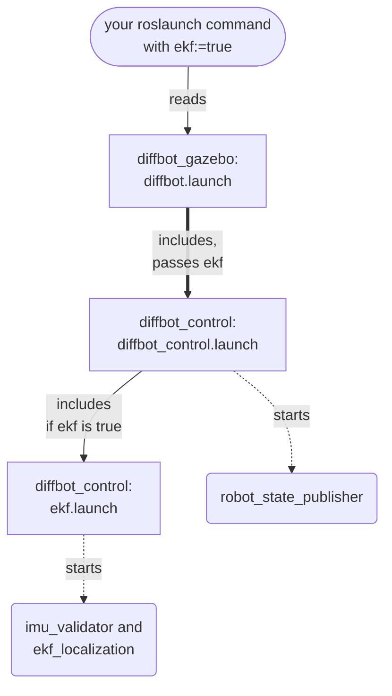
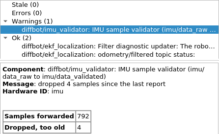

# Localization: Wheel Odometry and IMU (EKF)

DiffBot and Remo estimate how far they drove and turned from their wheels. The wheels' estimate of turning is the weak part. A wheel that slips, or a wheel separation $b$ that is a little off in the configuration, makes the estimated turn too small or too large. The wheel separation is the distance between the two drive wheels. The error in the heading then grows into an error in the position, the further the robot drives.

The estimate from the wheels is the **odometry**. The drive controller computes the odometry from the wheel encoders' angles. The odometry has two parts:

- **A pose in the `odom` frame:** the position $x$, $y$ and the heading $\theta$.
- **A velocity in the robot's own frame, `base_footprint`:** the forward speed $v_x$ and the **yaw rate** $\omega_z$, the angular velocity about the upward axis.

<a id="where-the-odom-frame-sits"></a>The figure shows where the two frames sit on the floor, seen from above. A frame is a coordinate system with a name:

- **The `odom` frame:** stays at one place. After a fresh start, its origin is where the robot stood when the odometry started.
- **The frame `base_footprint`:** moves with the robot. Its origin lies on the floor below the middle of the wheel axle. Its x axis points forward and its y axis to the left, as [REP 103's axis orientation](https://www.ros.org/reps/rep-0103.html#axis-orientation) says for a robot's body.

The position $x$, $y$ says where `base_footprint` lies along the two axes of `odom`. The heading $\theta$ is the angle from the x axis of `odom` to the robot's forward direction. The transform `odom → base_footprint` holds this pose.

--8<-- "includes/localization-odom-frame.html"

[REP 105's `odom` frame](https://www.ros.org/reps/rep-0105.html#odom) is ROS's convention for such a frame: the robot's pose in the `odom` frame changes smoothly, without jumps, but drifts over time. The `odom` frame itself is fixed in the world. What drifts is the estimate: the odometry's small errors add up, so the estimated pose moves away from the robot's true pose. During navigation on a map, [amcl](http://wiki.ros.org/amcl), the node that estimates the robot's pose on a known map, adjusts the transform `map → odom` to make up for this error. `map` is the frame of that map. The EKF alone doesn't publish `map → odom`. REP 105's section on the [relationship between the frames](https://www.ros.org/reps/rep-0105.html#relationship-between-frames) has a diagram of how the frames `map` and `odom` and the robot's base frame are attached to each other.

The IMU's gyroscope measures the turn directly. The gyroscope's yaw rate $\omega_z$ doesn't depend on the wheels.

With `ekf:=true`, an **extended Kalman filter (EKF)** from the [`robot_localization`](http://docs.ros.org/en/noetic/api/robot_localization/html/index.html) package combines both sensors:

- **The forward speed $v_x$:** the filter takes the forward speed from the wheels.
- **The yaw rate $\omega_z$:** the filter takes the yaw rate mostly from the gyroscope, because the gyroscope's variance $\sigma^2$ is far smaller than the wheels'. A variance says how far a value's errors spread. The smaller the variance, the more the filter trusts the value.

The filter publishes its estimate in two forms, which navigation and RViz use:

- on the topic `/diffbot/odometry/filtered`
- as the transform `odom → base_footprint` on the topic `/tf`

!!! warning "Not tested on the robot yet"
    The EKF runs in the simulation and in the tests that [How it's tested](#how-its-tested) lists. On Remo, the IMU's rate, axes and noise passed the [bench checks](driver-bno055.md#bench-checks), but the EKF itself hasn't run on a robot yet. Remo's URDF model in remo_description includes the IMU's position and orientation as the same bench checks confirmed them. DiffBot uses the same BNO055, but its mounting and the firmware still need checking on DiffBot. The variances that the firmware and the drive controller publish on the robot, and the IMU sample validator's time limits, are starting values, not measurements.

??? info "Reading the code on this page"
    - The excerpts on this page show fixed revisions: the diffbot repository at one commit, robot_localization 2.7.7, ros_controllers 0.22.0, gazebo_ros_pkgs 2.9.3, the navigation stack 1.17.3 and ROS's common_msgs at one commit. The line numbers are those of the original files.
    - The link in the sentence before an excerpt opens that revision and those lines on GitHub.
    - Where a section names a function, a class, a member, a setting or a file of the code, the name links to its line at that revision, or the section shows the name in an excerpt. File names of the diffbot repository link to the file's current version.

## What goes in and what comes out

Measurements go into the filter, and an estimate of the robot's motion comes out. Three terms and their symbols describe this. The figures and the formulas on this page use them:

- **The state $\mathbf{x}$:** the values that describe the robot's motion, such as its position, its heading and its velocities. These are the values that the filter is to find out. [The filter's state](#the-filters-state) lists all 15.
- **A measurement $\mathbf{z}$:** the values that one message of a sensor delivers. The index names the sensor: $\mathbf{z}_\text{wheels}$ is a measurement of the wheel odometry, and $\mathbf{z}_\text{IMU}$ is a measurement of the IMU.
- **The estimate $\hat{\mathbf{x}}$:** the filter can't know the true state $\mathbf{x}$. From the measurements, the filter computes its best guess of the state. The hat over the letter marks an estimated value.

A bold letter is a vector: the letter stands for several values at once.

<!-- TODO(theory): link the Robotics Theory page on the Kalman filter from the list above once that page exists, for example theory/state-estimation/gaussian-filters.md with a section on this notation -->

<a id="the-loop"></a>The figure shows the way of the values as a loop, in two variants. The tab **Real robot** shows the loop on the robot. The tab **Simulation** shows the same loop with Gazebo in the place of the robot's hardware. From the drive controller and the IMU sample validator on, both tabs show the same parts and topics at the same places. The topics' names in the figure leave out their namespace `/diffbot`, so `imu/data_raw` stands for the topic `/diffbot/imu/data_raw`.

Read the figure from the robot at the top down to the filter and to RViz, and then along the dashed arrows back up to the robot:

1. **The sensors:** a blue dot marks where the wheels' angles come from, and an orange square marks the IMU. $v_x$ and $\omega_z$ at the robot show the directions of the forward speed and of the yaw rate.
2. **The way to the filter:** on the real robot, the firmware on the Teensy reads both sensors. In the simulation, Gazebo computes the wheel joints' angles and the IMU sensor's values, and two Gazebo plugins pass them on. A plugin is code that Gazebo loads and runs as a part of itself. The drive controller turns the wheel angles into the wheel odometry, the measurement $\mathbf{z}_\text{wheels}$. The IMU sample validator forwards the IMU's valid samples, the measurement $\mathbf{z}_\text{IMU}$. The label at an arrow names the topic that carries the values.
3. **The filter:** the EKF fuses both measurements into its estimate $\hat{\mathbf{x}}$.
4. **The two outputs:** the EKF publishes the pose and the velocities of its estimate on a topic, and the pose as a transform. Both arrows end in a sketch of RViz with `odom` as its Fixed Frame. RViz can show the same two outputs for the real robot and for the simulation. RViz's RobotModel display places the robot where the transform puts it, and an Odometry display keeps arrows at poses of the topic's messages. The dashed line of the transform, the letters at the axes and the heading angle $\theta$ are added in the sketch to explain the pose. RViz doesn't draw them. The sketch shows the same pose as [the figure of the `odom` frame](#where-the-odom-frame-sits).
5. **The way back to the wheels:** the dashed gray arrows show the way of the velocity commands. A velocity command says how fast the robot is to drive forward and how fast the robot is to turn: the target forward speed $v_x^*$ and the target yaw rate $\omega_z^*$. The star marks a target value. A command comes from a teleop node, with which a person steers the robot, or from the planner in `move_base`, the node that computes the commands that lead the robot to a navigation goal. The planner reads the EKF's two outputs, which the thin green arrow at the figure's right edge shows. The drive controller turns each command into two target wheel speeds, the angular velocities $\omega_\text{l}^*$ for the left wheel and $\omega_\text{r}^*$ for the right wheel. On the real robot, the firmware on the Teensy drives the motors so that the wheels reach these speeds. In the simulation, the Gazebo plugin [`gazebo_ros_control`](https://github.com/ros-simulation/gazebo_ros_pkgs/blob/2.9.3/gazebo_ros_control) applies a torque $\tau$ to each wheel joint. A torque is the turning effect of a force about an axis, here the joint's axis. The robot moves, the sensors measure the motion, and the loop starts again.

--8<-- "includes/localization-loop.html"

[How it fits together](#how-it-fits-together) goes through the nodes and the topics of the figure one by one.

The formulas below write the two measurements and the published estimate as vectors, with the symbols of the figure and of [the filter's state](#the-filters-state). The position $x$, $y$ is in m, the heading $\theta$ in rad, the speeds $v_x$, $v_y$ in m/s and the yaw rate $\omega_z$ in rad/s.

The wheel odometry's measurement is the three velocities that the filter fuses from one odometry message:

$$
\mathbf{z}_\text{wheels} = (\,v_x,\ v_y,\ \omega_z\,)
$$

The IMU's measurement is the yaw rate of one validated sample:

$$
\mathbf{z}_\text{IMU} = (\,\omega_z\,)
$$

The topic carries the estimated pose in the `odom` frame and the estimated velocities in the frame `base_footprint`. With [`two_d_mode`](#what-two_d_mode-does), the height, roll, pitch and their velocities stay at 0. The message stores the orientation as a quaternion, which here holds the heading $\theta$. The six values that can differ from 0 form this vector:

$$
\hat{\mathbf{x}}_\text{published} = (\,x,\ y,\ \theta,\ v_x,\ v_y,\ \omega_z\,)
$$

The list says more about each part:

- **In, on DiffBot and Remo:** two measurements. The wheel odometry gives the forward speed $v_x$ and the yaw rate $\omega_z$ that the drive controller computes from the wheel encoders, and the sideways speed $v_y$, which the controller sets to 0 for a differential drive. The IMU gives the yaw rate $\omega_z$ that its gyroscope measures. [What the filter fuses](#what-the-filter-fuses) says why the filter takes these values and no others.
- **In, possible but not fed here:** robot_localization can fuse any number of inputs of four kinds, which are odometry, poses, velocities and IMUs. robot_localization's page on [preparing the sensor data](http://docs.ros.org/en/noetic/api/robot_localization/html/preparing_sensor_data.html) says what each kind of message has to contain. Examples of such inputs are a GPS position $x$, $y$, a pose $x$, $y$, $\theta$ from a camera, a second IMU, and more odometry, for example visual odometry. A GPS position needs a conversion first, which robot_localization's page on [integrating GPS data](http://docs.ros.org/en/noetic/api/robot_localization/html/integrating_gps.html) describes with the node `navsat_transform_node`. On DiffBot and Remo, the filter gets none of these.
- **The estimate:** robot_localization's state has 15 values. They are the position $x$, $y$, $z$, the orientation as roll, pitch and the heading $\theta$, the linear velocity $v_x$, $v_y$, $v_z$, the angular velocity $\omega_x$, $\omega_y$, $\omega_z$ and the linear acceleration $a_x$, $a_y$, $a_z$. [`two_d_mode`](#what-two_d_mode-does) keeps the height $z$, roll, pitch, their velocities $v_z$, $\omega_x$, $\omega_y$ and the vertical acceleration $a_z$ at 0, for a robot on a flat floor. Of what remains, the topic's message carries $x$, $y$, $\theta$, $v_x$, $v_y$ and $\omega_z$. The accelerations $a_x$ and $a_y$ stay inside the filter.
- **Out:** the filter publishes its estimate in two forms, because ROS nodes get a robot's motion in two ways. [The two outputs](#the-two-outputs) explains both forms and names the nodes that read each.

### The two outputs

- **The topic `/diffbot/odometry/filtered`:** carries the pose and the velocities of the filter's estimate, with their covariances, as a [`nav_msgs/Odometry`](http://docs.ros.org/en/noetic/api/nav_msgs/html/msg/Odometry.html) message. The message has the pose $x$, $y$, $\theta$ in the `odom` frame and the velocities $v_x$, $v_y$, $\omega_z$ in the robot's frame `base_footprint`. The message has no field for the accelerations of the filter's state. A node that needs the velocities or the uncertainty subscribes to this topic.
- **The transform `odom → base_footprint` on the topic `/tf`:** carries only the pose, as a translation and a rotation. A transform has no velocity and no covariance. TF, ROS's transform library, joins this transform with the robot's other transforms. So a node can ask TF where any frame of the robot is in the `odom` frame, without knowing which node estimated the pose.

The two forms hold the same pose. Each time the filter publishes, the filter builds the odometry message `filteredPosition` from its state and copies the message's pose into the transform `worldBaseLinkTransMsg_`, as [lines 1955–1965 of `ros_filter.cpp`](https://github.com/cra-ros-pkg/robot_localization/blob/ef5ad3c89457209530e262f3bac39b0f35d07b2b/src/ros_filter.cpp#L1955-L1965) in robot_localization 2.7.7 show:

??? quote "ros_filter.cpp, lines 1955–1965: the transform is a copy of the message's pose"
    ```cpp linenums="1955"
    --8<-- "https://raw.githubusercontent.com/cra-ros-pkg/robot_localization/ef5ad3c89457209530e262f3bac39b0f35d07b2b/src/ros_filter.cpp:1955:1965"
    ```

The ROS navigation stack needs the odometry in both forms. With `ekf:=true`, the EKF supplies both. Two sources say what is needed:

- **The transform:** REP 105 says in its section on [frame authorities](https://www.ros.org/reps/rep-0105.html#frame-authorities) that one of the odometry sources computes and broadcasts the transform from `odom` to the robot's base frame. So only one node may publish this transform, here the EKF.
- **Both:** the navigation stack's guide on [setting up a robot](http://wiki.ros.org/navigation/Tutorials/RobotSetup#Odometry_Information_.28odometry_source.29) says that the navigation stack requires the odometry both through TF and as a `nav_msgs/Odometry` message.

The following nodes read the two outputs when `ekf:=true`:

- **The topic:** the local planner that `move_base` and Move Base Flex load, by default [`DWAPlannerROS`](https://github.com/ros-planning/navigation/blob/1.17.3/dwa_local_planner/include/dwa_local_planner/dwa_planner_ros.h#L66), reads the robot's current velocities from the topic `/diffbot/odometry/filtered`: $v_x$, $v_y$ and $\omega_z$, the message's fields `twist.twist.linear.x`, `twist.twist.linear.y` and `twist.twist.angular.z`. [The planners' odometry topic](#the-planners-odometry-topic) shows the launch files' lines that select this topic. RViz can show the topic's poses with an Odometry display, as in [Comparing the two odometries](#comparing-the-two-odometries).
- **The transform:** everything that asks TF where the robot is. RViz places the robot in its view with the transform. amcl, which localizes the robot on a map, asks TF for the robot's pose in the `odom` frame. The planners' costmaps ask TF for the robot's pose in their own frames, the local costmap in `odom` and the global costmap in `map`. Each of these requests passes through the transform `odom → base_footprint`.

The planner's subscriber is the function `odomCallback()` of the class `OdometryHelperRos`, which copies the three velocities and `child_frame_id` from each message, as [lines 48–59 of `odometry_helper_ros.cpp`](https://github.com/ros-planning/navigation/blob/1.17.3/base_local_planner/src/odometry_helper_ros.cpp#L48-L59) in the navigation stack 1.17.3 show:

??? quote "odometry_helper_ros.cpp, lines 48–59: the velocities that the local planner reads"
    ```cpp linenums="48"
    --8<-- "https://raw.githubusercontent.com/ros-planning/navigation/1.17.3/base_local_planner/src/odometry_helper_ros.cpp:48:59"
    ```

## How it fits together

This section goes through the nodes and the topics of [the loop figure](#the-loop), in the figure's order, and says where the real robot and the simulation differ. On the way to the filter, the data takes two branches that meet at the EKF. The wheels' angles pass the drive controller, step 2 of the list. The IMU's samples pass the IMU sample validator, step 3. The sensors', the odometry's and the commands' topics are in the `/diffbot` namespace. The transform is published on the global topic `/tf`.

1. **The source of the sensors' values:** the real robot and the simulation differ here.
    - **Real robot:** the firmware on the Teensy reads the wheel encoders and the BNO055. rosserial, the connection between the Teensy and the robot's single-board computer (SBC), turns what the firmware sends into ROS topics. The firmware publishes the wheels' angles and the wheels' angular velocities $\omega_\text{l}$ and $\omega_\text{r}$, in rad/s, on the topic `/diffbot/measured_joint_states`. The firmware publishes the IMU's samples on the topic `/diffbot/imu/data_raw` at 50 Hz, as [IMU: Bosch BNO055](driver-bno055.md) explains.
    - **Simulation:** Gazebo computes the wheel joints' angles and the IMU sensor's values. The Gazebo plugin [`gazebo_ros_control`](https://github.com/ros-simulation/gazebo_ros_pkgs/blob/2.9.3/gazebo_ros_control) reads the wheel joints' angles inside Gazebo, without a topic. The IMU sensor's plugin publishes the topic `/diffbot/imu/gazebo`, and the small adapter [`imu_raw_adapter.py`]({{ diffbot_repo_url }}/diffbot_gazebo/scripts/imu_raw_adapter.py) republishes its samples on the topic `/diffbot/imu/data_raw`, as the [Simulation page's IMU section](../../diffbot_gazebo.md#inertial-measurement-unit-imu) explains.
2. **The wheels' branch, the drive controller:** [`mobile_base_controller`]({{ ekf_src_url }}/diffbot_control/config/diffbot_control.yaml#L23), a [diff_drive_controller](http://wiki.ros.org/diff_drive_controller), computes the wheel odometry from the wheels' angles and publishes the wheel odometry on the topic `/diffbot/mobile_base_controller/odom`. On the real robot, the drive controller runs in the node `diffbot_base`, whose hardware interface takes the wheels' angles from the topic `/diffbot/measured_joint_states`. In the simulation, the drive controller runs inside Gazebo, in `gazebo_ros_control`. With the EKF on, the drive controller doesn't publish the transform `odom → base_footprint`. Two nodes that publish the same transform would make the robot's pose jump between their two estimates.
3. **The IMU's branch, the IMU sample validator:** the node [`imu_validator.py`]({{ diffbot_repo_url }}/diffbot_control/scripts/imu_validator.py) subscribes to the topic `/diffbot/imu/data_raw`. The validator checks each sample against what this EKF configuration needs and forwards the valid samples, unchanged, on the topic `/diffbot/imu/data_validated`. [The IMU sample validator](#the-imu-sample-validator) lists its checks.
4. **The EKF:** the node `/diffbot/ekf_localization` subscribes to the wheel odometry on the topic `/diffbot/mobile_base_controller/odom` and to the validated samples on the topic `/diffbot/imu/data_validated`. The EKF fuses the two. The EKF publishes the filtered odometry on the topic `/diffbot/odometry/filtered` and the transform `odom → base_footprint` on the topic `/tf`.
5. **The readers of the two outputs:** RViz can show both outputs, as in the figure's sketch, for the real robot and for the simulation alike. For the topic, RViz needs an Odometry display, which [Comparing the two odometries](#comparing-the-two-odometries) sets up. The planner in `move_base` or in Move Base Flex reads both outputs too. [The two outputs](#the-two-outputs) names every node that reads them.
6. **The velocity commands:** a node that wants the robot to move publishes [`geometry_msgs/Twist`](http://docs.ros.org/en/noetic/api/geometry_msgs/html/msg/Twist.html) messages on the topic `/diffbot/mobile_base_controller/cmd_vel`. The drive controller subscribes to this topic and uses two values of a command: `linear.x`, the target forward speed $v_x^*$ in m/s, and `angular.z`, the target yaw rate $\omega_z^*$ in rad/s. The launch files of the diffbot repository start three kinds of nodes that publish commands:
    - **A teleop node for the keyboard:** [`keyboard_teleop.launch`]({{ diffbot_repo_url }}/diffbot_bringup/launch/keyboard_teleop.launch) starts `teleop_twist_keyboard`, which turns key presses into commands.
    - **A teleop window:** in the simulation, [`diffbot_control.launch`]({{ diffbot_repo_url }}/diffbot_control/launch/diffbot_control.launch) starts `rqt_robot_steering`, a window with sliders to drive the robot.
    - **The planner:** `move_base` and Move Base Flex compute the commands that lead the robot to a goal. With `ekf:=true`, the planner reads the EKF's two outputs, so the EKF's estimate is part of the loop. [The planners' odometry topic](#the-planners-odometry-topic) shows the lines that connect the planner to both topics.

    The EKF doesn't read the velocity commands. robot_localization can use the commands in its prediction with the setting [`use_control`](https://docs.ros.org/en/noetic/api/robot_localization/html/state_estimation_nodes.html#use-control), whose default is `false`. [`ekf.yaml`]({{ diffbot_repo_url }}/diffbot_control/config/ekf.yaml) doesn't set `use_control`, so the figure has no arrow from the commands to the EKF.

7. **The way back to the wheels:** the drive controller first limits the command's velocities and accelerations to the limits in [`diffbot_control.yaml`]({{ diffbot_repo_url }}/diffbot_control/config/diffbot_control.yaml). From the limited command, the drive controller computes two target wheel speeds in rad/s, the angular velocities $\omega_\text{l}^*$ for the left wheel and $\omega_\text{r}^*$ for the right wheel:

    $$
    \omega_\text{l}^* = \frac{v_x^* - \omega_z^* \, b / 2}{r}, \qquad \omega_\text{r}^* = \frac{v_x^* + \omega_z^* \, b / 2}{r}
    $$

    $b$ is the wheel separation and $r$ is the wheel radius, both in m. The real robot and the simulation differ in what happens to the two targets.

    - **Real robot:** the hardware interface in the node `diffbot_base` publishes the two targets on the topic `/diffbot/wheel_cmd_velocities`. The firmware on the Teensy receives them through rosserial. For each motor, a [proportional–integral–derivative (PID) controller](../diffbot_base/pid.md) in the firmware compares the wheel's target with the wheel's angular velocity that the encoder measures, $\omega_\text{l}$ or $\omega_\text{r}$, and sets the motor driver's output for this motor. [Low-Level PID Approach](../diffbot_base/low-level.md) explains the firmware.
    - **Simulation:** `gazebo_ros_control` gets the two targets inside Gazebo, without a topic. For each wheel joint, a PID controller of `gazebo_ros_control` compares the target with the joint's angular velocity and applies a torque $\tau$ in N m to the joint. [Turning a wheel-speed command into torque](../../theory/modeling-control/wheel-dynamics-simulation.md#turning-a-wheel-speed-command-into-torque) explains this PID controller. The controller's gains are in the robot's `pid.yaml`, for Remo [`diffbot_control/config/remo/pid.yaml`]({{ diffbot_repo_url }}/diffbot_control/config/remo/pid.yaml).

    The wheels turn, the robot moves, and the sensors of step 1 measure the motion.

The collapsed box shows the code of step 7, from a velocity command to the wheels.

??? quote "The way back in the code: from a velocity command to the wheels"
    The table lists the quantities of step 7 with their names in the code of the four excerpts:

    | Symbol | Unit | Quantity | Names in the code |
    |:--|:--|:--|:--|
    | $v_x^*$ | m/s | target forward speed, after the limits | `curr_cmd.lin` |
    | $\omega_z^*$ | rad/s | target yaw rate, after the limits | `curr_cmd.ang` |
    | $b$ | m | wheel separation | `ws` |
    | $r$ | m | wheel radius | `lwr` for the left wheel, `rwr` for the right wheel |
    | $\omega_\text{l}^*$, $\omega_\text{r}^*$ | rad/s | target wheel speeds | `vel_left` and `vel_right`, `joint_velocity_commands_`, `wheel_cmd_velocity_left_` and `wheel_cmd_velocity_right_`, `joint_velocity_command_` |
    | $\omega_\text{l}$, $\omega_\text{r}$ | rad/s | measured wheel speeds | `angular_velocity_` of `joint_state_left_` and `joint_state_right_`, `joint_velocity_` |
    | $\tau$ | N m | torque on a wheel joint | `effort` |

    The drive controller's function [`update()`](https://github.com/ros-controls/ros_controllers/blob/0.22.0/diff_drive_controller/src/diff_drive_controller.cpp#L391) computes `vel_left` and `vel_right`, the two target wheel speeds, from `curr_cmd.lin` and `curr_cmd.ang`, the limited command, the wheel separation `ws` and the wheel radii `lwr` and `rwr`. `setCommand()` hands each target to the hardware interface, as [lines 491–500 of `diff_drive_controller.cpp`](https://github.com/ros-controls/ros_controllers/blob/0.22.0/diff_drive_controller/src/diff_drive_controller.cpp#L491-L500) in ros_controllers 0.22.0 show:

    ```cpp linenums="491"
    --8<-- "https://raw.githubusercontent.com/ros-controls/ros_controllers/0.22.0/diff_drive_controller/src/diff_drive_controller.cpp:491:500"
    ```

    On the real robot, the control loop of the node `diffbot_base` calls the hardware interface's function [`DiffBotHWInterface::write()`]({{ ekf_src_url }}/diffbot_base/src/diffbot_hw_interface.cpp#L163) after each `update()` of the drive controller. `write()` first scales the left target by `(gain_ - trim_) / motor_constant_` and the right target by `(gain_ + trim_) / motor_constant_`. Both factors are 1 with the settings `gain`, `trim` and `motor_constant` in [`base.yaml`, lines 6–8]({{ ekf_src_url }}/diffbot_base/config/base.yaml#L6-L8). `write()` then copies the two targets from `joint_velocity_commands_` into the message `wheel_cmd_msg` and publishes the message, as [lines 169–186 of `diffbot_hw_interface.cpp`]({{ ekf_src_url }}/diffbot_base/src/diffbot_hw_interface.cpp#L169-L186) show:

    ```cpp linenums="169"
    --8<-- "{{ ekf_src_raw }}/diffbot_base/src/diffbot_hw_interface.cpp:169:186"
    ```

    In the firmware, the function [`WheelControl::step()`]({{ ekf_src_url }}/diffbot_firmware/lib/wheel_control/wheel_control.h#L86) calls [`BaseController::read()`]({{ ekf_src_url }}/diffbot_firmware/lib/base_controller/base_controller.h#L447) on each control step. `WheelControl::step()` then calls [`BaseController::write()`]({{ ekf_src_url }}/diffbot_firmware/lib/base_controller/base_controller.h#L470), unless the last command is older than the command timeout. `BaseController::write()` computes the two motor outputs `motor_cmd_left_` and `motor_cmd_right_` with the PID controllers `motor_pid_left_` and `motor_pid_right_`. Each PID controller gets its wheel's target, `wheel_cmd_velocity_left_` or `wheel_cmd_velocity_right_`, and the wheel's measured `angular_velocity_`. `setSpeed()` passes each output to the motor driver, as [lines 484–488 of `base_controller.h`]({{ ekf_src_url }}/diffbot_firmware/lib/base_controller/base_controller.h#L484-L488) show:

    ```cpp linenums="484"
    --8<-- "{{ ekf_src_raw }}/diffbot_firmware/lib/base_controller/base_controller.h:484:488"
    ```

    In the simulation, the update callback of `gazebo_ros_control`, [`GazeboRosControlPlugin::Update()`](https://github.com/ros-simulation/gazebo_ros_pkgs/blob/2.9.3/gazebo_ros_control/src/gazebo_ros_control_plugin.cpp#L211), calls [`DefaultRobotHWSim::readSim()`](https://github.com/ros-simulation/gazebo_ros_pkgs/blob/2.9.3/gazebo_ros_control/src/default_robot_hw_sim.cpp#L261), then the controllers' `update()` and then [`DefaultRobotHWSim::writeSim()`](https://github.com/ros-simulation/gazebo_ros_pkgs/blob/2.9.3/gazebo_ros_control/src/default_robot_hw_sim.cpp#L285). `writeSim()` computes the `error` between the target `joint_velocity_command_` and the joint's velocity `joint_velocity_`. The PID controller `pid_controllers_` turns the error into the torque `effort`, which `clamp()` keeps within the joint's effort limit. `SetForce()` applies the torque to Gazebo's joint, as [lines 370–380 of `default_robot_hw_sim.cpp`](https://github.com/ros-simulation/gazebo_ros_pkgs/blob/2.9.3/gazebo_ros_control/src/default_robot_hw_sim.cpp#L370-L380) in gazebo_ros_pkgs 2.9.3 show:

    ```cpp linenums="370"
    --8<-- "https://raw.githubusercontent.com/ros-simulation/gazebo_ros_pkgs/2.9.3/gazebo_ros_control/src/default_robot_hw_sim.cpp:370:380"
    ```

[`ekf.launch`]({{ diffbot_repo_url }}/diffbot_control/launch/ekf.launch) in `diffbot_control` starts the validator and the EKF, for the robot and the simulation alike.

## Running it

The `ekf` argument switches the EKF on. The EKF is off by default. Pass `ekf:=true` to the launch file that you start:

| Where | Command |
|:--|:--|
| On the robot, when you start the bringup yourself | `roslaunch diffbot_bringup bringup.launch model:=remo ekf:=true` (or [`bringup_with_laser.launch`]({{ diffbot_repo_url }}/diffbot_bringup/launch/bringup_with_laser.launch)) |
| In the simulation | `roslaunch diffbot_gazebo diffbot.launch model:=remo ekf:=true` |
| Simulation with navigation | `roslaunch diffbot_navigation diffbot.launch model:=remo ekf:=true` |
| Navigation on the development PC, for a robot that runs with the EKF | `roslaunch diffbot_navigation diffbot_hw.launch model:=remo ekf:=true` |

### Which launch file starts what

A `roslaunch` command names one launch file. roslaunch reads that file and every file that it includes with the [`<include>` tag](http://wiki.ros.org/roslaunch/XML/include), directly or through another included file. roslaunch starts the nodes that these files declare. A node is a running ROS program. A file can pass arguments such as `ekf` to a file that it includes. Starting an included file on its own doesn't read the file that includes it.

The two figures show which launch file includes which, and which file declares which node, one figure for the real robot and one for the simulation. The figures show only the launch files and the nodes that matter for the EKF. The same command reads more files and starts more nodes, and the text below each figure names them. The figures don't show the order in which the nodes start.

Read the figures as follows:

- **The pill-shaped box:** your command.
- **A rectangle:** a launch file, written as its package and its file name.
- **A rounded rectangle:** the node or the two nodes that a file starts.
- **A thick arrow:** an include that passes `ekf` to the included file.
- **The node with the thick orange border:** `robot_state_publisher`, which the EKF needs.
- **The badge above a figure:** says whether the figure is for the real robot or for the simulation.

#### On the real robot

When you start the bringup yourself, you start one of the two bringup files. This command is for Remo. For DiffBot, use `model:=diffbot`:

```console
roslaunch diffbot_bringup bringup.launch model:=remo ekf:=true
```

!!! note "With the robot container"
    In the [robot container](../../processing_units/robot-container/usage.md), Docker Compose starts [`bringup.launch`]({{ diffbot_repo_url }}/diffbot_bringup/launch/bringup.launch) for you, without `ekf`, as the `bringup` service's command in [`compose.yaml`]({{ diffbot_repo_url }}/.docker/robot/compose.yaml) says. So `robot_state_publisher` runs there and the EKF is off. The container's settings have no switch for the EKF. The issue [Robot container: a setting that starts the bringup with the EKF (diffbot#202)](https://github.com/ros-mobile-robots/diffbot/issues/202) asks for such a setting. Don't start a second bringup by hand next to the container's.

The figure shows which files this command reads on the real robot and which nodes they start:

<p class="lv-badge-line"><span class="lv-badge">Real robot</span></p>


This command also starts the following nodes, which the figure leaves out:

- **rosserial:** [`minimal.launch`]({{ diffbot_repo_url }}/diffbot_bringup/launch/minimal.launch) also starts rosserial, the connection to the Teensy.
- **The hardware interface:** [`diffbot_base/launch/diffbot.launch`]({{ diffbot_repo_url }}/diffbot_base/launch/diffbot.launch) also starts the hardware interface `diffbot_base`, which runs the drive controller.
- **The lidar:** [`bringup_with_laser.launch`]({{ diffbot_repo_url }}/diffbot_bringup/launch/bringup_with_laser.launch) does the same as [`bringup.launch`]({{ diffbot_repo_url }}/diffbot_bringup/launch/bringup.launch) and also starts the lidar.

`minimal.launch` takes the `ekf` argument because the bringup files pass `ekf` through `minimal.launch`. Starting `minimal.launch` on its own with `ekf:=true` doesn't read the bringup file, so nothing starts `robot_state_publisher`. Without another publisher that provides the transform between `imu_link` and `base_footprint`, the EKF can't use the IMU's samples, and the EKF's estimate follows the wheels.

#### In the simulation

In the simulation, you start `diffbot_gazebo`'s [`diffbot.launch`]({{ diffbot_repo_url }}/diffbot_gazebo/launch/diffbot.launch):

```console
roslaunch diffbot_gazebo diffbot.launch model:=remo ekf:=true
```

The figure shows which files this command reads in the simulation and which nodes they start:

<p class="lv-badge-line"><span class="lv-badge">Simulation</span></p>



This command also reads one more file, which the figure leaves out. [`diffbot_gazebo/launch/diffbot.launch`]({{ diffbot_repo_url }}/diffbot_gazebo/launch/diffbot.launch) also includes [`diffbot_view.launch`]({{ diffbot_repo_url }}/diffbot_gazebo/launch/diffbot_view.launch). That file starts Gazebo through gazebo_ros's [`empty_world.launch`](https://github.com/ros-simulation/gazebo_ros_pkgs/blob/2.9.3/gazebo_ros/launch/empty_world.launch), the adapter [`imu_raw_adapter.py`]({{ diffbot_repo_url }}/diffbot_gazebo/scripts/imu_raw_adapter.py) and the node that puts the robot into Gazebo. Gazebo runs the drive controller.

#### What the launch files do with `ekf`

The file at the end of the thick arrows uses the `ekf` value. On the real robot, that file is [`diffbot_base/launch/diffbot.launch`]({{ diffbot_repo_url }}/diffbot_base/launch/diffbot.launch). In the simulation, that file is [`diffbot_control.launch`]({{ diffbot_repo_url }}/diffbot_control/launch/diffbot_control.launch). Each of these two launch files loads the drive controller's configuration and then does two things with its `ekf` value, in two lines. The excerpt shows the two lines, from [`diffbot_base/launch/diffbot.launch`, lines 45–46]({{ ekf_src_url }}/diffbot_base/launch/diffbot.launch#L45-L46). `diffbot_control.launch` has the same two lines:

```xml title="diffbot_base/launch/diffbot.launch: the two lines that use ekf" linenums="45"
--8<-- "{{ ekf_src_raw }}/diffbot_base/launch/diffbot.launch:45:46"
```

1. **Line 45 sets the drive controller's parameter `enable_odom_tf`:** the parameter says whether the drive controller publishes the transform `odom → base_footprint`. The line's value stands at the line's end: `$(eval not arg('ekf'))`, which turns the value of `ekf` around. So the line writes `false` with the EKF and `true` without the EKF. With the EKF, the EKF publishes the transform, and the drive controller must not.
2. **Line 46 includes [`ekf.launch`]({{ diffbot_repo_url }}/diffbot_control/launch/ekf.launch):** the file starts the validator and the EKF. The line includes the file only if `ekf` is true.

Line 45 writes the parameter in both cases, also the `true`, for this reason: a parameter stays on the ROS parameter server as long as the ROS master runs, also after the launch that wrote the parameter has ended. Suppose that the line wrote only the `false`, and only with the EKF. Then this sequence would go wrong:

1. You start the robot with `ekf:=true`. The line writes `enable_odom_tf: false`.
2. You stop this launch. The ROS master keeps running, for example because you started `roscore` on its own. The `false` stays on the parameter server.
3. You start the robot again, without the EKF. Nothing writes the parameter, so the drive controller reads the old `false` and doesn't publish the transform. No EKF runs either. Nothing publishes `odom → base_footprint`.

Because line 45 writes `true` without the EKF, every start sets the value that fits.

`robot_state_publisher`, the node with the thick orange border in the figures, publishes the transforms of the joints in the robot's URDF model. From these transforms, TF gets the transform between the IMU's frame `imu_link` and `base_footprint`. The EKF needs this transform to turn the IMU's yaw rate $\omega_z$ into the robot's frame.

#### The planners' odometry topic

The navigation launch files pass `ekf` on in the same way. [`diffbot_navigation/launch/diffbot.launch`]({{ diffbot_repo_url }}/diffbot_navigation/launch/diffbot.launch) includes `diffbot_gazebo`'s [`diffbot.launch`]({{ diffbot_repo_url }}/diffbot_gazebo/launch/diffbot.launch) and [`move_base.launch`]({{ diffbot_repo_url }}/diffbot_navigation/launch/move_base.launch) and passes `ekf` to both.

`move_base.launch` starts no EKF. The file uses its `ekf` argument to choose the odometry topic that the planner reads. Line 8 computes the default of the argument `odom_topic` from `ekf`: `/diffbot/odometry/filtered` with the EKF, and the wheel odometry's topic `/diffbot/mobile_base_controller/odom` without the EKF. The excerpt shows the two arguments in lines 7 and 8, and above them the argument `cmd_vel_topic` for the topic of the planner's velocity commands, from [`move_base.launch`, lines 6–8]({{ ekf_src_url }}/diffbot_navigation/launch/move_base.launch#L6-L8):

```xml title="move_base.launch: the odometry topic follows ekf" linenums="6"
--8<-- "{{ ekf_src_raw }}/diffbot_navigation/launch/move_base.launch:6:8"
```

The planner subscribes to a topic named `odom`. Line 28 remaps this name to the topic of `odom_topic`, as the excerpt of the node's two remappings shows, from [`move_base.launch`, lines 27–28]({{ ekf_src_url }}/diffbot_navigation/launch/move_base.launch#L27-L28):

```xml title="move_base.launch: the planner's odom is the chosen topic" linenums="27"
--8<-- "{{ ekf_src_raw }}/diffbot_navigation/launch/move_base.launch:27:28"
```

Line 27 connects the planner's output in the same way. The planner publishes its velocity commands on a topic named `cmd_vel`. Line 27 remaps this name to the topic of `cmd_vel_topic`, `/diffbot/mobile_base_controller/cmd_vel`, to which the drive controller subscribes. [The loop figure](#the-loop) shows both connections.

So with `ekf:=true`, the planner's velocities and the transform come from the same estimate. Two more files work in the same way:

- **Move Base Flex:** [`move_base.launch.xml`]({{ diffbot_repo_url }}/diffbot_mbf/launch/includes/move_base.launch.xml) has the same argument and the same remapping, as the collapsed box shows.
- **Navigation for the real robot:** [`diffbot_hw.launch`]({{ diffbot_repo_url }}/diffbot_navigation/launch/diffbot_hw.launch) starts no EKF. Its `ekf` argument only selects the odometry that the planner reads, for a robot whose bringup runs with `ekf:=true`.

??? quote "move_base.launch.xml: the same lines for Move Base Flex"
    The excerpt shows the three arguments, from [`move_base.launch.xml`, lines 5–7]({{ ekf_src_url }}/diffbot_mbf/launch/includes/move_base.launch.xml#L5-L7):

    ```xml linenums="5"
    --8<-- "{{ ekf_src_raw }}/diffbot_mbf/launch/includes/move_base.launch.xml:5:7"
    ```

    The next excerpt shows the two remappings, from [`move_base.launch.xml`, lines 28–29]({{ ekf_src_url }}/diffbot_mbf/launch/includes/move_base.launch.xml#L28-L29):

    ```xml linenums="28"
    --8<-- "{{ ekf_src_raw }}/diffbot_mbf/launch/includes/move_base.launch.xml:28:29"
    ```

### Comparing the two odometries

To see what the filter does, compare the two odometries while the robot turns:

- **The wheel odometry:** the drive controller's estimate, on the topic `/diffbot/mobile_base_controller/odom`.
- **The filtered odometry:** the EKF's estimate, on the topic `/diffbot/odometry/filtered`.

You can compare them in two ways:

- **In RViz:** set RViz's Fixed Frame to `odom`. Add one Odometry display for each of the two topics, and give the two displays different colors. Four settings of an Odometry display matter for a small robot. The source of RViz 1.14.26's [Odometry display](https://github.com/ros-visualization/rviz/blob/1.14.26/src/rviz/default_plugin/odometry_display.cpp) defines their defaults and the rule for adding an arrow:
    - **Keep:** the number of arrows that the display keeps. The default is 100, and 0 keeps all arrows.
    - **Position Tolerance and Angle Tolerance:** the display adds a new arrow only when the pose has moved by at least one of the two tolerances since the last arrow. The defaults are 0.1 m and 0.1 rad.
    - **Shaft Length, Shaft Radius, Head Length and Head Radius:** the size of an arrow. The default arrow is 1.3 m long, far longer than the robot.
    - **Covariance:** the display also draws each pose's covariance by default. Switch this setting off to see the arrows alone.
- **In a terminal:** print the yaw rate $\omega_z$ of both topics side by side, with `rostopic echo /diffbot/mobile_base_controller/odom/twist/twist/angular/z` and `rostopic echo /diffbot/odometry/filtered/twist/twist/angular/z`.

The picture shows such a comparison in RViz, for the simulated Remo with `ekf:=true`. The robot drove 1.5 s straight, then a left arc of 5 s, then 1.5 s straight again, at 0.2 m/s and with a commanded yaw rate of 0.5 rad/s in the arc. What the picture shows:

- **Blue arrows:** the wheel odometry, as an Odometry display with Keep 2000 and a Position Tolerance of 0.045 m.
- **Green arrows:** the filtered odometry, as a second Odometry display with Keep 2000 and a Position Tolerance of 0.09 m. The larger tolerance spaces the green arrows more widely along the path. Both displays have an Angle Tolerance of 0.5 rad.
- **White band:** the robot's true path in Gazebo. A small script outside the repository republishes Gazebo's topic `/gazebo/model_states` in the `odom` frame for the picture.
- **The robot:** RViz draws the robot at the pose of the transform `odom → base_footprint`, which is the EKF's estimate. The robot appears with the collision shapes of Remo's URDF model.

<figure markdown="span">
{ width="520" }
<figcaption>RViz from above after the drive, with the Gazebo test's wheel separation in the drive controller. The grid's cells are 0.1 m wide. The legend was added to the screenshot. The run was in a container of the dev container's image, at the commit <code>ead3402</code> of the diffbot repository.</figcaption>
</figure>

The two paths differ in this run for a reason. The picture's run has the set-up of the Gazebo test of [How it's tested](#how-its-tested). The drive controller works with a wheel separation of 0.18 m instead of Remo's 0.144 m. The controller then turns the robot 25 % more than its wheel odometry reports. So the wheel odometry's heading falls behind in the arc, and its path leaves the true path. The EKF takes the yaw rate $\omega_z$ mostly from the gyroscope, which measures the robot's real turn, so the EKF's path stays on the true path. The values at the end of the drive:

- **The wheel odometry:** its heading $\theta$ is 0.62 rad behind the true heading, and its position is 0.40 m away from the true position.
- **The EKF:** its heading $\theta$ differs from the true heading by 0.004 rad, and its position by 2 mm.

With the robot's own wheel separation, the two odometries hardly differ in this drive. In three runs of the same drive in the simulation, the wheel odometry ended within 0.5 mm of the true position, and the EKF's estimate ended within 0.005 rad and 9 mm of the wheel odometry. In these three runs, the EKF's estimate was not closer to the true pose at the end than the wheel odometry. So the picture needs a wheel odometry that is wrong. The wrong wheel separation stands in for an error of the wheel odometry that the gyroscope doesn't share.

## What the filter fuses

[`ekf.yaml`]({{ diffbot_repo_url }}/diffbot_control/config/ekf.yaml) configures the filter. For each input, a list of 15 booleans says which values of the input's messages the filter fuses: [`odom0_config`]({{ ekf_src_url }}/diffbot_control/config/ekf.yaml#L55-L59) for the wheel odometry and [`imu0_config`]({{ ekf_src_url }}/diffbot_control/config/ekf.yaml#L74-L78) for the IMU. [The two lists](#the-two-lists) shows both lists.

To **fuse** means that the filter corrects its estimate $\hat{\mathbf{x}}$ with a measurement $\mathbf{z}$. One measurement can hold several values, for example the wheel odometry's three velocities, and the filter uses them together in one correction. Each value counts by its certainty. The filter computes the weights from two uncertainties: the covariance of the measurement, which holds the variance $\sigma^2$ of each of its values, and the covariance of the filter's own estimate. The smaller a measured value's variance is next to the estimate's uncertainty, the closer the estimate moves to the measured value.

After its first measurement, the filter repeats two steps for every measurement that is newer than the measurement before:

1. **Prediction:** the filter moves its estimate forward to the time of the next measurement, with a model of how the robot moves. The estimate's uncertainty grows.
2. **Correction:** the filter fuses the measurement. The uncertainty of the fused values shrinks.

For a measurement that is not newer, the filter skips the prediction, as [Why the EKF needs the validator](#why-the-ekf-needs-the-validator) explains.

The paper on robot_localization, [A Generalized Extended Kalman Filter Implementation for the Robot Operating System](http://docs.ros.org/en/noetic/api/robot_localization/html/_downloads/1c51b4cda4ceb8a27476715a980a5ec2/robot_localization_ias13_revised.pdf) by Moore and Stouch, gives the formulas of both steps.

<!-- TODO(theory): link the Robotics Theory page on the Kalman filter, the EKF and the UKF here once that page exists, for example theory/state-estimation/gaussian-filters.md with its sections on the prediction and the correction -->

### The filter's state

The 15 booleans stand for the 15 variables that robot_localization's filter estimates, its **state** $\mathbf{x}$:

$$
\mathbf{x} = (\,x,\ y,\ z,\ \text{roll},\ \text{pitch},\ \theta,\ v_x,\ v_y,\ v_z,\ \omega_x,\ \omega_y,\ \omega_z,\ a_x,\ a_y,\ a_z\,)
$$

The table shows the state's five groups of three variables, with the labels that the comments in [`ekf.yaml`]({{ diffbot_repo_url }}/diffbot_control/config/ekf.yaml) use and the names on [robot_localization's parameter page](https://docs.ros.org/en/noetic/api/robot_localization/html/state_estimation_nodes.html#sensor-config), which gives the same order:

| Group | Symbols | Unit | Labels in `ekf.yaml` | Names on the parameter page |
|:--|:--|:--|:--|:--|
| Position | $x$, $y$, $z$ | m | `x`, `y`, `z` | $X$, $Y$, $Z$ |
| Orientation | roll, pitch, heading $\theta$ | rad | `roll`, `pitch`, `yaw` | roll, pitch, yaw |
| Linear velocity | $v_x$, $v_y$, $v_z$ | m/s | `vx`, `vy`, `vz` | $\dot X$, $\dot Y$, $\dot Z$ |
| Angular velocity | $\omega_x$, $\omega_y$, $\omega_z$ | rad/s | `vroll`, `vpitch`, `vyaw` | the rates of roll, pitch and yaw |
| Linear acceleration | $a_x$, $a_y$, $a_z$ | m/s² | `ax`, `ay`, `az` | $\ddot X$, $\ddot Y$, $\ddot Z$ |

The position and the orientation are the robot's pose in the filter's [`world_frame`]({{ ekf_src_url }}/diffbot_control/config/ekf.yaml#L23), here `odom`. The velocities and the acceleration are in the robot's own frame, the filter's [`base_link_frame`]({{ ekf_src_url }}/diffbot_control/config/ekf.yaml#L20), here `base_footprint`. The yaw rate $\omega_z$ is the rate at which the heading $\theta$ changes.

### The two lists

The excerpt shows the wheel odometry's topic and list, from [`ekf.yaml`, lines 54–59]({{ ekf_src_url }}/diffbot_control/config/ekf.yaml#L54-L59). Each row of the list is one group of the state, and the comment at the end of a row names the row's three variables:

```yaml title="ekf.yaml: the wheel odometry's topic and list" linenums="54"
--8<-- "{{ ekf_src_raw }}/diffbot_control/config/ekf.yaml:54:59"
```

The next excerpt shows the IMU's topic and list, from [`ekf.yaml`, lines 73–78]({{ ekf_src_url }}/diffbot_control/config/ekf.yaml#L73-L78):

```yaml title="ekf.yaml: the IMU's topic and list" linenums="73"
--8<-- "{{ ekf_src_raw }}/diffbot_control/config/ekf.yaml:73:78"
```

The figure shows both lists in the file's layout. A green cell with a check mark is a `true`: the filter fuses this value from the input. A plain cell is a `false`: the filter ignores this value of the input, even when the message carries it. A dashed cell belongs to a variable that [`two_d_mode`](#what-two_d_mode-does) keeps at 0, whatever the list says.

--8<-- "includes/localization-fused-values.html"

The filter fuses four values, the four cells with a check mark in the figure. The list below describes each of the four values with three entries:

- **Message field:** the field of the input's message that carries the value, of a [`nav_msgs/Odometry`](https://github.com/ros/common_msgs/blob/092bc230c8153dd4cfee0c84c9796cc7e6b09fdb/nav_msgs/msg/Odometry.msg) message for the wheel odometry and of a [`sensor_msgs/Imu`](https://github.com/ros/common_msgs/blob/092bc230c8153dd4cfee0c84c9796cc7e6b09fdb/sensor_msgs/msg/Imu.msg) message for the IMU.
- **Variance:** the element of the message's covariance that holds the value's variance $\sigma^2$, and the variance's number.
- **Frame:** the coordinate frame in which the message gives the value.

The filter fuses these four values:

1. **Forward speed $v_x$, from the wheel odometry:**
    - Message field: `twist.twist.linear.x`
    - Variance: `twist.covariance[0]`, 0.001 (m/s)²
    - Frame: `base_footprint`
2. **Sideways speed $v_y$, from the wheel odometry:**
    - Message field: `twist.twist.linear.y`
    - Variance: `twist.covariance[7]`, 0.001 (m/s)²
    - Frame: `base_footprint`
3. **Yaw rate $\omega_z$, from the wheel odometry:**
    - Message field: `twist.twist.angular.z`
    - Variance: `twist.covariance[35]`, 0.03 (rad/s)²
    - Frame: `base_footprint`
4. **Yaw rate $\omega_z$, from the IMU:**
    - Message field: `angular_velocity.z`
    - Variance: `angular_velocity_covariance[8]`, 4 · 10⁻⁴ (rad/s)² on the robot and 2.5 · 10⁻⁵ (rad/s)² in the simulation
    - Frame: `imu_link`, rotated into `base_footprint`

The next three sections explain the entries: the messages with their fields, the variances, and the frames.

#### The messages and their fields

The wheel odometry arrives as [`nav_msgs/Odometry`](http://docs.ros.org/en/noetic/api/nav_msgs/html/msg/Odometry.html) messages on the topic `/diffbot/mobile_base_controller/odom`. The collapsed box shows the message's definition, from [`Odometry.msg`](https://github.com/ros/common_msgs/blob/092bc230c8153dd4cfee0c84c9796cc7e6b09fdb/nav_msgs/msg/Odometry.msg) in ROS's common_msgs, and the definition of the type of its field `twist`, from [`TwistWithCovariance.msg`](https://github.com/ros/common_msgs/blob/092bc230c8153dd4cfee0c84c9796cc7e6b09fdb/geometry_msgs/msg/TwistWithCovariance.msg):

??? quote "Odometry.msg and TwistWithCovariance.msg: the wheel odometry's message"
    ```text title="nav_msgs/msg/Odometry.msg" linenums="1"
    --8<-- "https://raw.githubusercontent.com/ros/common_msgs/092bc230c8153dd4cfee0c84c9796cc7e6b09fdb/nav_msgs/msg/Odometry.msg"
    ```

    ```text title="geometry_msgs/msg/TwistWithCovariance.msg" linenums="1"
    --8<-- "https://raw.githubusercontent.com/ros/common_msgs/092bc230c8153dd4cfee0c84c9796cc7e6b09fdb/geometry_msgs/msg/TwistWithCovariance.msg"
    ```

Of an odometry message, the filter uses these fields:

- **`header.stamp`:** the time of the measurement.
- **`child_frame_id`:** the frame of the velocities, here `base_footprint`.
- **`twist.twist`:** the velocities. `twist.twist.linear.x` is the forward speed $v_x$, `twist.twist.linear.y` is the sideways speed $v_y$ and `twist.twist.angular.z` is the yaw rate $\omega_z$.
- **`twist.covariance`:** the covariance of the velocities, 36 numbers.

The filter doesn't read the message's `pose`, because [`odom0_config`]({{ ekf_src_url }}/diffbot_control/config/ekf.yaml#L55-L59) fuses no pose value.

The IMU's samples arrive as [`sensor_msgs/Imu`](http://docs.ros.org/en/noetic/api/sensor_msgs/html/msg/Imu.html) messages on the topic `/diffbot/imu/data_validated`. The collapsed box shows the message's definition with its comments, from [`Imu.msg`](https://github.com/ros/common_msgs/blob/092bc230c8153dd4cfee0c84c9796cc7e6b09fdb/sensor_msgs/msg/Imu.msg) in ROS's common_msgs:

??? quote "Imu.msg: the IMU's message"
    ```text title="sensor_msgs/msg/Imu.msg" linenums="1"
    --8<-- "https://raw.githubusercontent.com/ros/common_msgs/092bc230c8153dd4cfee0c84c9796cc7e6b09fdb/sensor_msgs/msg/Imu.msg"
    ```

Of an IMU sample, the filter uses these fields:

- **`header.stamp`:** the time of the measurement.
- **`header.frame_id`:** the frame of the values, here `imu_link`.
- **`angular_velocity`:** the angular velocity about the three axes of `imu_link`. After the rotation into `base_footprint`, its z component is the yaw rate $\omega_z$.
- **`angular_velocity_covariance`:** the covariance of the angular velocity, 9 numbers.

The filter doesn't read the sample's `orientation` and `linear_acceleration`, because [`imu0_config`]({{ ekf_src_url }}/diffbot_control/config/ekf.yaml#L74-L78) fuses no orientation and no acceleration.

#### The variances

A covariance matrix $\boldsymbol\Sigma$ holds the uncertainties of several values at once. Its element in row $i$ and column $j$ is the covariance of the $i$-th and the $j$-th value. On the diagonal, where $i = j$, the element is the variance $\sigma^2$ of one value. Off the diagonal, the element says how the errors of two different values go together. For the IMU's angular velocity $\boldsymbol\omega$, the matrix is:

$$
\boldsymbol\Sigma_{\boldsymbol\omega} = \begin{pmatrix}
\sigma^2_{\omega_x} & \sigma_{\omega_x \omega_y} & \sigma_{\omega_x \omega_z} \\
\sigma_{\omega_y \omega_x} & \sigma^2_{\omega_y} & \sigma_{\omega_y \omega_z} \\
\sigma_{\omega_z \omega_x} & \sigma_{\omega_z \omega_y} & \sigma^2_{\omega_z}
\end{pmatrix}
$$

A message has no type for a matrix, so it stores the matrix as an array, row by row, as the comments in [`TwistWithCovariance.msg`](https://github.com/ros/common_msgs/blob/092bc230c8153dd4cfee0c84c9796cc7e6b09fdb/geometry_msgs/msg/TwistWithCovariance.msg#L5) and [`Imu.msg`](https://github.com/ros/common_msgs/blob/092bc230c8153dd4cfee0c84c9796cc7e6b09fdb/sensor_msgs/msg/Imu.msg#L21) say: first the elements of row 0, then those of row 1, and so on. With $n$ rows and $n$ columns, counted from 0, the element in row $i$ and column $j$ has the index $k$ in the array:

$$
k = n\,i + j
$$

[`twist.covariance`](https://github.com/ros/common_msgs/blob/092bc230c8153dd4cfee0c84c9796cc7e6b09fdb/geometry_msgs/msg/TwistWithCovariance.msg#L9), the field of a [`nav_msgs/Odometry`](https://github.com/ros/common_msgs/blob/092bc230c8153dd4cfee0c84c9796cc7e6b09fdb/nav_msgs/msg/Odometry.msg) message, holds the 6 × 6 matrix of the velocities $v_x$, $v_y$, $v_z$, $\omega_x$, $\omega_y$ and $\omega_z$, with $n = 6$. Its variances lie at the indices 0, 7, 14, 21, 28 and 35. [`angular_velocity_covariance`](https://github.com/ros/common_msgs/blob/092bc230c8153dd4cfee0c84c9796cc7e6b09fdb/sensor_msgs/msg/Imu.msg#L21) of a [`sensor_msgs/Imu`](https://github.com/ros/common_msgs/blob/092bc230c8153dd4cfee0c84c9796cc7e6b09fdb/sensor_msgs/msg/Imu.msg) message holds the 3 × 3 matrix above, with $n = 3$ and the variances at 0, 4 and 8. The figure shows both matrices with the index of each element:

--8<-- "includes/localization-covariances.html"

What fills the elements, and what the filter does with them:

- **Only the diagonals are filled:** the drive controller and the firmware write a variance onto each element of the diagonal and leave every other element at 0. So both messages say that the errors of two different values don't go together.
- **The filter copies all elements:** robot_localization copies each array into a matrix, element by element, and rotates the matrix into `base_footprint`. The wheel odometry's velocities are in `base_footprint` already. The z axis of `imu_link` points up like the robot's, so the rotation leaves the yaw rate's variance at index 8 as it is.
- **The filter fuses four variances:** the three of the wheel odometry's fused velocities, at 0, 7 and 35, and the IMU's yaw rate's, at 8. These are the cells with a check mark.
- **`two_d_mode` replaces the hatched variances:** the variances of $v_z$, $\omega_x$ and $\omega_y$ become 10⁻⁶, as [What `two_d_mode` does](#what-two_d_mode-does) explains.

??? quote "The code that fills the arrays and copies them into matrices"
    The drive controller writes the six values of its parameter [`twist_covariance_diagonal`]({{ ekf_src_url }}/diffbot_control/config/diffbot_control.yaml#L37) onto the diagonal of `twist.covariance` and 0 everywhere else, in its function [`setOdomPubFields()`](https://github.com/ros-controls/ros_controllers/blob/0.22.0/diff_drive_controller/src/diff_drive_controller.cpp#L689), as [lines 722–728 of `diff_drive_controller.cpp`](https://github.com/ros-controls/ros_controllers/blob/0.22.0/diff_drive_controller/src/diff_drive_controller.cpp#L722-L728) in ros_controllers 0.22.0 show:

    ```cpp linenums="722"
    --8<-- "https://raw.githubusercontent.com/ros-controls/ros_controllers/0.22.0/diff_drive_controller/src/diff_drive_controller.cpp:722:728"
    ```

    The firmware's function [`ImuPublisher::publish()`]({{ ekf_src_url }}/diffbot_firmware/lib/imu/imu_publisher.h#L209) writes [`angular_velocity_variance`]({{ ekf_src_url }}/diffbot_firmware/lib/config/diffbot_base_config.h#L71) to the indices 0, 4 and 8 of `angular_velocity_covariance`, as [lines 220–224 of `imu_publisher.h`]({{ ekf_src_url }}/diffbot_firmware/lib/imu/imu_publisher.h#L220-L224) show:

    ```cpp linenums="220"
    --8<-- "{{ ekf_src_raw }}/diffbot_firmware/lib/imu/imu_publisher.h:220:224"
    ```

    robot_localization's function [`copyCovariance()`](https://github.com/cra-ros-pkg/robot_localization/blob/ef5ad3c89457209530e262f3bac39b0f35d07b2b/src/ros_filter.cpp#L2329) takes the element in row `i` and column `j` from the index `dimension * i + j` of the array, which is $k = n\,i + j$ with `dimension` as $n$, as [lines 2336–2340 of `ros_filter.cpp`](https://github.com/cra-ros-pkg/robot_localization/blob/ef5ad3c89457209530e262f3bac39b0f35d07b2b/src/ros_filter.cpp#L2336-L2340) in robot_localization 2.7.7 show:

    ```cpp linenums="2336"
    --8<-- "https://raw.githubusercontent.com/cra-ros-pkg/robot_localization/ef5ad3c89457209530e262f3bac39b0f35d07b2b/src/ros_filter.cpp:2336:2340"
    ```

These settings supply the numbers on the diagonals:

- **The wheel odometry's variances:** the drive controller publishes the values of its parameter [`twist_covariance_diagonal`]({{ ekf_src_url }}/diffbot_control/config/diffbot_control.yaml#L37) in [`diffbot_control.yaml`]({{ diffbot_repo_url }}/diffbot_control/config/diffbot_control.yaml), on the robot and in the simulation.
- **The IMU's variance on the robot:** the firmware publishes its setting [`angular_velocity_variance`]({{ ekf_src_url }}/diffbot_firmware/lib/config/diffbot_base_config.h#L71), 4 · 10⁻⁴ (rad/s)². [What the firmware publishes](driver-bno055.md#what-the-firmware-publishes) on the BNO055 page lists the firmware's settings. The value is a starting value from the datasheet's noise and offsets. The [bench checks](driver-bno055.md#bench-checks) on the same page measured the gyroscope's noise with the robot at rest: a variance of 2 to 6 · 10⁻⁷ (rad/s)². The starting value stays for now, because driving adds vibration and drift, which a recording at rest doesn't show.
- **The IMU's variance in the simulation:** the simulated sensor publishes the square of `gaussianNoise`, 0.005 rad/s, in DiffBot's [`common_sensors.xacro`]({{ ekf_src_url }}/diffbot_description/urdf/include/common_sensors.xacro#L251) and in Remo's [`common_sensors.xacro`](https://github.com/ros-mobile-robots/remo_description/blob/2.5.0/urdf/include/common_sensors.xacro#L261), the noise that the sensor adds to each value.

#### The frames

The filter turns every velocity into its [`base_link_frame`]({{ ekf_src_url }}/diffbot_control/config/ekf.yaml#L20), here `base_footprint`, before the filter fuses the value:

- **The wheel odometry's velocities $v_x$, $v_y$ and $\omega_z$:** a [`nav_msgs/Odometry`](https://github.com/ros/common_msgs/blob/092bc230c8153dd4cfee0c84c9796cc7e6b09fdb/nav_msgs/msg/Odometry.msg) message names the frame of its velocities in [`child_frame_id`](https://github.com/ros/common_msgs/blob/092bc230c8153dd4cfee0c84c9796cc7e6b09fdb/nav_msgs/msg/Odometry.msg#L5), which is `base_footprint` already. So the filter takes the three velocities as they are.
- **The IMU's angular velocity $\boldsymbol\omega = (\omega_x, \omega_y, \omega_z)$:** a [`sensor_msgs/Imu`](https://github.com/ros/common_msgs/blob/092bc230c8153dd4cfee0c84c9796cc7e6b09fdb/sensor_msgs/msg/Imu.msg) message names its frame in `header.frame_id`, here `imu_link`. The filter rotates the angular velocity into `base_footprint` with the transform from TF. In the URDF models of both robots, the z axis of `imu_link` points up like the robot's z axis. So the rotation leaves the yaw rate $\omega_z$, the field `angular_velocity.z`, as it is.

The collapsed box shows where robot_localization 2.7.7 reads these fields and frames.

??? quote "ros_filter.cpp: the velocities of an odometry message and of an IMU sample"
    robot_localization passes the wheel odometry's velocities on with the frame `child_frame_id` and the target frame `baseLinkFrameId_`, the filter's `base_link_frame`, as [lines 1794–1804 of `ros_filter.cpp`](https://github.com/cra-ros-pkg/robot_localization/blob/ef5ad3c89457209530e262f3bac39b0f35d07b2b/src/ros_filter.cpp#L1794-L1804) show:

    ```cpp linenums="1794"
    --8<-- "https://raw.githubusercontent.com/cra-ros-pkg/robot_localization/ef5ad3c89457209530e262f3bac39b0f35d07b2b/src/ros_filter.cpp:1794:1804"
    ```

    For an IMU sample, robot_localization copies `angular_velocity` and the nine elements of `angular_velocity_covariance` into a velocity measurement with the same target frame, as [lines 558–574 of `ros_filter.cpp`](https://github.com/cra-ros-pkg/robot_localization/blob/ef5ad3c89457209530e262f3bac39b0f35d07b2b/src/ros_filter.cpp#L558-L574) show:

    ```cpp linenums="558"
    --8<-- "https://raw.githubusercontent.com/cra-ros-pkg/robot_localization/ef5ad3c89457209530e262f3bac39b0f35d07b2b/src/ros_filter.cpp:558:574"
    ```

### Why these values and no others

| Input | Fused | Not fused, and why |
|:--|:--|:--|
| Wheel odometry | forward speed $v_x$, sideways speed $v_y$, yaw rate $\omega_z$ | its pose $x$, $y$, $\theta$: the controller computes the pose from the same velocities, so fusing both would count the wheels twice |
| IMU | yaw rate $\omega_z$ | its orientation, which the firmware marks as unavailable in the message, and its acceleration, which would need its bias removed first |

The sideways speed $v_y$ is always 0 in the wheel odometry, because a differential drive robot can't move sideways. Fusing the 0 keeps the estimate from drifting sideways. Both inputs give the yaw rate $\omega_z$. On the robot, the gyroscope's variance of 4 · 10⁻⁴ (rad/s)² is 75 times smaller than the wheels' 0.03 (rad/s)², so the filter's yaw rate lies close to the gyroscope's. In the simulation, the simulated gyroscope's variance is 1200 times smaller than the wheels'.

### What `two_d_mode` does

DiffBot and Remo drive on a flat floor, so `ekf.yaml` sets [`two_d_mode`](https://docs.ros.org/en/noetic/api/robot_localization/html/state_estimation_nodes.html#two-d-mode) to `true`, as the excerpt from [`ekf.yaml`, lines 15–16]({{ ekf_src_url }}/diffbot_control/config/ekf.yaml#L15-L16) shows:

```yaml title="ekf.yaml: two_d_mode" linenums="15"
--8<-- "{{ ekf_src_raw }}/diffbot_control/config/ekf.yaml:15:16"
```

The setting concerns seven of the 15 variables: the height $z$, roll, pitch, their velocities $v_z$, $\omega_x$ and $\omega_y$, and the vertical acceleration $a_z$. For every measurement, the filter replaces the measurement's value for each of the seven with 0, gives the 0 the small variance 10⁻⁶, and marks the variable as fused. The function `forceTwoD()` does this with its arguments `measurement`, `measurementCovariance` and `updateVector`, as [lines 347–374 of `ros_filter.cpp`](https://github.com/cra-ros-pkg/robot_localization/blob/ef5ad3c89457209530e262f3bac39b0f35d07b2b/src/ros_filter.cpp#L347-L374) show:

??? quote "ros_filter.cpp, lines 347–374: forceTwoD()"
    ```cpp linenums="347"
    --8<-- "https://raw.githubusercontent.com/cra-ros-pkg/robot_localization/ef5ad3c89457209530e262f3bac39b0f35d07b2b/src/ros_filter.cpp:347:374"
    ```

So the two lists can't change these seven variables. A `false` at their positions loses nothing, and a `true` would fuse the same 0. [The figure of the two lists](#the-two-lists) shows their cells dashed for this reason.

### The other settings

This section explains the settings of [`ekf.yaml`]({{ diffbot_repo_url }}/diffbot_control/config/ekf.yaml) that the sections above don't, in the order of the file. Each setting comes with its lines of the file.

- **`frequency`:** the filter produces its estimate 50 times per second, at the [`frequency`](https://docs.ros.org/en/noetic/api/robot_localization/html/state_estimation_nodes.html#frequency) of 50 Hz, the IMU's rate. In each of these runs, the filter processes the measurements that have arrived, up to the ROS time, and publishes the estimate. The excerpt shows the setting with its comment, from [`ekf.yaml`, lines 8–12]({{ ekf_src_url }}/diffbot_control/config/ekf.yaml#L8-L12):

    ```yaml title="ekf.yaml: frequency" linenums="8"
    --8<-- "{{ ekf_src_raw }}/diffbot_control/config/ekf.yaml:8:12"
    ```

    The inputs don't have to arrive at this rate. In the simulation, the wheel odometry arrives at a nominal 50 Hz too, in simulation time, the drive controller's [`publish_rate`]({{ ekf_src_url }}/diffbot_control/config/diffbot_control.yaml#L25) in [`diffbot_control.yaml`]({{ diffbot_repo_url }}/diffbot_control/config/diffbot_control.yaml). On the robot, two rates in the code limit the wheel odometry:

    - **The firmware's rate:** the firmware on the Teensy sends the wheels' joint states at a nominal 20 Hz, its setting [`UPDATE_RATE_CONTROL`]({{ ekf_src_url }}/diffbot_firmware/lib/config/diffbot_base_config.h#L30).
    - **The control loop's rate:** the control loop of the node `diffbot_base` reads the latest joint states, runs the drive controller and writes the wheel commands at a nominal 10 Hz, with [`ros::Rate rate(10.0)` in `diffbot_base.cpp`]({{ ekf_src_url }}/diffbot_base/src/diffbot_base.cpp#L27).

    The drive controller publishes at most one odometry message each time it runs, so the wheel odometry arrives at most 10 times per second. The drive controller's [`update()`](https://github.com/ros-controls/ros_controllers/blob/0.22.0/diff_drive_controller/src/diff_drive_controller.cpp#L391) publishes the odometry only when `publish_period_` has passed since `last_state_publish_time_`, as [lines 430–432 of `diff_drive_controller.cpp`](https://github.com/ros-controls/ros_controllers/blob/0.22.0/diff_drive_controller/src/diff_drive_controller.cpp#L430-L432) in ros_controllers 0.22.0 show:

    ```cpp title="diff_drive_controller.cpp: when update() publishes the odometry" linenums="430"
    --8<-- "https://raw.githubusercontent.com/ros-controls/ros_controllers/0.22.0/diff_drive_controller/src/diff_drive_controller.cpp:430:432"
    ```

    Between two wheel messages, the IMU's samples at 50 Hz keep the prediction and the correction going. So the estimate's yaw rate $\omega_z$ follows the gyroscope at 50 Hz, while the wheels correct the forward speed $v_x$ only when a wheel message arrives. These rates are set in the code and not measured on the robot. The issue [Base: measure the control loop's rate on the robot, then decide (diffbot#218)](https://github.com/ros-mobile-robots/diffbot/issues/218) measures them.

- **`sensor_timeout`:** when no measurement has arrived for 0.1 s, five of the IMU's sample periods, the filter predicts its estimate to the ROS time in each run, without a correction. The [`sensor_timeout`](https://docs.ros.org/en/noetic/api/robot_localization/html/state_estimation_nodes.html#sensor-timeout) keeps the estimate moving when the inputs stop, as the excerpt from [`ekf.yaml`, lines 13–14]({{ ekf_src_url }}/diffbot_control/config/ekf.yaml#L13-L14) says:

    ```yaml title="ekf.yaml: sensor_timeout" linenums="13"
    --8<-- "{{ ekf_src_raw }}/diffbot_control/config/ekf.yaml:13:14"
    ```

- **The frames:** five settings name the frames of [REP 105](https://www.ros.org/reps/rep-0105.html) for this robot and say which transform the filter publishes. robot_localization's description of the [frame settings](https://docs.ros.org/en/noetic/api/robot_localization/html/state_estimation_nodes.html#frame) explains them. The excerpt shows the five, from [`ekf.yaml`, lines 18–24]({{ ekf_src_url }}/diffbot_control/config/ekf.yaml#L18-L24):

    ```yaml title="ekf.yaml: the frames" linenums="18"
    --8<-- "{{ ekf_src_raw }}/diffbot_control/config/ekf.yaml:18:24"
    ```

    - **`map_frame`, `odom_frame` and `base_link_frame`:** the names of the frames `map` and `odom` and of the robot's frame `base_footprint`. The filter fuses the velocities in `base_link_frame`, as [The frames](#the-frames) explains.
    - **`world_frame`:** the value is `odom`, so the filter estimates the pose in `odom`. The estimate is continuous, without the jumps of a map-based localization such as amcl, which publishes `map → odom` itself. A filter with `world_frame: map` would publish `map → odom` instead. This filter doesn't, so `map_frame` only names the frame.
    - **`publish_tf`:** with `true`, the filter publishes the transform from `world_frame` to `base_link_frame`, here `odom → base_footprint`, as robot_localization's [description of `publish_tf`](https://docs.ros.org/en/noetic/api/robot_localization/html/state_estimation_nodes.html#publish-tf) says.

- **`reset_on_time_jump`:** the value is `true`. In the simulation, a call of the service `/gazebo/reset_simulation` sets the clock back to zero, and every measurement after the call looks older than the one before. The filter then starts again from the new time. robot_localization does this only with simulated time, as its [description of `reset_on_time_jump`](https://docs.ros.org/en/noetic/api/robot_localization/html/state_estimation_nodes.html#reset-on-time-jump) says. On the robot, a clock that goes back makes the filter ignore the messages of an input, with a warning on the topic `/diagnostics`, until the input's stamps have caught up with its last stamp from before. The excerpt shows the setting with its comment, from [`ekf.yaml`, lines 26–32]({{ ekf_src_url }}/diffbot_control/config/ekf.yaml#L26-L32):

    ```yaml title="ekf.yaml: reset_on_time_jump" linenums="26"
    --8<-- "{{ ekf_src_raw }}/diffbot_control/config/ekf.yaml:26:32"
    ```

    The collapsed box shows in robot_localization's code why the filter starts over only with simulated time.

    ??? quote "Why only simulated time starts the filter over: ros_filter.cpp, lines 2197–2252"
        robot_localization 2.7.7 decides what to do with a message that is older than the last one in the callback of the message's input. Both inputs of this configuration, the wheel odometry's velocities and the IMU's angular velocity, pass through the function [`twistCallback()`](https://github.com/cra-ros-pkg/robot_localization/blob/ef5ad3c89457209530e262f3bac39b0f35d07b2b/src/ros_filter.cpp#L2168). The function first tests that the message's stamp isn't older than `lastMessageTimes_`, the last stamp of the same input. For an older message, the function calls [`reset()`](https://github.com/cra-ros-pkg/robot_localization/blob/ef5ad3c89457209530e262f3bac39b0f35d07b2b/src/ros_filter.cpp#L161) when `resetOnTimeJump_` is set and `ros::Time::isSimTime()` says that the ROS time is simulated. Otherwise the function ignores the message and adds a warning to the filter's diagnostics, as [lines 2197–2252 of `ros_filter.cpp`](https://github.com/cra-ros-pkg/robot_localization/blob/ef5ad3c89457209530e262f3bac39b0f35d07b2b/src/ros_filter.cpp#L2197-L2252) show:

        ```cpp linenums="2197"
        --8<-- "https://raw.githubusercontent.com/cra-ros-pkg/robot_localization/ef5ad3c89457209530e262f3bac39b0f35d07b2b/src/ros_filter.cpp:2197:2252"
        ```

- **The inputs' other settings, `_differential` and `_queue_size`:** each input has the same two. The excerpt shows them for the wheel odometry, from [`ekf.yaml`, lines 60–66]({{ ekf_src_url }}/diffbot_control/config/ekf.yaml#L60-L66):

    ```yaml title="ekf.yaml: the wheel odometry's other settings" linenums="60"
    --8<-- "{{ ekf_src_raw }}/diffbot_control/config/ekf.yaml:60:66"
    ```

    The next excerpt shows them for the IMU, from [`ekf.yaml`, lines 79–81]({{ ekf_src_url }}/diffbot_control/config/ekf.yaml#L79-L81):

    ```yaml title="ekf.yaml: the IMU's other settings" linenums="79"
    --8<-- "{{ ekf_src_raw }}/diffbot_control/config/ekf.yaml:79:81"
    ```

    - **`odom0_differential` and `imu0_differential`:** the [`_differential` setting](https://docs.ros.org/en/noetic/api/robot_localization/html/state_estimation_nodes.html#sensor-differential) applies to pose values only. With `true`, the filter would fuse the change between two consecutive poses as a velocity, instead of the pose. Neither list fuses a pose value, so the setting has no effect here. `false` is robot_localization's default.
    - **`odom0_queue_size` and `imu0_queue_size`:** each of the two parameters sets the size of the [queue](https://docs.ros.org/en/noetic/api/robot_localization/html/state_estimation_nodes.html#sensor-queue-size) of the filter node's ROS subscriber for the input's topic. Messages that arrive while the node is busy wait in the queue. With 10, at most ten wait, and ROS drops the oldest one when another arrives. robot_localization's default is 1.

## The IMU sample validator

The IMU sample validator is the ROS node `/diffbot/imu_validator`, from [`imu_validator.py`]({{ diffbot_repo_url }}/diffbot_control/scripts/imu_validator.py). The validator subscribes to the topic `/diffbot/imu/data_raw` and forwards each valid sample, unchanged and with its stamp, on the topic `/diffbot/imu/data_validated`, which the EKF reads. The validator drops every other sample.

### Why the EKF needs the validator

robot_localization checks the stamp of every message of an input itself. But this stamp check allows equal stamps and doesn't limit a sample's age. Three facts about robot_localization 2.7.7, the version in the dev container, matter here. The figures and the formulas use four times:

- **$t$:** the ROS time, the clock of the receiving node when a sample arrives.
- **$t_s$:** the sample's stamp, `msg->header.stamp`.
- **$t_\text{input}$:** `lastMessageTimes_`, the last stamp of the same input that the filter took.
- **$t_\text{filter}$:** `lastMeasurementTime_`, the stamp of the last measurement that the filter processed, from either input.

**1. The stamp check compares with the input's last stamp, not with the clock:** the filter takes an IMU sample when $t_s \ge t_\text{input}$. So an equal stamp passes, and so does a stamp that lies far behind the ROS time $t$, as the figure shows:

--8<-- "includes/localization-stamp-check.html"

**2. The filter predicts only forward in time:** the time step $\Delta t$, in s, is the time from the filter's time to the new measurement's stamp:

$$
\Delta t = t_s - t_\text{filter}
$$

- **When $\Delta t > 0$:** the filter predicts its estimate forward by $\Delta t$, to $t_s$, and then corrects it with the measurement. $t_s$ becomes the new $t_\text{filter}$.
- **When $\Delta t = 0$:** the filter skips the prediction and corrects its estimate with the measurement. $t_\text{filter}$ stays.
- **When $\Delta t < 0$:** the filter skips the prediction too, and corrects its estimate at $t_\text{filter}$ with the older measurement. $t_\text{filter}$ stays.

**3. The filter doesn't go back in time:** [`ekf.yaml`]({{ diffbot_repo_url }}/diffbot_control/config/ekf.yaml) leaves [`smooth_lagged_data`](https://github.com/cra-ros-pkg/robot_localization/blob/ef5ad3c89457209530e262f3bac39b0f35d07b2b/doc/state_estimation_nodes.rst#smooth_lagged_data) off, so the filter doesn't return to $t_s$ to process a late measurement in its place.

The figure shows the second and the third fact for a current and for a late IMU sample:

--8<-- "includes/localization-time-step.html"

So a delayed sample, or a sample with the same stamp as the sample before, can pass the filter's stamp check. If the sample also passes the filter's other input checks, such as the transform into `base_footprint`, the filter corrects its current estimate with the sample, as if the sample were current. A sample that waited in a buffer would count as the robot's yaw rate $\omega_z$ now.

The collapsed box shows the code of the first two facts.

??? quote "ros_filter.cpp and filter_base.cpp: the stamp check, and prediction only forward in time"
    The function [`twistCallback()`](https://github.com/cra-ros-pkg/robot_localization/blob/ef5ad3c89457209530e262f3bac39b0f35d07b2b/src/ros_filter.cpp#L2168) checks the stamp of an angular velocity, as [lines 2197–2221 of `ros_filter.cpp`](https://github.com/cra-ros-pkg/robot_localization/blob/ef5ad3c89457209530e262f3bac39b0f35d07b2b/src/ros_filter.cpp#L2197-L2221) show:

    ```cpp linenums="2197"
    --8<-- "https://raw.githubusercontent.com/cra-ros-pkg/robot_localization/ef5ad3c89457209530e262f3bac39b0f35d07b2b/src/ros_filter.cpp:2197:2221"
    ```

    The function `processMeasurement()` computes `delta`, $\Delta t$, from `measurement.time_`, $t_s$, and `lastMeasurementTime_`, $t_\text{filter}$. The function calls [`predict()`](https://github.com/cra-ros-pkg/robot_localization/blob/ef5ad3c89457209530e262f3bac39b0f35d07b2b/src/ekf.cpp#L210) only when `delta` is positive, and then [`correct()`](https://github.com/cra-ros-pkg/robot_localization/blob/ef5ad3c89457209530e262f3bac39b0f35d07b2b/src/ekf.cpp#L55), as [lines 205–234 of `filter_base.cpp`](https://github.com/cra-ros-pkg/robot_localization/blob/ef5ad3c89457209530e262f3bac39b0f35d07b2b/src/filter_base.cpp#L205-L234) show:

    ```cpp linenums="205"
    --8<-- "https://raw.githubusercontent.com/cra-ros-pkg/robot_localization/ef5ad3c89457209530e262f3bac39b0f35d07b2b/src/filter_base.cpp:205:234"
    ```

    At its end, the function moves `lastMeasurementTime_` to the measurement's stamp only when `delta` is not negative, as [lines 259–262 of `filter_base.cpp`](https://github.com/cra-ros-pkg/robot_localization/blob/ef5ad3c89457209530e262f3bac39b0f35d07b2b/src/filter_base.cpp#L259-L262) show:

    ```cpp linenums="259"
    --8<-- "https://raw.githubusercontent.com/cra-ros-pkg/robot_localization/ef5ad3c89457209530e262f3bac39b0f35d07b2b/src/filter_base.cpp:259:262"
    ```

Two settings of the EKF sound as if they covered this case. They don't:

- **[`sensor_timeout`](https://github.com/cra-ros-pkg/robot_localization/blob/ef5ad3c89457209530e262f3bac39b0f35d07b2b/doc/state_estimation_nodes.rst#sensor_timeout):** makes the filter predict without a correction when its inputs stop.
- **A rejection threshold:** compares a measurement's value with the filter's prediction, as [What the validator doesn't check](#what-the-validator-doesnt-check) explains.

Neither setting looks at a sample's age, its frame or a repeated stamp.

### The five checks

A sample is valid only if it passes all five checks. For each sample, the node calls [`validate_and_record()`]({{ ekf_src_url }}/diffbot_control/scripts/imu_validator.py#L244) of the class [`ImuValidator`]({{ ekf_src_url }}/diffbot_control/scripts/imu_validator.py#L203), which runs the checks and returns the reason of the first one that fails. In the figures and in the text, $t$ is the ROS time, the node's clock at the moment the sample arrives. $t_s$ is the sample's stamp, and $t_\text{last}$ is the stamp of the last sample that the node forwarded.

Before the first check, the node drops every sample while the ROS time is zero. With simulation time, the ROS time is zero until the first message on Gazebo's topic `/clock` arrives. [`frame_id`]({{ ekf_src_url }}/diffbot_control/launch/ekf.launch#L31), [`max_age`]({{ ekf_src_url }}/diffbot_control/launch/ekf.launch#L32) and [`max_future`]({{ ekf_src_url }}/diffbot_control/launch/ekf.launch#L33) are the node's parameters, which [`ekf.launch`]({{ diffbot_repo_url }}/diffbot_control/launch/ekf.launch) sets.

#### Checks 1 to 3: the sample's form

The first three checks look at the sample's frame, values and variances, fields of its [`sensor_msgs/Imu`](https://github.com/ros/common_msgs/blob/092bc230c8153dd4cfee0c84c9796cc7e6b09fdb/sensor_msgs/msg/Imu.msg) message, as the figure shows:

--8<-- "includes/localization-validator-form.html"

1. **The frame:** [`check_frame()`]({{ ekf_src_url }}/diffbot_control/scripts/imu_validator.py#L264) checks that the sample's `header.frame_id` is the node's parameter [`frame_id`]({{ ekf_src_url }}/diffbot_control/launch/ekf.launch#L31), `imu_link`. The EKF needs this frame to turn the measured rate into the robot's frame with TF.
2. **The values:** [`check_finite_values()`]({{ ekf_src_url }}/diffbot_control/scripts/imu_validator.py#L268) checks that the three components of the angular velocity $\boldsymbol\omega$ and of the accelerometer's reading $\mathbf f$, the field `linear_acceleration`, are finite numbers, so that none is NaN or infinite.
3. **The variances:** [`check_angular_velocity_covariance()`]({{ ekf_src_url }}/diffbot_control/scripts/imu_validator.py#L275) checks that the nine values of the angular velocity's covariance are finite, and that its diagonal, the three variances $\sigma^2$, is positive.

#### Check 4: the stamp against the ROS time

[`check_not_too_old()`]({{ ekf_src_url }}/diffbot_control/scripts/imu_validator.py#L289) and [`check_not_from_the_future()`]({{ ekf_src_url }}/diffbot_control/scripts/imu_validator.py#L285) check that the sample's stamp lies in this interval:

$$
t - \texttt{max\_age} \le t_s \le t + \texttt{max\_future}
$$

A stamp can fail only one of the two checks, so their order doesn't matter. The figure shows samples inside and outside the interval:

--8<-- "includes/localization-validator-time.html"

- **Not too old:** the stamp is at most [`max_age`]({{ ekf_src_url }}/diffbot_control/launch/ekf.launch#L32), 0.1 s, older than the ROS time. That is five samples at the IMU's 50 Hz. On the robot, a sample takes time to travel from the Teensy over USB and through rosserial's node. So its stamp is normally a little older than the ROS time when the sample arrives, as sample B. A sample that waited long in a buffer on the way is older than `max_age`, as sample A.
- **Not too far ahead:** the stamp is at most [`max_future`]({{ ekf_src_url }}/diffbot_control/launch/ekf.launch#L33), 0.02 s, ahead of the ROS time. That is one sample. The Teensy stamps a sample with its own clock, which rosserial synchronizes only approximately with the SBC's clock. The offset that remains between the two clocks can put a stamp ahead of the ROS time, as sample C. In the simulation, a sample can arrive before the node has received the matching message on the topic `/clock`. Sample D is ahead by more than `max_future`. `max_future` is the allowed difference, not a measured delay.

The values of `max_age` and `max_future` are initial policy values, not standard IMU limits. They stay until the latency of the robot's USB link and rosserial is measured. The issue [IMU validator: measure the samples' age on the robot, then set max_age and max_future (diffbot#LATENCY_ISSUE)](https://github.com/ros-mobile-robots/diffbot/issues/LATENCY_ISSUE) plans this measurement.

#### Check 5: the stamp against the last forwarded sample

[`check_newer_than_the_last()`]({{ ekf_src_url }}/diffbot_control/scripts/imu_validator.py#L293) checks that the sample's stamp is later than the stamp of the last forwarded sample: $t_s > t_\text{last}$. A sample with an older stamp arrived out of order, as sample E. A sample with the same stamp came twice, as sample F:

--8<-- "includes/localization-validator-order.html"

When the ROS time goes back, for example after a call of the service `/gazebo/reset_simulation`, the order check starts over from the new time.

### What the validator doesn't check

- **Other fields of the message:** the orientation, the acceleration's covariance, or whether a covariance matrix is positive definite. So the validator doesn't validate every field of a [`sensor_msgs/Imu`](https://github.com/ros/common_msgs/blob/092bc230c8153dd4cfee0c84c9796cc7e6b09fdb/sensor_msgs/msg/Imu.msg) message.
- **Whether a value is plausible:** the validator looks at a sample's form and its time only. A yaw rate $\omega_z$ of 100 rad/s with a fresh stamp is valid.

The validator also never gives an old sample a new stamp.

Judging a value is a statistical test inside robot_localization, which a **rejection threshold** switches on. Each input can have a threshold for its pose update, for its velocity update and for its acceleration update. With a threshold, the filter doesn't fuse an update that lies too far from the filter's own prediction. The filter measures "too far" as a [Mahalanobis distance](https://github.com/cra-ros-pkg/robot_localization/blob/ef5ad3c89457209530e262f3bac39b0f35d07b2b/doc/state_estimation_nodes.rst#sensor_threshold): the difference between the measurement and the prediction, counted in units of their combined uncertainty. For an update of one value, the distance is the number of standard deviations between the measurement and the prediction. For an update of several values, the distance is one number for all of them together, not a limit for each value. The test compares an input with the filter's prediction, not with the other input.

The figure shows the distance $d$ for one value and for two values, with example numbers:

- **One value:** the prediction of the yaw rate $\omega_z$ has the standard deviation $\sigma_\text{pred}$, and the IMU's measurement has the standard deviation $\sigma_\text{IMU}$. The difference $y$ between the measurement and the prediction counts in units of both standard deviations together:

    $$
    d = \frac{|y|}{\sqrt{\sigma_\text{pred}^2 + \sigma_\text{IMU}^2}} = \frac{0.05\ \text{rad/s}}{\sqrt{(0.015\ \text{rad/s})^2 + (0.02\ \text{rad/s})^2}} = \frac{0.05\ \text{rad/s}}{0.025\ \text{rad/s}} = 2
    $$

- **Two values:** the forward speed $v_x$ and the yaw rate $\omega_z$ each have their own difference, $y_{v_x}$ and $y_{\omega_z}$, and their own standard deviation of the prediction and the measurement together, $\sigma_{v_x}$ and $\sigma_{\omega_z}$. When the errors of the two values don't go together, as in the example, the squares of the two counts add up to the square of the distance:

    $$
    d^2 = \left(\frac{y_{v_x}}{\sigma_{v_x}}\right)^2 + \left(\frac{y_{\omega_z}}{\sigma_{\omega_z}}\right)^2
    $$

    All measurements with the same distance lie on an ellipse around the prediction, and a threshold is one of these ellipses. So a measurement can lie within two standard deviations in each value alone and still have a distance of more than 2, as Q.

--8<-- "includes/localization-distance.html"

[`ekf.yaml`]({{ diffbot_repo_url }}/diffbot_control/config/ekf.yaml) sets no rejection threshold, so this test is off for both inputs. The filter's other handling of an input stays: the stamp-order check, the transform into `base_footprint`, the selection by the [two lists](#the-two-lists), and leaving out values that are not finite. The test is off for two reasons:

- **The robot's variances are starting values:** the firmware and the drive controller publish fixed variances. Whether these fit while the robot drives isn't checked yet. A threshold counts in these uncertainties, so a number chosen today would mean little.
- **A threshold needs recorded drives:** a threshold that is too tight rejects valid changes of the motion, for example the start of a turn. Recordings at rest can't show how the test behaves when the robot accelerates, turns and slips.

The issue [EKF: evaluate outlier rejection on recorded drives (diffbot#205)](https://github.com/ros-mobile-robots/diffbot/issues/205) covers the evaluation of the thresholds on recorded drives of the robot.

??? info "How robot_localization 2.7.7 computes the test, and the parameters' names"
    Once the filter has its first measurement, which sets the state without a test, the filter compares the squared distance $d^2$ of every update with the square of the threshold. For one value, the formula is the one of the figure, with $\mathbf{H} \mathbf{P} \mathbf{H}^\mathsf{T} = \sigma_\text{pred}^2$ and $\mathbf{R} = \sigma_\text{IMU}^2$. The squared distance is:

    $$
    d^2 = \mathbf{y}^\mathsf{T} \left(\mathbf{H} \mathbf{P} \mathbf{H}^\mathsf{T} + \mathbf{R}\right)^{-1} \mathbf{y}, \qquad \mathbf{y} = \mathbf{z} - \mathbf{H} \hat{\mathbf{x}}
    $$

    - $\mathbf{z}$: the values of this update after the transform into `base_footprint`, for example the three velocities of one wheel odometry message, together with the zeros that [`two_d_mode`](#what-two_d_mode-does) adds.
    - $\hat{\mathbf{x}}$: the filter's state estimate right before this correction. The filter predicts the estimate to the measurement's stamp when that stamp is later than the filter's time. A late measurement is compared with the estimate as it is.
    - $\mathbf{H}$: the matrix that picks the update's variables out of the state.
    - $\mathbf{y}$: the innovation, the difference between the measurement and the state estimate.
    - $\mathbf{P}$: the covariance of that state estimate, the filter's own uncertainty.
    - $\mathbf{R}$: the covariance of the update's values after the transform, together with the variances that `two_d_mode` adds.
    - The raised $\mathsf{T}$ transposes a vector or a matrix, and the raised $-1$ inverts a matrix.

    The filter doesn't fuse the update when $d^2$ is the threshold's square or more. The function `checkMahalanobisThreshold()` computes `sqMahalanobis`, $d^2$, from `innovation`, $\mathbf{y}$, and `invCovariance`, the inverse in the formula. `nsigmas` is the threshold. [Lines 384–401 of `filter_base.cpp`](https://github.com/cra-ros-pkg/robot_localization/blob/ef5ad3c89457209530e262f3bac39b0f35d07b2b/src/filter_base.cpp#L384-L401) show the function:

    ```cpp linenums="384"
    --8<-- "https://raw.githubusercontent.com/cra-ros-pkg/robot_localization/ef5ad3c89457209530e262f3bac39b0f35d07b2b/src/filter_base.cpp:384:401"
    ```

    The threshold for the wheel odometry's velocities is `odom0_twist_rejection_threshold`, which robot_localization 2.7.7 reads in [line 1126 of `ros_filter.cpp`](https://github.com/cra-ros-pkg/robot_localization/blob/ef5ad3c89457209530e262f3bac39b0f35d07b2b/src/ros_filter.cpp#L1126). The parameter tests the whole velocity update at once: $v_x$, $v_y$ and $\omega_z$, together with the zeros that [`two_d_mode`](#what-two_d_mode-does) adds. When the update fails the test, the filter fuses none of the three velocities. No parameter tests the yaw rate alone.

    The threshold for an IMU's angular velocity is `imu0_twist_rejection_threshold`. The [parameter documentation](https://github.com/cra-ros-pkg/robot_localization/blob/ef5ad3c89457209530e262f3bac39b0f35d07b2b/doc/state_estimation_nodes.rst#sensor_threshold) calls it `imu0_angular_velocity_rejection_threshold`, but robot_localization 2.7.7 reads the name with `twist`, as [lines 1414–1418 of `ros_filter.cpp`](https://github.com/cra-ros-pkg/robot_localization/blob/ef5ad3c89457209530e262f3bac39b0f35d07b2b/src/ros_filter.cpp#L1414-L1418) show:

    ```cpp linenums="1414"
    --8<-- "https://raw.githubusercontent.com/cra-ros-pkg/robot_localization/ef5ad3c89457209530e262f3bac39b0f35d07b2b/src/ros_filter.cpp:1414:1418"
    ```

### The validator's diagnostics

The validator publishes its counts on the topic `/diagnostics`, next to the EKF's own status there: how many samples it forwarded, and how many it dropped for which reason. The function [`health()`]({{ ekf_src_url }}/diffbot_control/scripts/imu_validator.py#L143) sets the status. The status is an error in three cases: before the validator has forwarded its first sample, after the ROS time went back until the validator forwards a sample again, and when the validator forwarded no sample for more than [`SILENCE_LIMIT`]({{ ekf_src_url }}/diffbot_control/scripts/imu_validator.py#L101), 1 s. The status is a warning when the validator dropped samples since its last report.

`rostopic echo /diagnostics` prints the reports as text. `rosrun rqt_runtime_monitor rqt_runtime_monitor` shows them in a window, sorted into errors, warnings and OK, with the values of the entry that you click. rqt_robot_monitor shows nothing here, because it reads the topic `/diagnostics_agg` of a diagnostic aggregator, which the launch files don't start.

The example comes from the simulation, at the commit [`ead3402`](https://github.com/ros-mobile-robots/diffbot/commit/ead34027a9507c65d7415f93817177340d60d549) of the diffbot repository, with Remo and `ekf:=true`. Five IMU samples stamped 0.5 s before the ROS time were sent by hand on the topic `/diffbot/imu/data_raw`, next to the simulated IMU's own samples. The validator dropped four of them before its report at the ROS time 16 s, and the fifth before its next report. The report at 16 s, as `rostopic echo /diagnostics` prints it:

```yaml title="The validator's report at 16 s, in the simulation"
header:
  seq: 8
  stamp:
    secs: 16
    nsecs:         0
  frame_id: ''
status:
  -
    level: 1
    name: "diffbot/imu_validator: IMU sample validator (imu/data_raw to imu/data_validated)"
    message: "dropped 4 samples since the last report"
    hardware_id: "imu"
    values:
      -
        key: "Samples forwarded"
        value: "792"
      -
        key: "Dropped, too old"
        value: "4"
```

The level 1 is a warning. The picture shows the same report in rqt_runtime_monitor, next to the two entries of robot_localization's node:

<figure markdown="span">
{ width="600" }
<figcaption>rqt_runtime_monitor's view in the same run. The robot's diagnostics are not recorded yet.</figcaption>
</figure>

## How it's tested

Four tests check the EKF without the robot, in [CI with the repository's other tests](../../development/ci.md#tests):

- **The validator alone:** [`test_imu_validator.py`]({{ diffbot_repo_url }}/diffbot_control/test/test_imu_validator.py) calls the validator's checks directly, without a ROS master. Its 27 unit tests cover each reason to drop a sample, the limits [`max_age`]({{ ekf_src_url }}/diffbot_control/launch/ekf.launch#L32) and [`max_future`]({{ ekf_src_url }}/diffbot_control/launch/ekf.launch#L33), a clock that goes back, and the diagnostics: the status for each case and the counts of a report.
- **On a stepped clock:** [`ekf_synthetic.test`]({{ diffbot_repo_url }}/diffbot_control/test/ekf_synthetic.test) starts [`ekf.launch`]({{ diffbot_repo_url }}/diffbot_control/launch/ekf.launch) with DiffBot's URDF for the IMU's frame. The test publishes the simulated clock itself and advances it 20 ms at a time: it publishes a step's inputs, waits until the validator's output has arrived and a little longer, moves the clock on, and waits for the filter's output, each wait with a time limit. These bounded waits reduce how much the results depend on the computer's speed, although they can't prove that the filter received each input before the clock moved. The wheels report a yaw rate $\omega_z$ of 0.4 rad/s, as with a wheel separation that is too large, and the IMU 0.5 rad/s: the estimate is 0.499 rad/s. The test then sends IMU samples that are 0.5 s old, from the future, repeated or out of order, each reporting 2.0 rad/s. The validator drops them, and the estimate stays with the valid samples, or goes to the wheels' 0.4 rad/s when only old samples come. After the clock goes back, the filter starts over. The validator's counts on the topic `/diagnostics` have to match the samples the test sent.
- **In Gazebo:** [`sim_ekf_diffbot.test`]({{ diffbot_repo_url }}/diffbot_gazebo/test/sim_ekf_diffbot.test) and [`sim_ekf_remo.test`]({{ diffbot_repo_url }}/diffbot_gazebo/test/sim_ekf_remo.test) give the drive controller a wheel separation 25 % larger than the robot's. The controller then turns the robot 25 % more than commanded, while its odometry reports the commanded turn. In a 3 s left turn, DiffBot turned 1.849 rad, its odometry said 1.479 rad and the EKF 1.844 rad. Remo turned 1.873 rad, its odometry said 1.499 rad and the EKF 1.870 rad. These numbers are from a run in a container of the dev container's image, at the commit [`3ef4a91`](https://github.com/ros-mobile-robots/diffbot/pull/154/commits/3ef4a916d256da9ad95ed22dae066e3c3e5aed72) of the pull request [EKF: fuse the wheel odometry with the IMU's yaw rate (diffbot#154)](https://github.com/ros-mobile-robots/diffbot/pull/154). The test also checks that the controller's wheel separation is 1.25 times the robot's, and that only the EKF publishes the transform `odom → base_footprint` on the topic `/tf`.
- **The switch:** [`test_ekf_switch.py`]({{ diffbot_repo_url }}/diffbot_gazebo/test/test_ekf_switch.py) reads the launch files with roslaunch's loader, without starting them, and checks both positions of `ekf` and its default: which nodes start, [`enable_odom_tf`]({{ ekf_src_url }}/diffbot_base/launch/diffbot.launch#L45), and which odometry the planners read. With `ekf:=true`, the two bringup files and `diffbot_gazebo`'s [`diffbot.launch`]({{ diffbot_repo_url }}/diffbot_gazebo/launch/diffbot.launch) also have to start `robot_state_publisher`. The planners' launch files start no EKF, so the test checks only the odometry topic that their planner reads.

These tests don't show four things:

- **The real gyroscope while the robot drives:** the tests use the simulated IMU's samples, or samples that the stepped-clock test publishes itself.
- **How long the samples take to arrive on the robot:** the issue [IMU validator: measure the samples' age on the robot, then set max_age and max_future (diffbot#LATENCY_ISSUE)](https://github.com/ros-mobile-robots/diffbot/issues/LATENCY_ISSUE) measures it.
- **The robot's slower wheel odometry:** in these tests, both inputs arrive at 50 Hz, the simulation's rates. On the robot, the wheel odometry arrives at a nominal 10 Hz, as [`frequency`](#the-other-settings) in "The other settings" explains. The issue [EKF tests: wheel odometry at 10 Hz with the IMU at 50 Hz (diffbot#187)](https://github.com/ros-mobile-robots/diffbot/issues/187) adds a test at the robot's rate. The issue [Base: measure the control loop's rate on the robot, then decide (diffbot#218)](https://github.com/ros-mobile-robots/diffbot/issues/218) measures the rates on the robot.
- **Whether the filter improves the odometry on the floor:** the [floor odometry test (diffbot#138)](https://github.com/ros-mobile-robots/diffbot/issues/138) will measure this on Remo.

## Limits

- **A clock that goes back:** the filter recovers differently on the robot and in the simulation. In the simulation, the filter starts over. On the robot, the filter ignores each input until the input's stamps have caught up. The reason is robot_localization's code, which starts over only with simulated time, as [`reset_on_time_jump`](#the-other-settings) in "The other settings" shows. So on the robot, a clock that goes back pauses the filter's inputs for as long as the clock went back.
- **The wheel odometry after a reset of the simulation:** the drive controller's odometry pauses. `/gazebo/reset_simulation` sets the simulation's clock back to zero. The simulated IMU, the validator and the filter go on from the new time right away. `diff_drive_controller` publishes again only when the clock has passed `last_state_publish_time_`, the time of its last message from before the reset, as the [excerpt of `diff_drive_controller.cpp`](#the-other-settings) shows. Until then, the filter gets the IMU's yaw rate but no wheel speeds. In a test run that was reset after 9.7 s, the filter's first output after the reset was stamped 0.08 s, and the wheel odometry's first message 9.75 s.
- **The poses after a reset of the simulation:** the two pose estimates don't start again together. The EKF's reset clears the filter's state, so the EKF's position $x$, $y$ starts again at 0 m and its heading $\theta$ at 0 rad. The EKF doesn't take over the drive controller's pose. The reset doesn't restart the drive controller, and the drive controller doesn't clear the pose that its odometry has added up. So a reset of the simulation is not a fresh start for both odometries, and [the figure of the `odom` frame](#where-the-odom-frame-sits) describes a fresh start only. These statements follow from the code and are not measured in a run: the functions [`RosFilter::reset()`](https://github.com/cra-ros-pkg/robot_localization/blob/ef5ad3c89457209530e262f3bac39b0f35d07b2b/src/ros_filter.cpp#L161) and [`FilterBase::reset()`](https://github.com/cra-ros-pkg/robot_localization/blob/ef5ad3c89457209530e262f3bac39b0f35d07b2b/src/filter_base.cpp#L78) of robot_localization 2.7.7, the class [`Odometry`](https://github.com/ros-controls/ros_controllers/blob/0.22.0/diff_drive_controller/include/diff_drive_controller/odometry.h#L59) of ros_controllers 0.22.0 with its methods in [`odometry.cpp`](https://github.com/ros-controls/ros_controllers/blob/0.22.0/diff_drive_controller/src/odometry.cpp), and [`GazeboRosControlPlugin::Reset()`](https://github.com/ros-simulation/gazebo_ros_pkgs/blob/2.9.3/gazebo_ros_control/src/gazebo_ros_control_plugin.cpp#L261) of gazebo_ros_pkgs 2.9.3.
- **Starting values:** the robot's variances and the validator's time limits are not measured yet. These are the variances that the firmware and the drive controller publish on the robot, and the IMU sample validator's [`max_age`]({{ ekf_src_url }}/diffbot_control/launch/ekf.launch#L32) and [`max_future`]({{ ekf_src_url }}/diffbot_control/launch/ekf.launch#L33). The [bench checks](driver-bno055.md#bench-checks) measured the IMU's noise at rest only, and measurements while driving still have to show the values that the EKF should use. So on the robot, the filter's weights of the two inputs are a first choice. In the simulation, the IMU's variance describes the Gaussian noise that the simulated sensor adds.
- **Drift:** the pose drifts over time, as with any odometry. The gyroscope helps with the heading, but no input measures the position independently of the wheels, so the position's drift remains. A map-based localization such as amcl corrects the drift in the `map` frame.

## More about robot_localization

- [robot_localization on the ROS Wiki](http://wiki.ros.org/robot_localization): the package's summary page, with links to its API, FAQ and changelog.
- [robot_localization's documentation for Noetic](http://docs.ros.org/en/noetic/api/robot_localization/html/index.html): the state estimation nodes and their parameters, how to prepare the sensor data, how to configure the filters and how to add GPS.
- [cra-ros-pkg/robot_localization](https://github.com/cra-ros-pkg/robot_localization) on GitHub: the source code and the issues. The Noetic version is on the [`noetic-devel`](https://github.com/cra-ros-pkg/robot_localization/tree/noetic-devel) branch.
