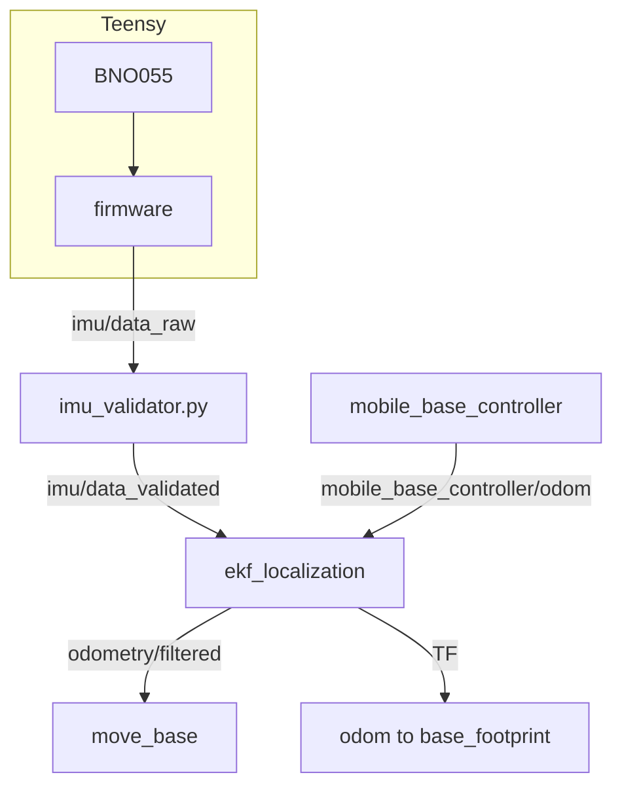
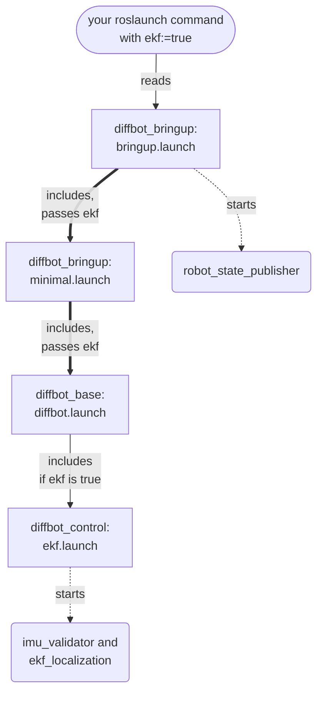

# Localization: Wheel Odometry and IMU (EKF)

DiffBot and Remo estimate how far they drove and turned from their wheels: the drive controller turns the wheel encoders' angles into **odometry**, a pose and a velocity in the `odom` frame. [REP 105's `odom` frame](https://www.ros.org/reps/rep-0105.html#odom) is ROS's convention for such a frame: the robot's pose in it changes smoothly, without jumps, but drifts over time. The wheels' estimate of turning is the weaker part. A wheel that slips, or a wheel separation that is a little off in the configuration, makes the estimated turn too small or too large, and the error in the heading grows into an error in the position the further the robot drives.

The IMU's gyroscope measures the turn directly: its **yaw rate**, the angular velocity about the upward axis, doesn't depend on the wheels. With `ekf:=true`, an **extended Kalman filter (EKF)** from the [`robot_localization`](http://docs.ros.org/en/noetic/api/robot_localization/html/index.html) package combines both: it takes the forward speed from the wheels and the turn mostly from the gyroscope, because the gyroscope's variance is far smaller. A variance says how far a value's errors spread. The smaller the variance, the more the filter trusts the value. The filter publishes the result as `/diffbot/odometry/filtered` and as the transform `odom → base_footprint`, which navigation and RViz use.

robot_localization can fuse any number of sensors, for example GPS, several IMUs and several odometry sources. The DiffBot and Remo configuration combines one IMU with the wheel odometry.

!!! warning "Not tested on the robot yet"
    The EKF runs in the simulation and in the tests below. On Remo, the IMU's rate, axes and noise passed the [bench checks](driver-bno055.md#bench-checks), but the EKF itself hasn't run on a robot yet. Remo's model includes the IMU's checked position and orientation ([bench checks](driver-bno055.md#bench-checks)). DiffBot uses the same BNO055, but its mounting and the firmware still need checking on DiffBot. The variances and the IMU sample validator's time limits below are initial values, not measurements.

## How it fits together



The topics are in the `/diffbot` namespace, for example `/diffbot/imu/data_raw`.

- The **firmware** reads the BNO055 on the Teensy and publishes `/diffbot/imu/data_raw` at 50 Hz, as [IMU: Bosch BNO055](driver-bno055.md) explains. In the simulation, Gazebo's IMU sensor and a small adapter publish the same topic, as [IMU: Simulation](simulation/index.md) explains.
- The **IMU sample validator**, [`imu_validator.py`]({{ diffbot_repo_url }}/diffbot_control/scripts/imu_validator.py), subscribes to `/diffbot/imu/data_raw`. It checks each sample against what this EKF configuration needs and forwards the valid samples, unchanged, on `/diffbot/imu/data_validated`. [Why the EKF needs the IMU sample validator](#the-imu-sample-validator) lists its checks.
- The **drive controller**, `mobile_base_controller` ([diff_drive_controller](http://wiki.ros.org/diff_drive_controller)), publishes the wheel odometry. With the EKF on, it doesn't publish the transform `odom → base_footprint`: two nodes publishing the same transform would make the robot's pose jump between their two estimates.
- The **EKF**, `/diffbot/ekf_localization`, subscribes to `/diffbot/imu/data_validated` and to the wheel odometry. It fuses the two and publishes the filtered odometry and the transform.

[`ekf.launch`]({{ diffbot_repo_url }}/diffbot_control/launch/ekf.launch) in `diffbot_control` starts the validator and the EKF, for the robot and the simulation alike.

## Running it

The `ekf` argument switches the EKF on. The EKF is off by default. Pass `ekf:=true` to the launch file you start:

| Where | Command |
|:--|:--|
| On the robot, when you start the bringup yourself | `roslaunch diffbot_bringup bringup.launch model:=remo ekf:=true` (or [`bringup_with_laser.launch`]({{ diffbot_repo_url }}/diffbot_bringup/launch/bringup_with_laser.launch)) |
| In the simulation | `roslaunch diffbot_gazebo diffbot.launch model:=remo ekf:=true` |
| Simulation with navigation | `roslaunch diffbot_navigation diffbot.launch model:=remo ekf:=true` |
| Navigation on the development PC, for a robot that runs with the EKF | `roslaunch diffbot_navigation diffbot_hw.launch model:=remo ekf:=true` |

### Which launch file starts what

A `roslaunch` command names one launch file. roslaunch reads that file and every file that it includes with the [`<include>` tag](http://wiki.ros.org/roslaunch/XML/include), directly or through another included file. It starts the nodes that these files declare. A node is a running ROS program. A file can pass arguments such as `ekf` to a file that it includes. Starting an included file on its own doesn't read the file that includes it.

The two figures show which launch file includes which, and which file declares which node. They don't show the order in which the nodes start. The pill-shaped box is your command. A rectangle is a launch file, written as its package and its file name. A rounded rectangle names the node or the two nodes that a file starts. A thick arrow is an include that passes `ekf` to the included file.

**On the robot**, when you start the bringup yourself, you start one of the two bringup files. This command is for Remo. For DiffBot, use `model:=diffbot`:

```console
roslaunch diffbot_bringup bringup.launch model:=remo ekf:=true
```

!!! note "With the robot container"
    In the [robot container](../../processing_units/robot-container/usage.md), Docker Compose starts `bringup.launch` for you, without `ekf`, as the `bringup` service's command in [`compose.yaml`]({{ diffbot_repo_url }}/.docker/robot/compose.yaml) says. So `robot_state_publisher` runs there and the EKF is off. The container's settings have no switch for the EKF. Don't start a second bringup by hand next to the container's.



The figure leaves out the other nodes. [`minimal.launch`]({{ diffbot_repo_url }}/diffbot_bringup/launch/minimal.launch) also starts rosserial, the connection to the Teensy. [`diffbot_base/launch/diffbot.launch`]({{ diffbot_repo_url }}/diffbot_base/launch/diffbot.launch) also starts the hardware interface `diffbot_base`, which runs the drive controller. `bringup_with_laser.launch` does the same as [`bringup.launch`]({{ diffbot_repo_url }}/diffbot_bringup/launch/bringup.launch) and also starts the lidar.

`minimal.launch` takes the `ekf` argument because the bringup files pass `ekf` through `minimal.launch`. Starting `minimal.launch` on its own with `ekf:=true` doesn't read the bringup file, so nothing starts `robot_state_publisher`. Without another publisher that provides the transform between `imu_link` and `base_footprint`, the EKF can't use the IMU's samples, and its estimate follows the wheels.

**In the simulation**, you start `diffbot_gazebo`'s `diffbot.launch`:

```console
roslaunch diffbot_gazebo diffbot.launch model:=remo ekf:=true
```


This figure leaves out the other nodes too. [`diffbot_gazebo/launch/diffbot.launch`]({{ diffbot_repo_url }}/diffbot_gazebo/launch/diffbot.launch) also includes [`diffbot_view.launch`]({{ diffbot_repo_url }}/diffbot_gazebo/launch/diffbot_view.launch), which starts Gazebo through gazebo_ros's `empty_world.launch`. Gazebo runs the drive controller.

What the file at the end of the thick arrows does with `ekf`: on the robot, that file is `diffbot_base/launch/diffbot.launch`. In the simulation, that file is [`diffbot_control.launch`]({{ diffbot_repo_url }}/diffbot_control/launch/diffbot_control.launch). Each of these two launch files loads the drive controller's configuration and does two things with its `ekf` value:

1. The file sets the controller's `enable_odom_tf` parameter to `false` with the EKF and to `true` without it. The file writes the value in both cases because a value stays on the ROS parameter server as long as the ROS master runs. Without the `true`, a launch without the EKF after one with the EKF would keep the controller's transform off.
2. The file includes [`ekf.launch`]({{ diffbot_repo_url }}/diffbot_control/launch/ekf.launch), which starts the validator and the EKF, only if `ekf` is true.

Why the EKF needs `robot_state_publisher`, the orange node: `robot_state_publisher` publishes the transforms of the joints in the robot's model, the URDF. From them, TF gets the transform between the IMU's frame `imu_link` and `base_footprint`. The EKF needs this transform to turn the IMU's yaw rate into the robot's frame.

The navigation launch files pass `ekf` on in the same way. [`diffbot_navigation/launch/diffbot.launch`]({{ diffbot_repo_url }}/diffbot_navigation/launch/diffbot.launch) includes `diffbot_gazebo`'s `diffbot.launch` and [`move_base.launch`]({{ diffbot_repo_url }}/diffbot_navigation/launch/move_base.launch) and passes `ekf` to both. With `ekf:=true`, the planners in `move_base.launch` and in Move Base Flex's [`move_base.launch.xml`]({{ diffbot_repo_url }}/diffbot_mbf/launch/includes/move_base.launch.xml) read `/diffbot/odometry/filtered` instead of the controller's odometry, so that their velocities and the transform come from the same estimate. [`diffbot_hw.launch`]({{ diffbot_repo_url }}/diffbot_navigation/launch/diffbot_hw.launch) starts no EKF. Its `ekf` argument only selects the odometry that the planner reads, for a robot whose bringup runs with `ekf:=true`.

To see what the filter does, compare the two odometries while the robot turns, for example in RViz with two Odometry displays, or with `rostopic echo /diffbot/odometry/filtered/twist/twist/angular` next to `/diffbot/mobile_base_controller/odom`'s.

## What the filter fuses

[`ekf.yaml`]({{ diffbot_repo_url }}/diffbot_control/config/ekf.yaml) configures the filter. Each input has a list of 15 booleans that says which of its values the filter uses: position x, y, z, the angles roll, pitch, yaw, their velocities, and the accelerations ([configuring robot_localization](http://docs.ros.org/en/noetic/api/robot_localization/html/configuring_robot_localization.html)).

| Input | Topic | Fused | Not fused, and why |
|:--|:--|:--|:--|
| Wheel odometry | `mobile_base_controller/odom` | forward speed vx, sideways speed vy (always 0), yaw rate | its pose: the controller computes it from the same velocities, so fusing it too would count the wheels twice |
| IMU | `imu/data_validated` | yaw rate | its acceleration, which would need its bias removed first. It has no orientation: the firmware leaves it out |

The sideways speed is 0 for a differential drive robot, which can't move sideways. Fusing it keeps the estimate from drifting sideways. How much the filter trusts each value comes from the variances in the messages: the controller's `twist_covariance_diagonal` in [`diffbot_control.yaml`]({{ diffbot_repo_url }}/diffbot_control/config/diffbot_control.yaml) gives the wheels' yaw rate 0.03 (rad/s)², the firmware gives the gyroscope 4 · 10⁻⁴ (rad/s)². With these, the filter's yaw rate lies close to the gyroscope's.

Other settings: `two_d_mode` keeps z, roll and pitch at 0 for a robot on a flat floor. `world_frame` is `odom`, so the estimate is continuous, without the jumps of a map-based localization such as amcl, which publishes `map → odom` itself. `frequency` is 50 Hz, the IMU's rate. In the simulation, the wheel odometry arrives at 50 Hz too, the drive controller's `publish_rate` in `diffbot_control.yaml`. On the robot, the wheel odometry arrives at most 10 times per second. The controller publishes at most one odometry message each time it runs ([`diff_drive_controller.cpp`, lines 430–432](https://github.com/ros-controls/ros_controllers/blob/0.22.0/diff_drive_controller/src/diff_drive_controller.cpp#L430-L432)), and the base node's control loop in [`diffbot_base.cpp`]({{ diffbot_repo_url }}/diffbot_base/src/diffbot_base.cpp) runs the controller at 10 Hz.

## The IMU sample validator

robot_localization's EKF has a per-input timestamp-order check, but that check doesn't enforce freshness or reject equal timestamps. In robot_localization 2.7.7, the version in the dev container, the IMU's angular velocity passes this check when its stamp isn't earlier than the last stamp on the same input ([`ros_filter.cpp`, lines 2197–2221](https://github.com/cra-ros-pkg/robot_localization/blob/ef5ad3c89457209530e262f3bac39b0f35d07b2b/src/ros_filter.cpp#L2197-L2221)). When a measurement's stamp isn't later than the last measurement that the filter processed, the filter corrects its current estimate with it, without predicting first ([`filter_base.cpp`, lines 205–234](https://github.com/cra-ros-pkg/robot_localization/blob/ef5ad3c89457209530e262f3bac39b0f35d07b2b/src/filter_base.cpp#L205-L234)). [`ekf.yaml`]({{ diffbot_repo_url }}/diffbot_control/config/ekf.yaml) leaves [`smooth_lagged_data`](https://github.com/cra-ros-pkg/robot_localization/blob/ef5ad3c89457209530e262f3bac39b0f35d07b2b/doc/state_estimation_nodes.rst#smooth_lagged_data) off, so the filter doesn't go back to the time of a late measurement. So the filter fuses a sample that arrives late, or one with the same stamp as the one before, as if it were current. A sample that sat in a buffer would count as the robot's yaw rate now.

Two other settings of the EKF sound similar but don't cover this. [`sensor_timeout`](https://github.com/cra-ros-pkg/robot_localization/blob/ef5ad3c89457209530e262f3bac39b0f35d07b2b/doc/state_estimation_nodes.rst#sensor_timeout) makes the filter predict without a correction when its inputs stop. `imu0_twist_rejection_threshold` rejects an angular velocity that lies too far from the estimate, as a [Mahalanobis distance](https://github.com/cra-ros-pkg/robot_localization/blob/ef5ad3c89457209530e262f3bac39b0f35d07b2b/doc/state_estimation_nodes.rst#sensor_threshold), and `ekf.yaml` doesn't set it. The parameter documentation calls it `imu0_angular_velocity_rejection_threshold`, but robot_localization 2.7.7 reads `imu0_twist_rejection_threshold` ([`ros_filter.cpp`, lines 1414–1418](https://github.com/cra-ros-pkg/robot_localization/blob/ef5ad3c89457209530e262f3bac39b0f35d07b2b/src/ros_filter.cpp#L1414-L1418)). Neither checks a sample's age, its frame or a repeated stamp.

The IMU sample validator runs as the ROS node `/diffbot/imu_validator`, from [`imu_validator.py`]({{ diffbot_repo_url }}/diffbot_control/scripts/imu_validator.py). It checks the timing and the input that this EKF configuration needs. It subscribes to `/diffbot/imu/data_raw` and forwards a sample on `/diffbot/imu/data_validated`, unchanged and with its stamp, only if all of these hold:

- The ROS time is nonzero. With simulation time, it stays zero until the first message on Gazebo's `/clock` arrives.
- The sample's frame is `imu_link`. The EKF needs this frame to turn the measured rate into the robot's frame with TF.
- Its angular velocity and its linear acceleration are finite, all three components of each.
- Its angular velocity covariance has finite values, and its diagonal, the three variances, is positive.
- Its stamp is at most `max_age` before the ROS time and at most `max_future` after it. `max_age` is 0.1 s, five samples at 50 Hz. `max_future` is 0.02 s, one sample.
- Its stamp is later than the stamp of the last sample that the validator forwarded.

The validator doesn't check the orientation, the acceleration's covariance, or whether a covariance matrix is positive definite, so it doesn't validate every field of a `sensor_msgs/Imu` message. It never gives an old sample a new stamp. When the ROS time goes back, as when Gazebo's world is reset, the order check starts over from the new time. `max_age` and `max_future` are initial policy values, not standard IMU limits. They stay until the latency of the robot's USB link and rosserial is measured.

The validator's counts are on `/diagnostics`, apart from the EKF's own: how many samples it forwarded, and how many it dropped and why. Its status is an error when no sample was forwarded in the last second, or since the ROS time last went back, and a warning when it dropped samples since its last report. `rosrun rqt_robot_monitor rqt_robot_monitor` shows them.

## How it's tested

Four tests check the EKF without the robot, in [CI with the repository's other tests](../../development/ci.md#tests):

- **The validator alone:** [`test_imu_validator.py`]({{ diffbot_repo_url }}/diffbot_control/test/test_imu_validator.py) calls the validator's checks directly, without a ROS master. Its 27 unit tests cover each reason to drop a sample, the limits `max_age` and `max_future`, a clock that goes back, and the diagnostics: the status for each case and the counts of a report.
- **On a stepped clock:** [`ekf_synthetic.test`]({{ diffbot_repo_url }}/diffbot_control/test/ekf_synthetic.test) starts `ekf.launch` with DiffBot's URDF for the IMU's frame. The test publishes the simulated clock itself and advances it 20 ms at a time: it publishes a step's inputs, waits until the validator's output has arrived and a little longer, moves the clock on, and waits for the filter's output, each wait with a time limit. These bounded waits reduce how much the results depend on the computer's speed, although they can't prove that the filter received each input before the clock moved. The wheels report 0.4 rad/s, as with a wheel separation that is too large, and the IMU 0.5 rad/s: the estimate is 0.499 rad/s. Then IMU samples that are 0.5 s old, from the future, repeated or out of order, all reporting 2.0 rad/s: the validator drops them, and the estimate stays with the valid samples, or goes to the wheels' 0.4 rad/s when only old samples come. After the clock goes back, the filter starts over. The validator's counts on `/diagnostics` have to match the samples the test sent.
- **In Gazebo:** [`sim_ekf_diffbot.test`]({{ diffbot_repo_url }}/diffbot_gazebo/test/sim_ekf_diffbot.test) and [`sim_ekf_remo.test`]({{ diffbot_repo_url }}/diffbot_gazebo/test/sim_ekf_remo.test) give the drive controller a wheel separation 25 % larger than the robot's. The controller then turns the robot 25 % more than commanded, while its odometry reports the commanded turn. In a 3 s left turn, DiffBot turned 1.849 rad, its odometry said 1.479 rad and the EKF 1.844 rad. Remo turned 1.873 rad, its odometry said 1.499 rad and the EKF 1.870 rad. These numbers are from a run in the dev container at the commit `3ef4a91` of [diffbot#154](https://github.com/ros-mobile-robots/diffbot/pull/154), which lists the same run. The test also checks that the controller's wheel separation is 1.25 times the robot's, and that only the EKF publishes `odom → base_footprint`.
- **The switch:** [`test_ekf_switch.py`]({{ diffbot_repo_url }}/diffbot_gazebo/test/test_ekf_switch.py) reads the launch files with roslaunch's loader, without starting them, and checks both positions of `ekf` and its default: which nodes start, `enable_odom_tf`, and which odometry the planners read. With `ekf:=true`, the two bringup files and `diffbot_gazebo`'s `diffbot.launch` also have to start `robot_state_publisher`. The planners' launch files start no EKF, so the test checks only the odometry topic that their planner reads.

What these tests don't show: how the real gyroscope behaves (its noise and bias, how it's mounted), the delays on the robot, the filter with the robot's slower wheel odometry (in these tests, both inputs arrive at 50 Hz), and whether the filter helps on the floor. The [floor odometry test](https://github.com/ros-mobile-robots/diffbot/issues/138) will measure that on Remo.

## Limits

- **A clock that goes back:** in the simulation, the filter starts over (`reset_on_time_jump`). robot_localization does that only with simulated time. On the robot, after the computer's clock goes back, the filter ignores each input until its stamps are newer than its last ones again.
- **A reset of the simulation:** `/gazebo/reset_simulation` sets the simulation's clock back to zero. The simulated IMU, the validator and the filter go on from the new time right away. [The reset test](simulation/tests.md#the-reset-test) checks that for the IMU. The drive controller's odometry doesn't. `diff_drive_controller` publishes again only when the clock has passed the time of its last message from before the reset ([`diff_drive_controller.cpp`, lines 430–432](https://github.com/ros-controls/ros_controllers/blob/0.22.0/diff_drive_controller/src/diff_drive_controller.cpp#L430-L432)). Until then, the filter gets the IMU's yaw rate but no wheel speeds. In a test run that was reset after 9.7 s, the filter's first output after the reset was stamped 0.08 s, and the wheel odometry's first message 9.75 s.
- **The variances and the IMU sample validator's time limits** are initial values. The [bench checks](driver-bno055.md#bench-checks) measured the IMU's noise at rest. Measurements while driving still have to show the values that the EKF should use.
- **The pose drifts** over time, as any odometry: the gyroscope helps with the heading, but nothing corrects the position. A map-based localization such as amcl corrects it in the `map` frame.

## More about robot_localization

- [robot_localization on the ROS Wiki](http://wiki.ros.org/robot_localization): the package's summary page, with links to its API, FAQ and changelog.
- [robot_localization's documentation for Noetic](http://docs.ros.org/en/noetic/api/robot_localization/html/index.html): the state estimation nodes and their parameters, how to prepare the sensor data, how to configure the filters and how to add GPS.
- [cra-ros-pkg/robot_localization](https://github.com/cra-ros-pkg/robot_localization) on GitHub: the source code and the issues. The Noetic version is on the [`noetic-devel`](https://github.com/cra-ros-pkg/robot_localization/tree/noetic-devel) branch.
