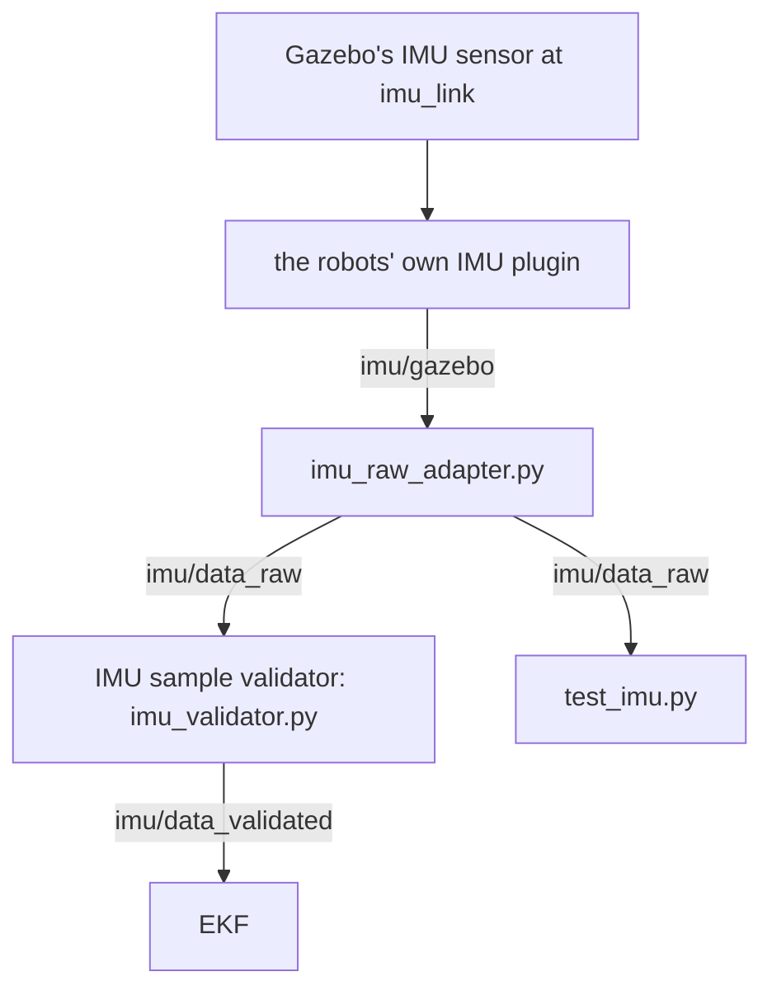
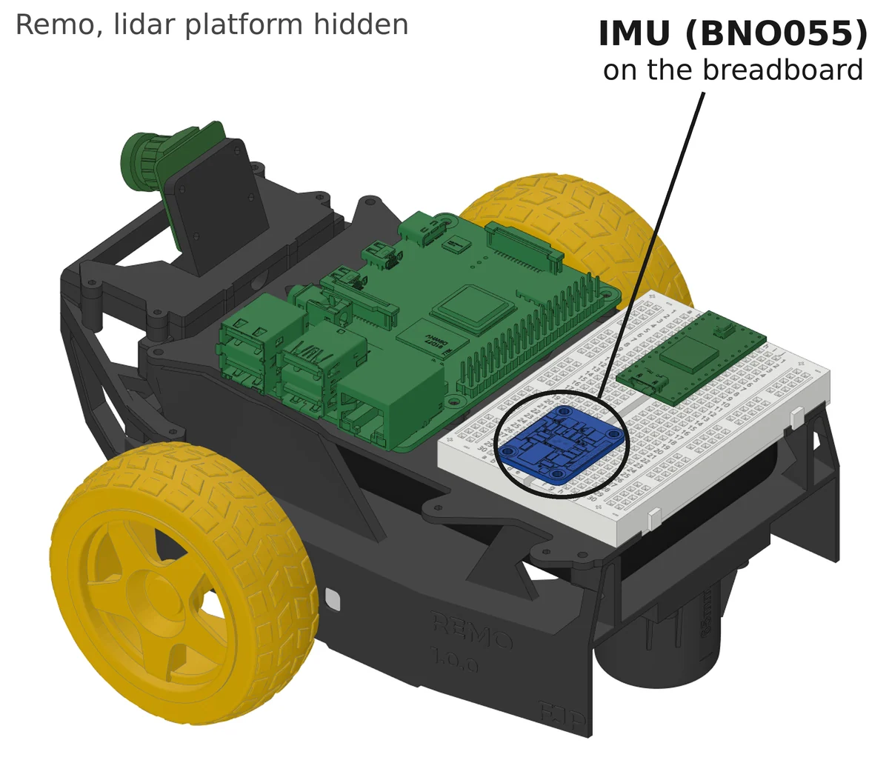
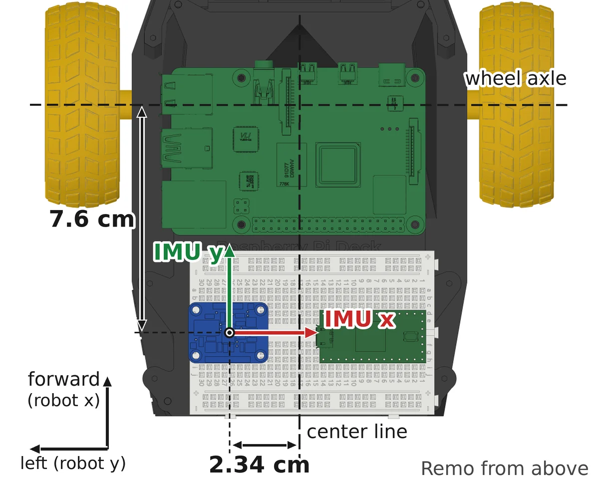

# IMU: Simulation

In the Gazebo simulation, DiffBot and Remo have an IMU too. It publishes the same topic and the same message as the [BNO055 firmware on the real robot](driver-bno055.md#what-the-firmware-publishes). So the EKF that fuses the IMU's yaw rate with the wheel odometry gets the same input in the simulation as on the robot.

[Localization: Wheel Odometry and IMU (EKF)](robot_localization.md) explains the EKF and how to switch it on.

## What the simulated IMU publishes

Both robots publish `/diffbot/imu/data_raw`, 50 times per second, the firmware's rate. Each message is a [`sensor_msgs/Imu`](https://docs.ros.org/en/noetic/api/sensor_msgs/html/msg/Imu.html), ROS's standard message for IMU data. The message's definition, [`Imu.msg` in ROS's common_msgs]({{ common_msgs_src_url }}/sensor_msgs/msg/Imu.msg):

```text title="Imu.msg: the sensor_msgs/Imu message" linenums="1" hl_lines="15 17 18 20 21 23 24"
--8<-- "{{ common_msgs_src_raw }}/sensor_msgs/msg/Imu.msg"
```

The comments at the top are the message's contract for every publisher:

- Angular velocities are in rad/s, accelerations in m/s².
- Each vector has a 3 × 3 covariance matrix, stored as nine numbers, row by row. A publisher that knows only the variances puts them on the diagonal.
- A covariance of all zeros means that the covariance is unknown, not that the value has no uncertainty. A node that reads the message then has to assume a covariance.
- −1 as a covariance's first element means that the publisher has no estimate for that field. A node that reads the message should check this element and disregard the field.

The fields in order, and what the simulated IMU puts into them:

- **`header`:** `header.stamp` is the time of the measurement, here the simulation time at which Gazebo's sensor measured. `header.frame_id` names the frame whose axes the values use, here `imu_link`, the IMU's frame.
- **`orientation` and `orientation_covariance`:** an estimate of the sensor's orientation, as a quaternion, and its covariance. Like the firmware, the simulated IMU has no orientation estimate: `orientation_covariance[0]` is −1, which marks the orientation unavailable. The quaternion's four numbers are 0. That isn't a valid orientation, and the −1 tells a reader not to use it.
- **`angular_velocity`:** the angular velocity $\boldsymbol\omega$ about the three axes of `imu_link`, in rad/s. The simulated IMU publishes $\tilde{\boldsymbol\omega}$, the angular velocity with noise.
- **`angular_velocity_covariance`:** $\Sigma_\omega$, in (rad/s)². In the simulation, it's a diagonal matrix, $\Sigma_\omega = \sigma^2 I_3$. The noise's standard deviation is $\sigma = 0.005$ rad/s, and its variance $\sigma^2 = 2.5 \cdot 10^{-5}$ (rad/s)².
- **`linear_acceleration`:** despite its name, what an accelerometer measures: the specific force $\mathbf f = \mathbf a - \mathbf g$, the acceleration minus gravity, along the same axes, in m/s². At rest, the upward axis reads +9.8 m/s² in Gazebo. The simulated IMU publishes $\tilde{\mathbf f}$, the specific force with noise.
- **`linear_acceleration_covariance`:** $\Sigma_f = \sigma^2 I_3$, in (m/s²)², with $\sigma = 0.005$ m/s².

[What the sensor measures](#what-the-sensor-measures) and [how the plugin adds noise](#noise-and-covariance) derive these values from the code. The firmware's message has no orientation either. The firmware reads only the BNO055's angular velocity and acceleration, because the EKF fuses only the yaw rate, as [what the firmware publishes](driver-bno055.md#what-the-firmware-publishes) explains.



The topics are in the `/diffbot` namespace, for both robots. The parts of the diagram:

- **Gazebo's IMU sensor** measures the angular velocity and the specific force at `imu_link`, the IMU's frame. [The IMU's position and axes](#position-and-axes) shows where this frame sits on each robot.
- **The robots' own IMU plugin**, a Gazebo plugin from the diffbot repository, adds noise and publishes the values on `/diffbot/imu/gazebo`. [The Gazebo sensor and the plugin](#the-gazebo-sensor-and-the-plugin) shows how the model loads it.
- **The adapter**, `imu_raw_adapter.py`, subscribes to `/diffbot/imu/gazebo`, removes the orientation and publishes the rest on `/diffbot/imu/data_raw`. [The adapter's code](#the-adapter) shows how.
- **The IMU sample validator**, `imu_validator.py`, subscribes to `/diffbot/imu/data_raw` and forwards the samples it accepts, unchanged, on `/diffbot/imu/data_validated`, which the EKF subscribes to. It drops a sample while the ROS time is still zero, when its frame isn't `imu_link`, when a value or a variance isn't usable, or when its stamp is too old, too far ahead or not newer than the last one. [The IMU sample validator on the Localization page](robot_localization.md#the-imu-sample-validator) lists the checks. The validator and the EKF run only with `ekf:=true`, as [running the EKF](robot_localization.md#running-it) shows.
- **The test**, `test_imu.py`, subscribes to `/diffbot/imu/data_raw` and checks the messages in CI, as [the IMU test](#how-its-tested) explains.

## Position and axes

The IMU's frame is the link [`imu_link`]({{ imu_sim_src_url }}/diffbot_description/urdf/include/common_sensors.xacro#L208-L234). A fixed joint, [`imu_joint`]({{ imu_sim_src_url }}/diffbot_description/urdf/include/common_sensors.xacro#L236-L240), places it on [`chassis_link`]({{ imu_sim_src_url }}/diffbot_description/urdf/include/common_macros.urdf.xacro#L197-L207), the frame at the center of the robot's base plate. The joint's origin says where the sensor sits and how it's turned:

- `xyz` is the position in m, along `chassis_link`'s x (forward), y (left) and z (up) axes.
- `rpy` is the rotation in rad: roll about x, pitch about y and yaw about z.

Every value in the IMU's message is along `imu_link`'s axes. The EKF turns them into the robot's axes with this joint's transform, which `robot_state_publisher` publishes from the URDF.

!!! info "Reading the code"

    - The excerpts show fixed revisions, with their comments: diffbot's source at one commit, Remo's model at remo_description 2.5.0, and ROS's message definition at one commit of common_msgs. Their line numbers match the original files.
    - The link above each excerpt opens that revision and those lines on GitHub.

### The link and the joint in the model

The robots' models are written in [xacro](http://wiki.ros.org/xacro), XML with macros. Xacro expands a model into the URDF that ROS and Gazebo read. Both models declare `imu_link` and `imu_joint` in a macro called `imu_sensor`. A macro is a template: each call expands it into URDF elements. DiffBot's macro declares the link in [`common_sensors.xacro`, lines 208–234]({{ imu_sim_src_url }}/diffbot_description/urdf/include/common_sensors.xacro#L208-L234):

```xml title="common_sensors.xacro (xacro, expands into URDF): imu_link" linenums="208"
--8<-- "{{ imu_sim_src_raw }}/diffbot_description/urdf/include/common_sensors.xacro:208:234"
```

`imu` is the IMU's entry in [`sensors.yaml`]({{ imu_sim_src_url }}/diffbot_description/config/diffbot/sensors.yaml#L16-L26), which the call passes to the macro ([line 206]({{ imu_sim_src_url }}/diffbot_description/urdf/include/common_sensors.xacro#L206)). DiffBot's entry has no mesh, so the link draws a red box of the board's size, 27 × 20 × 4 mm. The collision box has the same size, and `box_inertia` gives the link the board's mass, 3 g.

The joint, [`common_sensors.xacro`, lines 236–240]({{ imu_sim_src_url }}/diffbot_description/urdf/include/common_sensors.xacro#L236-L240):

```xml title="common_sensors.xacro (xacro, expands into URDF): imu_joint" linenums="236" hl_lines="2 4"
--8<-- "{{ imu_sim_src_raw }}/diffbot_description/urdf/include/common_sensors.xacro:236:240"
```

- The joint is `fixed`, so `imu_link` moves with its parent link, as the board moves with the robot.
- `${parent_link}` and the `<origin>` come from the macro's call. The macro's parameter `*origin` takes the `<origin>` element written between the call's tags, and `xacro:insert_block` puts it here. So these lines don't say where the IMU sits. Each robot's call does, in the sections on Remo's and DiffBot's mounting.

Remo's macro in remo_description declares the same link and joint, with a mesh of the BNO055 board ([remo_description's `common_sensors.xacro`, lines 216–250](https://github.com/ros-mobile-robots/remo_description/blob/2.5.0/urdf/include/common_sensors.xacro#L216-L250)).

### Remo's mounting

<div class="grid" markdown>

<figure markdown>
  
  <figcaption>Remo, with the lidar platform hidden. The IMU board sits on the breadboard, at the rear.</figcaption>
</figure>

<figure markdown>
  
  <figcaption>Remo from above. The IMU's x axis points to the right, its y axis forward, and its z axis up, toward you.</figcaption>
</figure>

</div>

Remo's model describes the BNO055 board on the breadboard on the Raspberry Pi deck. The diffbot repository uses Remo's model at remo_description 2.5.0 ([`diffbot_dev.repos`]({{ imu_sim_src_url }}/diffbot_dev.repos)). The call of the macro puts the IMU on `chassis_link`, [`remo.urdf.xacro`, lines 211–216](https://github.com/ros-mobile-robots/remo_description/blob/2.5.0/urdf/remo.urdf.xacro#L211-L216):

```xml title="remo.urdf.xacro: the call of imu_sensor" linenums="211" hl_lines="2 5"
--8<-- "https://raw.githubusercontent.com/ros-mobile-robots/remo_description/2.5.0/urdf/remo.urdf.xacro:211:216"
```

`imu_xyz` and `imu_rpy` are xacro arguments, declared at the top of the file with their defaults, [`remo.urdf.xacro`, lines 26–27](https://github.com/ros-mobile-robots/remo_description/blob/2.5.0/urdf/remo.urdf.xacro#L26-L27):

```xml title="remo.urdf.xacro: the IMU's mounting" linenums="26"
--8<-- "https://raw.githubusercontent.com/ros-mobile-robots/remo_description/2.5.0/urdf/remo.urdf.xacro:26:27"
```

Xacro turns the call into this joint in Remo's URDF. The lines are xacro's output for `remo.urdf.xacro` at 2.5.0, with its default arguments, not a file in a repository:

```xml title="Remo's URDF, expanded by xacro: imu_joint"
<joint name="imu_joint" type="fixed">
  <parent link="chassis_link"/>
  <child link="imu_link"/>
  <origin rpy="0 0 -1.5707963" xyz="-0.0401 0.0234 0.013"/>
</joint>
```

- **Position:** −4.01 cm, +2.34 cm and +1.3 cm from `chassis_link`, which is 3.6 cm behind the wheel axle ([`remo.urdf.xacro`, lines 71–74](https://github.com/ros-mobile-robots/remo_description/blob/2.5.0/urdf/remo.urdf.xacro#L71-L74)). So the chip's center lies 7.6 cm behind the wheel axle, 2.34 cm left of the robot's center line, and 8 cm above the floor. The board's header pins sit in the breadboard.
- **Rotation:** $-\pi/2$ rad, −90°, about z. The board lies flat. Its z axis points up, its y axis forward and its x axis to the robot's right. A tilt test on Remo showed these axes, as the [bench checks](driver-bno055.md#bench-checks) describe. The comment above the arguments in `remo.urdf.xacro` says how each value was found.

Because both z axes point up, a left turn reads as a positive yaw rate $\omega_z$, for the IMU as for the robot. Forward acceleration appears on the IMU's positive y axis, not on its x axis. At a steady forward speed on level ground, that axis reads about zero.

### DiffBot's mounting

DiffBot uses the same BNO055 board as Remo, moved from one robot to the other. Its mounting on DiffBot isn't measured yet. So DiffBot's model uses placeholders: 1 cm above `chassis_link`'s origin, with the board's axes along the robot's. [`diffbot.urdf.xacro`, lines 4–10]({{ imu_sim_src_url }}/diffbot_description/urdf/diffbot.urdf.xacro#L4-L10):

```xml title="diffbot.urdf.xacro: the IMU's mounting" linenums="4"
--8<-- "{{ imu_sim_src_raw }}/diffbot_description/urdf/diffbot.urdf.xacro:4:10"
```

The call of the macro passes them to the joint, [`diffbot.urdf.xacro`, lines 80–82]({{ imu_sim_src_url }}/diffbot_description/urdf/diffbot.urdf.xacro#L80-L82):

```xml title="diffbot.urdf.xacro: the call of imu_sensor" linenums="80"
--8<-- "{{ imu_sim_src_raw }}/diffbot_description/urdf/diffbot.urdf.xacro:80:82"
```

In DiffBot's URDF, xacro's output for `diffbot.urdf.xacro` at the pinned commit, the joint's origin is `<origin rpy="0 0 0" xyz="0 0 0.01"/>`, on `chassis_link`. To try another mounting, override the arguments when you expand the model, for example `xacro diffbot.urdf.xacro imu_xyz:='0 0 0.02'`.

## How the plugin and the adapter make the message

### The Gazebo sensor and the plugin

The macro `imu_sensor` adds the sensor in a block that only Gazebo reads. DiffBot's macro is in [`common_sensors.xacro`]({{ imu_sim_src_url }}/diffbot_description/urdf/include/common_sensors.xacro#L191-L258), Remo's in [remo_description's file of the same name](https://github.com/ros-mobile-robots/remo_description/blob/2.5.0/urdf/include/common_sensors.xacro#L211-L268). [`common_sensors.xacro`, lines 242–257]({{ imu_sim_src_url }}/diffbot_description/urdf/include/common_sensors.xacro#L242-L257):

```xml title="common_sensors.xacro: the Gazebo sensor and its plugin" linenums="242" hl_lines="2 5"
--8<-- "{{ imu_sim_src_raw }}/diffbot_description/urdf/include/common_sensors.xacro:242:257"
```

- **`<gazebo reference="imu_link">`** holds what only Gazebo reads. URDF tools ignore it. When Gazebo converts the URDF, it places the sensor at `imu_link`'s position and rotation. Gazebo merges links that are joined by fixed joints into one link, so the converted model has no `imu_link`. The sensor keeps its pose in the link that remains: `base_footprint` for DiffBot, as `gz sdf -p` shows when you [convert the model as on the Simulation page](../../diffbot_gazebo.md#troubleshooting). For ROS, `imu_link` stays the IMU's frame.
- **`type="imu"`** is Gazebo's IMU sensor. `update_rate` makes it measure 50 times per second.
- **The plugin** turns the sensor's values into ROS messages. `filename` names its library, `libdiffbot_gazebo_ros_imu_sensor.so`.

`libdiffbot_gazebo_ros_imu_sensor.so` isn't a standard ROS plugin. It's the diffbot repository's own copy of the IMU plugin `libgazebo_ros_imu_sensor.so` from [gazebo_plugins 2.9.3](https://github.com/ros-simulation/gazebo_ros_pkgs/blob/2.9.3/gazebo_plugins/src/gazebo_ros_imu_sensor.cpp), the version that the dev container installs. The package [`diffbot_gazebo_plugins`]({{ imu_sim_src_url }}/diffbot_gazebo_plugins) builds it from [`gazebo_ros_imu_sensor.cpp`]({{ imu_sim_src_url }}/diffbot_gazebo_plugins/src/gazebo_ros_imu_sensor.cpp). The copy takes the same parameters, computes the same values and publishes the same message, a `sensor_msgs/Imu`. It leaves out one function call, and [why the plugin doesn't spin](#why-the-plugin-doesnt-spin) explains which one and why. The plugin's parameters:

- `robotNamespace` and `topicName`, `/diffbot` and `imu/gazebo`, give the topic `/diffbot/imu/gazebo`.
- `frameName`, `imu_link`, becomes the message's `header.frame_id`.
- `updateRateHZ`, 50, is the plugin's own limit: at most 50 messages per second.
- `gaussianNoise`, 0.005, is the standard deviation $\sigma$ of the [noise that the plugin adds](#noise-and-covariance).
- `xyzOffset` is read, but not used.
- `rpyOffset` and `initialOrientationAsReference` change only the orientation, which the adapter removes.

Where the sensor sits and how it's turned comes from the joint's origin, not from the offsets.

### What the sensor measures

Gazebo's IMU sensor measures two vectors in `imu_link`'s axes ([`ImuSensor.cc`, lines 344–376](https://github.com/gazebosim/gazebo-classic/blob/gazebo11_11.15.1/gazebo/sensors/ImuSensor.cc#L344-L376), Gazebo 11.15):

- $\boldsymbol\omega$, the angular velocity of the robot's body, which the sensor sits on, in rad/s.
- $\mathbf f$, the **specific force**, in m/s²:

$$
\mathbf f = \mathbf a - \mathbf g
$$

$\mathbf a$ is the acceleration of the point where the sensor sits, and $\mathbf g$ is gravity, both in `imu_link`'s axes. At rest, $\mathbf a = \mathbf 0$. With `imu_link`'s z axis up, gravity is $\mathbf g = (0, 0, -9.8)$ m/s², so the sensor reads $\mathbf f = (0, 0, +9.8)$ m/s². A real accelerometer reads the same: the box at the top of [IMU: Bosch BNO055](driver-bno055.md) explains why it reads about +9.81 m/s² upward at rest. Gazebo's gravity is 9.8 m/s² in the robots' worlds, SDF's default ([SDF's `<gravity>`](http://sdformat.org/spec?ver=1.6&elem=world#world_gravity)).

### Noise and covariance

`Load()` connects the plugin's `UpdateChild()` to Gazebo's world update event ([`gazebo_ros_imu_sensor.cpp`, lines 121–122]({{ imu_sim_src_url }}/diffbot_gazebo_plugins/src/gazebo_ros_imu_sensor.cpp#L121-L122)). So Gazebo's [physics thread](#threads-callbacks-and-the-callback-queue) calls `UpdateChild()` at the start of every simulation step. `UpdateChild()` goes on at most 50 times per second of simulation time and returns right away otherwise. It fills and publishes a message only while the topic has a subscriber ([lines 127–134]({{ imu_sim_src_url }}/diffbot_gazebo_plugins/src/gazebo_ros_imu_sensor.cpp#L127-L134)). In the simulation, the adapter always subscribes. [`gazebo_ros_imu_sensor.cpp`, lines 147–165]({{ imu_sim_src_url }}/diffbot_gazebo_plugins/src/gazebo_ros_imu_sensor.cpp#L147-L165):

```cpp title="gazebo_ros_imu_sensor.cpp: noise and covariance" linenums="147"
--8<-- "{{ imu_sim_src_raw }}/diffbot_gazebo_plugins/src/gazebo_ros_imu_sensor.cpp:147:165"
```

The plugin adds noise to each component of both vectors:

$$
\tilde{\boldsymbol\omega} = \boldsymbol\omega + \mathbf n_\omega, \qquad \tilde{\mathbf f} = \mathbf f + \mathbf n_f
$$

$\tilde{\boldsymbol\omega}$ and $\tilde{\mathbf f}$ are what the message carries. Each component $n$ of $\mathbf n_\omega$ and $\mathbf n_f$ is a new random number in every message, from a normal distribution with mean 0 and standard deviation $\sigma$, the parameter `gaussianNoise` (`GuassianKernel()`, [lines 181–193]({{ imu_sim_src_url }}/diffbot_gazebo_plugins/src/gazebo_ros_imu_sensor.cpp#L181-L193)):

$$
n \sim \mathcal N(0, \sigma^2), \qquad \sigma = 0.005
$$

$\sigma$ is 0.005 rad/s for the angular velocity and 0.005 m/s² for the specific force. It's a simulation setting, not the BNO055's measured noise. Gazebo's sensor adds no noise of its own, because the model gives it none.

The plugin writes the variance $\sigma^2 = 2.5 \cdot 10^{-5}$ on the diagonal of each covariance matrix, in (rad/s)² and (m/s²)². The other elements stay 0: the noise on one axis doesn't depend on the others. For the angular velocity:

$$
\Sigma_\omega = \begin{pmatrix} \sigma^2 & 0 & 0 \\ 0 & \sigma^2 & 0 \\ 0 & 0 & \sigma^2 \end{pmatrix} = \sigma^2 I_3
$$

$I_3$ is the 3 × 3 identity matrix. The specific force's covariance $\Sigma_f$ is the same, in (m/s²)².

The message stores each matrix as nine numbers, row by row. So the diagonal is elements 0, 4 and 8, and element 8 is the yaw rate's variance, which the EKF uses. The plugin also writes Gazebo's orientation of the sensor, with noise. The adapter removes it.

### The header and the stamp

[`gazebo_ros_imu_sensor.cpp`, lines 167–175]({{ imu_sim_src_url }}/diffbot_gazebo_plugins/src/gazebo_ros_imu_sensor.cpp#L167-L175), the end of `UpdateChild()`:

```cpp title="gazebo_ros_imu_sensor.cpp: the end of UpdateChild()" linenums="167" hl_lines="7 8 9"
--8<-- "{{ imu_sim_src_raw }}/diffbot_gazebo_plugins/src/gazebo_ros_imu_sensor.cpp:167:175"
```

The stamp is the sensor's last update time, in simulation time. After `publish()`, gazebo_plugins' original calls `ros::spinOnce()` ([the original's lines 137–151](https://github.com/ros-simulation/gazebo_ros_pkgs/blob/2.9.3/gazebo_plugins/src/gazebo_ros_imu_sensor.cpp#L137-L151), with `ros::spinOnce()` in line 150). The copy leaves this call out, as its comment says. [Why the plugin doesn't spin](#why-the-plugin-doesnt-spin) explains the reason.

### The plugin's library in Remo's model

DiffBot's macro names the plugin's library itself ([`common_sensors.xacro`, line 246]({{ imu_sim_src_url }}/diffbot_description/urdf/include/common_sensors.xacro#L246)). Remo's model takes the library's name as the xacro argument `imu_plugin` instead. The argument's default is gazebo_plugins' own library ([`remo.urdf.xacro`, lines 29–36](https://github.com/ros-mobile-robots/remo_description/blob/2.5.0/urdf/remo.urdf.xacro#L29-L36)), and the model passes it to its macro ([`remo.urdf.xacro`, lines 211–216](https://github.com/ros-mobile-robots/remo_description/blob/2.5.0/urdf/remo.urdf.xacro#L211-L216)). The diffbot repository's simulation sets the argument when it expands the model. [`diffbot_view.launch`, lines 6–11]({{ imu_sim_src_url }}/diffbot_gazebo/launch/diffbot_view.launch#L6-L11):

```xml title="diffbot_view.launch: the command that expands the model" linenums="6" hl_lines="6"
--8<-- "{{ imu_sim_src_raw }}/diffbot_gazebo/launch/diffbot_view.launch:6:11"
```

`urdf_file` is the xacro command for the selected robot's model. It passes `imu_plugin:=libdiffbot_gazebo_ros_imu_sensor.so` to both models. Remo's model uses the value as the plugin's `filename`. DiffBot's model doesn't declare `imu_plugin`, and xacro ignores the argument. So both robots load the same plugin in this simulation, and Remo's model still works on its own, with its default library.

### The adapter

The plugin's message has an orientation, and the firmware's message has none. [`imu_raw_adapter.py`]({{ imu_sim_src_url }}/diffbot_gazebo/scripts/imu_raw_adapter.py) makes the simulated message match the firmware's. `diffbot_view.launch` starts it in the `diffbot` namespace ([line 39]({{ imu_sim_src_url }}/diffbot_gazebo/launch/diffbot_view.launch#L39)), so its relative topic names become `/diffbot/imu/gazebo` and `/diffbot/imu/data_raw`. [`imu_raw_adapter.py`, lines 16–36]({{ imu_sim_src_url }}/diffbot_gazebo/scripts/imu_raw_adapter.py#L16-L36):

```python title="imu_raw_adapter.py" linenums="16" hl_lines="4 5 16 17 18 19 20"
--8<-- "{{ imu_sim_src_raw }}/diffbot_gazebo/scripts/imu_raw_adapter.py:16:36"
```

- **How a field is marked unavailable.** A `sensor_msgs/Imu` message always has an orientation field. To say that a field holds no data, the [message definition's comments]({{ common_msgs_src_url }}/sensor_msgs/msg/Imu.msg#L10-L13) and [REP 145](https://www.ros.org/reps/rep-0145.html#topics), the ROS convention for IMU drivers, set the first element of the field's covariance to −1. A node that reads the message should check that element and ignore the field. `ORIENTATION_UNAVAILABLE` is such a covariance: −1, then eight zeros, the 3 × 3 matrix row by row.
- **A convention, not a rule to drop the orientation.** REP 145 doesn't ask an IMU driver to leave out the orientation. A driver whose sensor estimates an orientation can publish it on `imu/data`. The firmware's topic, `imu/data_raw`, is REP 145's name for the accelerometer's and the gyroscope's data alone.
- **The callback** sets the quaternion's four values to 0 and the orientation covariance to a copy of the constant. `list()` makes the copy, so that the messages don't share the constant's list. Then the callback publishes the same message object.
- **What stays:** the header with its stamp and frame, the angular velocity, the specific force and their covariances. The adapter doesn't stamp the message again. The [IMU sample validator](robot_localization.md#the-imu-sample-validator) checks how old each sample is, and a new stamp would hide a delay.

## Why the plugin doesn't spin

gazebo_plugins' original IMU plugin calls `ros::spinOnce()` right after it publishes. In the simulation, this one call can stop Gazebo's clock for good while the controllers start ([diffbot#185](https://github.com/ros-mobile-robots/diffbot/issues/185)). This section explains why, with the threads in the Gazebo server and the controller manager's services.

### Threads, callbacks and the callback queue

The Gazebo server, `gzserver`, is one program that does several things at the same time, in **threads**. A thread works through its functions one after the other. The threads of one program run in parallel and share its data. Two kinds of threads matter here.

**Gazebo's physics thread** steps the simulation. Each step moves the simulation forward by 1 ms of simulation time, the world's `max_step_size` ([`diffbot_empty.world`, line 15]({{ imu_sim_src_url }}/diffbot_gazebo/worlds/diffbot_empty.world#L15)). At the start of every step, the physics thread calls the plugins' update functions, among them:

- the IMU plugin's `UpdateChild()`,
- `gazebo_ros_control`'s `Update()`, which calls the controller manager's `update()`, `ControllerManager::update()` ([`gazebo_ros_control_plugin.cpp`, line 251](https://github.com/ros-simulation/gazebo_ros_pkgs/blob/2.9.3/gazebo_ros_control/src/gazebo_ros_control_plugin.cpp#L251)). `update()` runs the controllers, such as the drive controller, as [what runs in the simulation](../../development/simulation-test.md#what-runs-in-the-simulation) shows.

Only the physics thread calls `update()`. The simulation's clock moves on only when the physics thread finishes a step.

**A callback** is a function that ROS runs for an incoming message or service request. The controller manager has one for each of its services, for example `switch_controller`, which starts and stops controllers. ROS doesn't run a callback the moment its request arrives. It adds the call to a **callback queue**, a waiting list. The queue itself runs nothing, and it isn't a thread. A thread has to take each call out of the queue and run it. ROS calls this **spinning**.

The whole Gazebo server is one ROS node, `/gazebo`. Its plugins share the node's **global callback queue**, unless a plugin sets up a queue of its own. `gazebo_ros_control` creates the controller manager with an ordinary node handle ([`gazebo_ros_control_plugin.cpp`, lines 150 and 193–194](https://github.com/ros-simulation/gazebo_ros_pkgs/blob/2.9.3/gazebo_ros_control/src/gazebo_ros_control_plugin.cpp#L150-L194)). The controller manager offers its services with it ([`controller_manager.cpp`, lines 45–61](https://github.com/ros-controls/ros_control/blob/0.20.0/controller_manager/src/controller_manager.cpp#L45-L61)). So the callbacks of its services wait in the global queue.

**The ROS spinner threads** spin the global queue: each takes a waiting call out and runs it. Gazebo's ROS interface, the plugin `gazebo_ros_api_plugin`, starts them with a `ros::AsyncSpinner`, one thread per CPU core ([`gazebo_ros_api_plugin.cpp`, line 148](https://github.com/ros-simulation/gazebo_ros_pkgs/blob/2.9.3/gazebo_ros/src/gazebo_ros_api_plugin.cpp#L148)). gazebo_ros's `gzserver` script loads this plugin into the server ([`gzserver`, lines 21–24](https://github.com/ros-simulation/gazebo_ros_pkgs/blob/2.9.3/gazebo_ros/scripts/gzserver#L21-L24)).

**[`ros::spinOnce()`](http://wiki.ros.org/roscpp/Overview/Callbacks%20and%20Spinning#Single-threaded_Spinning)** spins too, once and in the thread that calls it. It runs the callbacks that wait in the global queue at that moment ([`init.cpp`, lines 585–588](https://github.com/ros/ros_comm/blob/1.17.4/clients/roscpp/src/libros/init.cpp#L585-L588)). In the original plugin's `UpdateChild()`, the caller is the physics thread.

### How the spawner starts the controllers

The controller spawner is a separate ROS node, which [`diffbot_control.launch`]({{ imu_sim_src_url }}/diffbot_control/launch/diffbot_control.launch#L23-L25) starts. It loads and starts the controllers with two of the controller manager's services, `load_controller` and `switch_controller`. Their callbacks don't change the running controllers themselves, because `update()` may be using them at that moment. They hand the change to `update()` and wait until `update()` has taken it ([`controller_manager.cpp`, lines 352–359](https://github.com/ros-controls/ros_control/blob/0.20.0/controller_manager/src/controller_manager.cpp#L352-L359) and [lines 612–630](https://github.com/ros-controls/ros_control/blob/0.20.0/controller_manager/src/controller_manager.cpp#L612-L630)). `switch_controller` takes a timeout, but the spawner passes 0, which means no limit ([`spawner`, line 212](https://github.com/ros-controls/ros_control/blob/0.20.0/controller_manager/scripts/spawner#L212)).

### Two ways to run the callback

The figure follows one `switch_controller` request in two cases, with the physics thread and one of the spinner threads:

--8<-- "includes/imu-sim-threads.html"

**Case 1, a spinner thread runs the callback.** The spinner thread waits in the callback. The physics thread goes on with the next steps and calls `update()`, which takes the change. Then the callback returns, and the spawner gets its answer.

**Case 2, the original plugin runs the callback.** One of the spawner's requests waits in the queue just when `UpdateChild()` calls `ros::spinOnce()`, before a spinner thread has taken it:

1. The physics thread runs the service's callback, inside `UpdateChild()`.
2. The callback hands its change to `update()` and waits.
3. `update()` runs only in the physics thread, and the physics thread is busy waiting in the callback. It waits for itself. This is a **deadlock**.
4. The simulation step never ends. The simulation's clock stops for good, and the spawner's call never returns.

The copy runs no callbacks in the physics thread. It needs no spinning of its own, because it only publishes. The spinner threads run every callback, including the controller manager's, and the physics thread keeps calling `update()`. With the original, the stall depends on timing, so it hits only some starts of the simulation. [diffbot#185](https://github.com/ros-mobile-robots/diffbot/issues/185) has the diagnosis, the stalled simulations' backtraces, and how many starts stalled with the original and with the copy.

### Why not just wait?

The deadlock comes from the physics thread running a callback that waits for the physics thread. The first three ideas below wait differently and don't remove that dependency. The fourth removes it in another place:

- **A delay, or starting Gazebo paused.** A delay at the start might change which thread takes the spawner's request, but it doesn't remove the unsafe path. Starting Gazebo paused doesn't help either. The controllers start only when `ControllerManager::update()` takes the change, and the physics thread calls `update()` only while the simulation runs. So the request waits for the simulation to run, and then the same path is open. Later requests to the controller manager can take it too.
- **A condition variable.** The callback already waits. Waiting on a condition variable instead of polling would still block the physics thread, which is the only thread that can run `update()`.
- **A timeout.** `switch_controller` has an escape: with a positive timeout, its callback returns a failure about a second after the timeout ([`controller_manager.cpp`, lines 612–636](https://github.com/ros-controls/ros_control/blob/0.20.0/controller_manager/src/controller_manager.cpp#L612-L636)). The spawner passes 0, which turns that escape off. `load_controller` has no timeout at all. And a failed switch wouldn't start the controllers anyway.
- **A separate queue for the controller manager**, served by a thread of its own, would also keep the callbacks out of the physics thread. It changes how `gazebo_ros_control` sets up the controller manager, though, which passes it an ordinary node handle on the global queue ([`gazebo_ros_control_plugin.cpp`, lines 149–150](https://github.com/ros-simulation/gazebo_ros_pkgs/blob/2.9.3/gazebo_ros_control/src/gazebo_ros_control_plugin.cpp#L149-L150)).

The IMU plugin only publishes, so it has no callbacks of its own to run. Leaving out `ros::spinOnce()` is the smallest change that keeps the physics thread out of the queue. The packaged plugin has no option to turn off this call. The robots load their own library, so the fix doesn't require replacing gazebo_plugins' installed library.

### The copy's other changes

The [change notice]({{ imu_sim_src_url }}/diffbot_gazebo_plugins/src/gazebo_ros_imu_sensor.cpp#L17-L33) at the top of the file lists every change. Apart from the missing `ros::spinOnce()`, they don't change what the plugin does:

- The class is in the namespace `diffbot_gazebo_plugins`. So a Gazebo process that loads both libraries can't mix up this class with gazebo_plugins' class of the same name ([the header's notice]({{ imu_sim_src_url }}/diffbot_gazebo_plugins/include/diffbot_gazebo_plugins/gazebo_ros_imu_sensor.h#L17-L25)).
- The optional profiler calls are left out. This package doesn't enable them.
- The lines are at most 99 characters long, and the file includes the header of every name it uses.

The source is under the Apache License 2.0, as the original is. The copy keeps the original's notices, and the package installs the license's text ([`package.xml`]({{ imu_sim_src_url }}/diffbot_gazebo_plugins/package.xml), [`CMakeLists.txt`]({{ imu_sim_src_url }}/diffbot_gazebo_plugins/CMakeLists.txt)). Gazebo looks for the library's file name on `GAZEBO_PLUGIN_PATH` and then on `LD_LIBRARY_PATH`. The workspace's `setup.bash` puts the workspace's library folder on `LD_LIBRARY_PATH` ([the comment in `CMakeLists.txt`]({{ imu_sim_src_url }}/diffbot_gazebo_plugins/CMakeLists.txt#L23-L25)).

## How it's tested

[`test_imu.py`]({{ imu_sim_src_url }}/diffbot_gazebo/test/test_imu.py) checks `/diffbot/imu/data_raw` as the EKF and the firmware expect it. Both simulation test files run it as a test node of its own, `imu_diffbot` and `imu_remo` ([`sim_drive_diffbot.test`, lines 27–29]({{ imu_sim_src_url }}/diffbot_gazebo/test/sim_drive_diffbot.test#L27-L29)). So rostest starts Gazebo and the robot again for this test node, as for the other test nodes in [the test file on Simulation Test](../../development/simulation-test.md#1-the-test-file). Simulation Test also shows how to [run the tests](../../development/simulation-test.md#run-it) and [read their results](../../development/simulation-test.md#read-the-results).

The test has two test methods, one at rest and one in a left turn. unittest runs a test class's methods in [alphabetical order](https://docs.python.org/3/library/unittest.html#unittest.TestLoader.sortTestMethodsUsing), so the left turn runs first.

??? example "The constants, `test_imu.py` lines 22–48"

    The comments say what each number is. `STARTUP_TIMEOUT` and `POLL_INTERVAL` are seconds of wall time, the computer's clock. `SETTLE`, `SPEED_UP` and `MEASURE` are seconds of simulation time, Gazebo's clock. [Wall time and simulation time](#wall-time-and-simulation-time) explains the difference.

    ```python title="test_imu.py: the constants" linenums="22"
    --8<-- "{{ imu_sim_src_raw }}/diffbot_gazebo/test/test_imu.py:22:48"
    ```

### Waiting until the robot can drive

unittest calls `setUp()` before each test method. [`test_imu.py`, lines 53–65]({{ imu_sim_src_url }}/diffbot_gazebo/test/test_imu.py#L53-L65):

```python title="test_imu.py: setUp()" linenums="53"
--8<-- "{{ imu_sim_src_raw }}/diffbot_gazebo/test/test_imu.py:53:65"
```

- **`List[Imu]`.** `Imu` is the Python class of the message type `sensor_msgs/Imu`, imported from `sensor_msgs.msg` ([line 20]({{ imu_sim_src_url }}/diffbot_gazebo/test/test_imu.py#L20)). Each IMU message arrives as an `Imu` object. `List[Imu]` is a type hint from Python's [`typing`](https://docs.python.org/3/library/typing.html) module: it says that `self.messages` is a list of `Imu` messages. Python doesn't check it when the test runs. It tells readers and tools such as mypy what the list holds.
- **The subscriber.** `rospy.Subscriber(TOPIC, Imu, self.messages.append, queue_size=QUEUE_SIZE)` subscribes to `/diffbot/imu/data_raw`. Its arguments are the topic, the message class, and the callback that rospy calls for each message. The callback is the list's `append` method, so each message is added to `self.messages`. rospy runs the callback in one of its background threads, so the list fills while the test method sleeps. The test keeps no variable for the subscriber: rospy keeps the subscription until the node shuts down.
- **The publisher.** `rospy.Publisher(COMMAND, Twist, queue_size=COMMAND_QUEUE_SIZE)` creates a publisher for `geometry_msgs/Twist` velocity commands on the drive controller's topic. `self.command` keeps it, and the test methods send each command with `self.command.publish(...)`.
- **The first IMU message.** `rospy.wait_for_message()` waits for it. It comes early: Gazebo's sensor and the adapter publish soon after the robot is in the simulation.
- **An IMU message doesn't mean that the robot can drive.** The controller spawner starts the drive controller, `mobile_base_controller`, later, as [the launch file on Simulation Test](../../development/simulation-test.md#2-the-launch-file) shows. So `setUp()` waits for the controller's first odometry message, which shows that the controller runs.
- **A running controller can still miss the first commands.** ROS connects a publisher and a subscriber only after both exist, and a message published before the connection is lost. `get_num_connections()` counts the subscribers connected to the test's publisher. The loop waits until the drive controller has connected, at most `STARTUP_TIMEOUT`, 60 s.

### The test at rest

`collect()` returns the messages of the next few seconds. [`test_imu.py`, lines 67–71]({{ imu_sim_src_url }}/diffbot_gazebo/test/test_imu.py#L67-L71):

```python title="test_imu.py: collect()" linenums="67"
--8<-- "{{ imu_sim_src_raw }}/diffbot_gazebo/test/test_imu.py:67:71"
```

It empties the list, sleeps for `seconds` of simulation time while the subscriber fills the list, and returns a copy of it. The test at rest starts like this, [`test_imu.py`, lines 73–76]({{ imu_sim_src_url }}/diffbot_gazebo/test/test_imu.py#L73-L76):

```python title="test_imu.py: stand still, then collect" linenums="73"
--8<-- "{{ imu_sim_src_raw }}/diffbot_gazebo/test/test_imu.py:73:76"
```

`Twist()` is a command with all velocities 0. The test waits `SETTLE`, 1 s, because the robot may still be braking after the left turn. Then it collects $T$ = `MEASURE` = 2 s of messages. The checks follow, each with its lines.

**The rate.** [`test_imu.py`, lines 77–80]({{ imu_sim_src_url }}/diffbot_gazebo/test/test_imu.py#L77-L80):

```python title="test_imu.py: the rate" linenums="77"
--8<-- "{{ imu_sim_src_raw }}/diffbot_gazebo/test/test_imu.py:77:80"
```

With $N$ messages in $T$ = 2 s, the check is $N / T > 0.9 \cdot 50 \text{ Hz} = 45 \text{ Hz}$. The firmware publishes at 50 Hz, and the EKF runs at that rate.

**The stamps.** [`test_imu.py`, lines 81–83]({{ imu_sim_src_url }}/diffbot_gazebo/test/test_imu.py#L81-L83):

```python title="test_imu.py: the stamps" linenums="81"
--8<-- "{{ imu_sim_src_raw }}/diffbot_gazebo/test/test_imu.py:81:83"
```

Each stamp must be later than the one before. The IMU sample validator drops a sample that isn't later than the last one it forwarded.

**The frame and the orientation.** For each message, [`test_imu.py`, lines 84–87]({{ imu_sim_src_url }}/diffbot_gazebo/test/test_imu.py#L84-L87):

```python title="test_imu.py: the frame and the orientation" linenums="84"
--8<-- "{{ imu_sim_src_raw }}/diffbot_gazebo/test/test_imu.py:84:87"
```

- The frame must be `imu_link`. The EKF looks up this frame to turn the yaw rate into the robot's axes.
- `orientation_covariance[0]` must be −1: the orientation is marked unavailable, as in the firmware's message. [The adapter](#the-adapter) sets it.

**The values and the yaw rate's variance.** In the same loop, [`test_imu.py`, lines 88–93]({{ imu_sim_src_url }}/diffbot_gazebo/test/test_imu.py#L88-L93):

```python title="test_imu.py: the values and the variance" linenums="88"
--8<-- "{{ imu_sim_src_raw }}/diffbot_gazebo/test/test_imu.py:88:93"
```

- `angular_velocity.z` and `linear_acceleration.z` must be finite: not NaN, not infinite. The IMU sample validator drops samples with values that aren't finite.
- `angular_velocity_covariance[8]` must be positive and finite. Element 8 is the z-z element of $\Sigma_\omega$, the yaw rate's variance, $\sigma^2 = 2.5 \cdot 10^{-5}$ (rad/s)² in the simulation, as [noise and covariance](#noise-and-covariance) derives. The EKF weighs the yaw rate with it, and the validator drops samples without a positive, finite variance.

**Gravity.** [`test_imu.py`, lines 94–97]({{ imu_sim_src_url }}/diffbot_gazebo/test/test_imu.py#L94-L97):

```python title="test_imu.py: gravity" linenums="94"
--8<-- "{{ imu_sim_src_raw }}/diffbot_gazebo/test/test_imu.py:94:97"
```

The check averages the upward axis's $N$ readings, $\bar f_z = \frac{1}{N} \sum_{i=1}^{N} f_{z,i}$, and needs

$$
|\bar f_z - 9.81 \text{ m/s}^2| \le 0.5 \text{ m/s}^2
$$

At rest, the upward axis reads gravity, $f_z = +9.8$ m/s² in Gazebo, as [what the sensor measures](#what-the-sensor-measures) derives. An IMU frame upside down reads about −9.8 m/s², and a plugin that leaves gravity out reads about 0.

### The left turn

[`test_imu.py`, lines 99–117]({{ imu_sim_src_url }}/diffbot_gazebo/test/test_imu.py#L99-L117):

```python title="test_imu.py: the left turn" linenums="99"
--8<-- "{{ imu_sim_src_raw }}/diffbot_gazebo/test/test_imu.py:99:117"
```

- The test commands a turn on the spot at `TURN_RATE`, 0.5 rad/s, and repeats the command 20 times per second with `rospy.Rate`. The drive controller stops the robot when no command arrives for 0.5 s.
- The first loop gives the robot `SPEED_UP`, 1 s, to reach the turn rate. Then the test empties the list, keeps turning for `MEASURE`, 2 s, and keeps the messages of that time. After the loop, the test stops the robot with `Twist()`.
- The check averages the yaw rates, $\bar\omega_z$, and needs $|\bar\omega_z - 0.5 \text{ rad/s}| \le 0.15 \text{ rad/s}$. A left turn, counterclockwise seen from above, is positive about the upward z axis ([REP 103](https://www.ros.org/reps/rep-0103.html)). So the check fails when the IMU's frame is upside down, or when the IMU doesn't measure the turn.

### Wall time and simulation time

The startup waits and the measurements use different clocks:

- **The startup waits** in `setUp()` use wall time: `rospy.wait_for_message()` measures its `timeout` with the computer's clock ([rospy's source](https://github.com/ros/ros_comm/blob/1.17.4/clients/rospy/src/rospy/client.py#L413-L420)), and the loop uses `time.monotonic()`. These waits have to end even when the simulation's clock doesn't run, for example when Gazebo hasn't started yet. Each of the three waits has its own limit of `STARTUP_TIMEOUT`, 60 s. When no IMU message or no odometry comes in time, `rospy.wait_for_message()` raises an exception, and the test reports an error. When the drive controller doesn't connect in time, `assertLess()` fails, and the test reports a failure. Independently of these limits, rostest stops the whole test node after its `time-limit` of 120 s ([`sim_drive_diffbot.test`, line 29]({{ imu_sim_src_url }}/diffbot_gazebo/test/sim_drive_diffbot.test#L29)).
- **The measurements** use simulation time: `rospy.sleep()`, `rospy.Time.now()` and `rospy.Rate` follow Gazebo's clock, because [the launch file on Simulation Test](../../development/simulation-test.md#2-the-launch-file) sets `use_sim_time`. So `MEASURE` always covers 2 s of simulated motion, about 100 IMU messages at 50 Hz, however fast the computer runs the simulation.

### What the test can't show

The test checks the simulated IMU in one start of the simulation. A pass doesn't show that the [deadlock of the original plugin](#two-ways-to-run-the-callback) can't happen. With the original plugin, the stall needs a spawner request in the queue at the moment that the plugin spins, and most starts pass without it. A stalled start ends with an error in `setUp()`, because no odometry comes. A longer `STARTUP_TIMEOUT` wouldn't help, because a stopped clock doesn't start again. The counts of many starts with and without the copy are in [diffbot#185](https://github.com/ros-mobile-robots/diffbot/issues/185).

The test checks only the upward axis, so it doesn't see a wrong rotation about that axis, such as a missing −90° in Remo's `imu_rpy`. It also says nothing about the real BNO055. The real sensor's noise, bias and mounting are checked on the robot, in the [bench checks](driver-bno055.md#bench-checks).
