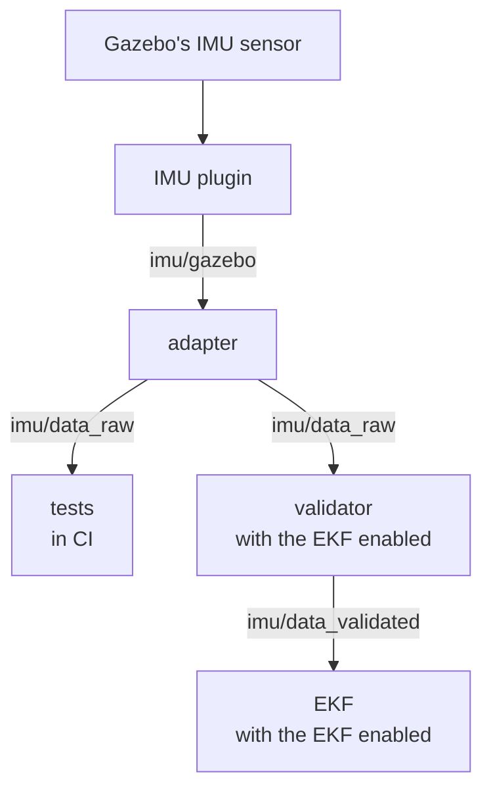

# IMU: Simulation

In the Gazebo simulation, DiffBot and Remo have an IMU too. The simulated IMU publishes on the same topic as the [BNO055 firmware on the real robot](../driver-bno055.md#what-the-firmware-publishes), with the same message type, the same frame and no orientation. So the nodes that read the IMU run with the same configuration in the simulation as on the robot. The noise and the covariances are the simulation's own, as [the simulation and the real robot](#the-simulation-and-the-real-robot) explains.

## One left turn, one message

Remo turns left on the spot at 0.5 rad/s. Which number of the IMU's message shows the turn? One message of the topic [`/diffbot/imu/data_raw`](#what-the-simulated-imu-publishes), from a run of Remo's simulation, has these three values among its fields:

- **[`angular_velocity.z`](#the-angular-velocity) is 0.4988 rad/s:** this number shows the turn. It is the yaw rate $\omega_z$, how fast the sensor turns about its upward z axis. At rest, the yaw rate is about 0 rad/s. In the turn, the yaw rate is about the turn rate, 0.5 rad/s. The yaw rate is the one value of the message that the EKF uses.
- **`header.frame_id` is [`imu_link`](position-and-axes.md#the-two-frames-and-their-fixed-joint):** this value explains the sign. The frame names the axes that the message's values are along. `imu_link` is the IMU's frame on the robot, and its z axis points up on both robots. Seen from above, a left turn is counterclockwise, and counterclockwise is the positive direction about an axis that points up at you. [The angular velocity](#the-angular-velocity) shows this rule in a figure.
- **[`orientation_covariance[0]`](#how-the-message-stores-a-covariance) is −1:** this value explains why the message has no heading. The −1 says that the message has no orientation. A gyroscope measures how fast the sensor turns, not which way the sensor points. To know the heading, something has to add up the yaw rates over time. That is the EKF's job, together with the wheel odometry, as [Localization: Wheel Odometry and IMU (EKF)](../robot_localization.md) explains.

??? example "The complete message, as `rostopic echo /diffbot/imu/data_raw` prints it"

    The block shows the whole message. The three highlighted lines are the three values above. The four zeros of `orientation` are a filler, not a rotation. The other numbers are the angular velocity about the two level axes, which stays near 0 rad/s on a level floor, the linear acceleration with gravity's 9.8 m/s² on the upward axis, and the covariances:

    ```yaml title="One message of /diffbot/imu/data_raw while Remo turns left" hl_lines="6 12 16"
    header:
      seq: 447
      stamp:
        secs: 9
        nsecs: 593000000
      frame_id: "imu_link"
    orientation:
      x: 0.0
      y: 0.0
      z: 0.0
      w: 0.0
    orientation_covariance: [-1.0, 0.0, 0.0, 0.0, 0.0, 0.0, 0.0, 0.0, 0.0]
    angular_velocity:
      x: -0.004345904605363372
      y: -0.003828368509674866
      z: 0.4988189368293472
    angular_velocity_covariance: [2.5e-05, 0.0, 0.0, 0.0, 2.5e-05, 0.0, 0.0, 0.0, 2.5e-05]
    linear_acceleration:
      x: 0.010647160142917143
      y: 0.10608663989830641
      z: 9.796201529357843
    linear_acceleration_covariance: [2.5e-05, 0.0, 0.0, 0.0, 2.5e-05, 0.0, 0.0, 0.0, 2.5e-05]
    ```

[What the simulated IMU publishes](#what-the-simulated-imu-publishes) explains every field.

## The parts, and where to read on

Three parts make the message, one after the other: Gazebo's IMU sensor, the robots' IMU plugin and an adapter. Two branches read the message. The tests run in CI. The IMU sample validator and the EKF run only when the EKF is enabled, with [`ekf:=true`](../robot_localization.md#what-the-launch-files-do-with-ekf). The validator and this switch are in a later commit of the diffbot repository than the simulated IMU, as the box "Reading the code" says.



The topics are in the [`/diffbot`](measurement-to-message.md#part-3-the-adapter) namespace, for both robots: [`/diffbot/imu/gazebo`](#from-the-sensor-to-the-ekf), [`/diffbot/imu/data_raw`](#what-the-simulated-imu-publishes) and [`/diffbot/imu/data_validated`](../robot_localization.md#the-imu-sample-validator). [From the sensor to the EKF](#from-the-sensor-to-the-ekf) says what each part adds to the message.

Four more pages go into the details. Each answers one question:

- **Which axis of the message is forward on my robot?** [Position and Axes](position-and-axes.md) shows where the IMU sits on each robot and which way its axes point, with the lines of the robot's URDF model that put the IMU there. Read it to change the mounting, too.
- **Where is a value of the message set?** [From Measurement to Message](measurement-to-message.md) follows one sample from Gazebo's IMU sensor to the published message, in the order in which the code runs: what the IMU sensor measures, the plugin's checks, the noise, the covariances, the header and the adapter.
- **Why don't the robots use the IMU plugin that comes with ROS?** [The Robots' Own IMU Plugin](plugin.md) explains what can go wrong with that plugin, and what the robots' copy does differently. It's background for the interested reader. You don't need it to use the simulated IMU.
- **What does CI check, and how do I run the checks?** [Tests](tests.md) shows the three tests in two Python files, how to run them and what a pass proves. Read it before you change the IMU in a robot's URDF model, the plugin or the adapter.

!!! info "Reading the code"

    - The excerpts on these pages show fixed revisions, with their comments. Their line numbers match the original files.
    - The diffbot repository's source is at two commits. The simulated IMU, its plugin, its adapter and its tests are at [`8c83f53`](https://github.com/ros-mobile-robots/diffbot/tree/8c83f53a6dd8685417e1d2a660d1d7395bf23757), the merge of the stricter IMU tests. The IMU sample validator and `ekf:=true` are at [`ead3402`](https://github.com/ros-mobile-robots/diffbot/tree/ead34027a9507c65d7415f93817177340d60d549), the merge commit of the EKF, which these pages use for both. The [Localization](../robot_localization.md) pages show the validator's code at the commits that their sections name.
    - Remo's URDF model is at [remo_description](../../remo_description.md) 2.5.0, and ROS's and Gazebo's sources are at one commit or one release each.
    - The link above each excerpt opens that revision and those lines on GitHub.
    - The numbers that a page calls "from a run" come from one run of Remo's simulation at these revisions, in the dev container. Another run gives other noise, and can give other times.

## What the simulated IMU publishes

Both robots publish [`/diffbot/imu/data_raw`]({{ imu_sim_src_url }}/diffbot_gazebo/scripts/imu_raw_adapter.py#L16-L27), 50 times per second, the firmware's rate. Each message is a [`sensor_msgs/Imu`](https://docs.ros.org/en/noetic/api/sensor_msgs/html/msg/Imu.html), ROS's standard message for IMU data. The excerpt shows the message's definition with its comments, from [`Imu.msg` in ROS's common_msgs]({{ common_msgs_src_url }}/sensor_msgs/msg/Imu.msg):

```text title="Imu.msg: the sensor_msgs/Imu message" linenums="1" hl_lines="15 17 18 20 21 23 24"
--8<-- "{{ common_msgs_src_raw }}/sensor_msgs/msg/Imu.msg"
```

The comments at the top are the message's contract for every publisher:

- Angular velocities are in rad/s, accelerations in m/s².
- Each of the three measurements, the orientation $\mathbf q$, the angular velocity $\boldsymbol\omega$ in rad/s and the linear acceleration $\mathbf f$ in m/s², comes with a covariance, which says how uncertain the measurement is. A publisher that knows only the variances puts them on the diagonal.
- A covariance of all zeros means that the covariance is unknown, not that the value has no uncertainty.
- −1 as a covariance's first element means that the publisher has no estimate for that field.

[How the message stores a covariance](#how-the-message-stores-a-covariance) shows a covariance's nine numbers and these two special cases.

The fields in order, and what the simulated IMU puts into them:

- **[`header`]({{ common_msgs_src_url }}/sensor_msgs/msg/Imu.msg#L15):** [`header.stamp`](https://docs.ros.org/en/noetic/api/std_msgs/html/msg/Header.html) is the message's time. In the simulation, the stamp is the simulation time at which Gazebo ran the IMU sensor's measurement, the sensor's update time. The motion data that the measurement uses has a time of its own, which can be a little earlier, as [two times of a measurement](measurement-to-message.md#part-1-gazebos-imu-sensor-measures) explains. `header.frame_id` names the frame whose axes the values use, here [`imu_link`](position-and-axes.md#the-two-frames-and-their-fixed-joint), the IMU's frame.
- **[`orientation`]({{ common_msgs_src_url }}/sensor_msgs/msg/Imu.msg#L17) and [`orientation_covariance`]({{ common_msgs_src_url }}/sensor_msgs/msg/Imu.msg#L18):** the IMU's orientation $\mathbf q$ and its covariance. The orientation is a **quaternion**: four numbers, x, y, z and w, that together describe a rotation in space. The ROS wiki's [quaternion basics](http://wiki.ros.org/tf2/Tutorials/Quaternions) explain them. Like the firmware, the simulated IMU has no orientation estimate. So the field is marked unavailable: [`orientation_covariance[0]`](#how-the-message-stores-a-covariance) is −1, and the quaternion's four numbers are 0. Four zeros don't describe a rotation, because a quaternion that does has the length 1. The −1 tells a node that reads the message not to use them.
- **[`angular_velocity`]({{ common_msgs_src_url }}/sensor_msgs/msg/Imu.msg#L20):** $\boldsymbol\omega$, how fast the sensor turns about each of `imu_link`'s three axes, in rad/s. [The angular velocity](#the-angular-velocity) shows the three rotations. The simulated IMU publishes $\tilde{\boldsymbol\omega}$, the angular velocity with noise.
- **[`angular_velocity_covariance`]({{ common_msgs_src_url }}/sensor_msgs/msg/Imu.msg#L21):** $\Sigma_\omega$, in (rad/s)². The noise's standard deviation is $\sigma = 0.005$ rad/s on each axis, so each variance is $\sigma^2 = 2.5 \cdot 10^{-5}$ (rad/s)².
- **[`linear_acceleration`]({{ common_msgs_src_url }}/sensor_msgs/msg/Imu.msg#L23):** despite its name, what an accelerometer measures: the specific force $\mathbf f$, the acceleration minus gravity, along the same axes, in m/s². [The linear acceleration](#the-linear-acceleration) explains it. The simulated IMU publishes $\tilde{\mathbf f}$, the specific force with noise.
- **[`linear_acceleration_covariance`]({{ common_msgs_src_url }}/sensor_msgs/msg/Imu.msg#L24):** $\Sigma_f$, in (m/s²)², with $\sigma = 0.005$ m/s² on each axis.

[From the sensor to the EKF](#from-the-sensor-to-the-ekf) says which part sets each of these values, with links to the setting or the lines of code.

### The angular velocity

--8<-- "includes/imu-sim-angular-velocity.html"

[`angular_velocity`]({{ common_msgs_src_url }}/sensor_msgs/msg/Imu.msg#L20) has one number for each axis of [`imu_link`](position-and-axes.md#the-two-frames-and-their-fixed-joint):

$$
\boldsymbol\omega = \begin{pmatrix} \omega_x \\ \omega_y \\ \omega_z \end{pmatrix}
$$

- **Each number** is how fast the sensor turns about that axis, in rad/s. $\omega_x$ is the message's `angular_velocity.x`, $\omega_y$ its `angular_velocity.y` and $\omega_z$ its `angular_velocity.z`.
- **The sign** follows the right-hand rule, as [REP 103](https://www.ros.org/reps/rep-0103.html#chirality), ROS's convention for coordinate frames, asks. Point your right thumb along the axis. Your fingers then curl in the positive direction.
- **The yaw rate** is $\omega_z$. `imu_link`'s z axis points up on both robots. So when the robot turns left, counterclockwise seen from above, $\omega_z$ is positive. The yaw rate is the one value of the message that the EKF fuses.
- **On a level floor**, the robot turns only about the upward axis. $\omega_x$ and $\omega_y$ then stay near 0.

The figure shows Remo. `imu_link`'s x axis points to Remo's right and its y axis forward, because the board is mounted turned by −90° about z. [Position and Axes](position-and-axes.md) shows the mounting on both robots.

### The linear acceleration

--8<-- "includes/imu-sim-specific-force.html"

[`linear_acceleration`]({{ common_msgs_src_url }}/sensor_msgs/msg/Imu.msg#L23) isn't the robot's acceleration alone. It's what an accelerometer measures, the **specific force**:

$$
\mathbf f = \mathbf a - \mathbf g
$$

- $\mathbf a$ is the acceleration of the point where the sensor sits.
- $\mathbf g$ is gravity. It points down, with 9.8 m/s² in the simulation.

All three are vectors along [`imu_link`](position-and-axes.md#the-two-frames-and-their-fixed-joint)'s axes, in m/s². Written out for the three axes:

$$
\begin{pmatrix} f_x \\ f_y \\ f_z \end{pmatrix} =
\begin{pmatrix} a_x \\ a_y \\ a_z \end{pmatrix} -
\begin{pmatrix} g_x \\ g_y \\ g_z \end{pmatrix}
$$

$f_x$ is the message's `linear_acceleration.x`, $f_y$ its `linear_acceleration.y` and $f_z$ its `linear_acceleration.z`.

So every reading is the acceleration minus gravity, on all three axes. A real accelerometer doesn't compute this difference. The difference is what the sensor feels. An accelerometer can't feel gravity itself, because gravity pulls on the sensor's housing and on the small mass inside it in the same way. What the sensor feels is the force that holds it up against gravity. The box at the top of [IMU: Bosch BNO055](../driver-bno055.md) explains the mass and its suspension. Gazebo's IMU sensor computes the difference, so that the simulated IMU sensor reads as a real one, in the lines of Gazebo's source code that [Part 1 of From Measurement to Message](measurement-to-message.md#part-1-gazebos-imu-sensor-measures) shows.

The list has four cases. The figure shows the first three:

- **At rest**, $\mathbf a$ is zero. With `imu_link`'s z axis up, gravity is $\mathbf g = (0, 0, -9.8)$ m/s², so the sensor reads $\mathbf f = (0, 0, +9.8)$ m/s². The floor holds the robot up, and the sensor reads that as 9.8 m/s² upward, although the robot doesn't move. At a steady speed in a straight line on a level floor, $\mathbf a$ is zero too, and the reading is the same.
- **Speeding up forward** with 0.5 m/s², the sensor reads 0.5 m/s² forward and 9.8 m/s² up. On Remo, forward is `imu_link`'s y axis, so the three numbers of this example are (0, +0.5, +9.8) m/s². The reading leans forward by only 3° from straight up, so the figure shows its tip in a circle, ten times larger. The forward value stays small next to the 9.8: the drive controller raises the robots' speed by at most 0.6 m/s in a second, the [`max_acceleration`]({{ imu_sim_src_url }}/diffbot_control/config/diffbot_control.yaml#L48) in [lines 47–48 of its configuration]({{ imu_sim_src_url }}/diffbot_control/config/diffbot_control.yaml#L47-L48).
- **In a turn**, the sensor moves on a circle, and its acceleration points to the circle's center. So the sensor accelerates although the turn rate stays the same. Its size is the turn rate squared times the distance to the center. Remo's IMU sits 8 cm from the midpoint of the wheel axle, which Remo turns about on the spot. At 0.5 rad/s, that gives $0.5^2 \cdot 0.08 = 0.02$ m/s², which is tiny next to the 9.8 m/s².
- **In free fall**, nothing holds the sensor up. $\mathbf a$ equals $\mathbf g$, and the sensor reads 0 on all three axes.

**A level, noise-free example:** the figure's numbers hold for a level floor, a robot that moves exactly as named, and readings without noise. A message of the simulation differs in two ways. Each value has the plugin's noise, and the simulated robot doesn't rest exactly level. The means of 200 readings each, from one run of Remo's simulation, show both:

- **At rest**, the mean reading was (+0.0004, +0.0693, +9.7998) m/s², not (0, 0, +9.8) m/s². The simulated Remo rests with its front about 0.4° higher than its rear. So a share of the upward reading, about 0.07 m/s², appears on the forward axis.
- **In the left turn** at 0.5 rad/s, the mean reading was (+0.0069, +0.0876, +9.7991) m/s². So the turn added +0.0065 m/s² to the x reading and +0.0183 m/s² to the y reading. The example's turn adds +0.0059 m/s² and +0.0190 m/s², which the figure rounds to +0.01 and +0.02.

The message in [one left turn, one message](#one-left-turn-one-message) is one reading of that turn, with its noise.

Which of the message's axes is forward depends on how the IMU is mounted. [Position and Axes](position-and-axes.md#the-mounting-on-each-robot) shows the mounting on both robots.

### How the message stores a covariance

Each of the message's three measurements has a covariance matrix: the orientation, the angular velocity and the linear acceleration. A covariance matrix says how uncertain a measurement is. Take the angular velocity, with its three components about the x, y and z axes. Its covariance matrix has three rows and three columns:

$$
\Sigma =
\begin{pmatrix}
\sigma_x^2 & \sigma_{xy} & \sigma_{xz} \\
\sigma_{yx} & \sigma_y^2 & \sigma_{yz} \\
\sigma_{zx} & \sigma_{zy} & \sigma_z^2
\end{pmatrix}
$$

- **On the diagonal** are the variances. $\sigma_x^2$ is the variance of the angular velocity about x: the square of its standard deviation $\sigma_x$, which says how far the value typically lies from the true one.
- **Off the diagonal** are the covariances. $\sigma_{xy}$ says whether the errors of the values about x and about y go up and down together. It's 0 when the two errors have nothing to do with each other. $\sigma_{xy}$ and $\sigma_{yx}$ are always equal.

The linear acceleration's matrix is built the same way, for its three components along the x, y and z axes. The orientation's matrix has three rows and three columns too, although a quaternion has four numbers. Its rows and columns stand for the rotation's errors about the x, y and z axes, not for three of the quaternion's four numbers. [`Imu.msg`]({{ common_msgs_src_url }}/sensor_msgs/msg/Imu.msg#L18) says so in the comment of its line 18: "about x, y, z axes".

Wikipedia's article on the [covariance matrix](https://en.wikipedia.org/wiki/Covariance_matrix) gives the definition.

A ROS message has no type for a matrix. `Imu.msg` declares each covariance as [`float64[9]`]({{ common_msgs_src_url }}/sensor_msgs/msg/Imu.msg#L18-L24), an array of nine numbers, with the comment "Row major", in the definition's lines 18, 21 and 24. Row major means row by row: the matrix's first row, then its second, then its third.

$$
[\,
\underbrace{\sigma_x^2, \sigma_{xy}, \sigma_{xz}}_{\text{row 1}},
\underbrace{\sigma_{yx}, \sigma_y^2, \sigma_{yz}}_{\text{row 2}},
\underbrace{\sigma_{zx}, \sigma_{zy}, \sigma_z^2}_{\text{row 3}}
\,]
$$

The array's elements are counted from 0, as in C++ and Python. Each element's index, at the element's place in the matrix:

$$
\begin{pmatrix}
\mathbf 0 & 1 & 2 \\
3 & \mathbf 4 & 5 \\
6 & 7 & \mathbf 8
\end{pmatrix}
$$

So the variances are at the indices 0, 4 and 8. [`angular_velocity_covariance[8]`]({{ common_msgs_src_url }}/sensor_msgs/msg/Imu.msg#L21), for example, is the angular velocity's $\sigma_z^2$, the variance of the yaw rate.

The message definition gives two arrays a special meaning, in its lines 7–8 and 10–13. Here they stand below the array of a publisher that knows only the variances:

- **The variances are known:** $[\,\sigma_x^2, 0, 0, 0, \sigma_y^2, 0, 0, 0, \sigma_z^2\,]$. A node that reads the message uses the values with these variances.
- **The covariance is unknown:** $[\,0, 0, 0, 0, 0, 0, 0, 0, 0\,]$, all zeros. A node that reads the message can use the values, but has to assume a covariance.
- **The field is unavailable:** $[\,-1, 0, 0, 0, 0, 0, 0, 0, 0\,]$. A node that reads the message ignores the field. The −1 goes into element 0. The message definition names no other element. The simulated IMU sets the other eight to 0.

What the simulated IMU's message holds:

- **`orientation_covariance`** is $[\,-1, 0, 0, 0, 0, 0, 0, 0, 0\,]$: the orientation is unavailable.
- **`angular_velocity_covariance`** is $[\,\sigma^2, 0, 0, 0, \sigma^2, 0, 0, 0, \sigma^2\,]$ with $\sigma^2 = 2.5 \cdot 10^{-5}$ (rad/s)²: the same variance for each axis.
- **[`linear_acceleration_covariance`]({{ common_msgs_src_url }}/sensor_msgs/msg/Imu.msg#L24)** has the same nine numbers, in (m/s²)².

None of the three covariance arrays is all zeros, so none says that a covariance is unknown. [Filling the covariances](measurement-to-message.md#filling-the-covariances) shows the plugin's lines that write the variances and explains why the other elements are 0. [Part 3: the adapter](measurement-to-message.md#part-3-the-adapter) shows the lines that write the −1.

## From the sensor to the EKF

[The diagram at the top of this page](#the-parts-and-where-to-read-on) shows the parts. What each of them adds to the message, or does with the message:

1. **Gazebo's IMU sensor** measures the angular velocity $\boldsymbol\omega$ and the specific force $\mathbf f$ at [`imu_link`](position-and-axes.md#the-two-frames-and-their-fixed-joint), the IMU's frame, at the rate that the robot's URDF model sets, 50 times per second. Gazebo computes both from the simulated robot's motion. [Part 1: Gazebo's IMU sensor measures](measurement-to-message.md#part-1-gazebos-imu-sensor-measures) shows the lines of Gazebo's source code, and [Position and Axes](position-and-axes.md) shows where `imu_link` sits on each robot.
2. **The robots' own IMU plugin** reads the IMU sensor's latest values when it publishes. The plugin publishes at most 50 times per second, and only while its topic has a subscriber. The plugin makes a [`sensor_msgs/Imu`](#what-the-simulated-imu-publishes) message from these values and publishes the message on [`/diffbot/imu/gazebo`](measurement-to-message.md#the-header-and-publishing). The plugin adds the noise to both vectors, writes the variance $\sigma^2$ into their covariances and sets the stamp and the frame. The noise's $\sigma$ of 0.005 rad/s and 0.005 m/s² is the plugin's parameter [`gaussianNoise`](measurement-to-message.md#reading-the-sensor-and-adding-noise) in the robot's URDF model. [Reading the sensor and adding noise](measurement-to-message.md#reading-the-sensor-and-adding-noise) shows where the robot's URDF model sets this parameter and which lines of the plugin use it. The plugin is a copy of the IMU plugin of ROS's [gazebo_plugins](https://github.com/ros-simulation/gazebo_ros_pkgs/tree/2.9.3/gazebo_plugins) package, because the original can stop the simulation's clock for good while the controllers start. [The Robots' Own IMU Plugin](plugin.md) explains why.
3. **The adapter**, [`imu_raw_adapter.py`](measurement-to-message.md#part-3-the-adapter), gives the simulated message the form of the message that the real robot's firmware publishes. The plugin's message has an orientation $\mathbf q$, and the firmware's message has none. The firmware reads only the BNO055's angular velocity and acceleration, because the EKF fuses only the yaw rate, as [what the firmware publishes](../driver-bno055.md#what-the-firmware-publishes) explains. So the adapter subscribes to `/diffbot/imu/gazebo`, marks the orientation unavailable and publishes the message on `/diffbot/imu/data_raw`. The stamp, the frame, the two vectors and their covariances stay as the plugin set them. The plugin's orientation is not ready to use, because the plugin adds noise to each of the quaternion's four numbers. [Part 3: the adapter](measurement-to-message.md#part-3-the-adapter) shows the adapter's code.
4. **The [IMU sample validator](../robot_localization.md#the-imu-sample-validator)** subscribes to `/diffbot/imu/data_raw` and forwards the samples that pass its checks on [`/diffbot/imu/data_validated`](../robot_localization.md#the-imu-sample-validator), which the EKF subscribes to. A forwarded sample keeps its stamp, its frame, its measurements and its covariances. Its `header.seq` is the validator's own count, as for [the adapter](measurement-to-message.md#part-3-the-adapter). The validator drops a sample while the ROS time is still zero, when the sample's frame isn't `imu_link`, when a value or a variance isn't usable, or when the sample's stamp is too old, too far ahead or not newer than the last one. The validator's code is [`imu_validator.py` in `diffbot_control`]({{ ekf_src_url }}/diffbot_control/scripts/imu_validator.py), at the EKF's merge commit `ead3402`. The validator and the EKF run only with [`ekf:=true`](../robot_localization.md#what-the-launch-files-do-with-ekf), as [running the EKF](../robot_localization.md#running-it) shows.
5. **The tests**, [`test_imu.py`](tests.md#the-test-at-rest) and [`test_imu_reset.py`](tests.md#the-reset-test), subscribe to `/diffbot/imu/data_raw` and check the messages in CI, as [Tests](tests.md) explains.

## The simulation and the real robot

The simulated IMU and the firmware keep the same contract for the message, so that the same validator and the same EKF configuration work with both:

- **The same:** the topic [`/diffbot/imu/data_raw`](#what-the-simulated-imu-publishes), the message type `sensor_msgs/Imu`, the rate of 50 Hz, the frame [`imu_link`](position-and-axes.md#the-two-frames-and-their-fixed-joint), and the orientation marked unavailable.
- **Not the same:** the values' noise and the covariances. The simulation's noise is a setting of the plugin, and the firmware's variances are settings of the firmware. The EKF weighs the yaw rate with its variance, [`angular_velocity_covariance[8]`](#how-the-message-stores-a-covariance). This variance is $2.5 \cdot 10^{-5}$ (rad/s)² in the simulation and $4 \cdot 10^{-4}$ (rad/s)² in the firmware's default configuration, 16 times as much. The linear acceleration's variances are $2.5 \cdot 10^{-5}$ (m/s²)² and $10^{-2}$ (m/s²)².

So the EKF gets its input in the same form in the simulation as on the robot, but not with the same weight. A filter that behaves well in the simulation is not yet tuned for the real sensor.

The excerpt shows the firmware's two variances, from [`diffbot_base_config.h`, lines 65–73]({{ imu_sim_src_url }}/diffbot_firmware/lib/config/diffbot_base_config.h#L65-L73). [Filling the covariances](measurement-to-message.md#filling-the-covariances) shows the plugin's lines for the simulation's variances:

```cpp title="diffbot_base_config.h: the firmware's IMU settings" linenums="65" hl_lines="7 8"
--8<-- "{{ imu_sim_src_raw }}/diffbot_firmware/lib/config/diffbot_base_config.h:65:73"
```
