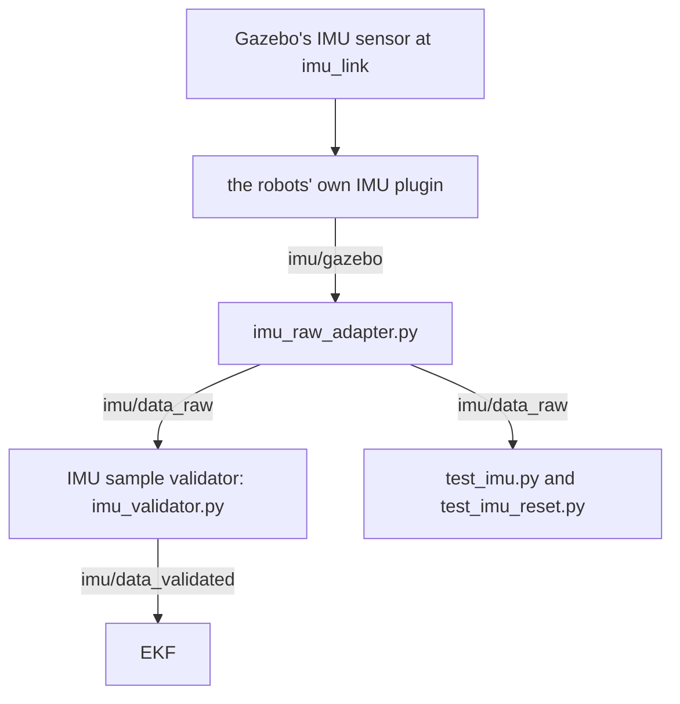

# IMU: Simulation

In the Gazebo simulation, DiffBot and Remo have an IMU too. It publishes the same topic and the same message as the [BNO055 firmware on the real robot](../driver-bno055.md#what-the-firmware-publishes). So the EKF that fuses the IMU's yaw rate, its angular velocity about the upward axis, with the wheel odometry gets the same input in the simulation as on the robot. [Localization: Wheel Odometry and IMU (EKF)](../robot_localization.md) explains the EKF and how to switch it on.

This page shows [what the simulated IMU publishes](#what-the-simulated-imu-publishes) and [which parts make the message](#from-the-sensor-to-the-ekf). Four more pages go into the details:

- **[Position and Axes](position-and-axes.md)** shows where the IMU sits on each robot and which way its axes point, with the lines of the robot's model that put it there. Read it to tell which axis of the message is the robot's forward direction, or to change the mounting.
- **[From Measurement to Message](measurement-to-message.md)** follows one sample from Gazebo's sensor to the published message: what the sensor measures, when the plugin publishes, the noise, the covariances, the stamp and the adapter. Read it to find where a value of the message is set.
- **[The Robots' Own IMU Plugin](plugin.md)** explains why the robots don't use the IMU plugin that comes with ROS, and what their copy does differently. It's background for the interested reader. You don't need it to use the simulated IMU.
- **[Tests](tests.md)** shows what CI checks on the simulated IMU and how the two tests work. Read it before you change the IMU's model, the plugin or the adapter.

!!! info "Reading the code"

    - The excerpts on these pages show fixed revisions, with their comments: diffbot's source at one commit, Remo's model at remo_description 2.5.0, and ROS's and Gazebo's sources at one commit each. Their line numbers match the original files.
    - The link above each excerpt opens that revision and those lines on GitHub.

## What the simulated IMU publishes

Both robots publish `/diffbot/imu/data_raw`, 50 times per second, the firmware's rate. Each message is a [`sensor_msgs/Imu`](https://docs.ros.org/en/noetic/api/sensor_msgs/html/msg/Imu.html), ROS's standard message for IMU data. The message's definition, [`Imu.msg` in ROS's common_msgs]({{ common_msgs_src_url }}/sensor_msgs/msg/Imu.msg):

```text title="Imu.msg: the sensor_msgs/Imu message" linenums="1" hl_lines="15 17 18 20 21 23 24"
--8<-- "{{ common_msgs_src_raw }}/sensor_msgs/msg/Imu.msg"
```

The comments at the top are the message's contract for every publisher:

- Angular velocities are in rad/s, accelerations in m/s².
- Each of the three measurements, the orientation, the angular velocity and the linear acceleration, comes with a covariance, which says how uncertain the measurement is. A publisher that knows only the variances puts them on the diagonal.
- A covariance of all zeros means that the covariance is unknown, not that the value has no uncertainty.
- −1 as a covariance's first element means that the publisher has no estimate for that field.

[How the message stores a covariance](#how-the-message-stores-a-covariance) shows a covariance's nine numbers and these two special cases.

The fields in order, and what the simulated IMU puts into them:

- **`header`:** `header.stamp` is the time of the measurement, here the simulation time at which Gazebo's sensor measured. `header.frame_id` names the frame whose axes the values use, here `imu_link`, the IMU's frame.
- **`orientation` and `orientation_covariance`:** the sensor's orientation and its covariance. The orientation is a **quaternion**: four numbers, x, y, z and w, that together describe a rotation in space. The ROS wiki's [quaternion basics](http://wiki.ros.org/tf2/Tutorials/Quaternions) explain them. Like the firmware, the simulated IMU has no orientation estimate. So the field is marked unavailable: `orientation_covariance[0]` is −1, and the quaternion's four numbers are 0. Four zeros don't describe a rotation, because a quaternion that does has the length 1. The −1 tells a node that reads the message not to use them.
- **`angular_velocity`:** $\boldsymbol\omega$, how fast the sensor turns about each of `imu_link`'s three axes, in rad/s. [The angular velocity](#the-angular-velocity) shows the three rotations. The simulated IMU publishes $\tilde{\boldsymbol\omega}$, the angular velocity with noise.
- **`angular_velocity_covariance`:** $\Sigma_\omega$, in (rad/s)². The noise's standard deviation is $\sigma = 0.005$ rad/s on each axis, so each variance is $\sigma^2 = 2.5 \cdot 10^{-5}$ (rad/s)².
- **`linear_acceleration`:** despite its name, what an accelerometer measures: the specific force $\mathbf f$, the acceleration minus gravity, along the same axes, in m/s². [The linear acceleration](#the-linear-acceleration) explains it. The simulated IMU publishes $\tilde{\mathbf f}$, the specific force with noise.
- **`linear_acceleration_covariance`:** $\Sigma_f$, in (m/s²)², with $\sigma = 0.005$ m/s² on each axis.

[From the sensor to the EKF](#from-the-sensor-to-the-ekf) says which part sets each of these values, with links to the setting or the lines of code.

### The angular velocity

--8<-- "includes/imu-sim-angular-velocity.html"

`angular_velocity` has one number for each axis of `imu_link`:

$$
\boldsymbol\omega = \begin{pmatrix} \omega_x \\ \omega_y \\ \omega_z \end{pmatrix}
$$

- **Each number** is how fast the sensor turns about that axis, in rad/s. $\omega_x$ is the message's `angular_velocity.x`, $\omega_y$ its `angular_velocity.y` and $\omega_z$ its `angular_velocity.z`.
- **The sign** follows the right-hand rule, as [REP 103](https://www.ros.org/reps/rep-0103.html#chirality), ROS's convention for coordinate frames, asks. Point your right thumb along the axis. Your fingers then curl in the positive direction.
- **The yaw rate** is $\omega_z$. `imu_link`'s z axis points up on both robots. So when the robot turns left, counterclockwise seen from above, $\omega_z$ is positive. The yaw rate is the one value of the message that the EKF fuses.
- **On a level floor**, the robot turns only about the upward axis. $\omega_x$ and $\omega_y$ then stay near 0.

The figure shows Remo. `imu_link`'s x axis points to Remo's right and its y axis forward, because the board is mounted turned by −90° about z. [Position and Axes](position-and-axes.md) shows the mounting on both robots.

### The linear acceleration

--8<-- "includes/imu-sim-specific-force.html"

`linear_acceleration` isn't the robot's acceleration alone. It's what an accelerometer measures, the **specific force**:

$$
\mathbf f = \mathbf a - \mathbf g
$$

- $\mathbf a$ is the acceleration of the point where the sensor sits.
- $\mathbf g$ is gravity. It points down, with 9.8 m/s² in the simulation.

All three are vectors along `imu_link`'s axes, in m/s². Written out for the three axes:

$$
\begin{pmatrix} f_x \\ f_y \\ f_z \end{pmatrix} =
\begin{pmatrix} a_x \\ a_y \\ a_z \end{pmatrix} -
\begin{pmatrix} g_x \\ g_y \\ g_z \end{pmatrix}
$$

$f_x$ is the message's `linear_acceleration.x`, $f_y$ its `linear_acceleration.y` and $f_z$ its `linear_acceleration.z`.

So every reading is the acceleration minus gravity, on all three axes. A real accelerometer doesn't compute this difference. The difference is what the sensor feels. An accelerometer can't feel gravity itself, because gravity pulls on the sensor's housing and on the small mass inside it in the same way. What the sensor feels is the force that holds it up against gravity. The box at the top of [IMU: Bosch BNO055](../driver-bno055.md) explains the mass and its suspension. Gazebo's sensor computes the difference, so that the simulated sensor reads as a real one, in the lines that [what the sensor measures](measurement-to-message.md#what-the-sensor-measures) shows.

Four cases. The figure shows the first three:

- **At rest**, $\mathbf a$ is zero. With `imu_link`'s z axis up, gravity is $\mathbf g = (0, 0, -9.8)$ m/s², so the sensor reads $\mathbf f = (0, 0, +9.8)$ m/s². The floor holds the robot up, and the sensor reads that as 9.8 m/s² upward, although the robot doesn't move. At a steady speed on a level floor, $\mathbf a$ is zero too, and the reading is the same.
- **Speeding up forward** with 0.5 m/s², the sensor reads 0.5 m/s² forward and 9.8 m/s² up. On Remo, forward is `imu_link`'s y axis, so the message's three numbers are (0, +0.5, +9.8). The reading leans forward by only 3° from straight up, so the figure shows its tip in a circle, ten times larger. The forward value stays small next to the 9.8: the drive controller raises the robots' speed by at most 0.6 m/s in a second, the `max_acceleration` in [lines 47–48 of its configuration]({{ imu_sim_src_url }}/diffbot_control/config/diffbot_control.yaml#L47-L48).
- **In a turn**, the sensor moves on a circle, and its acceleration points to the circle's center. Its size is the turn rate squared times the distance to the center. Remo's IMU sits 8 cm from the midpoint of the wheel axle, which Remo turns about on the spot. At 0.5 rad/s, that gives $0.5^2 \cdot 0.08 = 0.02$ m/s², which is tiny next to the 9.8 m/s².
- **In free fall**, nothing holds the sensor up. $\mathbf a$ equals $\mathbf g$, and the sensor reads 0 on all three axes.

Which of the message's axes is forward depends on how the IMU is mounted. [Position and Axes](position-and-axes.md#the-mounting-on-each-robot) shows the mounting on both robots.

### How the message stores a covariance

Each of the message's three measurements has a covariance matrix: the orientation, the angular velocity and the linear acceleration. A covariance matrix says how uncertain a measurement is. Take the angular velocity, with its three components about the x, y and z axes. Its covariance matrix has three rows and three columns:

$$
\Sigma =
\begin{pmatrix}
\sigma_x^2 & \sigma_{xy} & \sigma_{xz} \\
\sigma_{yx} & \sigma_y^2 & \sigma_{yz} \\
\sigma_{zx} & \sigma_{zy} & \sigma_z^2
\end{pmatrix}
$$

- **On the diagonal** are the variances. $\sigma_x^2$ is the variance of the angular velocity about x: the square of its standard deviation $\sigma_x$, which says how far the value typically lies from the true one.
- **Off the diagonal** are the covariances. $\sigma_{xy}$ says whether the errors of the values about x and about y go up and down together. It's 0 when the two errors have nothing to do with each other. $\sigma_{xy}$ and $\sigma_{yx}$ are always equal.

The linear acceleration's matrix is built the same way, for its three components along the x, y and z axes. The orientation's matrix has three rows and three columns too, although a quaternion has four numbers. Its rows and columns stand for the rotation's errors about the x, y and z axes, not for three of the quaternion's four numbers. `Imu.msg` says so in the comment of its line 18: "about x, y, z axes".

Wikipedia's article on the [covariance matrix](https://en.wikipedia.org/wiki/Covariance_matrix) gives the definition.

A ROS message has no type for a matrix. `Imu.msg` declares each covariance as `float64[9]`, an array of nine numbers, with the comment "Row major", in the definition's lines 18, 21 and 24. Row major means row by row: the matrix's first row, then its second, then its third.

$$
[\,
\underbrace{\sigma_x^2, \sigma_{xy}, \sigma_{xz}}_{\text{row 1}},
\underbrace{\sigma_{yx}, \sigma_y^2, \sigma_{yz}}_{\text{row 2}},
\underbrace{\sigma_{zx}, \sigma_{zy}, \sigma_z^2}_{\text{row 3}}
\,]
$$

The array's elements are counted from 0, as in C++ and Python. Each element's index, at the element's place in the matrix:

$$
\begin{pmatrix}
\mathbf 0 & 1 & 2 \\
3 & \mathbf 4 & 5 \\
6 & 7 & \mathbf 8
\end{pmatrix}
$$

So the variances are at the indices 0, 4 and 8. `angular_velocity_covariance[8]`, for example, is the angular velocity's $\sigma_z^2$, the variance of the yaw rate.

The message definition gives two arrays a special meaning, in its lines 7–8 and 10–13. Here they stand below the array of a publisher that knows only the variances:

- **The variances are known:** $[\,\sigma_x^2, 0, 0, 0, \sigma_y^2, 0, 0, 0, \sigma_z^2\,]$. A node that reads the message uses the values with these variances.
- **The covariance is unknown:** $[\,0, 0, 0, 0, 0, 0, 0, 0, 0\,]$, all zeros. A node that reads the message can use the values, but has to assume a covariance.
- **The field is unavailable:** $[\,-1, 0, 0, 0, 0, 0, 0, 0, 0\,]$. A node that reads the message ignores the field. The −1 goes into element 0. The message definition names no other element. The simulated IMU sets the other eight to 0.

What the simulated IMU's message holds:

- **`orientation_covariance`** is $[\,-1, 0, 0, 0, 0, 0, 0, 0, 0\,]$: the orientation is unavailable.
- **`angular_velocity_covariance`** is $[\,\sigma^2, 0, 0, 0, \sigma^2, 0, 0, 0, \sigma^2\,]$ with $\sigma^2 = 2.5 \cdot 10^{-5}$ (rad/s)²: the same variance for each axis.
- **`linear_acceleration_covariance`** has the same nine numbers, in (m/s²)².

None of the three covariance arrays is all zeros, so none says that a covariance is unknown. [Noise and covariance](measurement-to-message.md#noise-and-covariance) shows the plugin's lines that write the variances and explains why the other elements are 0. [The adapter](measurement-to-message.md#the-adapter) shows the lines that write the −1.

## From the sensor to the EKF

Three parts make the message, one after the other. Two more read it:



The topics are in the `/diffbot` namespace, for both robots. The parts of the diagram, and what each adds to the message:

1. **Gazebo's IMU sensor** measures the angular velocity $\boldsymbol\omega$ and the specific force $\mathbf f$ at `imu_link`, the IMU's frame, 50 times per second. Gazebo computes both from the simulated robot's motion. [What the sensor measures](measurement-to-message.md#what-the-sensor-measures) shows the lines of Gazebo's code, and [Position and Axes](position-and-axes.md) shows where `imu_link` sits on each robot.
2. **The robots' own IMU plugin** turns each measurement into a `sensor_msgs/Imu` message and publishes it on `/diffbot/imu/gazebo`. The plugin adds the noise to both vectors, writes the variance $\sigma^2$ into their covariances and sets the stamp and the frame. The noise's $\sigma$ of 0.005 is the plugin's parameter `gaussianNoise` in the robot's model. [Noise and covariance](measurement-to-message.md#noise-and-covariance) shows where the model sets this parameter and which lines of the plugin use it. The plugin is a copy of the IMU plugin of ROS's gazebo_plugins package, because the original can stop the simulation's clock for good while the controllers start. [The Robots' Own IMU Plugin](plugin.md) explains why.
3. **The adapter**, `imu_raw_adapter.py`, subscribes to `/diffbot/imu/gazebo`. The plugin's message has an orientation, and the firmware's message has none. The firmware reads only the BNO055's angular velocity and acceleration, because the EKF fuses only the yaw rate, as [what the firmware publishes](../driver-bno055.md#what-the-firmware-publishes) explains. So the adapter marks the orientation unavailable and publishes the rest unchanged on `/diffbot/imu/data_raw`. [The adapter](measurement-to-message.md#the-adapter) shows its code.
4. **The [IMU sample validator](../robot_localization.md#the-imu-sample-validator)** subscribes to `/diffbot/imu/data_raw` and forwards the samples that pass its checks, unchanged, on `/diffbot/imu/data_validated`, which the EKF subscribes to. The validator drops a sample while the ROS time is still zero, when the sample's frame isn't `imu_link`, when a value or a variance isn't usable, or when the sample's stamp is too old, too far ahead or not newer than the last one. The validator's code is [`imu_validator.py` in `diffbot_control`]({{ diffbot_repo_url }}/diffbot_control/scripts/imu_validator.py). The validator and the EKF run only with `ekf:=true`, as [running the EKF](../robot_localization.md#running-it) shows.
5. **The tests**, `test_imu.py` and `test_imu_reset.py`, subscribe to `/diffbot/imu/data_raw` and check the messages in CI, as [Tests](tests.md) explains.
