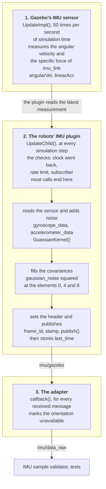
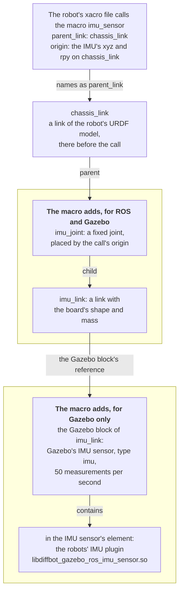

# IMU Simulation: From Measurement to Message

How one sample of the simulated IMU is made, from Gazebo's IMU sensor to the message on `/diffbot/imu/data_raw`. This page belongs to [IMU: Simulation](index.md), which shows the finished message.

Three parts make the sample, one after the other:

1. **Gazebo's IMU sensor** is the simulated IMU sensor. This sensor measures the angular velocity $\boldsymbol\omega$ and the specific force $\mathbf f$ of `imu_link`. The robot's URDF model declares the IMU sensor.
2. **The robots' IMU plugin** reads the IMU sensor's two results, adds noise, fills the covariances and the header, and publishes the message on `/diffbot/imu/gazebo`.
3. **The adapter** gives the simulated message the form of the message that the real robot's firmware publishes: the same topic, and no orientation. The plugin's message has an orientation $\mathbf q$, a quaternion with four numbers, and the firmware's message has none. So the adapter marks the orientation unavailable and publishes the rest unchanged on `/diffbot/imu/data_raw`.

The figure shows what each part does, in the order in which the code runs. The sections of this page follow the figure from top to bottom. The arrows show how the data reaches the message, not who calls whom. Gazebo runs the IMU sensor and the plugin in two separate loops, and the plugin reads the IMU sensor's latest measurement.



- [The IMU sensor in the robot's URDF model](#the-imu-sensor-in-the-robots-urdf-model) comes first. This section shows where the IMU sensor and the plugin are declared, before anything runs.
- [Part 1](#part-1-gazebos-imu-sensor-measures) is Gazebo's code.
- [Part 2](#part-2-the-plugin-makes-the-message) is the plugin's function `UpdateChild()`, from its first line to its last: [the checks](#the-checks-before-a-call-publishes), [the sensor's values with noise](#reading-the-sensor-and-adding-noise), [the covariances](#filling-the-covariances), and [the header and the call that publishes](#the-header-and-publishing).
- [Part 3](#part-3-the-adapter) is the adapter's callback.

## The IMU sensor in the robot's URDF model

Each robot's URDF model declares the simulated IMU sensor in a xacro macro named `imu_sensor`. [Position and Axes](position-and-axes.md#the-link-and-the-joint-in-the-model) explains what a macro and its call are. The diagram shows the macro's call, what the macro adds to the robot's URDF model, and who reads each part. Read the diagram from top to bottom. The two boxes with a bold first line hold what the macro adds. The labels on the arrows are the names that the URDF uses for these connections:



- **`imu_joint` and `imu_link`:** ROS and Gazebo both read them. The joint names `chassis_link` as its parent and `imu_link` as its child, and the call's origin places the joint. `robot_state_publisher` publishes the joint's transform, and Gazebo places the IMU sensor with this transform.
- **The Gazebo block:** only Gazebo reads this block. URDF tools and ROS ignore the block. The block's attribute `reference` names `imu_link`, the link that carries the IMU sensor. The IMU sensor's element contains the plugin's element.

DiffBot's macro is in [`common_sensors.xacro`]({{ imu_sim_src_url }}/diffbot_description/urdf/include/common_sensors.xacro#L204-L258) of `diffbot_description`, Remo's in [remo_description's file of the same name](https://github.com/ros-mobile-robots/remo_description/blob/2.5.0/urdf/include/common_sensors.xacro#L211-L268).

??? example "The complete macro `imu_sensor` of DiffBot's model"

    The excerpt shows the whole macro with the comment above it, from [`common_sensors.xacro`, lines 191–258]({{ imu_sim_src_url }}/diffbot_description/urdf/include/common_sensors.xacro#L191-L258). The link is in lines 208–234, the joint in lines 236–240 and the Gazebo block in lines 242–257:

    ```xml title="common_sensors.xacro: the macro imu_sensor" linenums="191"
    --8<-- "{{ imu_sim_src_raw }}/diffbot_description/urdf/include/common_sensors.xacro:191:258"
    ```

The next excerpt shows the macro's Gazebo block, which declares the IMU sensor and its plugin, from [`common_sensors.xacro`, lines 242–257]({{ imu_sim_src_url }}/diffbot_description/urdf/include/common_sensors.xacro#L242-L257):

```xml title="common_sensors.xacro: the IMU sensor and its plugin" linenums="242" hl_lines="2 5 10"
--8<-- "{{ imu_sim_src_raw }}/diffbot_description/urdf/include/common_sensors.xacro:242:257"
```

- **`<gazebo reference="imu_link">`:** this block holds what only Gazebo reads. `reference` attaches the IMU sensor to `imu_link`, so the IMU sensor measures at `imu_link`'s position and along its axes.
- **`type="imu"`:** this is Gazebo's IMU sensor. `update_rate` makes the IMU sensor measure 50 times per second.
- **`<plugin>`:** the plugin turns the IMU sensor's values into ROS messages. `filename` names its library, `libdiffbot_gazebo_ros_imu_sensor.so`, the robots' own copy of the IMU plugin that comes with ROS. [The Robots' Own IMU Plugin](plugin.md) explains why the robots have a copy, and how [Remo's URDF model gets the library's name](plugin.md#the-plugins-library-in-remos-model).

The lines inside `<plugin>` are the plugin's parameters:

- **`robotNamespace` and `topicName`:** `/diffbot` and `imu/gazebo` give the topic `/diffbot/imu/gazebo`.
- **`frameName`:** `imu_link` becomes the message's `header.frame_id`.
- **`updateRateHZ`:** 50 is the plugin's own limit, at most 50 messages per second.
- **`gaussianNoise`:** 0.005, in the last highlighted line, is the standard deviation $\sigma$ of the [noise that the plugin adds](#reading-the-sensor-and-adding-noise).
- **`xyzOffset`:** this parameter has no effect. The plugin reads the value and never uses it, as the comment in its source says: "POSITION OFFSET, UNUSED", in [line 275 of `gazebo_ros_imu_sensor.cpp`]({{ imu_sim_src_url }}/diffbot_gazebo_plugins/src/gazebo_ros_imu_sensor.cpp#L275). The plugin that comes with ROS has the same comment.
- **`rpyOffset` and `initialOrientationAsReference`:** both change only the orientation, which the adapter removes. `rpyOffset` is the one part of the offset that the plugin applies, in [line 150]({{ imu_sim_src_url }}/diffbot_gazebo_plugins/src/gazebo_ros_imu_sensor.cpp#L150).

Where the IMU sensor sits and how it's turned comes from the joint's origin in the robot's URDF model, not from the two offsets.

??? info "If you inspect the SDF model that Gazebo makes from the robot's URDF model"

    Gazebo converts the robot's URDF model into a model in its own format, SDF, before it simulates the robot. This SDF model has no `imu_link`. Gazebo merges links that are joined by fixed joints into one link, and `imu_link` hangs on a fixed joint.

    The IMU sensor is still there, at the same place. In the SDF model, the IMU sensor belongs to the link that remains, `base_footprint` for DiffBot, and the sensor's pose in that link is `imu_link`'s position and rotation. `gz sdf -p` prints the SDF model when you [convert the robot's URDF model as on the Gazebo Package page](../../../diffbot_gazebo.md#troubleshooting).

    For ROS nothing changes. `imu_link` stays the IMU's frame, in the message's header and in the transforms.

## Part 1: Gazebo's IMU sensor measures

The IMU sensor derives its measurements from motion that Gazebo has already computed. Gazebo's physics engine computes the motion of every link in every simulation step, and the IMU sensor reads the motion of the link that carries it. From that motion, the IMU sensor computes two vectors along `imu_link`'s axes: the angular velocity $\boldsymbol\omega$ and the specific force $\mathbf f$.

**Who runs this code, and when:** Gazebo's sensor manager runs the sensors in a loop of its own, apart from the physics engine. For each sensor, the loop calls `Sensor::Update()`. This function calls the IMU sensor's `ImuSensor::UpdateImpl()` once one update period has passed since the last measurement, in [lines 272–289 of Gazebo's `Sensor.cc`]({{ gazebo_src_url }}/gazebo/sensors/Sensor.cc#L272-L289). With the `update_rate` of 50 in the robot's URDF model, the period is 20 ms of simulation time. The robots' IMU plugin takes no part in the measurement. The plugin only reads the two results afterwards.

The excerpt shows the lines of Gazebo's source code that compute both vectors, from `ImuSensor::UpdateImpl()` in [`ImuSensor.cc` of Gazebo Classic 11.15.1, lines 322–380]({{ gazebo_src_url }}/gazebo/sensors/ImuSensor.cc#L322-L380), under the [Apache License 2.0]({{ gazebo_src_url }}/LICENSE):

```cpp title="ImuSensor.cc (Gazebo Classic 11.15.1): the two vectors" linenums="322" hl_lines="1 5 24 25 30 31 44 45 48 49 54 55"
--8<-- "{{ gazebo_src_raw }}/gazebo/sensors/ImuSensor.cc:322:380"
```

The variables, in the order in which the code computes them:

1. **`msg`:** in line 322, the latest motion data of the link that carries the IMU sensor. In Gazebo's SDF model that is the link that remains after the merging, as the box above explains. At the end of every simulation step, this link publishes its linear and angular velocity, in [`Link::PublishData()`]({{ gazebo_src_url }}/gazebo/physics/Link.cc#L1265-L1281). The IMU sensor receives each of these messages in [`ImuSensor::OnLinkData()`]({{ gazebo_src_url }}/gazebo/sensors/ImuSensor.cc#L252-L258) and keeps the newest one. These messages stay inside Gazebo. They aren't ROS messages.
2. **`dt`:** in line 326, the time between this motion data and the motion data of the IMU sensor's last measurement.
3. **`imuWorldPose`:** in line 342, where the IMU sensor is in the simulated world, and how the IMU sensor is turned. `imuWorldPose` combines the link's pose with the sensor's pose in the link.
4. **`linkWorldAngularVel`:** in line 345, the link's angular velocity from `msg`, along the world's axes.
5. **`angularVel`:** in line 351, the same angular velocity along the IMU sensor's axes, which are `imu_link`'s. `imuWorldPose.Rot().Inverse().RotateVector()` converts a vector from the world's axes to the sensor's. This is the angular velocity $\boldsymbol\omega$:

    $$
    \boldsymbol\omega = \begin{pmatrix} \omega_x \\ \omega_y \\ \omega_z \end{pmatrix}
    $$

6. **`linkWorldLinearVel`:** in line 360, the link's linear velocity from `msg`, along the world's axes.
7. **`imuWorldLinearVel`:** in line 365, the velocity of the point where the IMU sensor sits. That point isn't the link's origin, so a turning link moves that point too. The cross product adds this share.
8. **`linearAcc`:** in line 369, how much `imuWorldLinearVel` changed since the last measurement, `lastImuWorldLinearVel`, divided by `dt`, and converted to the sensor's axes. This is the acceleration $\mathbf a$ of the point where the IMU sensor sits.
9. **`linearAcc` again:** in line 375, the code subtracts gravity $\mathbf g$, converted to the sensor's axes too. `linearAcc` is now the **specific force** $\mathbf f$, in m/s²:

    $$
    \mathbf f = \mathbf a - \mathbf g =
    \begin{pmatrix} a_x - g_x \\ a_y - g_y \\ a_z - g_z \end{pmatrix}
    $$

The IMU sensor keeps both results. The plugin fetches them later with `sensor->AngularVelocity()` and `sensor->LinearAcceleration()`.

At rest, $\mathbf a$ is zero. With `imu_link`'s z axis up, gravity is $\mathbf g = (0, 0, -9.8)$ m/s², so the IMU sensor reads $\mathbf f = (0, 0, +9.8)$ m/s². The overview shows [the angular velocity](index.md#the-angular-velocity) and [the linear acceleration](index.md#the-linear-acceleration) each in a figure, and explains why an accelerometer reads the acceleration minus gravity.

Gazebo's gravity is 9.8 m/s² in the robots' worlds. That is the default of SDF, Gazebo's format for worlds and models, as the [SDF specification of `<gravity>`](http://sdformat.org/spec?ver=1.6&elem=world#world_gravity) says.

## Part 2: the plugin makes the message

The robots' IMU plugin makes the message in one function, `UpdateChild()`. `Load()` connects `UpdateChild()` to Gazebo's world update event. The excerpt shows this call, from [`gazebo_ros_imu_sensor.cpp`, lines 131–132]({{ imu_sim_src_url }}/diffbot_gazebo_plugins/src/gazebo_ros_imu_sensor.cpp#L131-L132):

```cpp title="gazebo_ros_imu_sensor.cpp: Load() connects UpdateChild()" linenums="131"
--8<-- "{{ imu_sim_src_raw }}/diffbot_gazebo_plugins/src/gazebo_ros_imu_sensor.cpp:131:132"
```

So Gazebo's physics thread, the part of Gazebo that computes the simulation's steps, calls `UpdateChild()` at the start of every step. With the 1 ms step of the simulation test's world, that is 1000 calls per second of simulation time. Most calls end after the checks. A call that passes them goes through the four steps below in this order, and publishes at the end.

### The checks before a call publishes

The first lines of `UpdateChild()` decide whether this call makes a message at all. The excerpt shows them, from [`gazebo_ros_imu_sensor.cpp`, lines 137–147]({{ imu_sim_src_url }}/diffbot_gazebo_plugins/src/gazebo_ros_imu_sensor.cpp#L137-L147):

```cpp title="gazebo_ros_imu_sensor.cpp: the start of UpdateChild()" linenums="137" hl_lines="3 5 6"
--8<-- "{{ imu_sim_src_raw }}/diffbot_gazebo_plugins/src/gazebo_ros_imu_sensor.cpp:137:147"
```

- **Two times:** `current_time` is the sensor's time: `sensor->LastUpdateTime()` in line 139, the simulation time of the IMU sensor's last measurement. `last_time` is the value that `current_time` had in the last call that got past the rate limit.
- **A clock that went back:** this is the first `if`, lines 141–142. A reset of the simulation sets Gazebo's clock back to zero. Then `current_time` is earlier than `last_time`, and the plugin sets `last_time` to `current_time`. The rate limit counts from the new time, and the plugin can publish again one period later. [Publishing again after a reset](plugin.md#publishing-again-after-a-reset) explains what would happen without these two lines.
- **The rate limit:** this is the second `if`, lines 144–145. `update_rate` is the parameter `updateRateHZ`, 50. A call returns right away while less than one period, 1/50 s = 20 ms, has passed since `last_time`. So at most 50 calls per second of simulation time go on.
- **A subscriber:** this is the third `if`, line 147. A call that got past the rate limit fills and publishes a message only while the topic has a subscriber. In the simulation, the adapter always subscribes.

### Reading the sensor and adding noise

A call that passed the checks reads the IMU sensor's last measurement and writes the measurement into the IMU message, with noise. The excerpt shows these lines, from [`gazebo_ros_imu_sensor.cpp`, lines 149–166]({{ imu_sim_src_url }}/diffbot_gazebo_plugins/src/gazebo_ros_imu_sensor.cpp#L149-L166):

```cpp title="gazebo_ros_imu_sensor.cpp: the sensor's values, with noise" linenums="149" hl_lines="3 4"
--8<-- "{{ imu_sim_src_raw }}/diffbot_gazebo_plugins/src/gazebo_ros_imu_sensor.cpp:149:166"
```

- **`accelerometer_data` and `gyroscope_data`:** the highlighted lines fetch the two results of [Part 1](#part-1-gazebos-imu-sensor-measures) from Gazebo's IMU sensor. `accelerometer_data` is the specific force $\mathbf f$, and `gyroscope_data` is the angular velocity $\boldsymbol\omega$.
- **`orientation`:** line 150 fetches the IMU sensor's orientation $\mathbf q$ in the simulated world. The adapter removes the orientation in [Part 3](#part-3-the-adapter).
- **`imu_msg`:** the lines from 155 on write each number into the message and add one random number to each.

The message's values are the IMU sensor's values plus noise:

$$
\tilde{\boldsymbol\omega} = \boldsymbol\omega + \mathbf n_\omega, \qquad \tilde{\mathbf f} = \mathbf f + \mathbf n_f
$$

$\tilde{\boldsymbol\omega}$ and $\tilde{\mathbf f}$ are what the message carries. Each component $n$ of $\mathbf n_\omega$ and $\mathbf n_f$ is a new random number in every message, from a normal distribution with mean 0 and standard deviation $\sigma$:

$$
n \sim \mathcal N(0, \sigma^2), \qquad \sigma = 0.005
$$

**Where $\sigma$ comes from:** $\sigma$ is the plugin's parameter `gaussianNoise`, 0.005, in the Gazebo block of the robot's URDF model, [line 251 of the macro](#the-imu-sensor-in-the-robots-urdf-model). The plugin reads the parameter into its variable `gaussian_noise` when Gazebo loads the plugin. The excerpt shows these lines, from [`gazebo_ros_imu_sensor.cpp`, lines 263–273]({{ imu_sim_src_url }}/diffbot_gazebo_plugins/src/gazebo_ros_imu_sensor.cpp#L263-L273):

```cpp title="gazebo_ros_imu_sensor.cpp: the parameter gaussianNoise" linenums="263" hl_lines="2 3 4"
--8<-- "{{ imu_sim_src_raw }}/diffbot_gazebo_plugins/src/gazebo_ros_imu_sensor.cpp:263:273"
```

**How a random number is drawn:** `GuassianKernel(0, gaussian_noise)` returns one random number with mean 0 and the standard deviation `gaussian_noise`. The excerpt above calls `GuassianKernel()` once for each value.

??? example "The function `GuassianKernel()`"

    The excerpt shows the function that draws one random number, from [`gazebo_ros_imu_sensor.cpp`, lines 194–206]({{ imu_sim_src_url }}/diffbot_gazebo_plugins/src/gazebo_ros_imu_sensor.cpp#L194-L206). It turns two evenly distributed random numbers into one normally distributed number, and scales that number with `sigma`:

    ```cpp title="gazebo_ros_imu_sensor.cpp: GuassianKernel()" linenums="194"
    --8<-- "{{ imu_sim_src_raw }}/diffbot_gazebo_plugins/src/gazebo_ros_imu_sensor.cpp:194:206"
    ```

**Two places where noise can be set:** the simulated IMU could get noise from two parts, and the robots use one of them.

- **Gazebo's IMU sensor** can add noise of its own, before the plugin reads the values. A URDF model asks for this noise with `<noise>` elements inside the sensor's `<imu>` element, one for each axis of the angular velocity and of the linear acceleration, as the [SDF specification of the IMU sensor](http://sdformat.org/spec?ver=1.6&elem=sensor#sensor_imu) lists them. The robots' URDF models have no such element. So Gazebo's IMU sensor adds no noise.
- **The plugin** adds noise when it fills the message. `gaussianNoise` is its only setting for that. All the noise that the robots' URDF models configure comes from the plugin.

**One value for both quantities:** $\sigma$ is 0.005 rad/s for the angular velocity and 0.005 m/s² for the specific force. This is a limit of the plugin, which has one parameter for all values, and not a model of a real sensor. A gyroscope's noise in rad/s and an accelerometer's noise in m/s² are different quantities with different sizes. The acceleration's noise doesn't matter to the EKF today, because the EKF fuses only the yaw rate $\omega_z$. The yaw rate's noise and variance do reach the EKF. They are simulation settings too. So the simulation doesn't show how the real sensor's noise affects the EKF.

**A simulation setting, not a measurement:** 0.005 isn't the BNO055's noise. At rest on Remo, the real BNO055's gyroscope scatters with a standard deviation of 0.0005 to 0.0008 rad/s, and its accelerometer with about 0.02 to 0.03 m/s². The [bench checks](../driver-bno055.md#bench-checks) on the BNO055 page have these measurements.

### Filling the covariances

After the values, the same call writes the covariances. The excerpt shows these lines, from [`gazebo_ros_imu_sensor.cpp`, lines 168–178]({{ imu_sim_src_url }}/diffbot_gazebo_plugins/src/gazebo_ros_imu_sensor.cpp#L168-L178):

```cpp title="gazebo_ros_imu_sensor.cpp: the covariances" linenums="168"
--8<-- "{{ imu_sim_src_raw }}/diffbot_gazebo_plugins/src/gazebo_ros_imu_sensor.cpp:168:178"
```

`gn2` is `gaussian_noise` squared, the variance $\sigma^2 = 2.5 \cdot 10^{-5}$. The plugin writes this variance into the elements 0, 4 and 8 of each covariance, in (rad/s)² for the angular velocity and in (m/s²)² for the specific force. These three elements are the matrix's diagonal, as [how the message stores a covariance](index.md#how-the-message-stores-a-covariance) on the overview shows. Element 8 of `angular_velocity_covariance` is the variance of the yaw rate $\omega_z$, which the EKF uses. The other elements stay 0. For the angular velocity:

$$
\Sigma_\omega = \begin{pmatrix} \sigma^2 & 0 & 0 \\ 0 & \sigma^2 & 0 \\ 0 & 0 & \sigma^2 \end{pmatrix} = \sigma^2 I_3
$$

$I_3$ is the 3 × 3 identity matrix. The specific force's covariance $\Sigma_f$ has the same numbers, in (m/s²)².

**Why the other elements are 0:** an element off the diagonal is the covariance of two axes' errors. The plugin draws a separate random number for each axis, so the noise on one axis says nothing about the noise on another. The two numbers are independent, and the covariance of two independent numbers is 0, as Wikipedia's article on [covariance](https://en.wikipedia.org/wiki/Covariance#Uncorrelatedness_and_independence) shows. On a real sensor, the errors of two axes can depend on each other. Then these elements aren't 0.

The first three lines of the excerpt write the orientation's covariance. The adapter replaces this covariance in [Part 3](#part-3-the-adapter).

### The header and publishing

The last lines of `UpdateChild()` set the header, publish the message and store the time for the next call's rate limit. The excerpt shows them, from [`gazebo_ros_imu_sensor.cpp`, lines 180–192]({{ imu_sim_src_url }}/diffbot_gazebo_plugins/src/gazebo_ros_imu_sensor.cpp#L180-L192):

```cpp title="gazebo_ros_imu_sensor.cpp: the end of UpdateChild()" linenums="180" hl_lines="6 12"
--8<-- "{{ imu_sim_src_raw }}/diffbot_gazebo_plugins/src/gazebo_ros_imu_sensor.cpp:180:192"
```

- **The frame:** `body_name` is the parameter `frameName`, `imu_link`.
- **The stamp:** `current_time` is the simulation time of the IMU sensor's last measurement, from the first line of `UpdateChild()`.
- **`publish()`:** line 185, the first highlighted line, publishes the finished message on `/diffbot/imu/gazebo`. This is the one place where the plugin publishes.
- **`last_time`:** line 191, the second highlighted line, stores `current_time` for the rate limit of the next calls. Line 191 also runs when no node subscribes.

!!! note "The original plugin calls `ros::spinOnce()` after `publish()`"

    gazebo_plugins' original IMU plugin calls `ros::spinOnce()` right after `publish()`, in [line 150 of its source](https://github.com/ros-simulation/gazebo_ros_pkgs/blob/2.9.3/gazebo_plugins/src/gazebo_ros_imu_sensor.cpp#L150). The robots' copy has the comment of lines 186–188 at this place instead. This one call is the main reason why the robots have their own plugin: with `ros::spinOnce()` at this place, the simulation's clock can stop for good while the controllers start. [Why the plugin doesn't spin](plugin.md#why-the-plugin-doesnt-spin) explains how.

## Part 3: the adapter

The adapter is there so that the nodes that read the IMU get its message in the same form in the simulation as on the real robot: a `sensor_msgs/Imu` message on `/diffbot/imu/data_raw`, with the orientation marked unavailable. On the real robot, the Teensy's firmware publishes this topic without an orientation, as [what the firmware publishes](../driver-bno055.md#what-the-firmware-publishes) shows. The plugin's message on `/diffbot/imu/gazebo` has an orientation $\mathbf q$. So [`imu_raw_adapter.py`]({{ imu_sim_src_url }}/diffbot_gazebo/scripts/imu_raw_adapter.py) takes each of the plugin's messages, marks the orientation unavailable as the firmware does, and publishes the result on `/diffbot/imu/data_raw`. The adapter changes nothing else. The angular velocity, the specific force and their covariances stay as the plugin set them. So their noise and their variances are the simulation's, not the firmware's.

`diffbot_view.launch` starts the adapter in the `diffbot` namespace. So the adapter's relative topic names become `/diffbot/imu/gazebo` and `/diffbot/imu/data_raw`. The excerpt shows the line that starts the adapter, with its comment, from [`diffbot_view.launch`, lines 37–39]({{ imu_sim_src_url }}/diffbot_gazebo/launch/diffbot_view.launch#L37-L39):

```xml title="diffbot_view.launch: the adapter's node" linenums="37"
--8<-- "{{ imu_sim_src_raw }}/diffbot_gazebo/launch/diffbot_view.launch:37:39"
```

The next excerpt shows the adapter's code, from [`imu_raw_adapter.py`, lines 16–36]({{ imu_sim_src_url }}/diffbot_gazebo/scripts/imu_raw_adapter.py#L16-L36):

```python title="imu_raw_adapter.py" linenums="16" hl_lines="4 5 16 17 18 19 20"
--8<-- "{{ imu_sim_src_raw }}/diffbot_gazebo/scripts/imu_raw_adapter.py:16:36"
```

- **How a field is marked unavailable:** a `sensor_msgs/Imu` message always has an orientation field. To say that a field holds no data, a publisher sets the first element of the field's covariance to −1. The [message definition's comments]({{ common_msgs_src_url }}/sensor_msgs/msg/Imu.msg#L10-L13) ask for that, and so does [REP 145](https://www.ros.org/reps/rep-0145.html#topics), the ROS convention for IMU drivers. A node that reads the message should check that element and ignore the field. `ORIENTATION_UNAVAILABLE` is such a covariance: −1, then eight zeros. [How the message stores a covariance](index.md#how-the-message-stores-a-covariance) shows the array next to the other cases.
- **A convention, not a rule to drop the orientation:** REP 145 doesn't ask an IMU driver to leave out the orientation. A driver whose sensor estimates an orientation can publish the orientation on `imu/data`. The firmware's topic, `imu/data_raw`, is REP 145's name for the accelerometer's and the gyroscope's data alone.
- **`callback()`:** the callback sets the four numbers of the quaternion $\mathbf q$ to 0 and the orientation covariance to a copy of the constant. `list()` makes the copy, so that the messages don't share the constant's list. Then the callback publishes the same message object.
- **What stays:** the header with its stamp and frame, the angular velocity $\tilde{\boldsymbol\omega}$, the specific force $\tilde{\mathbf f}$ and their covariances $\Sigma_\omega$ and $\Sigma_f$. The adapter doesn't stamp the message again. The [IMU sample validator](../robot_localization.md#the-imu-sample-validator) checks how old each sample is, and a new stamp would hide a delay.
