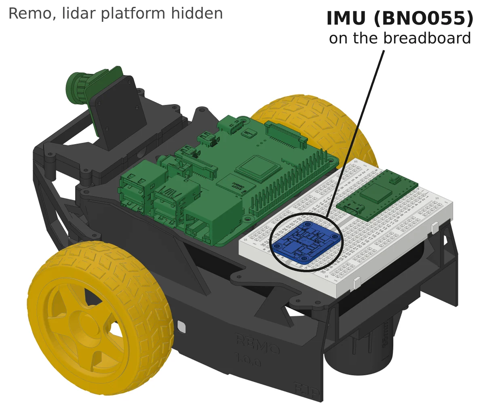
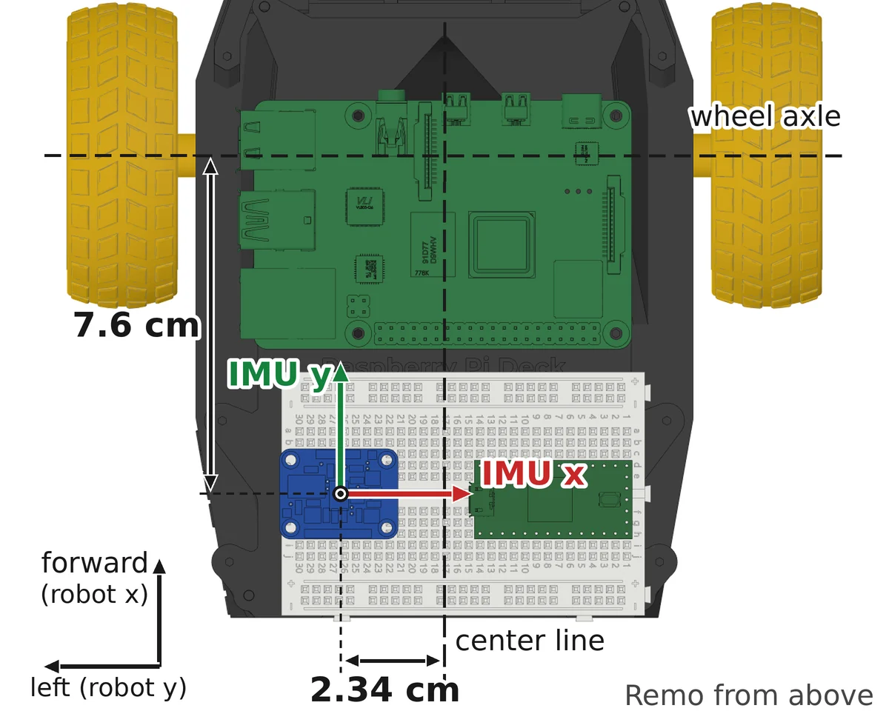

# IMU Simulation: Position and Axes

Where the simulated IMU sits on each robot, and which way its axes point. This page belongs to [IMU: Simulation](index.md), which shows the IMU's message.

--8<-- "includes/imu-sim-frames.html"

The figure shows Remo. DiffBot has the same three parts, with other values. Their names come from the robot's model:

- **`imu_link`** is the IMU's frame: a point on the robot with three axes. Every value in the IMU's message is along these axes.
- **`chassis_link`** is the frame at the center of the robot's base plate. Its x axis points forward, its y axis to the left and its z axis up, as [REP 103](https://www.ros.org/reps/rep-0103.html#axis-orientation), ROS's convention for coordinate frames, asks for a robot's body. The models declare `chassis_link` in their [base macro]({{ imu_sim_src_url }}/diffbot_description/urdf/include/common_macros.urdf.xacro#L197-L207).
- **`imu_joint`** is a fixed joint that puts `imu_link` on `chassis_link`. The joint's origin says where the sensor sits and how the sensor is turned:
    - `xyz` is the position in m, along `chassis_link`'s x, y and z axes.
    - `rpy` is the rotation in rad: roll about x, pitch about y and yaw about z.

The EKF needs the yaw rate along the robot's axes, not along the IMU's. It converts the IMU's values with this joint's transform. [`robot_state_publisher`](http://wiki.ros.org/robot_state_publisher) publishes the transform: this ROS node reads the robot's model and publishes the position of every link to tf, ROS's system for transforms between frames. In the simulation, [`diffbot_control.launch`]({{ imu_sim_src_url }}/diffbot_control/launch/diffbot_control.launch#L28-L30) starts it.

## The link and the joint in the model

The robots' models are written in [xacro](http://wiki.ros.org/xacro), XML with variables and macros. The program `xacro` reads such a file and writes the URDF that ROS and Gazebo use.

A **macro** is a piece of model with a name and with blanks. A **call** names the macro and fills the blanks. Where xacro finds a call, it writes the macro's content, with the blanks filled in. So one macro can put the same part on two robots, at a different place on each.

Both robots' models declare `imu_link` and `imu_joint` in a macro named `imu_sensor`. The excerpts below are DiffBot's. [Remo's macro in remo_description](https://github.com/ros-mobile-robots/remo_description/blob/2.5.0/urdf/include/common_sensors.xacro#L211-L268) declares the same link and joint.

**The macro's first line** gives the macro's name and its blanks, which xacro calls parameters. [`common_sensors.xacro`, line 204]({{ imu_sim_src_url }}/diffbot_description/urdf/include/common_sensors.xacro#L204):

```xml title="common_sensors.xacro: the macro imu_sensor and its parameters" linenums="204"
--8<-- "{{ imu_sim_src_raw }}/diffbot_description/urdf/include/common_sensors.xacro:204:204"
```

**The joint** in the macro uses two of the parameters, in the highlighted lines. [`common_sensors.xacro`, lines 236–240]({{ imu_sim_src_url }}/diffbot_description/urdf/include/common_sensors.xacro#L236-L240):

```xml title="common_sensors.xacro: imu_joint in the macro" linenums="236" hl_lines="2 4"
--8<-- "{{ imu_sim_src_raw }}/diffbot_description/urdf/include/common_sensors.xacro:236:240"
```

**The call** in DiffBot's model. [`diffbot.urdf.xacro`, lines 80–82]({{ imu_sim_src_url }}/diffbot_description/urdf/diffbot.urdf.xacro#L80-L82):

```xml title="diffbot.urdf.xacro: the call of imu_sensor" linenums="80"
--8<-- "{{ imu_sim_src_raw }}/diffbot_description/urdf/diffbot.urdf.xacro:80:82"
```

How xacro puts the macro and the call together:

1. `<xacro:imu_sensor …>` is the call. The name after `xacro:` is the macro's name.
2. `parent_link="chassis_link"` fills the parameter `parent_link`. In the macro, `${parent_link}` stands for the parameter's value. So the joint's parent becomes `chassis_link`.
3. `sensor_prop="${sensor_prop}"` fills the parameter `sensor_prop` with the model's sensor settings. The joint doesn't use them. [The link](#the-link) does.
4. `*origin` is a parameter of another kind. The star says that this blank doesn't take a value in quotes. It takes a whole XML element: the element that stands between the call's opening and closing tags. Here that is the `<origin … />` line. The xacro documentation calls such a parameter a block parameter.
5. `<xacro:insert_block name="origin"/>` marks the place in the macro where xacro puts that element.
6. `$(arg imu_xyz)` and `$(arg imu_rpy)` are arguments of the model file. Each has a default value, and you can set another one when you run xacro. [The mounting on each robot](#the-mounting-on-each-robot) shows their values.

The result is this joint in DiffBot's URDF. The lines are xacro's output for `diffbot.urdf.xacro` at the pinned commit, with the arguments' defaults. They aren't a file in a repository:

```xml title="DiffBot's URDF, expanded by xacro: imu_joint"
<joint name="imu_joint" type="fixed">
  <parent link="chassis_link"/>
  <child link="imu_link"/>
  <origin rpy="0 0 0" xyz="0 0 0.01"/>
</joint>
```

So the macro says that the IMU has a link and a joint. The call says where the joint puts the link. That is why the position and the rotation stand in each robot's model file, and not in the macro. `type="fixed"` means that the joint can't move: `imu_link` keeps its place on `chassis_link`, as the board keeps its place on the robot.

### The link

The macro's link gives the IMU a shape, a collision box and a mass. [`common_sensors.xacro`, lines 206–234]({{ imu_sim_src_url }}/diffbot_description/urdf/include/common_sensors.xacro#L206-L234):

```xml title="common_sensors.xacro: the IMU's settings and imu_link" linenums="206" hl_lines="1"
--8<-- "{{ imu_sim_src_raw }}/diffbot_description/urdf/include/common_sensors.xacro:206:234"
```

`imu` in these lines holds the IMU's settings. They reach the link in three steps:

1. DiffBot's model reads the file `sensors.yaml` into the property `sensor_prop`, in [lines 32–33 of `diffbot.urdf.xacro`]({{ imu_sim_src_url }}/diffbot_description/urdf/diffbot.urdf.xacro#L32-L33).
2. The call passes `sensor_prop` to the macro, as step 3 of the list above says.
3. The highlighted line takes the entry `imu` out of `sensor_prop`.

The entry, [`sensors.yaml`, lines 16–26]({{ imu_sim_src_url }}/diffbot_description/config/diffbot/sensors.yaml#L16-L26):

```yaml title="sensors.yaml: the IMU's entry" linenums="16"
--8<-- "{{ imu_sim_src_raw }}/diffbot_description/config/diffbot/sensors.yaml:16:26"
```

DiffBot's entry has no mesh, so the link draws a red box of the board's size, 27 × 20 × 4 mm. The collision box has the same size, and `box_inertia` gives the link the board's mass, 3 g. Remo's entry names a mesh of the BNO055 board, in [lines 38–51 of Remo's `sensors.yaml`](https://github.com/ros-mobile-robots/remo_description/blob/2.5.0/config/remo/sensors.yaml#L38-L51).

## The mounting on each robot

Each robot's model file sets where its call puts the IMU. Choose your robot:

=== "Remo"

    <div class="grid" markdown>

    <figure markdown>
      
      <figcaption>Remo, with the lidar platform hidden. The IMU board sits on the breadboard, at the rear.</figcaption>
    </figure>

    <figure markdown>
      
      <figcaption>Remo from above. The IMU's x axis points to the right, its y axis forward, and its z axis up, toward you.</figcaption>
    </figure>

    </div>

    Remo's model describes the BNO055 board on the breadboard on the Raspberry Pi deck. The diffbot repository uses Remo's model at remo_description 2.5.0, the version that [`diffbot_dev.repos`]({{ imu_sim_src_url }}/diffbot_dev.repos) names. The call of the macro puts the IMU on `chassis_link`. [`remo.urdf.xacro`, lines 211–216](https://github.com/ros-mobile-robots/remo_description/blob/2.5.0/urdf/remo.urdf.xacro#L211-L216):

    ```xml title="remo.urdf.xacro: the call of imu_sensor" linenums="211" hl_lines="2 5"
    --8<-- "https://raw.githubusercontent.com/ros-mobile-robots/remo_description/2.5.0/urdf/remo.urdf.xacro:211:216"
    ```

    `imu_xyz` and `imu_rpy` are xacro arguments, declared at the top of the file with their defaults. [`remo.urdf.xacro`, lines 26–27](https://github.com/ros-mobile-robots/remo_description/blob/2.5.0/urdf/remo.urdf.xacro#L26-L27):

    ```xml title="remo.urdf.xacro: the IMU's mounting" linenums="26"
    --8<-- "https://raw.githubusercontent.com/ros-mobile-robots/remo_description/2.5.0/urdf/remo.urdf.xacro:26:27"
    ```

    Xacro turns the call into this joint in Remo's URDF. The lines are xacro's output for `remo.urdf.xacro` at 2.5.0, with the arguments' defaults. They aren't a file in a repository:

    ```xml title="Remo's URDF, expanded by xacro: imu_joint"
    <joint name="imu_joint" type="fixed">
      <parent link="chassis_link"/>
      <child link="imu_link"/>
      <origin rpy="0 0 -1.5707963" xyz="-0.0401 0.0234 0.013"/>
    </joint>
    ```

    - **Position:** −4.01 cm, +2.34 cm and +1.3 cm from `chassis_link`. `chassis_link` lies 3.6 cm behind the wheel axle, as the comment in [lines 71–74 of `remo.urdf.xacro`](https://github.com/ros-mobile-robots/remo_description/blob/2.5.0/urdf/remo.urdf.xacro#L71-L74) explains. So the chip's center lies 7.6 cm behind the wheel axle, 2.34 cm left of the robot's center line, and 8 cm above the floor. The board's header pins sit in the breadboard.
    - **Rotation:** $-\pi/2$ rad, −90°, about z. The board lies flat. Its z axis points up, its y axis forward and its x axis to the robot's right. A tilt test on Remo showed these axes, as the [bench checks](../driver-bno055.md#bench-checks) describe. The comment above the arguments in `remo.urdf.xacro` says how each value was found.

    What follows for the message's values on Remo:

    - Both z axes point up. So a left turn reads as a positive yaw rate $\omega_z$, for the IMU as for the robot.
    - Forward is `imu_link`'s y axis. So a forward acceleration appears in `linear_acceleration.y`, not in `linear_acceleration.x`.

=== "DiffBot"

    DiffBot uses the same BNO055 board as Remo, moved from one robot to the other. Its mounting on DiffBot isn't measured yet. So DiffBot's model uses placeholders: 1 cm above `chassis_link`'s origin, with the board's axes along the robot's. [`diffbot.urdf.xacro`, lines 4–10]({{ imu_sim_src_url }}/diffbot_description/urdf/diffbot.urdf.xacro#L4-L10):

    ```xml title="diffbot.urdf.xacro: the IMU's mounting" linenums="4"
    --8<-- "{{ imu_sim_src_raw }}/diffbot_description/urdf/diffbot.urdf.xacro:4:10"
    ```

    The call of the macro passes them to the joint. [`diffbot.urdf.xacro`, lines 80–82]({{ imu_sim_src_url }}/diffbot_description/urdf/diffbot.urdf.xacro#L80-L82):

    ```xml title="diffbot.urdf.xacro: the call of imu_sensor" linenums="80"
    --8<-- "{{ imu_sim_src_raw }}/diffbot_description/urdf/diffbot.urdf.xacro:80:82"
    ```

    In DiffBot's URDF, the joint's origin is `<origin rpy="0 0 0" xyz="0 0 0.01"/>`, on `chassis_link`, as [the expanded joint above](#the-link-and-the-joint-in-the-model) shows. To try another mounting, override the arguments when you expand the model, for example `xacro diffbot.urdf.xacro imu_xyz:='0 0 0.02'`.

    What follows for the message's values in DiffBot's model:

    - `imu_link` lies straight above `chassis_link`, with the same directions. Seen from above, the two frames lie on top of each other, so this page has no figure of them.
    - Both z axes point up. So a left turn reads as a positive yaw rate $\omega_z$.
    - Forward is `imu_link`'s x axis. So a forward acceleration appears in `linear_acceleration.x`.
