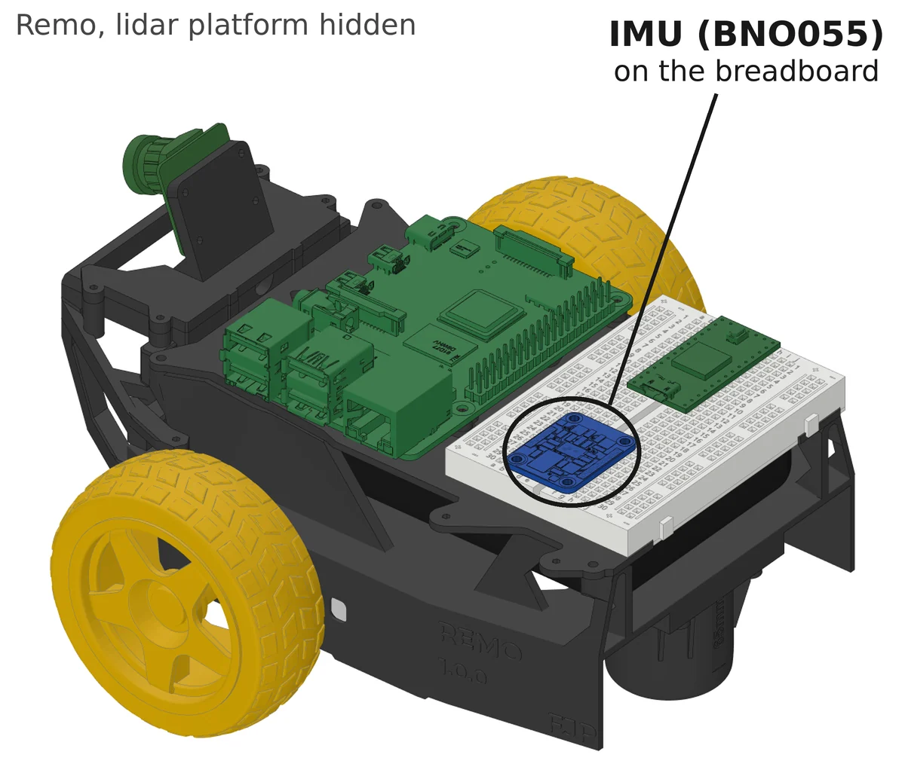
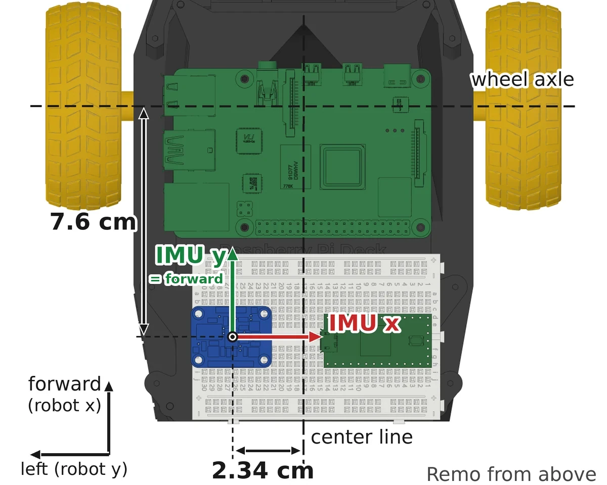

# IMU Simulation: Position and Axes

This page shows where the simulated IMU sits on each robot and which way the IMU's axes point. Read the page to find which axis of the IMU's message is forward on your robot, or to change the mounting. This page belongs to [IMU: Simulation](index.md), which shows the IMU's message.

Three names of the robot's URDF model describe the mounting. [`imu_link`](#the-two-frames-and-their-fixed-joint) is the IMU's frame, `chassis_link` is the frame at the center of the robot's base plate, and `imu_joint` is the fixed joint that puts `imu_link` on `chassis_link`. This page first shows [the mounting on each robot](#the-mounting-on-each-robot), then explains [the two frames and their fixed joint](#the-two-frames-and-their-fixed-joint) and [the lines of the robot's URDF model that make them](#the-link-and-the-joint-in-the-robots-urdf-model).

## The mounting on each robot

Choose your robot. The figure's tabs and the tabs of the text below switch together:

--8<-- "includes/imu-sim-frames.html"

=== "Remo"

    - **Position:** [`imu_link`](#the-two-frames-and-their-fixed-joint) lies 4.01 cm behind `chassis_link`, 2.34 cm to its left and 1.3 cm above it. That is 7.6 cm behind the wheel axle and 8 cm above the floor.
    - **Rotation:** −90° about z. The board lies flat on the breadboard.
    - **Axes:** `imu_link`'s x axis points to the robot's right, its y axis forward and its z axis up.
    - **For example:** when Remo speeds up forward with 0.5 m/s², the +0.5 m/s² appear in $f_y$, the message's [`linear_acceleration.y`](index.md#the-linear-acceleration). A left turn reads as a positive yaw rate $\omega_z$.
    - **Measured on the robot:** yes. A tilt test on Remo showed the axes, as the [bench checks](../driver-bno055.md#bench-checks) describe, and the position on the breadboard was checked on the robot.

    The two pictures show the mounting on a rendering of Remo:

    { width="340" }

    *Remo from the rear left, rendered with its mesh files installed and with the lidar platform hidden, which would cover the breadboard. The ring marks the IMU board on the breadboard, at the rear.*

    { width="340" }

    *Remo from above, front up, rendered with its mesh files installed. The IMU's y axis points forward and its x axis to the right. Its z axis points up, toward you. Select the picture to see the dimensions at full size.*

    The public [remo_description](../../remo_description.md) repository has empty placeholders for the mesh files, as [STL files](../../remo_description.md#stl-files) on the Remo Description page explains. With the placeholders, RViz and Gazebo show Remo without its meshes. The simulated IMU works the same: Gazebo's IMU sensor needs `imu_link`, not the board's mesh.

    Remo's URDF model describes the BNO055 board on the breadboard on the Raspberry Pi deck. The diffbot repository uses Remo's URDF model at remo_description 2.5.0, the version that [`diffbot_dev.repos`]({{ imu_sim_src_url }}/diffbot_dev.repos) names. The call of the macro puts the IMU on `chassis_link`. [The link and the joint in the robot's URDF model](#the-link-and-the-joint-in-the-robots-urdf-model) explains what a macro and its call are. The excerpt shows the call, from [`remo.urdf.xacro`, lines 211–216](https://github.com/ros-mobile-robots/remo_description/blob/2.5.0/urdf/remo.urdf.xacro#L211-L216):

    ```xml title="remo.urdf.xacro: the call of imu_sensor" linenums="211" hl_lines="2 5"
    --8<-- "https://raw.githubusercontent.com/ros-mobile-robots/remo_description/2.5.0/urdf/remo.urdf.xacro:211:216"
    ```

    [`imu_xyz`](https://github.com/ros-mobile-robots/remo_description/blob/2.5.0/urdf/remo.urdf.xacro#L26) and [`imu_rpy`](https://github.com/ros-mobile-robots/remo_description/blob/2.5.0/urdf/remo.urdf.xacro#L27) are [xacro](#the-link-and-the-joint-in-the-robots-urdf-model) arguments, declared at the top of the file with their defaults. The excerpt shows the two arguments, from [`remo.urdf.xacro`, lines 26–27](https://github.com/ros-mobile-robots/remo_description/blob/2.5.0/urdf/remo.urdf.xacro#L26-L27):

    ```xml title="remo.urdf.xacro: the IMU's mounting" linenums="26"
    --8<-- "https://raw.githubusercontent.com/ros-mobile-robots/remo_description/2.5.0/urdf/remo.urdf.xacro:26:27"
    ```

    Xacro turns the call into this joint in Remo's URDF model. The lines are xacro's output for `remo.urdf.xacro` at 2.5.0, with the arguments' defaults. They aren't a file in a repository:

    ```xml title="Remo's URDF, expanded by xacro: imu_joint"
    <joint name="imu_joint" type="fixed">
      <parent link="chassis_link"/>
      <child link="imu_link"/>
      <origin rpy="0 0 -1.5707963" xyz="-0.0401 0.0234 0.013"/>
    </joint>
    ```

    How the joint's numbers give the mounting:

    - **Position:** −4.01 cm, +2.34 cm and +1.3 cm from `chassis_link`. `chassis_link` lies 3.6 cm behind the wheel axle, as the comment in the collapsed box below explains. So the chip's center lies 7.6 cm behind the wheel axle, 2.34 cm left of the robot's center line, and 8 cm above the floor. The board's header pins sit in the breadboard.
    - **Rotation:** $-\pi/2$ rad, −90°, about z. Both z axes point up, so a left turn is positive for the IMU as for the robot. The yaw of −90° turns `imu_link`'s y axis forward, so a forward acceleration appears in $f_y$ and not in $f_x$. The comment above the arguments in `remo.urdf.xacro` says how each value was found.

    ??? example "Where `chassis_link` lies behind the wheel axle"

        The excerpt shows the lines of Remo's xacro file that compute [`axle_x`](https://github.com/ros-mobile-robots/remo_description/blob/2.5.0/urdf/remo.urdf.xacro#L71-L75), how far the wheel axle is in front of `chassis_link`, from [`remo.urdf.xacro`, lines 71–75](https://github.com/ros-mobile-robots/remo_description/blob/2.5.0/urdf/remo.urdf.xacro#L71-L75). The comment gives the value, 0.036 m:

        ```xml title="remo.urdf.xacro: axle_x" linenums="71"
        --8<-- "https://raw.githubusercontent.com/ros-mobile-robots/remo_description/2.5.0/urdf/remo.urdf.xacro:71:75"
        ```

=== "DiffBot"

    - **Position:** `imu_link` lies 1 cm straight above `chassis_link`.
    - **Rotation:** none.
    - **Axes:** `imu_link`'s axes point the same way as the robot's: x forward, y to the left and z up.
    - **For example:** when DiffBot speeds up forward with 0.5 m/s², the +0.5 m/s² appear in $f_x$, the message's `linear_acceleration.x`. A left turn reads as a positive yaw rate $\omega_z$.
    - **Measured on the robot:** no. These values are placeholders. DiffBot uses the same BNO055 board as Remo, moved from one robot to the other, and its mounting on DiffBot isn't measured yet.

    The excerpt shows the two arguments of DiffBot's xacro file with their comment, from [`diffbot.urdf.xacro`, lines 4–10]({{ imu_sim_src_url }}/diffbot_description/urdf/diffbot.urdf.xacro#L4-L10):

    ```xml title="diffbot.urdf.xacro: the IMU's mounting" linenums="4"
    --8<-- "{{ imu_sim_src_raw }}/diffbot_description/urdf/diffbot.urdf.xacro:4:10"
    ```

    The call of the macro passes the two arguments to the joint. The excerpt shows the call, from [`diffbot.urdf.xacro`, lines 80–82]({{ imu_sim_src_url }}/diffbot_description/urdf/diffbot.urdf.xacro#L80-L82):

    ```xml title="diffbot.urdf.xacro: the call of imu_sensor" linenums="80"
    --8<-- "{{ imu_sim_src_raw }}/diffbot_description/urdf/diffbot.urdf.xacro:80:82"
    ```

    In DiffBot's URDF model, the joint's origin is `<origin rpy="0 0 0" xyz="0 0 0.01"/>`, on `chassis_link`, as the expanded joint in [the link and the joint in the robot's URDF model](#the-link-and-the-joint-in-the-robots-urdf-model) shows. To try another mounting, override the arguments when you run xacro, for example `xacro diffbot.urdf.xacro imu_xyz:='0 0 0.02'`.

    Seen from above, the two frames lie on top of each other. So the figure shows DiffBot from the side.

## The two frames and their fixed joint

[The figure of the mounting](#the-mounting-on-each-robot) shows three parts: two frames and the joint between them. Both robots have them, with other values. Their names come from the robot's URDF model:

- **[`imu_link`]({{ imu_sim_src_url }}/diffbot_description/urdf/include/common_sensors.xacro#L208)** is the IMU's frame: a point on the robot with three axes. Every value in the IMU's message is along these axes.
- **[`chassis_link`]({{ imu_sim_src_url }}/diffbot_description/urdf/include/common_macros.urdf.xacro#L197-L207)** is the frame at the center of the robot's base plate. Its x axis points forward, its y axis to the left and its z axis up, as [REP 103](https://www.ros.org/reps/rep-0103.html#axis-orientation), ROS's convention for coordinate frames, asks for a robot's body. Each robot's URDF model declares `chassis_link` in its base macro: DiffBot's in [`common_macros.urdf.xacro`, lines 197–207]({{ imu_sim_src_url }}/diffbot_description/urdf/include/common_macros.urdf.xacro#L197-L207), and Remo's in [`remo_base_macro.urdf.xacro`, lines 20–30](https://github.com/ros-mobile-robots/remo_description/blob/2.5.0/urdf/include/remo_base_macro.urdf.xacro#L20-L30).
- **[`imu_joint`]({{ imu_sim_src_url }}/diffbot_description/urdf/include/common_sensors.xacro#L236-L240)** is not a frame. It is the fixed joint that puts `imu_link` on `chassis_link`. In tf, the joint appears as the transform from `chassis_link` to `imu_link`. The joint's origin says where the IMU sensor sits and how the IMU sensor is turned:
    - [`xyz`](https://github.com/ros/urdfdom/blob/1.0.4/urdf_parser/src/pose.cpp#L90-L115) is the position in m, along `chassis_link`'s x, y and z axes.
    - `rpy` is the rotation in rad: roll about x, pitch about y and yaw about z.

??? example "Where the two base macros declare `chassis_link`"

    The excerpt shows the lines of DiffBot's base macro that declare `base_link`, `chassis_link` and the joint between them, from [`common_macros.urdf.xacro`, lines 197–207]({{ imu_sim_src_url }}/diffbot_description/urdf/include/common_macros.urdf.xacro#L197-L207):

    ```xml title="common_macros.urdf.xacro (DiffBot): chassis_link" linenums="197"
    --8<-- "{{ imu_sim_src_raw }}/diffbot_description/urdf/include/common_macros.urdf.xacro:197:207"
    ```

    The next excerpt shows the same lines of Remo's base macro, from [`remo_base_macro.urdf.xacro`, lines 20–30](https://github.com/ros-mobile-robots/remo_description/blob/2.5.0/urdf/include/remo_base_macro.urdf.xacro#L20-L30):

    ```xml title="remo_base_macro.urdf.xacro (Remo): chassis_link" linenums="20"
    --8<-- "https://raw.githubusercontent.com/ros-mobile-robots/remo_description/2.5.0/urdf/include/remo_base_macro.urdf.xacro:20:30"
    ```

The EKF needs the yaw rate $\omega_z$ along the robot's axes, not along the IMU's. The EKF converts the IMU's values with this joint's transform. [`robot_state_publisher`](https://github.com/ros/robot_state_publisher/blob/1.15.3/src/robot_state_publisher.cpp#L145-L166) publishes the transform: this ROS node reads the robot's URDF model and publishes the position of every link to tf, ROS's system for transforms between frames. In the simulation, [`diffbot_control.launch`]({{ imu_sim_src_url }}/diffbot_control/launch/diffbot_control.launch#L44-L46) starts `robot_state_publisher`.

## The link and the joint in the robot's URDF model

The robots' URDF models are written in [xacro](http://wiki.ros.org/xacro), XML with variables and macros. The program `xacro` reads a robot's xacro files and writes one URDF file: the robot's URDF model, which ROS and Gazebo use.

A **macro** is a piece of a URDF model with a name and with blanks. A **call** names the macro and fills the blanks. Where xacro finds a call, it writes the macro's content, with the blanks filled in. So one macro can put the same part on two robots, at a different place on each.

Both robots' URDF models declare [`imu_link`]({{ imu_sim_src_url }}/diffbot_description/urdf/include/common_sensors.xacro#L208) and [`imu_joint`]({{ imu_sim_src_url }}/diffbot_description/urdf/include/common_sensors.xacro#L236-L240) in a macro named [`imu_sensor`]({{ imu_sim_src_url }}/diffbot_description/urdf/include/common_sensors.xacro#L204). The excerpts below are DiffBot's. [Remo's macro in remo_description](https://github.com/ros-mobile-robots/remo_description/blob/2.5.0/urdf/include/common_sensors.xacro#L211-L268) declares the same link and joint.

**The macro's first line:** the excerpt shows the line that gives the macro's name and its blanks, which xacro calls parameters, from [`common_sensors.xacro`, line 204]({{ imu_sim_src_url }}/diffbot_description/urdf/include/common_sensors.xacro#L204):

```xml title="common_sensors.xacro: the macro imu_sensor and its parameters" linenums="204"
--8<-- "{{ imu_sim_src_raw }}/diffbot_description/urdf/include/common_sensors.xacro:204:204"
```

**The joint:** the excerpt shows the joint in the macro, from [`common_sensors.xacro`, lines 236–240]({{ imu_sim_src_url }}/diffbot_description/urdf/include/common_sensors.xacro#L236-L240). The highlighted lines use two of the parameters:

```xml title="common_sensors.xacro: imu_joint in the macro" linenums="236" hl_lines="2 4"
--8<-- "{{ imu_sim_src_raw }}/diffbot_description/urdf/include/common_sensors.xacro:236:240"
```

**The call:** the excerpt shows the call in DiffBot's xacro file, from [`diffbot.urdf.xacro`, lines 80–82]({{ imu_sim_src_url }}/diffbot_description/urdf/diffbot.urdf.xacro#L80-L82):

```xml title="diffbot.urdf.xacro: the call of imu_sensor" linenums="80"
--8<-- "{{ imu_sim_src_raw }}/diffbot_description/urdf/diffbot.urdf.xacro:80:82"
```

How xacro puts the macro and the call together:

1. [`<xacro:imu_sensor …>`]({{ imu_sim_src_url }}/diffbot_description/urdf/diffbot.urdf.xacro#L80-L82) is the call. The name after [`xacro:`](https://github.com/ros/xacro/blob/1.14.20/src/xacro/__init__.py#L786-L795) is the macro's name.
2. [`parent_link="chassis_link"`]({{ imu_sim_src_url }}/diffbot_description/urdf/diffbot.urdf.xacro#L80) fills the parameter `parent_link`. In the macro, [`${parent_link}`]({{ imu_sim_src_url }}/diffbot_description/urdf/include/common_sensors.xacro#L237) stands for the parameter's value. So the joint's parent becomes [`chassis_link`](#the-two-frames-and-their-fixed-joint).
3. `sensor_prop="${sensor_prop}"` fills the parameter `sensor_prop` with the robot's sensor settings. The joint doesn't use them. [The link](#the-link) does.
4. `*origin` is a parameter of another kind. The star says that this blank doesn't take a value in quotes. It takes a whole XML element: the element that stands between the call's opening and closing tags. Here that is the [`<origin … />`]({{ imu_sim_src_url }}/diffbot_description/urdf/diffbot.urdf.xacro#L81) line. The xacro documentation calls such a parameter a block parameter.
5. [`<xacro:insert_block name="origin"/>`]({{ imu_sim_src_url }}/diffbot_description/urdf/include/common_sensors.xacro#L239) marks the place in the macro where xacro puts that element.
6. `$(arg imu_xyz)` and `$(arg imu_rpy)` are arguments of the robot's xacro file. Each has a default value, and you can set another one when you run xacro. [The mounting on each robot](#the-mounting-on-each-robot) shows their values.

The result is this joint in DiffBot's URDF model. The lines are xacro's output for `diffbot.urdf.xacro` at the pinned commit, with the arguments' defaults. They aren't a file in a repository:

```xml title="DiffBot's URDF, expanded by xacro: imu_joint"
<joint name="imu_joint" type="fixed">
  <parent link="chassis_link"/>
  <child link="imu_link"/>
  <origin rpy="0 0 0" xyz="0 0 0.01"/>
</joint>
```

So the macro says that the IMU has a link and a joint. The call says where the joint puts the link. That is why the position and the rotation stand in each robot's xacro file, and not in the macro. [`type="fixed"`]({{ imu_sim_src_url }}/diffbot_description/urdf/include/common_sensors.xacro#L236) means that the joint can't move: `imu_link` keeps its place on `chassis_link`, as the board keeps its place on the robot.

### The link

The macro's link gives the IMU a shape, a collision box and a mass. The excerpt shows the link, from [`common_sensors.xacro`, lines 206–234]({{ imu_sim_src_url }}/diffbot_description/urdf/include/common_sensors.xacro#L206-L234):

```xml title="common_sensors.xacro: the IMU's settings and imu_link" linenums="206" hl_lines="1"
--8<-- "{{ imu_sim_src_raw }}/diffbot_description/urdf/include/common_sensors.xacro:206:234"
```

[`imu`]({{ imu_sim_src_url }}/diffbot_description/config/diffbot/sensors.yaml#L16) in these lines holds the IMU's settings. They reach the link in three steps:

1. DiffBot's [xacro](#the-link-and-the-joint-in-the-robots-urdf-model) file reads the file [`sensors.yaml`]({{ imu_sim_src_url }}/diffbot_description/config/diffbot/sensors.yaml) into the property [`sensor_prop`]({{ imu_sim_src_url }}/diffbot_description/urdf/diffbot.urdf.xacro#L32-L33), in [lines 32–33 of `diffbot.urdf.xacro`]({{ imu_sim_src_url }}/diffbot_description/urdf/diffbot.urdf.xacro#L32-L33).
2. The call passes `sensor_prop` to the macro, as step 3 of the list above says.
3. The highlighted line takes the entry `imu` out of `sensor_prop`.

The excerpt shows the entry, from [`sensors.yaml`, lines 16–26]({{ imu_sim_src_url }}/diffbot_description/config/diffbot/sensors.yaml#L16-L26):

```yaml title="sensors.yaml: the IMU's entry" linenums="16"
--8<-- "{{ imu_sim_src_raw }}/diffbot_description/config/diffbot/sensors.yaml:16:26"
```

DiffBot's entry has no mesh, so the link draws a red box of the board's size, 27 × 20 × 4 mm. The collision box has the same size, and [`box_inertia`]({{ imu_sim_src_url }}/diffbot_description/urdf/include/common_macros.urdf.xacro#L305) gives the link the board's mass, 3 g. Remo's entry names a mesh of the BNO055 board, in [lines 38–51 of Remo's `sensors.yaml`](https://github.com/ros-mobile-robots/remo_description/blob/2.5.0/config/remo/sensors.yaml#L38-L51).
