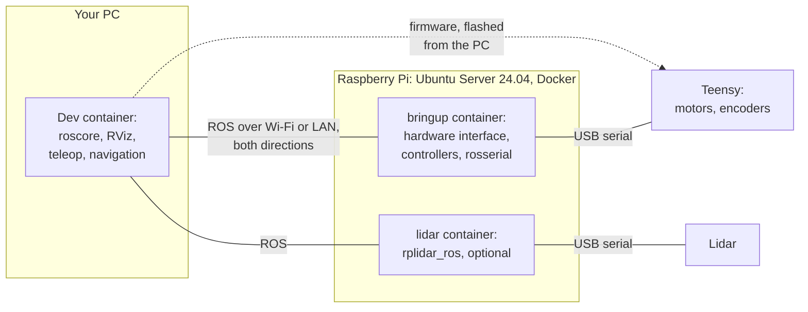
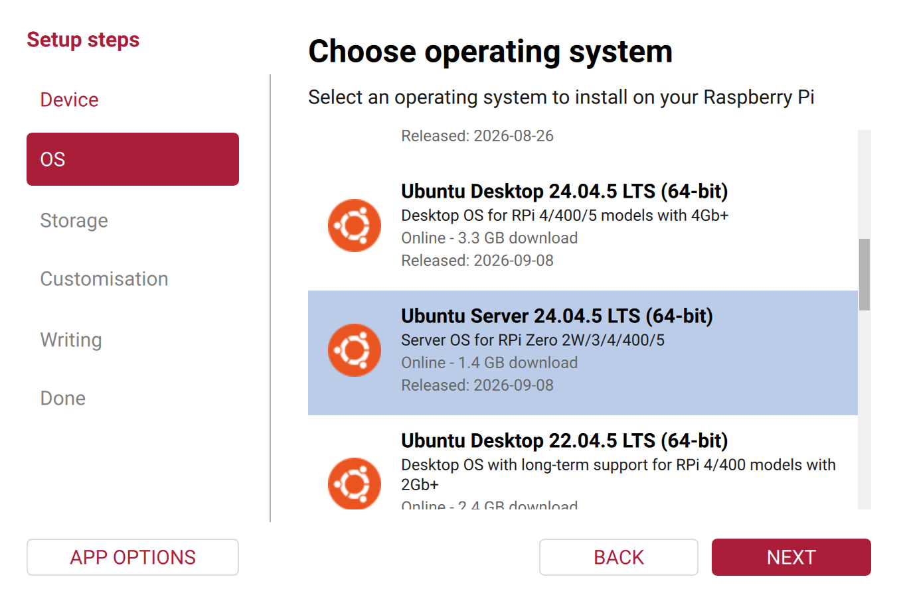

# Robot Container

The robot's computer, a Raspberry Pi 4 B, can run ROS Noetic in a [Docker](https://docs.docker.com/get-started/docker-overview/) container instead of a native installation. ROS Noetic needs Ubuntu 20.04, whose standard support ended in May 2025 ([ROS Setup](ros-setup.md)). With the container, the Raspberry Pi runs a current operating system, Ubuntu Server 24.04, and the container brings Ubuntu 20.04 and ROS Noetic along. Ubuntu 24.04 is also the OS of ROS 2 Jazzy, the planned next ROS version for the robots ([diffbot#136](https://github.com/ros-mobile-robots/diffbot/issues/136)), so the SD card doesn't have to be set up again for it.

The container doesn't make ROS Noetic itself supported again: Noetic reached its end of life on 31 May 2025, and its packages get no more updates. What gets updates is the operating system around it.

!!! warning "Experimental: not tested on a robot yet"
    CI builds the image for arm64, the Raspberry Pi's processor architecture, and tests it without hardware ([How it's tested](#how-its-tested)). It hasn't driven a robot yet. The test with teleop and the lidar on a Raspberry Pi in Remo is open in [diffbot#109](https://github.com/ros-mobile-robots/diffbot/issues/109), and the steps on this page follow Ubuntu's and Docker's documentation but haven't been run on that Raspberry Pi either. The native setup, [Raspberry Pi Setup](rpi-setup.md) and [ROS Setup](ros-setup.md), stays documented as the alternative.

## How it fits together



Two containers run on the Raspberry Pi, both from the same image: the bringup and, if the robot has one, the lidar. They talk ROS with your PC over the network, in both directions, and to the Teensy and the lidar over USB. The Teensy's firmware isn't part of the container: you flash it from the PC.

| Where | What runs there | Explained in |
|:--|:--|:--|
| Your PC | The [dev container](../development/dev-container.md) with ROS Noetic, Gazebo and RViz, and usually the ROS master (`roscore`) | [Set Up Your PC](../getting-started/set-up-your-pc.md), [ROS Network Setup](ros-network-setup.md) |
| The Raspberry Pi, the robot's host | Ubuntu Server 24.04 and Docker Engine, the udev rules for the serial devices, the diffbot repository with the settings, and a folder for ROS logs | [Set up the robot's host](#set-up-the-robots-host), [Settings](#settings) on this page |
| The robot containers, on the Raspberry Pi | ROS Noetic and the robot's packages: the bringup with the hardware interface, the controllers and rosserial, the robot models and the lidar driver. Docker builds their image on the Raspberry Pi from the diffbot repository | [Start, check and stop](#start-check-and-stop), [How the image is built](#how-the-image-is-built) on this page |
| The Teensy | The firmware that drives the motors and reads the encoders | [Microcontroller](teensy-mcu.md): flash it from the PC before the first start |

## Set up the robot's host

These steps run once. Each one says where it runs: on your PC, or on the Raspberry Pi over SSH.

### 1. Flash Ubuntu Server 24.04

On your PC, with [Raspberry Pi Imager](https://www.raspberrypi.com/software/) and the robot's microSD card:

1. **Device:** Raspberry Pi 4.
2. **OS:** *Other general-purpose OS* → *Ubuntu* → *Ubuntu Server 24.04.5 LTS (64-bit)*. Ubuntu supports the [Raspberry Pi 4 B](https://ubuntu.com/hardware/docs/boards/how-to/ubuntu_supported/raspberry-pi/) with this release.
3. **Storage:** your microSD card. Writing erases everything on it.
4. **Customisation:** a hostname for the robot, for example `remo`, your time zone and keyboard, a user name and password, your Wi-Fi, and *Enable SSH* with password authentication. Imager writes these settings onto the card, and Ubuntu applies them at the first boot.
5. **Write**, then put the card into the Raspberry Pi and switch it on.

=== "Choose the OS"

    { style="border: 1px solid var(--md-default-fg-color--lightest)" }

=== "Enable SSH"

    { style="border: 1px solid var(--md-default-fg-color--lightest)" }

=== "Before writing"

    { style="border: 1px solid var(--md-default-fg-color--lightest)" }

The screenshots show Raspberry Pi Imager 2.0.12 with example settings, before writing. Use your own SD card, time zone, network and credentials. [Ubuntu's guide](https://ubuntu.com/tutorials/how-to-install-ubuntu-on-your-raspberry-pi) shows the same steps.

### 2. First login and updates

The first boot takes a few minutes, while Ubuntu applies Imager's settings. Find the Raspberry Pi's IP address in your router's list of devices, under the hostname you chose. Then, on your PC:

```console
ssh robot@192.168.1.20
```

with your user name and the robot's address. All further steps run in this SSH session, on the Raspberry Pi. Wait until the first-boot setup has finished, then install the current updates and restart:

```console
cloud-init status --wait
sudo apt update && sudo apt full-upgrade
sudo reboot
```

- **`cloud-init status --wait`:** [cloud-init](https://cloudinit.readthedocs.io/en/latest/reference/cli.html#status) is the tool that applies Imager's settings on the first boot: the hostname, the user, Wi-Fi and SSH. It also installs Avahi ([step 3](#3-a-fixed-ip-address)), so it may still be installing packages when you log in. The command returns when cloud-init is done.
- **`sudo apt update && sudo apt full-upgrade`:** the system on the SD card is as old as the image. This installs all updates published since, the Linux kernel included. Ubuntu installs security updates automatically ([automatic updates](https://ubuntu.com/server/docs/how-to/software/automatic-updates/)), the others need this command from time to time.
- **`sudo reboot`:** restarts the Raspberry Pi, so that it runs the new kernel. After the restart, log in again.

### 3. A fixed IP address

`ROS_MASTER_URI` and `ROS_IP` in the [settings](#settings) hold IP addresses, so the robot's address and your PC's must not change. Give both a fixed address in your router: most routers call this a *DHCP reservation* or *static lease*.

Imager also had Avahi installed in step 2, a service that announces the Raspberry Pi's name on the network as `remo.local`, with your hostname. So `ssh robot@remo.local` works too, from PCs that look up these names, as Ubuntu Desktop and macOS do. ROS uses the IP addresses anyway: the containers on the Raspberry Pi and the dev container on your PC can't look up `.local` names. That needs mDNS (multicast DNS), the protocol behind these names, and their images don't include it. ROS's own pages explain the two variables, [`ROS_MASTER_URI`](https://wiki.ros.org/ROS/EnvironmentVariables#ROS_MASTER_URI) and [`ROS_IP`](https://wiki.ros.org/ROS/EnvironmentVariables#ROS_IP.2FROS_HOSTNAME), and how to check the network ([ROS/NetworkSetup](https://wiki.ros.org/ROS/NetworkSetup)).

### 4. The clock

ROS compares time stamps from the robot and the PC, for example to match a lidar scan with the robot's pose, so both clocks have to be right. The Raspberry Pi 4 has no battery-backed clock: after switching it on, its time is wrong until it has synchronized over the network. Check on the Raspberry Pi:

```console
timedatectl
```

It shows `System clock synchronized: yes` once the clock is right. Ubuntu's time service, systemd-timesyncd, asks time servers on the network (NTP), for example Ubuntu's own or one your router announces. It doesn't synchronize with your PC, but your PC sets its clock from time servers too, so both agree. `timedatectl timesync-status` shows which server the Raspberry Pi uses ([time synchronization](https://documentation.ubuntu.com/server/how-to/networking/timedatectl-and-timesyncd/)). The container uses the Raspberry Pi's clock, so it needs no setup of its own.

### 5. Docker Engine

Docker Engine builds the image and runs the containers. Install it the same way as on your PC ([Set Up Your PC](../getting-started/set-up-your-pc.md#docker)):

=== "Docker's repository"

    Follow Docker's guide [Install Docker Engine on Ubuntu](https://docs.docker.com/engine/install/ubuntu/#install-using-the-repository), section *Install using the apt repository*. It works the same on the Raspberry Pi, whose Ubuntu is the arm64 version. It adds Docker's package repository and installs:

    ```console
    sudo apt install docker-ce docker-ce-cli containerd.io docker-buildx-plugin docker-compose-plugin
    ```

=== "Ubuntu's packages"

    Ubuntu has its own Docker packages. Docker calls them unofficial, and they can be older than Docker's releases:

    ```console
    sudo apt install docker.io docker-compose-v2 docker-buildx
    ```

Then let your user run Docker without `sudo`, log out, and log in again so the new group applies ([post-installation steps](https://docs.docker.com/engine/install/linux-postinstall/)):

```console
sudo usermod -aG docker $USER
exit
```

After logging in again, check that Docker works:

```console
docker run --rm hello-world
```

!!! info "What these packages are for"
    - **Docker Engine** (`docker-ce`, or `docker.io` from Ubuntu): the background service `dockerd`, which builds images and runs containers. **containerd** is the part underneath that starts the containers.
    - **The Docker CLI** (`docker-ce-cli`, part of `docker.io` in Ubuntu): the `docker` command.
    - **Buildx** (`docker-buildx-plugin` or `docker-buildx`): the builder that `docker build` and Compose use.
    - **Compose** (`docker-compose-plugin` or `docker-compose-v2`): the `docker compose` command. It reads a `compose.yaml` file that describes the containers, their devices and their settings, so one command starts them all.

    That's all the robot needs: it builds one image and runs it with Compose. Members of the `docker` group can control Docker without `sudo`, which amounts to root access on the Raspberry Pi ([Docker's security notes](https://docs.docker.com/engine/security/#docker-daemon-attack-surface)).

### 6. The diffbot repository

Clone the [diffbot repository](https://github.com/ros-mobile-robots/diffbot) into your home folder:

```console
cd ~
git clone https://github.com/ros-mobile-robots/diffbot.git
```

Git is already installed on Ubuntu Server. Cloning needs no GitHub account and no Git settings: your name, email and editor only matter when you commit changes ([Git and GitHub](../getting-started/git-and-github.md)). The robot's Docker files are in [`.docker/robot`]({{ robot_container_src_url }}/.docker/robot). The dot at the start of the folder name hides it from a plain `ls`, like `.github`. In this repository, it marks folders for tools, apart from the ROS packages. It's not Docker's own settings folder `~/.docker`.

After the next steps, the robot's files are in these places on the Raspberry Pi:

```text
/home/robot/              your home folder (user robot)
├── diffbot/              the diffbot repository
│   └── .docker/robot/
│       ├── compose.yaml  the containers
│       ├── env.example   the settings template
│       └── .env          your settings
└── robot-data/           ROS logs (step 8)
```

`.env` is a copy of `env.example` with your [settings](#settings). The packages built in the image are inside it, in `/home/ros/catkin_ws`, not in your home folder.

### 7. Stable device names

The Linux kernel numbers serial devices in the order they appear, so the Teensy isn't always `/dev/ttyACM0`. [udev](https://manpages.ubuntu.com/manpages/noble/en/man7/udev.7.html), the service that creates the device files, can add fixed names by rules. The repository's [rules]({{ robot_container_src_url }}/.docker/robot/99-diffbot-robot.rules) name the Teensy `/dev/teensy` and the lidar `/dev/rplidar`, recognized by their USB vendor and product IDs:

```console
sudo cp ~/diffbot/.docker/robot/99-diffbot-robot.rules /etc/udev/rules.d/
sudo udevadm control --reload-rules
sudo udevadm trigger
ls -l /dev/teensy /dev/rplidar
```

1. `cp` installs the rules where udev reads them. The number `99` makes them come after the system's own rules.
2. `udevadm control --reload-rules` makes udev read its rule files again ([udevadm](https://manpages.ubuntu.com/manpages/noble/en/man8/udevadm.8.html)).
3. `udevadm trigger` replays the events of the devices that are already plugged in, so they get the new names without unplugging them.
4. `ls -l` shows the new names as links to the kernel's devices, for example `/dev/teensy -> ttyACM0`, for the devices that are plugged in.

`lsusb` lists the USB devices with their IDs: the Teensy is `16c0:0483`, the lidar's USB adapter `10c4:ea60`. Two devices with the same IDs need a rule with their serial number, as the rules file explains.

### 8. The folder for logs

```console
mkdir -p ~/robot-data
id -u
```

The containers write ROS's log files into this folder. Inside the container, they run as the user `ros` with the user ID (UID) 1000, so the folder must be writable for UID 1000. The first user on Ubuntu, the one from Imager, usually has that ID, which `id -u` shows. If it shows another number, give the folder to UID 1000: `sudo chown 1000:1000 ~/robot-data`.

## Settings

The settings are in the file `.env` in the folder `~/diffbot/.docker/robot`, next to `compose.yaml`. Docker Compose reads it from there. Create it from the template [`env.example`]({{ robot_container_src_url }}/.docker/robot/env.example), which explains each setting, and edit it, on the Raspberry Pi:

```console
cd ~/diffbot/.docker/robot
cp env.example .env
nano .env
```

For Remo with a lidar and the ROS master on your PC, it contains, besides comments:

```bash title=".docker/robot/.env"
ROBOT_MODEL=remo # (1)!
COMPOSE_PROFILES=lidar # (2)!
ROS_MASTER_URI=http://192.168.1.10:11311 # (3)!
ROS_IP=192.168.1.20 # (4)!
```

1. The robot this Raspberry Pi is in: `remo` or `diffbot`. It selects the robot model and the controller's wheel radius and separation. With the other robot's model, the controller computes the wheel speeds and the odometry with the wrong wheel geometry, and the robot's frames are the other robot's.
2. Starts the lidar driver too. Leave this line out on a robot without a lidar. To switch the lidar off later, run `docker compose down` while the line is still there, then remove it: without it, Compose doesn't stop the lidar container anymore.
3. The PC that runs `roscore`: `http://` and the PC's IP address, and `11311`, the ROS master's port ([`ROS_MASTER_URI`](https://wiki.ros.org/ROS/EnvironmentVariables#ROS_MASTER_URI)).
4. The Raspberry Pi's own IP address. ROS tells the other nodes to reach the robot's nodes at this address ([`ROS_IP`](https://wiki.ros.org/ROS/EnvironmentVariables#ROS_IP.2FROS_HOSTNAME)).

On your PC, set `ROS_MASTER_URI` to the same value, and `ROS_IP` to the PC's own address, as described in [ROS Network Setup](ros-network-setup.md). Without `ROS_MASTER_URI`, the bringup starts its own ROS master on the robot, which is enough to check the robot alone.

All settings:

| Setting | Default | What it's for |
|:--|:--|:--|
| `ROBOT_MODEL` | `remo` | `remo` or `diffbot`, the robot the container runs on |
| `COMPOSE_PROFILES` | not set | `lidar` starts the lidar container too |
| `ROS_MASTER_URI` | not set | The ROS master on the PC. Without it, the bringup starts a master on the robot |
| `ROS_IP` | not set | The robot's own IP address. `ROS_HOSTNAME` with a name works too, if the PC can resolve that name |
| `TEENSY_DEVICE`, `LIDAR_DEVICE` | `/dev/teensy`, `/dev/rplidar` | The serial devices on the host, from [step 7](#7-stable-device-names) |
| `DIALOUT_GID` | `20` | The number of the group that owns the serial devices on the host |
| `ROBOT_DATA` | `~/robot-data` | The folder for logs, from [step 8](#8-the-folder-for-logs) |

**Why `DIALOUT_GID` is a number:** inside the container, the user `ros` may open the Teensy's device only as a member of the group that owns it, `dialout` on Ubuntu. Docker can add a group to the container's user by name or by number, but it looks a name up in the container's own list of groups, where the same name could have another number than on the host. So `compose.yaml` adds the host's group by its number. On Ubuntu that's 20, the default. To check, on the Raspberry Pi:

```console
stat -Lc %g /dev/teensy
```

`-L` follows the link to the real device. Without it, `stat` shows the group of the link itself. Write the number into `.env`: Compose doesn't run commands in it.

??? info "How `compose.yaml` uses the settings"
    Both containers share these settings ([`compose.yaml`]({{ robot_container_src_url }}/.docker/robot/compose.yaml), lines 17–41):

    ```yaml title="compose.yaml" linenums="17"
    --8<-- "{{ robot_container_src_raw }}/.docker/robot/compose.yaml:17:41"
    ```

    - **`network_mode: host`** (line 21): the containers use the Raspberry Pi's network directly, so their ROS nodes are reachable at its IP address, like native ones. ROS 1 needs this: besides the master's port 11311, every node opens its own random port, and the other nodes connect to it directly ([ROS Network Setup](ros-network-setup.md)).
    - **`group_add`** (line 24): the group with the number from `DIALOUT_GID`.
    - **`environment`** (lines 26–29): passes the ROS network settings from `.env` into the containers.
    - **`volumes`** (lines 32–37): mounts the logs folder as the containers' `~/.ros`, where ROS writes its logs. Compose doesn't create a missing folder: Docker would create it for root, and the user `ros` couldn't write into it.
    - **`logging`** (lines 40–41): Docker's [local log format](https://docs.docker.com/engine/logging/drivers/local/), which keeps at most five files of 20 MB per container, so the containers' output can't fill the SD card.

    Each service then adds its device and its command: `bringup.launch` with the model, or `lidar.launch`.

## Start, check and stop

Flash the Teensy's firmware first ([Microcontroller](teensy-mcu.md)), and connect the Teensy and the lidar to the Raspberry Pi's USB ports. If the ROS master runs on your PC, start `roscore` there, in the dev container.

**Start** the robot, on the Raspberry Pi:

```console
cd ~/diffbot/.docker/robot
docker compose up -d --build
```

`up` starts the containers described in `compose.yaml`: the bringup, and the lidar if `COMPOSE_PROFILES=lidar` is set. `-d` runs them in the background and gives you the prompt back. `--build` builds the image first. The first build downloads the official ROS image and compiles the robot's packages on the Raspberry Pi, which takes a while. Later builds reuse the steps whose input didn't change, so they're usually much faster.

**Check** on the Raspberry Pi that the containers run, and follow their output:

```console
docker compose ps -a
docker compose logs -f
```

`ps -a` lists the containers with their state, also those that stopped: `bringup`, and `lidar` if it's on, should be running. `logs -f` follows the bringup's and the lidar's output. `Ctrl+C` stops following, and the robot keeps running.

Then check on your PC, in the dev container, that the robot's topics have data. A topic that's listed but has no messages isn't enough:

```console
rostopic hz /diffbot/measured_joint_states
rostopic echo -n 1 /diffbot/mobile_base_controller/odom
rostopic hz /diffbot/scan
```

`measured_joint_states` comes from the Teensy: messages at a steady rate mean that rosserial talks with the firmware and the encoders are read. `odom` is the controller's odometry. `scan` comes from the lidar, if it runs.

**Drive** from your PC, first with the wheels off the ground, then slowly on the floor:

```console
rosrun teleop_twist_keyboard teleop_twist_keyboard.py cmd_vel:=/diffbot/mobile_base_controller/cmd_vel
```

**Stop** the robot, on the Raspberry Pi:

```console
docker compose down
```

`down` stops and removes the containers. The image stays for the next start, and so do the ROS logs in `~/robot-data`. The output that `docker compose logs` shows is removed with the containers. Before you switch the Raspberry Pi off, shut it down with `sudo poweroff`, so the SD card isn't written to while the power goes.

All commands run on the Raspberry Pi, in `~/diffbot/.docker/robot`:

| Task | Command |
|:--|:--|
| Start, or restart after a change | `docker compose up -d --build` |
| Is it running? | `docker compose ps -a` |
| Follow the output | `docker compose logs -f` |
| Stop | `docker compose down` |
| Update the code | `git pull`, then `docker compose up -d --build` |
| Switch off | `docker compose down`, then `sudo poweroff` |

!!! warning "After the Teensy was reset, reflashed or unplugged"
    Stop the containers and start them again: `docker compose down`, then `docker compose up -d`. A container gets its devices when it starts, and a reconnected Teensy is a new device for the kernel, which the running container doesn't see. A new start also starts a new odometry, so a measurement run ends there.

??? info "Running a command in a container"
    Most ROS commands run on your PC. To run one on the robot itself, for example when no PC is connected:

    ```console
    docker compose exec bringup /entrypoint.sh rostopic list
    ```

    | Part | From | What it does |
    |:--|:--|:--|
    | `docker compose` | Docker | Works on the containers that `compose.yaml` in the current folder describes |
    | `exec` | Docker | Runs a command in a running container |
    | `bringup` | `compose.yaml` | The name of the service, the container to run it in |
    | `/entrypoint.sh` | the diffbot repository | [Our script]({{ robot_container_src_url }}/.docker/robot/entrypoint.sh) that loads ROS and the workspace, then runs the rest of the line. Docker runs it when a container starts, but `exec` starts a new process without it, so the command names it |
    | `rostopic list` | ROS | The command itself |

    `docker compose exec bringup /entrypoint.sh bash` opens a shell in the container, with ROS loaded.

## When something doesn't work

| What you see | Check | Fix |
|:--|:--|:--|
| SSH can't connect | The router lists the Raspberry Pi. The first boot takes a few minutes | Wait. If it never appears, check the Wi-Fi name and password in Imager and write the card again |
| `docker` commands fail with *permission denied* for `docker.sock` | `groups` lists `docker` | Log out and in again after `usermod` |
| Compose stops with *bind source path does not exist* | `ls -ld ~/robot-data` | `mkdir -p ~/robot-data`, or set `ROBOT_DATA` |
| Compose stops with *error gathering device information* for `/dev/teensy` or `/dev/rplidar` | `ls -l /dev/teensy /dev/rplidar`, `lsusb` | Plug the device in, install the udev rules ([step 7](#7-stable-device-names)). Without a lidar, remove `COMPOSE_PROFILES=lidar` |
| The bringup's output shows *Permission denied* for `/dev/ttyACM0` | `stat -Lc %g /dev/teensy` | Write that number into `DIALOUT_GID` |
| The bringup stops with *cannot create log directory* and *Permission denied* for `/home/ros/.ros/log` | `ls -ldn ~/robot-data ~/robot-data/log`: UID 1000 must be able to write, for example owner `1000` with `drwx` | `sudo chown -R 1000:1000 ~/robot-data`, then `sudo chmod -R u+rwX ~/robot-data` |
| The bringup stops with *unable to contact ROS master* | `roscore` runs on the PC. `ping` the PC's address from the Raspberry Pi | Correct `ROS_MASTER_URI`. A PC with WSL 2 needs [mirrored networking](ros-network-setup.md#work-machine-on-windows-wsl-2) |
| The PC lists the robot's topics, but `rostopic hz` shows no messages | `ROS_IP` on each machine is its own address | Correct `ROS_IP` on the robot or the PC. Both directions must work ([ROS Network Setup](ros-network-setup.md)) |
| The bringup's output shows *Unable to sync with device* | The Teensy has the firmware, the USB cable carries data | Flash the firmware ([Microcontroller](teensy-mcu.md)) |
| No `/diffbot/scan` | `docker compose ps -a` lists `lidar` as running | Set `COMPOSE_PROFILES=lidar`, then `docker compose up -d`. If it exited, its output in `docker compose logs lidar` tells why |
| The lidar still runs after removing `COMPOSE_PROFILES=lidar` | `docker compose ps -a` | `docker compose --profile lidar down`, then `docker compose up -d` |

After changing `.env`, run `docker compose up -d` again: Compose recreates the containers whose settings changed. To switch the lidar off, run `docker compose down` first, while `COMPOSE_PROFILES=lidar` is still set.

## Logs

- **The containers' output**, everything the bringup and the lidar driver print: `docker compose logs` on the Raspberry Pi, until the containers are removed with `down`.
- **ROS's log files** of the robot's nodes: `~/robot-data/log` on the Raspberry Pi, with a folder per start and the link `latest` to the newest one. roslaunch writes its own log there, and the nodes theirs.
- **The messages of all nodes**, from the robot and the PC: the ROS master's `rosout` node collects them on the machine that runs `roscore`. With the master on your PC, `rqt_console` there shows them live, with filters by node and severity ([rqt_console](https://wiki.ros.org/rqt_console)).

To look at the robot's log files on the PC, copy them, on the PC:

```console
scp -r robot@192.168.1.20:robot-data/log/latest robot-logs
```

## How the image is built

The image is defined in the diffbot repository's [`.docker/robot`]({{ robot_container_src_url }}/.docker/robot) folder. Its [`Dockerfile`]({{ robot_container_src_url }}/.docker/robot/Dockerfile) starts from the official ROS image [`ros:noetic-ros-base`](https://hub.docker.com/_/ros), which exists for arm64 and amd64, and adds the robot's packages in three steps, with the same tools as a native workspace:

1. **vcstool** fetches the repositories listed in [`remo_robot.repos`]({{ robot_container_src_url }}/remo_robot.repos): Remo's model `remo_description` and the lidar driver `rplidar_ros`.
2. **rosdep** installs the Ubuntu and ROS packages that the packages' `package.xml` files declare as dependencies.
3. **catkin** builds the packages, in the workspace `/home/ros/catkin_ws`.

A [catkin workspace](https://wiki.ros.org/catkin/workspaces) is a folder whose `src` folder holds the source code of ROS packages, which catkin builds together. The image has one, with the diffbot repository and the two fetched repositories in `src`. The dev container on your PC has its own.

Which packages are built is a list in the Dockerfile ([lines 42–45]({{ robot_container_src_url }}/.docker/robot/Dockerfile#L42-L45)): the packages that the bringup and the lidar need, for both robots.

```dockerfile title="Dockerfile" linenums="42"
--8<-- "{{ robot_container_src_raw }}/.docker/robot/Dockerfile:42:45"
```

The list is needed because rosdep reads only the `package.xml` files it's given. In its `package.xml`, a package declares each other package it needs when the robot runs with an `<exec_depend>` line, for example:

```xml title="diffbot_bringup/package.xml"
<exec_depend>diffbot_base</exec_depend>
```

With this line, rosdep would recognize `diffbot_base` as a package of the workspace. But it wouldn't read `diffbot_base`'s own `package.xml`, so it wouldn't install what `diffbot_base` needs, such as rosserial (our test with rosdep 0.25.1 in the ROS image). That's why rosdep gets the `package.xml` of each package to build.

catkin does follow these lines: `catkin build diffbot_bringup` would first build the workspace packages that `diffbot_bringup` declares. But today `diffbot_bringup` declares only `teleop_twist_keyboard`, not the packages its launch files start. Adding them is the first step of [diffbot#131](https://github.com/ros-mobile-robots/diffbot/issues/131). Gazebo, navigation and SLAM aren't in the image: they run on the PC.

Unpacked, the image takes about 3.2 GB on an amd64 PC, and about 0.7 GB compressed. On that PC, `docker images` shows about 3.9 GB, because Docker's containerd image store keeps both ([disk space usage](https://docs.docker.com/engine/storage/containerd/#disk-space-usage)). That's the default for Docker Engine 29 and later on a fresh installation. Installations with the legacy image store keep only the unpacked files. It hasn't been measured on the Raspberry Pi yet. What takes the space, measured with `du` and `dpkg-query` in the image:

- **The official ROS image, 2.4 GB:** besides ROS, it has the tools to build ROS packages, such as the C++ compiler, CMake and Boost's headers. 1.2 GB of it is a Fortran compiler, flang, with the compiler libraries it's built on (LLVM). It comes in through Boost: ROS's `pluginlib` depends on all of Boost. That includes Boost.MPI, for programs that run on several computers at once, which needs OpenMPI, and OpenMPI's development package needs a Fortran compiler.
- **The robot's part, 0.7 GB:** almost all of it comes with RViz, which the robot models declare ([Limitations](#limitations-and-planned-work)): graphics drivers (Mesa), the window toolkit Qt and the 3D engine OGRE. The built workspace itself is about 70 MB.

Docker builds the image on the Raspberry Pi with the first `docker compose up -d --build`. The container runs as the user `ros` with UID 1000, not as root.

## How it's tested

The workflow [`robot_container.yml`]({{ robot_container_src_url }}/.github/workflows/robot_container.yml) runs for every pull request and push that changes the image or its packages. GitHub provides the computers it runs on, called runners. It runs twice: on an arm64 runner (`ubuntu-24.04-arm`, free for public repositories) and on an amd64 runner. So each builds the image natively, for its own architecture, without emulation, in about two minutes.

```yaml title="robot_container.yml" linenums="32"
--8<-- "{{ robot_container_src_raw }}/.github/workflows/robot_container.yml:32:38"
```

Each run checks that `env.example` gives a valid configuration, builds the image, and runs [`smoke_test.sh`]({{ robot_container_src_url }}/.docker/robot/smoke_test.sh) in it twice: directly in the image, and through `compose.yaml` with its mounts and groups. The test checks, without hardware, that:

- the packages and the programs that talk to the hardware are there,
- both robot models expand with xacro,
- the launch files parse, and the lidar driver runs in the robot's namespace, so its scans are on `/diffbot/scan`,
- Remo's bringup starts: the robot model loads and both controllers run.

The result is the workflow's check on the pull request, passed or failed. The image itself is deleted with the runner: it isn't published. Without a Teensy, rosserial can't open its port and the hardware interface gets no wheel feedback, so the test can't show that the robot drives. That needs the real robot: teleop and lidar scans on a Raspberry Pi in Remo, the open test in [diffbot#109](https://github.com/ros-mobile-robots/diffbot/issues/109).

[Testing and CI](../development/ci.md) describes all workflows of the diffbot repository, what each one checks, and how to run the checks on your PC.

## Limitations and planned work

- **Ready-made images.** Today the Raspberry Pi builds the image itself. CI could publish the images it builds, so the robot only downloads them, and a known version could be installed again.
- **The camera.** The Raspberry Pi camera driver, `raspicam_node`, needs the Raspberry Pi's legacy camera stack, which current operating systems no longer have. A driver for libcamera is planned in [diffbot#111](https://github.com/ros-mobile-robots/diffbot/issues/111).
- **I2C and GPIO**, for sensors on the Raspberry Pi's pins, aren't passed into the containers yet.
- **Starting at boot.** For now, start the robot with the command in [Start, check and stop](#start-check-and-stop) after logging in. An automatic start needs the Teensy, the network, the synchronized clock and the PC's ROS master when the Raspberry Pi boots. Docker's restart policy alone can't handle a missing device, so this needs its own tests.
- **A smaller image.** `diffbot_description` and `remo_description` declare RViz as a dependency, because they have launch files that open RViz. So the image contains RViz with its graphics libraries, about 0.7 GB, which the robot never shows. Moving the visualization launch files into packages of their own would leave them out.
