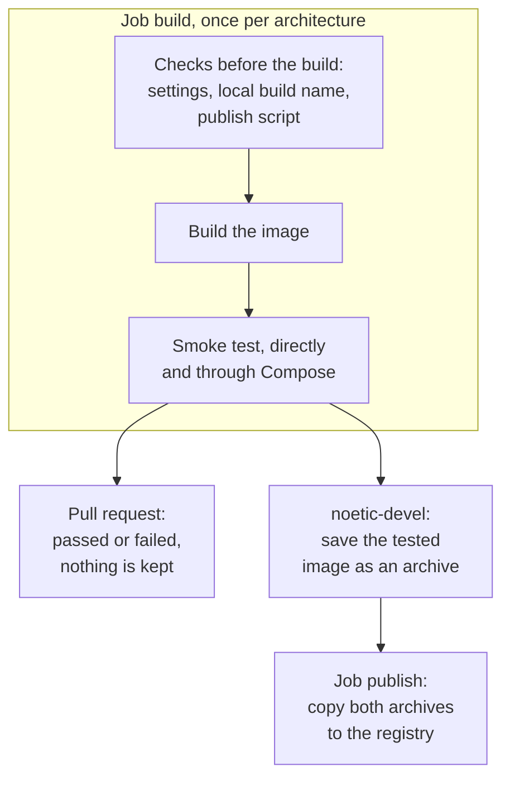

# Image and Tests

How the [robot container's](index.md) Docker image is built, what takes its space, and how CI tests and publishes it. You don't need this page to use the robot container. It's for changing the image, or for understanding it.

The page follows the image's way: [how it's built](#how-the-image-is-built), [what takes the space](#what-takes-the-space), [how it's tested](#how-its-tested) and [how it's published](#how-its-published).

## How the image is built

The robot's Docker image is defined in the diffbot repository's [`.docker/robot`]({{ robot_container_src_url }}/.docker/robot) folder. Its [`Dockerfile`]({{ robot_container_src_url }}/.docker/robot/Dockerfile) starts from the official ROS image [`ros:noetic-ros-base`](https://hub.docker.com/_/ros), which exists for arm64 and amd64. It then adds the robot's packages in three steps, with the same tools as a native workspace:

1. **[vcstool](../../packages/packages-setup.md#source-dependencies)** fetches the repositories listed in [`remo_robot.repos`]({{ robot_container_src_url }}/remo_robot.repos): Remo's model [`remo_description`](../../packages/remo_description.md) and the lidar driver [`rplidar_ros`](https://github.com/ros-mobile-robots/rplidar_ros/tree/0c474e311f925f81ffba97313745f80a2de02e68).
2. **[rosdep]({{ robot_container_src_url }}/.docker/robot/Dockerfile#L72-L81)** installs the Ubuntu and ROS packages that the packages' [`package.xml`](https://www.ros.org/reps/rep-0140.html) files declare as dependencies.
3. **[catkin](../ros-setup.md#build-tool-catkin_tools)** builds the packages, in the workspace [`/home/ros/catkin_ws`]({{ robot_container_src_url }}/.docker/robot/Dockerfile#L68).

A [catkin workspace](https://wiki.ros.org/catkin/workspaces) is a folder whose `src` folder holds the source code of ROS packages, which catkin builds together. The image has one, with the diffbot repository and the two fetched repositories in `src` ([folders in the container](setup.md#6-the-diffbot-repository)). The dev container on your PC has its own.

Which packages are built is a list in the Dockerfile ([lines 58–61]({{ robot_container_src_url }}/.docker/robot/Dockerfile#L58-L61)): the packages that the bringup and the lidar need, for both robots.

```dockerfile title="Dockerfile" linenums="58"
--8<-- "{{ robot_container_src_raw }}/.docker/robot/Dockerfile:58:61"
```

The list is needed because rosdep reads only the `package.xml` files it's given. In its `package.xml`, a package declares each other package it needs when the robot runs with an [`<exec_depend>`](https://www.ros.org/reps/rep-0140.html#exec-depend-multiple) line, for example:

```xml title="diffbot_bringup/package.xml"
<exec_depend>diffbot_base</exec_depend>
```

With this line, rosdep would recognize [`diffbot_base`](../../packages/diffbot_base/index.md) as a package of the workspace. But it wouldn't read `diffbot_base`'s own `package.xml`, so it wouldn't install what `diffbot_base` needs, such as [rosserial](../teensy-mcu.md#other-boards-such-as-an-arduino) (our test with rosdep 0.25.1 in the ROS image). That's why rosdep gets the `package.xml` of each package to build.

catkin does follow these lines: `catkin build diffbot_bringup` would first build the workspace packages that [`diffbot_bringup`]({{ robot_container_src_url }}/diffbot_bringup/package.xml#L52) declares. But today `diffbot_bringup` declares only [`teleop_twist_keyboard`](usage.md#with-the-keyboard), not the packages its launch files start. Adding them is the first step of [diffbot#131](https://github.com/ros-mobile-robots/diffbot/issues/131). Gazebo, navigation and SLAM aren't in the image: they run on the PC.

CI builds the image and publishes it ([How it's published](#how-its-published)). Docker builds it on the Raspberry Pi only for [your own build](versions.md#your-own-build). The container runs as the user `ros` with UID 1000, not as root. The image also sets [`PYTHONUNBUFFERED`]({{ robot_container_src_url }}/.docker/robot/Dockerfile#L93) and [`ROSCONSOLE_STDOUT_LINE_BUFFERED`]({{ robot_container_src_url }}/.docker/robot/Dockerfile#L94), so that Python and ROS write each line of output at once. Without a terminal, they would collect it first, and `docker compose logs` would show it late.

### The same inputs for both builds

CI builds the image twice, once per processor architecture, on two computers ([How it's tested](#how-its-tested)). Three inputs of the build come from outside the diffbot repository. Two of them are named by their content, so both builds get the same files, also when one of the two builds runs again later. The third is named by a release tag:

| Input | How the build names it | Where |
|:--|:--|:--|
| The two base images, [`ubuntu:20.04`]({{ robot_container_src_url }}/.docker/robot/Dockerfile#L24) and [`ros:noetic-ros-base`]({{ robot_container_src_url }}/.docker/robot/Dockerfile#L31) | By tag and digest. A digest is a checksum of an image's content, so it names exactly one content, whatever the tag points to by now | The [Dockerfile](#how-the-image-is-built)'s two [`FROM`](https://github.com/moby/buildkit/blob/v0.26.1/frontend/dockerfile/docs/reference.md#from) lines |
| The lidar driver [`rplidar_ros`]({{ robot_container_src_url }}/remo_robot.repos#L2-L9) | By one commit of its branch `noetic-devel`. A commit names exactly one state of the code | [`remo_robot.repos`]({{ robot_container_src_url }}/remo_robot.repos) |
| Remo's model [`remo_description`]({{ robot_container_src_url }}/remo_robot.repos#L14-L21) | By the release tag `2.5.0`. A tag is a name for a commit. It selects one version, but it isn't a checksum of the content | `remo_robot.repos` |

These lines of the Dockerfile explain the digests and name the first base image ([lines 12–24]({{ robot_container_src_url }}/.docker/robot/Dockerfile#L12-L24)). The second `FROM` line, in line 31, names the ROS image the same way:

```dockerfile title="Dockerfile" linenums="12"
--8<-- "{{ robot_container_src_raw }}/.docker/robot/Dockerfile:12:24"
```

Each digest is the one of the image's index. An index is the list that holds one image per processor architecture. Docker reads the index and picks the image for the computer that builds, so the same line works on the arm64 and on the amd64 computer.

`remo_robot.repos` lists the two repositories that [vcstool](../../packages/packages-setup.md#source-dependencies) fetches, with the lidar driver's commit and the model's release tag in the [`version`]({{ robot_container_src_url }}/remo_robot.repos#L9-L21) fields:

```yaml title="remo_robot.repos" linenums="1"
--8<-- "{{ robot_container_src_raw }}/remo_robot.repos:1:21"
```

One more input isn't fixed at all: the Ubuntu and ROS packages that apt and [rosdep](#how-the-image-is-built) install during the build. They come from the package servers at the time of the build, so two builds at different times can get different package versions.

## What takes the space

Unpacked, the image takes about 3.2 GB on an amd64 PC, and about 0.7 GB compressed. On that PC, `docker images` shows about 3.9 GB, because Docker's containerd image store keeps both ([disk space usage](https://docs.docker.com/engine/storage/containerd/#disk-space-usage)). That's the default for Docker Engine 29 and later on a fresh installation. Installations with the legacy image store keep only the unpacked files. It hasn't been measured on the Raspberry Pi yet. What takes the space, measured with `du` and `dpkg-query` in the image:

- **The official ROS image, 2.4 GB:** besides ROS, it has the tools to build ROS packages, such as the C++ compiler, CMake and Boost's headers. 1.2 GB of it is a Fortran compiler, flang, with the compiler libraries it's built on (LLVM). It comes in through Boost: ROS's [`pluginlib`](https://github.com/ros/pluginlib/blob/1.13.2/pluginlib/package.xml#L35) depends on all of Boost. That includes Boost.MPI, for programs that run on several computers at once, which needs OpenMPI, and OpenMPI's development package needs a Fortran compiler.
- **The robot's part, about 0.7 GB of the unpacked 3.2 GB:** almost all of it comes with RViz, which the robot models declare ([Limitations](index.md#limitations-and-planned-work)): graphics drivers (Mesa), the window toolkit Qt and the 3D engine OGRE. The built workspace itself is about 70 MB.

## How it's tested

The workflow [`robot_container.yml`]({{ robot_container_src_url }}/.github/workflows/robot_container.yml) runs in three cases:

- **For a pull request:** when the pull request changes the image or its packages.
- **For a push to the branch `noetic-devel`:** when the push changes them. A merged pull request is such a push.
- **By hand:** from the repository's Actions tab.

The figure shows what a run does, and where a pull request's run ends:



GitHub provides the computers that the workflow runs on, called runners. The job [`build`]({{ robot_container_src_url }}/.github/workflows/robot_container.yml#L62-L145) runs twice: on an arm64 runner (`ubuntu-24.04-arm`, free for public repositories) and on an amd64 runner. These lines of the workflow name the two runners ([lines 62–72]({{ robot_container_src_url }}/.github/workflows/robot_container.yml#L62-L72)):

```yaml title="robot_container.yml" linenums="62"
--8<-- "{{ robot_container_src_raw }}/.github/workflows/robot_container.yml:62:72"
```

So each runner builds the image natively, for its own architecture, without emulation, in about two minutes. The build step's times in seven runs, and one build on a Raspberry Pi for comparison:

| Where | Shortest build | Longest build |
|:--|:--|:--|
| arm64 runner, `ubuntu-24.04-arm` | 1 min 42 s | 1 min 55 s |
| amd64 runner, `ubuntu-24.04` | 1 min 42 s | 2 min 21 s |
| Raspberry Pi 4 B in Remo, one build | 14 min 20 s | 14 min 20 s |

The Raspberry Pi's build was measured on 31 October 2026, at the diffbot repository's commit [`3541965`](https://github.com/ros-mobile-robots/diffbot/commit/3541965496d50ce629e00054e8d3acd12e4beed5) ([the bench record](https://github.com/ros-mobile-robots/diffbot/issues/160#issuecomment-6550353204)).

Each run of the job `build` does five things, in this order:

1. **It checks the settings template:** [`env.example`]({{ robot_container_src_url }}/.docker/robot/env.example) has to give a valid configuration with [`compose.yaml`](setup.md#how-composeyaml-uses-the-settings).
2. **It checks the name of a local build:** with [`ROBOT_IMAGE`](setup.md#all-settings) set to the published image's name and every service switched on, `compose.yaml` alone must build nothing, and [`compose.build.yaml`](versions.md#on-the-raspberry-pi) must build only `diffbot-robot:local`, alone and combined with `compose.yaml` in both orders.
3. **It tests the publish script** without a registry ([The script's tests](#the-scripts-tests)).
4. **It builds the image:** with `docker build`, for the runner's own architecture.
5. **It runs [`smoke_test.sh`](#one-check-step-by-step) in the image, twice:** directly in a container of the image, and through `compose.yaml` with its mounts and groups.

The smoke test checks four things, without hardware:

- **The packages and programs:** ROS finds the packages, and the programs that talk to the hardware exist.
- **The robot models:** both robots' URDF models expand with [xacro](../../diffbot_gazebo.md#troubleshooting).
- **The launch files:** the bringup's and the lidar's launch files parse. The lidar's launch file names the driver's node [`/diffbot/rplidarNode`]({{ robot_container_src_url }}/.docker/robot/smoke_test.sh#L40-L43), in the robot's namespace, so a connected lidar's scans are on [`/diffbot/scan`](usage.md#3-the-topics-carry-data).
- **Remo's bringup:** the bringup starts, its URDF model loads, and both controllers run.

The test doesn't start the lidar driver, and no check talks to a device. Without a Teensy, [rosserial](../teensy-mcu.md#other-boards-such-as-an-arduino) can't open its port and the hardware interface gets no wheel feedback, so the test can't show that the robot drives. That needs the real robot: [the robot container's status](index.md) says what ran on Remo and what is still open in [diffbot#109](https://github.com/ros-mobile-robots/diffbot/issues/109).

### One check, step by step

The last check of the smoke test starts Remo's bringup as the robot would, only without the Teensy. These lines of [`smoke_test.sh`]({{ robot_container_src_url }}/.docker/robot/smoke_test.sh) are the check ([lines 45–58]({{ robot_container_src_url }}/.docker/robot/smoke_test.sh#L45-L58)):

```bash title="smoke_test.sh" linenums="45"
--8<-- "{{ robot_container_src_raw }}/.docker/robot/smoke_test.sh:45:58"
```

1. **What the check sets up** (line 48): [`roslaunch`](https://github.com/ros/ros_comm/tree/25d371664e34ec9d26ee331434de9a38c412c890/tools/roslaunch) starts [`bringup.launch`](../../packages/imu/robot_localization.md#on-the-real-robot) for Remo in the background, with its output in the file `/tmp/bringup.log`. A ROS master runs already, from an earlier step of the script.
2. **What the check waits for** (lines 49–54): once per second, for at most 60 s, the script asks the controller manager for its controllers with the service [`/diffbot/controller_manager/list_controllers`]({{ robot_container_src_url }}/.docker/robot/smoke_test.sh#L51). It counts the controllers in the state `running` in the variable [`running`]({{ robot_container_src_url }}/.docker/robot/smoke_test.sh#L49-L52).
3. **What has to hold** (lines 55–58): `running` is 2, for [`joint_state_controller`]({{ robot_container_src_url }}/diffbot_control/config/diffbot_control.yaml#L9-L20) and [`mobile_base_controller`]({{ robot_container_src_url }}/diffbot_control/config/diffbot_control.yaml#L23-L54). The odometry topic [`/diffbot/mobile_base_controller/odom`]({{ robot_container_src_url }}/.docker/robot/smoke_test.sh#L57) is listed. The parameter [`/diffbot/robot_description`]({{ robot_container_src_url }}/.docker/robot/smoke_test.sh#L58) holds the URDF model. If `running` isn't 2 after 60 s, the script prints the bringup's output and fails.

To run the whole smoke test on your PC, build the image and start the script in a container of the image. Run this command in the root folder of your clone of the diffbot repository:

```console
docker build -f .docker/robot/Dockerfile -t diffbot-robot:noetic . &&
  docker run --rm -v "$PWD/.docker/robot/smoke_test.sh:/smoke_test.sh:ro" diffbot-robot:noetic bash /smoke_test.sh
```

`&&` starts the test only if the build succeeded. Without it, a failed build would leave an image from an earlier build under the same name, and the test would run in that older image.

The output has one heading per check, starting with `==`. Recorded on an amd64 PC, it ends like this:

```text
== Remo's bringup starts without hardware: the model loads and both controllers run
running controllers: 2
/diffbot/mobile_base_controller/odom
Smoke test passed
```

## How it's published

For a pull request, the run ends after the smoke tests. The result is the workflow's check, passed or failed, and the image is deleted with the runner. Nothing is published, because a pull request's code isn't reviewed yet.

After a change is merged into `noetic-devel`, each run of the job [`build`]({{ robot_container_src_url }}/.github/workflows/robot_container.yml#L62-L145) also saves the image that it tested, as an archive. A third job, [`publish`]({{ robot_container_src_url }}/.github/workflows/robot_container.yml#L150-L184), then copies both archives to the registry. It doesn't build the image again. So the published image is the very image that passed the smoke test, not a second build that could differ from it. These steps of the job `build` save the image and hand it over ([lines 125–145]({{ robot_container_src_url }}/.github/workflows/robot_container.yml#L125-L145)):

```yaml title="robot_container.yml" linenums="125"
--8<-- "{{ robot_container_src_raw }}/.github/workflows/robot_container.yml:125:145"
```

The three conditions under [`if`]({{ robot_container_src_url }}/.github/workflows/robot_container.yml#L152-L155) are the same for both steps and for the job `publish`: the repository is `ros-mobile-robots/diffbot`, not a fork, the branch is `noetic-devel`, and the run was started by a push or by hand. A pull request never meets them.

The job `publish` starts only if both runs of `build` passed ([`needs: build`]({{ robot_container_src_url }}/.github/workflows/robot_container.yml#L151)). These lines define the job and its steps ([lines 147–184]({{ robot_container_src_url }}/.github/workflows/robot_container.yml#L147-L184)):

```yaml title="robot_container.yml" linenums="147"
--8<-- "{{ robot_container_src_raw }}/.github/workflows/robot_container.yml:147:184"
```

- **[`permissions`]({{ robot_container_src_url }}/.github/workflows/robot_container.yml#L157-L159)** (lines 157–159): only this job may write packages. The rest of the workflow can only read.
- **[`concurrency`]({{ robot_container_src_url }}/.github/workflows/robot_container.yml#L162-L164)** (lines 162–164): one publication runs at a time, and later ones wait for their turn.
- **[`uses`]({{ robot_container_src_url }}/.github/workflows/robot_container.yml#L167-L174)** (lines 167, 170 and 174): each action is named by the full commit of one of its releases, with the release in the comment. A commit can't be moved to other code later, as a tag such as `v4` can. That matters here, because these actions run in the job that may write packages.
- **The last step** (lines 179–184): runs the script [`publish_image.sh`](#what-the-script-asks-the-registry-first) with the image's name, the commit and the folder with the two archives. The job runs nothing from the images.

The script copies both images to the registry and combines them under one name. A Raspberry Pi then downloads the arm64 image and a PC the amd64 one. The version `noetic-<commit>` is published once and never replaced, and `noetic` only moves to a later commit ([Versions](versions.md#versions)).

### What the script asks the registry first

Before the script writes the version or `noetic`, it asks the registry about both names. For each name, the function [`state`]({{ robot_container_src_url }}/.docker/robot/publish_image.sh#L53-L84) gives one of three answers, with the tool [skopeo](https://github.com/containers/skopeo):

| Answer of `state` for one name | What the registry said about that name |
|:--|:--|
| `present` | It returned the name's manifest, the description of an image. The name exists |
| `missing` | *manifest unknown*, the registry's own error code for a name that it doesn't have. The name is free |
| `unreadable` | The registry itself refuses: it denies the request for the name, it doesn't know the repository at all, or its token service answers 403 |
| No answer | Anything else, after three tries: a failed login, a login file that can't be read, another error of the token service, no connection. The script stops and prints the error |

The script then decides from the two answers together:

1. **Both names are `present` or `missing`:** the script publishes. It writes a name that is missing. A version that is present is checked and reused, never written again. A `noetic` that is present moves only to a later commit.
2. **One of the two names is `unreadable`:** the script stops and writes nothing.
3. **Both names are `unreadable`, in a run for the first publication:** the script copies one image under a name of its own and asks about both names again ([The first publication](#the-first-publication)). The version and `noetic` are still written only by rule 1.

Only *manifest unknown* counts as "the name is free", because other failures read alike. A login helper that isn't installed and a token service that answers 404 both print *not found*, and neither says anything about the name. If the script took them for a free name, it could write a version that exists already. The same holds for `unreadable`: a login file that the job can't read prints *permission denied*, which is no answer of the registry.

These lines of [`publish_image.sh`]({{ robot_container_src_url }}/.docker/robot/publish_image.sh) are the function `state` and its comment ([lines 36–84]({{ robot_container_src_url }}/.docker/robot/publish_image.sh#L36-L84)):

```bash title="publish_image.sh" linenums="36"
--8<-- "{{ robot_container_src_raw }}/.docker/robot/publish_image.sh:36:84"
```

The function recognizes each answer by the text that skopeo prints for it, with the name's tag and repository in the text. The variable [`manifest_request`]({{ robot_container_src_url }}/.docker/robot/publish_image.sh#L56) holds the start of these texts, and the list [`refusals`]({{ robot_container_src_url }}/.docker/robot/publish_image.sh#L57-L62) holds the registry's refusals.

The script also checks that an archive holds the right architecture and commit before it copies that archive's image.

### The first publication

The first publication is the one exception to "stops". The package doesn't exist yet then, and the registry may deny the read or say that it doesn't know the repository. A run for this case is one that a maintainer starts by hand, in the repository's Actions tab, with the box **First publication** ticked. If both names are `unreadable` in such a run, the script creates the package: it copies the checked amd64 image under the name `first-publication`, which nothing else uses, and asks about both names again. If the two answers still aren't `present` or `missing`, the script stops. So an image can be in the registry under `first-publication` although the run failed later, for example at the check of the arm64 archive. The version and `noetic` are not written in that case.

### The script's tests

[`test_publish_image.sh`]({{ robot_container_src_url }}/.docker/robot/test_publish_image.sh) runs [`publish_image.sh`]({{ robot_container_src_url }}/.docker/robot/publish_image.sh) without a registry and without images. Stand-ins take the place of [`skopeo`]({{ robot_container_src_url }}/.docker/robot/test_publish_image.sh#L52-L127) and [`docker`]({{ robot_container_src_url }}/.docker/robot/test_publish_image.sh#L130-L161). They answer the script's reads with texts recorded from skopeo, and they note each write that the script attempts instead of doing it. Each test chooses the registry's answer, runs the script, and compares the script's exit code and its writes with the expected ones:

| The registry's answer in the test | Expected writes | Expected result |
|:--|:--|:--|
| *manifest unknown* for both names | Both images, the version and `noetic` | The script succeeds |
| A login helper that isn't installed | None | The script fails |
| The token service answers 404 | None | The script fails |
| A 404 page without the registry's error code | None | The script fails |
| The registry can't be reached | None | The script fails |
| The read is denied | None | The script fails |
| The repository is unknown | None | The script fails |
| The read is denied, in a first publication | Only `first-publication` | The script fails, because the read stays denied |
| The repository is unknown, in a first publication | Only `first-publication` | The script fails, because the repository stays unknown |
| The login file can't be read, in a first publication | None | The script fails |
| One name is free and the read of the other is denied, in a first publication | None | The script fails |
| The version and `noetic` exist | None | The script succeeds |
| They exist, but one image is from another commit | None | The script fails |
| They exist, but `noetic` has another digest | None | The script fails |

Run the script from the root folder of your clone, with the tool [`jq`](https://jqlang.org/manual/v1.7/) installed:

```console
.docker/robot/test_publish_image.sh
```

The script prints one line per test, starting with `ok` or `FAILED`, and ends with the count:

```text
14 tests, 0 failed
```

[Testing and CI](../../development/ci.md) describes all workflows of the diffbot repository, what each one checks, and how to run the checks on your PC.
