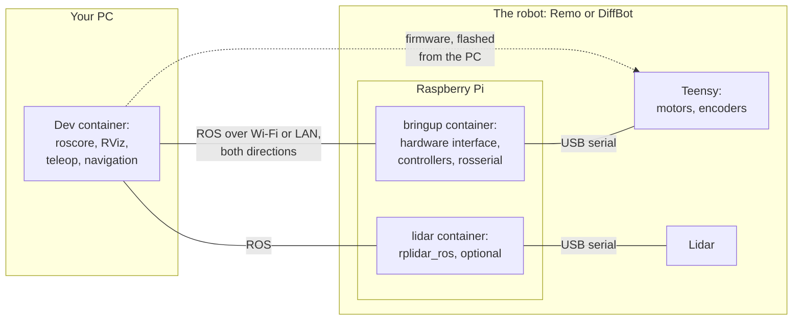

# Robot Container

The robot's computer, a Raspberry Pi 4 B, can run ROS Noetic in a [Docker](https://docs.docker.com/get-started/docker-overview/) container instead of a native installation. ROS Noetic needs Ubuntu 20.04, whose standard support ended in May 2025 ([ROS Setup](../ros-setup.md)). With the container, the Raspberry Pi runs a current operating system, Ubuntu Server 24.04, and the container brings Ubuntu 20.04 and ROS Noetic along. Ubuntu 24.04 is also the OS of ROS 2 Jazzy, the planned next ROS version for the robots ([diffbot#136](https://github.com/ros-mobile-robots/diffbot/issues/136)), so the SD card doesn't have to be set up again for it.

!!! note "ROS Noetic itself gets no more updates"
    The container doesn't make ROS Noetic supported again. Noetic reached its end of life on 31 May 2025, and its packages get no more updates. What gets updates is the operating system around it, Ubuntu Server 24.04 on the Raspberry Pi.

!!! warning "Experimental: not tested on a robot yet"
    CI builds the image for arm64, the Raspberry Pi's processor architecture, and tests it without hardware ([How it's tested](image.md#how-its-tested)). It hasn't driven a robot yet. The test with teleop and the lidar on a Raspberry Pi in Remo is open in [diffbot#109](https://github.com/ros-mobile-robots/diffbot/issues/109), and the setup steps follow Ubuntu's and Docker's documentation but haven't been run on that Raspberry Pi either. The native setup, [Raspberry Pi Setup](../rpi-setup.md) and [ROS Setup](../ros-setup.md), stays documented as the alternative.

## How it fits together

The robot is Remo or DiffBot, with its Raspberry Pi, its Teensy and, if it has one, its lidar. The Raspberry Pi runs Ubuntu Server 24.04 and Docker, and two containers, both from the same image: the bringup and the lidar. They talk ROS with your PC over the network, in both directions, and to the Teensy and the lidar over USB. The Teensy's firmware isn't part of the container: you flash it from the PC.

What runs where, and which page explains it:

| Where | What runs there | Explained in |
|:--|:--|:--|
| Your PC | The [dev container](../../development/dev-container.md) with ROS Noetic, Gazebo and RViz, and usually the ROS master (`roscore`) | [Set Up Your PC](../../getting-started/set-up-your-pc.md), [ROS Network Setup](../ros-network-setup.md) |
| The Raspberry Pi, the robot's computer | Ubuntu Server 24.04 and Docker Engine, the udev rules for the serial devices, the diffbot repository with the settings, and a folder for ROS logs | [Set Up the Raspberry Pi](setup.md) |
| The robot containers, on the Raspberry Pi | ROS Noetic and the robot's packages: the bringup with the hardware interface, the controllers and rosserial, the robot models and the lidar driver. CI builds and tests their image and publishes it, and Docker downloads it to the Raspberry Pi | [Start, Check and Stop](usage.md), [Image and Tests](image.md) |
| The Teensy | The firmware that drives the motors and reads the encoders | [Microcontroller](../teensy-mcu.md): flash it from the PC before the first start |

## The pages of this section

1. [Set Up the Raspberry Pi](setup.md): once, from the empty microSD card to the settings.
2. [Start, Check and Stop](usage.md): each time you use the robot, and where its logs are.
3. [Troubleshooting](troubleshooting.md): what you might see, how to find the cause, and how to fix it.
4. [Image and Tests](image.md): how the image is built, what takes its space, and how CI tests it.

## Limitations and planned work

- **The camera.** The Raspberry Pi camera driver, `raspicam_node`, needs the Raspberry Pi's legacy camera stack, which current operating systems no longer have. A driver for libcamera is planned in [diffbot#111](https://github.com/ros-mobile-robots/diffbot/issues/111).
- **I2C and GPIO on the Raspberry Pi** aren't passed into the containers yet. The current robots don't need them: the motor driver and the optional IMU connect to the Teensy, which reaches the Raspberry Pi over USB ([Processing Units](../index.md)). Parts on the Raspberry Pi's own pins wouldn't work in the containers yet, such as the Grove motor driver of earlier DiffBot versions or the ultrasonic ranger ([Hardware Interfaces](../hardware-interfaces.md)).
- **Starting at boot.** For now, start the robot with the command in [Start, Check and Stop](usage.md#start) after logging in. An automatic start needs the Teensy, the network, the synchronized clock and the PC's ROS master when the Raspberry Pi boots. Docker's restart policy alone can't handle a missing device, so this needs its own tests.
- **A smaller image.** `diffbot_description` and `remo_description` declare RViz as a dependency, because they have launch files that open RViz. So the image contains RViz with its graphics libraries, about 0.7 GB, which the robot never shows ([What takes the space](image.md#what-takes-the-space)). Husky, for example, keeps its RViz launch files in a package of their own, [`husky_viz`](https://github.com/husky/husky/blob/noetic-devel/husky_viz/package.xml), and its description package doesn't declare RViz. The same split here would leave RViz out of the image.
