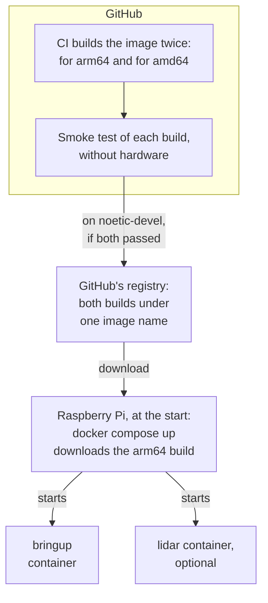
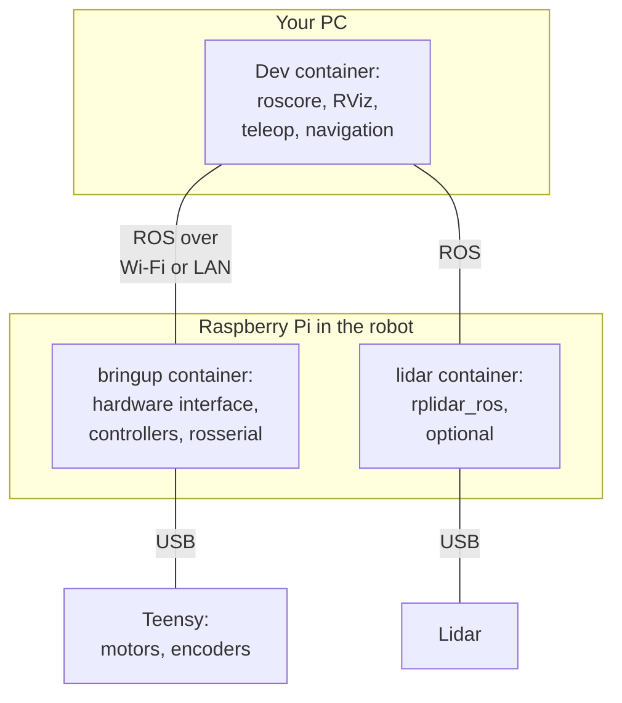

# Robot Container

The robot's computer, a Raspberry Pi 4 B, can run ROS Noetic in a [Docker](https://docs.docker.com/get-started/docker-overview/) container instead of a native installation. The robot's software comes ready-made: CI builds and tests the container's Docker image, and the Raspberry Pi downloads the image. Nothing is compiled on the robot.

- **To set up a new Raspberry Pi:** [Set Up the Raspberry Pi](setup.md), once, from the empty microSD card to the settings.
- **To start a Raspberry Pi that is set up:** [Start, Check and Stop](usage.md), each time you use the robot.

ROS Noetic needs Ubuntu 20.04, whose standard support ended in May 2025 ([ROS Setup](../ros-setup.md)). With the container, the Raspberry Pi runs a current operating system, Ubuntu Server 24.04, and the container brings Ubuntu 20.04 and ROS Noetic along. Ubuntu 24.04 is also the OS of ROS 2 Jazzy, the planned next ROS version for the robots ([diffbot#136](https://github.com/ros-mobile-robots/diffbot/issues/136)), so the SD card doesn't have to be set up again for it.

!!! note "ROS Noetic itself gets no more updates"
    The container doesn't make ROS Noetic supported again. Noetic reached its end of life on 31 May 2025, and its packages get no more updates. What gets updates is the operating system around it, Ubuntu Server 24.04 on the Raspberry Pi.

!!! warning "Experimental: checked on a bench, not driven on the floor yet"
    - **What CI checks:** CI builds the robot's Docker image for arm64, the Raspberry Pi's processor architecture, and tests the image without hardware ([How it's tested](image.md#how-its-tested)).
    - **What ran on a robot:** on 31 October 2026, Remo's Raspberry Pi 4 B built the image itself, from the diffbot repository's commit [`3541965`](https://github.com/ros-mobile-robots/diffbot/commit/3541965496d50ce629e00054e8d3acd12e4beed5), in 14 min 20 s. The bringup then connected to the Teensy, with the ROS master on the Raspberry Pi. With the robot on a stand, teleop turned the wheels in the commanded directions ([the bench record](https://github.com/ros-mobile-robots/diffbot/issues/160#issuecomment-6550353204)).
    - **What is still open:** the download of the published image on a Raspberry Pi, an SD card written with Raspberry Pi Imager, the lidar's scans, and a drive on the floor. The robot test with teleop and the lidar is [diffbot#109](https://github.com/ros-mobile-robots/diffbot/issues/109).

    The native setup, [Raspberry Pi Setup](../rpi-setup.md) and [ROS Setup](../ros-setup.md), stays documented as the alternative.

## Where the robot's software comes from

The figure follows the robot's software from the top to the bottom: from a change in the diffbot repository, through GitHub's registry, to the containers on the Raspberry Pi.

The five steps of the figure:

1. **CI builds the image twice:** CI runs when a change touches the image or the packages in it. A Docker image is a package with a program and everything the program needs to run: here Ubuntu 20.04, ROS Noetic and the robot's compiled packages. A Raspberry Pi and a PC have different processor architectures, arm64 and amd64, and each needs its own build of the image. CI is the set of automated checks that GitHub runs for the diffbot repository ([Testing and CI](../../development/ci.md)).
2. **CI tests each build without hardware:** the smoke test starts the bringup in the image and checks that both controllers run ([How it's tested](image.md#how-its-tested)).
3. **CI publishes both builds under one name:** that happens only on the branch `noetic-devel`, for a change that is merged into it or for a run that a maintainer starts by hand, and only when both builds passed. The name is `ghcr.io/ros-mobile-robots/diffbot-robot`. A registry is a server that stores Docker images, and `ghcr.io` is GitHub's registry.
4. **The Raspberry Pi downloads its build:** at the first start, `docker compose up` asks the registry for the image, and Docker picks the arm64 build by itself. Later starts use the downloaded image ([Start](usage.md#start)).
5. **Docker starts the containers:** a container is a running copy of the image. The bringup container runs the robot's nodes. The lidar container runs the lidar driver, if the robot has a lidar.

## How it fits together

The second figure shows what is connected to what while the robot runs: your PC, the two containers on the Raspberry Pi, the Teensy and the lidar.

The robot is Remo or DiffBot, with its Raspberry Pi, its Teensy and, if it has one, its lidar. The Raspberry Pi runs Ubuntu Server 24.04 and Docker, and two containers, both from the same Docker image: the bringup and the lidar. They talk ROS with your PC over the network, in both directions, and to the Teensy and the lidar over USB. The Teensy's firmware isn't part of the container: you flash it from the PC.

What runs where, and which page explains it:

| Where | What runs there | Explained in |
|:--|:--|:--|
| Your PC | The [dev container](../../development/dev-container.md) with ROS Noetic, Gazebo and RViz, and usually the ROS master ([`roscore`](usage.md#the-ros-master)) | [Set Up Your PC](../../getting-started/set-up-your-pc.md), [ROS Network Setup](../ros-network-setup.md) |
| The Raspberry Pi, the robot's computer | Ubuntu Server 24.04 and Docker Engine, the udev rules for the serial devices, the diffbot repository with the settings, and a folder for ROS logs | [Set Up the Raspberry Pi](setup.md) |
| The robot containers, on the Raspberry Pi | ROS Noetic and the robot's packages: the bringup with the hardware interface, the controllers and [rosserial](../teensy-mcu.md#other-boards-such-as-an-arduino), the robots' URDF models and the lidar driver | [Start, Check and Stop](usage.md), [Versions and Your Own Build](versions.md), [Image and Tests](image.md) |
| The Teensy | The firmware that drives the motors and reads the encoders | [Microcontroller](../teensy-mcu.md): flash it from the PC before the first start |

## The pages of this section

1. [Set Up the Raspberry Pi](setup.md): once, from the empty microSD card to the settings.
2. [Start, Check and Stop](usage.md): each time you use the robot, and where its logs are.
3. [Versions and Your Own Build](versions.md): how to update the robot's Docker image, how to stay on one version, and how to build the image yourself.
4. [Troubleshooting](troubleshooting.md): what you might see, how to find the cause, and how to fix it.
5. [Image and Tests](image.md): how the Docker image is built, what takes its space, and how CI tests it.

## Limitations and planned work

- **The camera:** the Raspberry Pi camera driver, [`raspicam_node`](../../packages/raspicam_node.md), needs the Raspberry Pi's legacy camera stack, which current operating systems no longer have. A driver for libcamera is planned in [diffbot#111](https://github.com/ros-mobile-robots/diffbot/issues/111).
- **I2C and GPIO on the Raspberry Pi** aren't passed into the containers yet. The current robots don't need them: the motor driver and the optional IMU connect to the Teensy, which reaches the Raspberry Pi over USB ([Processing Units](../index.md)). Parts on the Raspberry Pi's own pins wouldn't work in the containers yet, such as the Grove motor driver of earlier DiffBot versions or the ultrasonic ranger ([Hardware Interfaces](../hardware-interfaces.md)).
- **Starting at boot:** for now, start the robot with the commands in [Start, Check and Stop](usage.md#start) after logging in. An automatic start needs the Teensy, the network, the synchronized clock and the PC's ROS master when the Raspberry Pi boots. Docker's restart policy alone can't handle a missing device, so this needs its own tests.
- **A smaller Docker image:** [`diffbot_description`]({{ robot_container_src_url }}/diffbot_description/package.xml#L64-L67) and [`remo_description`](https://github.com/ros-mobile-robots/remo_description/blob/2.5.0/package.xml#L60) declare RViz as a dependency, because they have launch files that open RViz. So the image contains RViz with its graphics libraries, about 0.7 GB, which the robot never shows ([What takes the space](image.md#what-takes-the-space)). Husky, for example, keeps its RViz launch files in a package of their own, [`husky_viz`](https://github.com/husky/husky/blob/noetic-devel/husky_viz/package.xml), and its description package doesn't declare RViz. The same split here would leave RViz out of the image.
