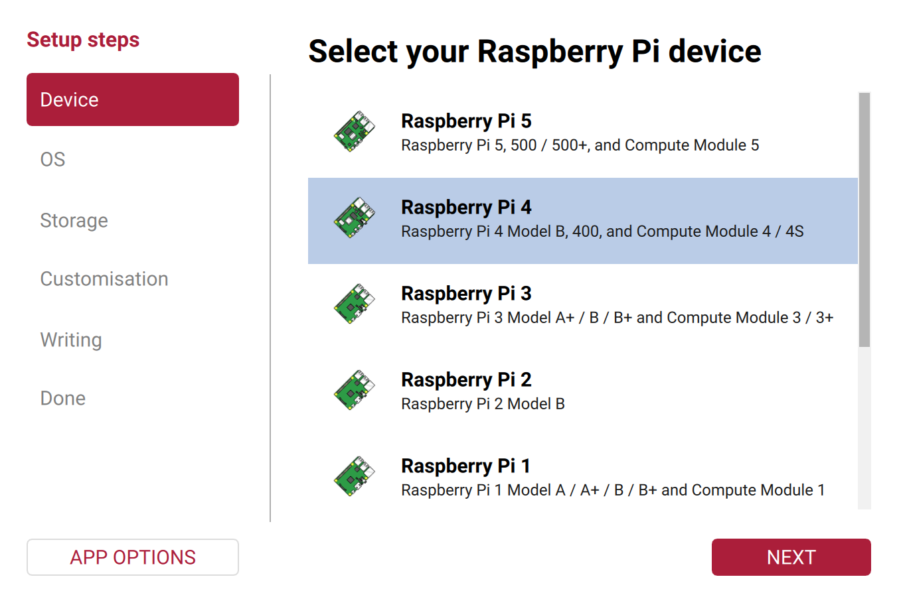
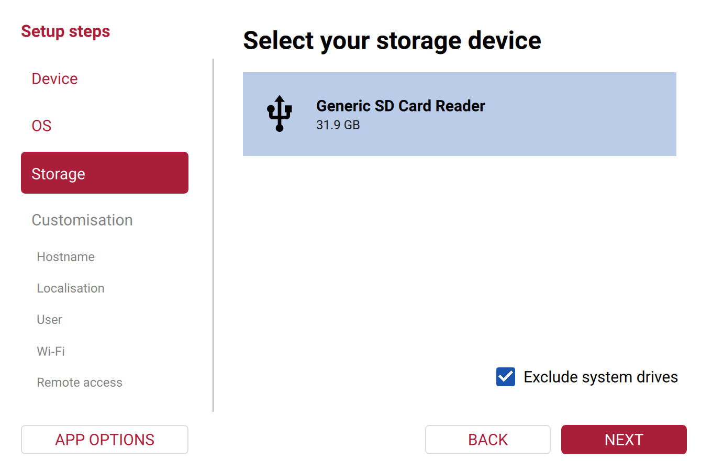
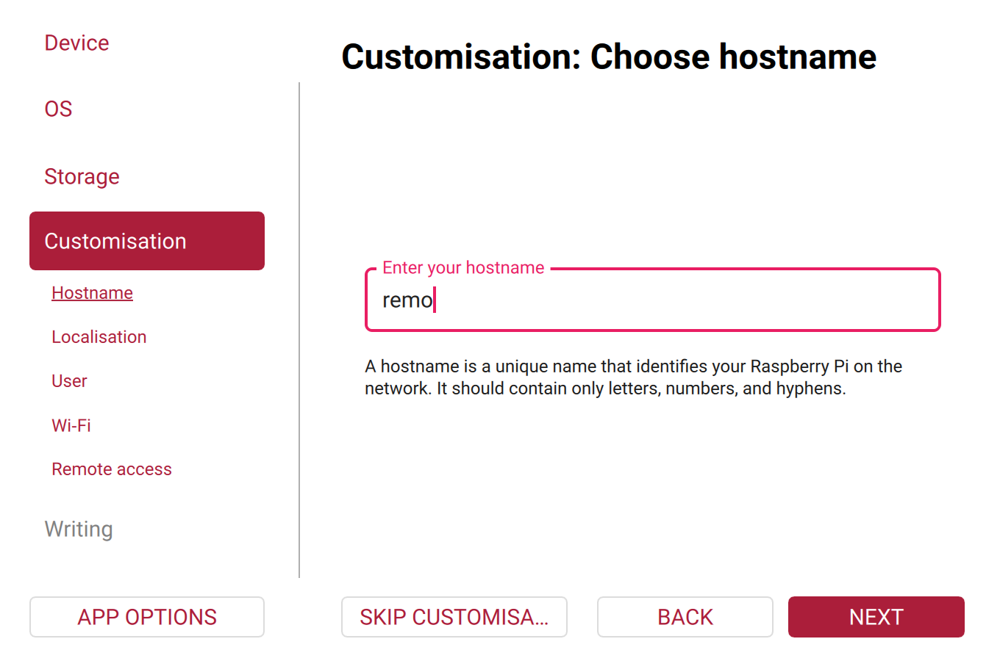
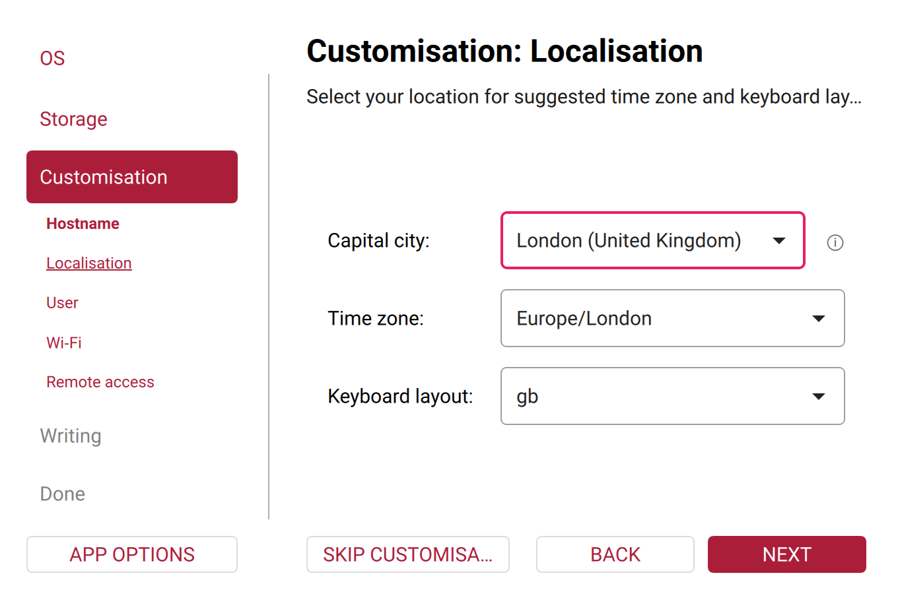
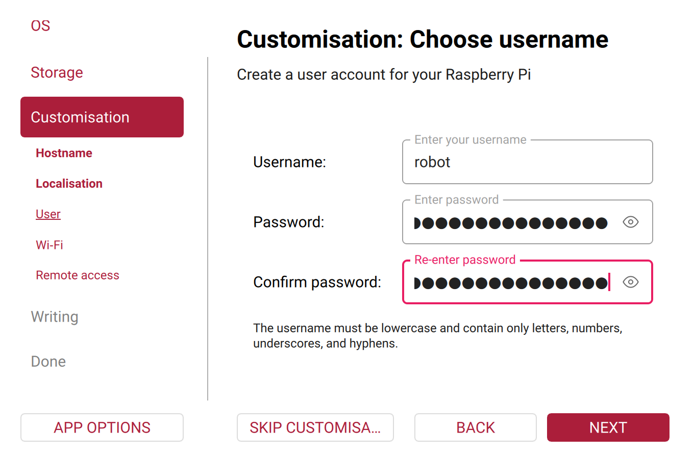
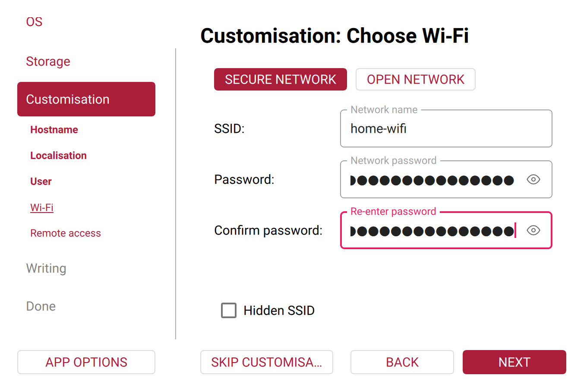
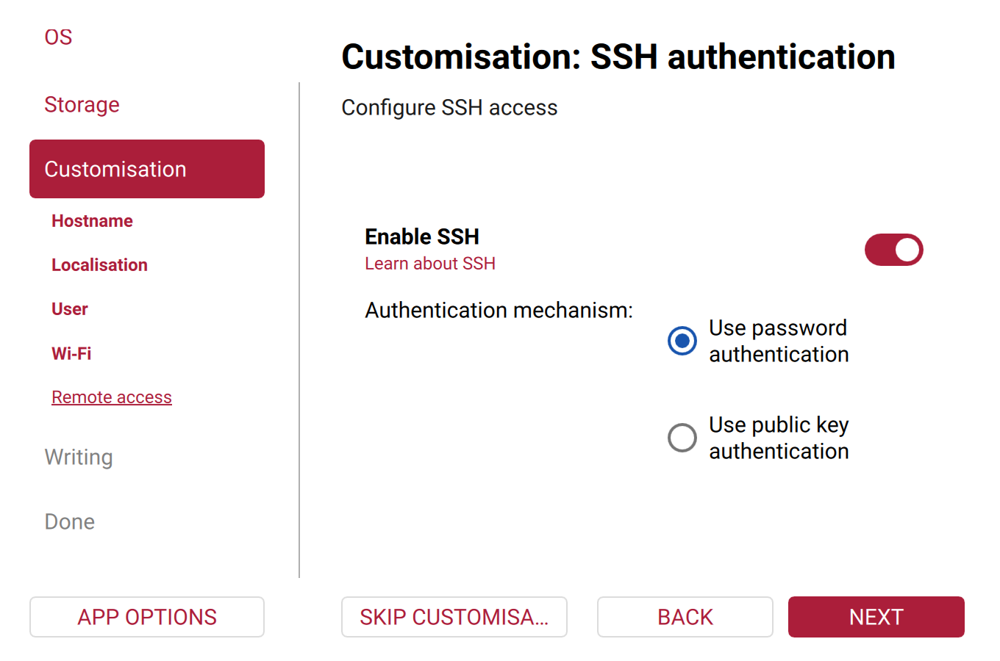
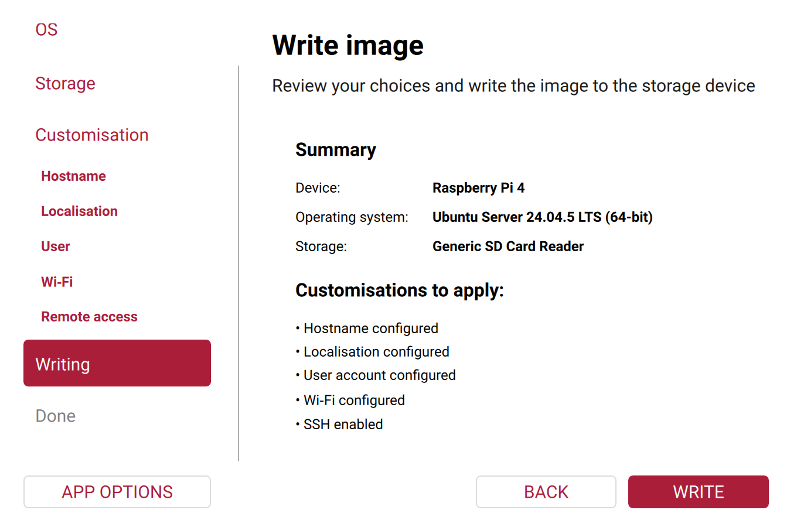

# Set Up the Raspberry Pi

These steps prepare the robot's Raspberry Pi for the [robot container](index.md), once. Each step says where it runs: on your PC, or on the Raspberry Pi over SSH. Afterwards, [Start, Check and Stop](usage.md) starts the robot.

## 1. Flash Ubuntu Server 24.04

On your PC, with [Raspberry Pi Imager](https://www.raspberrypi.com/software/) and the robot's microSD card. Imager asks for these settings, one screen each, shown in the tabs below:

1. **Device:** Raspberry Pi 4.
2. **OS:** *Other general-purpose OS* → *Ubuntu* → *Ubuntu Server 24.04.5 LTS (64-bit)*. Ubuntu supports the [Raspberry Pi 4 B](https://ubuntu.com/hardware/docs/boards/how-to/ubuntu_supported/raspberry-pi/) with this release.
3. **Storage:** your microSD card. Writing erases everything on it.
4. **Customisation:** Imager writes these settings onto the card, and Ubuntu applies them at the first boot.
    - **Hostname:** the robot's name on the network, for example `remo`.
    - **Localisation:** your time zone and keyboard layout.
    - **User:** a user name and password for the Raspberry Pi, for example `robot`.
    - **Wi-Fi:** your network's name and password.
    - **Remote access:** *Enable SSH* with password authentication.
5. **Write**, then put the card into the Raspberry Pi and switch it on.

=== "Device"

    { style="border: 1px solid var(--md-default-fg-color--lightest)" }

=== "OS"

    { style="border: 1px solid var(--md-default-fg-color--lightest)" }

=== "Storage"

    { style="border: 1px solid var(--md-default-fg-color--lightest)" }

=== "Hostname"

    { style="border: 1px solid var(--md-default-fg-color--lightest)" }

=== "Localisation"

    { style="border: 1px solid var(--md-default-fg-color--lightest)" }

=== "User"

    { style="border: 1px solid var(--md-default-fg-color--lightest)" }

=== "Wi-Fi"

    { style="border: 1px solid var(--md-default-fg-color--lightest)" }

=== "Remote access"

    { style="border: 1px solid var(--md-default-fg-color--lightest)" }

=== "Write"

    { style="border: 1px solid var(--md-default-fg-color--lightest)" }

The screenshots show Raspberry Pi Imager 2.0.12 with example settings, before writing. Use your own SD card, time zone, network and credentials. [Ubuntu's guide](https://ubuntu.com/tutorials/how-to-install-ubuntu-on-your-raspberry-pi) shows the same steps.

## 2. First login and updates

The first boot takes a few minutes, while Ubuntu applies Imager's settings. Then find the Raspberry Pi's IP address in your router's list of devices. The Raspberry Pi gets its address from the router by DHCP, and when it asks for one, it also sends its hostname, so the router lists it under that name ([`SendHostname=`](https://manpages.ubuntu.com/manpages/noble/man5/systemd.network.5.html), on by default). Then log in from your PC, with the user name from Imager and that address:

```console
ssh <user>@<robot-ip>
```

For example `ssh robot@192.168.1.20`. Once the first boot has finished, `ssh robot@remo.local` works too, with your hostname, from PCs that look up `.local` names (*Names instead of addresses* in [step 3](#3-fixed-ip-addresses)).

All further steps run in this SSH session, on the Raspberry Pi. Wait until the first-boot setup has finished, then install the current updates and restart:

```console
cloud-init status --wait
sudo apt update && sudo apt full-upgrade
sudo reboot
```

- **`cloud-init status --wait`:** [cloud-init](https://cloudinit.readthedocs.io/en/latest/reference/cli.html#status) is the tool that applies Imager's settings on the first boot: the hostname, the user, Wi-Fi and SSH. It also installs Avahi ([step 3](#3-fixed-ip-addresses)), so it may still be installing packages when you log in. The command returns when cloud-init is done.
- **`sudo apt update && sudo apt full-upgrade`:** the system on the SD card is as old as the image. `apt update` fetches the lists of available packages, and `apt full-upgrade` installs all updates published since, the Linux kernel included. Ubuntu installs security updates by itself, once a day ([automatic updates](https://ubuntu.com/server/docs/how-to/software/automatic-updates/)). All other updates, such as bug fixes, come only with this command, so run it from time to time.
- **`sudo reboot`:** restarts the Raspberry Pi, so that it runs the new kernel. After the restart, log in again.

To check that the Raspberry Pi runs the new kernel, compare these two after the restart:

```console
uname -r
dpkg-query -W linux-image-raspi
```

`uname -r` shows the kernel that runs, for example `6.8.0-1064-raspi`. `dpkg-query` shows the newest installed version of Ubuntu's kernel for the Raspberry Pi, for example `6.8.0-1064.68`. The first part, `6.8.0-1064`, must be the same in both. When an update needs a restart, Ubuntu's login message says *System restart required* until you restart.

## 3. Fixed IP addresses

ROS on the robot and on your PC find each other by IP address. Two settings hold the addresses, on both machines:

- **`ROS_MASTER_URI`:** where the ROS master runs. That's usually your PC, where you start `roscore`. Both machines get the same value: `http://`, the PC's address and `11311`, the master's port.
- **`ROS_IP`:** the machine's own address. The Raspberry Pi gets its own, and the PC its own. ROS tells the other machine to reach this machine's nodes at this address.

With this page's example addresses, `192.168.1.10` for the PC and `192.168.1.20` for the Raspberry Pi, the Raspberry Pi gets in its [settings](#9-settings):

```bash title="Raspberry Pi: .docker/robot/.env"
ROS_MASTER_URI=http://192.168.1.10:11311
ROS_IP=192.168.1.20
```

and your PC, as in [ROS Network Setup](../ros-network-setup.md):

```bash title="PC: in the dev container"
export ROS_MASTER_URI=http://192.168.1.10:11311
export ROS_IP=192.168.1.10
```

So neither address may change. Give both machines a fixed address in your router: most routers call this a *DHCP reservation* or *static lease*. ROS's own pages explain the two variables, [`ROS_MASTER_URI`](https://wiki.ros.org/ROS/EnvironmentVariables#ROS_MASTER_URI) and [`ROS_IP`](https://wiki.ros.org/ROS/EnvironmentVariables#ROS_IP.2FROS_HOSTNAME), and how to check the network ([ROS/NetworkSetup](https://wiki.ros.org/ROS/NetworkSetup)).

!!! info "Names instead of addresses"
    In step 2, cloud-init also installed Avahi, a service that announces the Raspberry Pi's name on the network as `remo.local`, with your hostname. So `ssh robot@remo.local` works from PCs that look up these names, as Ubuntu Desktop and macOS do.

    ROS uses the IP addresses anyway, because the robot containers and the dev container can't look up `.local` names. A program looks up a name through the system's C library, which asks the sources listed in [`/etc/nsswitch.conf`](https://manpages.ubuntu.com/manpages/noble/man5/nsswitch.conf.5.html). In the containers, these are only the file `/etc/hosts` and DNS servers, such as your router. `.local` names aren't in DNS: the device with that name answers for it itself, when asked over [multicast DNS](https://www.rfc-editor.org/rfc/rfc6762) (mDNS). On Ubuntu Desktop, the package [`libnss-mdns`](https://github.com/avahi/nss-mdns) adds mDNS to that list, and asks Avahi. The container images have neither. Adding them would mean changing both images and running Avahi on your PC too, so this page uses IP addresses.

## 4. The clock

ROS compares time stamps from the robot and the PC, for example to match a lidar scan with the robot's pose, so both clocks have to be right. The Raspberry Pi 4 has no battery-backed clock: after switching it on, its time is wrong until it has synchronized over the network. Check on the Raspberry Pi:

```console
timedatectl
```

It shows `System clock synchronized: yes` once the clock is right. Ubuntu's time service, systemd-timesyncd, asks time servers on the network (NTP), for example Ubuntu's own or one your router announces. It doesn't synchronize with your PC, but your PC sets its clock from time servers too, so both agree. The container uses the Raspberry Pi's clock, so it needs no setup of its own.

`timedatectl timesync-status` shows the details ([time synchronization](https://documentation.ubuntu.com/server/how-to/networking/timedatectl-and-timesyncd/)). Its most important lines:

- **`Server`:** the time server that the Raspberry Pi asks, for example `ntp.ubuntu.com`.
- **`Offset`:** how far the Raspberry Pi's clock was off at the last comparison with the server. systemd-timesyncd then corrects it.
- **`Poll interval`:** how often it asks. It starts at 32 seconds and grows up to 34 minutes while the clock stays steady ([timesyncd.conf](https://manpages.ubuntu.com/manpages/noble/man5/timesyncd.conf.5.html)).

## 5. Docker Engine

Docker Engine builds the image and runs the containers. Install it the same way as on your PC ([Set Up Your PC](../../getting-started/set-up-your-pc.md#docker)):

=== "Docker's repository (recommended)"

    Docker's guide [Install Docker Engine on Ubuntu](https://docs.docker.com/engine/install/ubuntu/#install-using-the-repository), section *Install using the apt repository*, works the same on the Raspberry Pi, whose Ubuntu is the arm64 version. These are its commands, as of October 2026. If the guide has changed since, follow the guide.

    First, add Docker's package repository:

    ```console
    sudo apt update
    sudo apt install ca-certificates curl
    sudo install -m 0755 -d /etc/apt/keyrings
    sudo curl -fsSL https://download.docker.com/linux/ubuntu/gpg -o /etc/apt/keyrings/docker.asc
    sudo chmod a+r /etc/apt/keyrings/docker.asc

    sudo tee /etc/apt/sources.list.d/docker.sources <<EOF
    Types: deb
    URIs: https://download.docker.com/linux/ubuntu
    Suites: $(. /etc/os-release && echo "${UBUNTU_CODENAME:-$VERSION_CODENAME}")
    Components: stable
    Architectures: $(dpkg --print-architecture)
    Signed-By: /etc/apt/keyrings/docker.asc
    EOF

    sudo apt update
    ```

    1. `ca-certificates` and `curl` download files over HTTPS.
    2. The key in `/etc/apt/keyrings/docker.asc` lets apt check that the packages come from Docker.
    3. `docker.sources` adds Docker's repository for your Ubuntu version, `noble` for 24.04, and your processor architecture, `arm64` on the Raspberry Pi.
    4. `apt update` reads the package list of the new repository.

    Then install the packages from it:

    ```console
    sudo apt install docker-ce docker-ce-cli containerd.io \
      docker-buildx-plugin docker-compose-plugin
    ```

    Without the repository, apt doesn't know these packages and stops with *Unable to locate package*.

=== "Ubuntu's packages"

    Ubuntu has its own Docker packages, so they need no other repository. Docker calls them unofficial, and they can be older than Docker's releases:

    ```console
    sudo apt install docker.io docker-compose-v2 docker-buildx
    ```

Then let your user run Docker without `sudo`, log out, and log in again so the new group applies ([post-installation steps](https://docs.docker.com/engine/install/linux-postinstall/)):

```console
sudo usermod -aG docker $USER
exit
```

After logging in again, check that Docker works:

```console
docker run --rm hello-world
```

!!! info "What these packages are for"
    - **Docker Engine** (`docker-ce`, or `docker.io` from Ubuntu): the background service `dockerd`, which builds images and runs containers. **containerd** is the part underneath that starts the containers.
    - **The Docker CLI** (`docker-ce-cli`, part of `docker.io` in Ubuntu): the `docker` command.
    - **Buildx** (`docker-buildx-plugin` or `docker-buildx`): the builder that `docker build` and Compose use.
    - **Compose** (`docker-compose-plugin` or `docker-compose-v2`): the `docker compose` command. It reads a `compose.yaml` file that describes the containers, their devices and their settings, so one command starts them all.

    That's all the robot needs: it builds one image and runs it with Compose. Members of the `docker` group can control Docker without `sudo`, which amounts to root access on the Raspberry Pi ([Docker's security notes](https://docs.docker.com/engine/security/#docker-daemon-attack-surface)).

## 6. The diffbot repository

On the Raspberry Pi, clone the [diffbot repository](https://github.com/ros-mobile-robots/diffbot) into your home folder:

```console
cd ~
git clone https://github.com/ros-mobile-robots/diffbot.git
```

Git is already installed on Ubuntu Server. Cloning needs no GitHub account and no Git settings: your name, email and editor only matter when you commit changes ([Git and GitHub](../../getting-started/git-and-github.md)). The robot's Docker files are in [`.docker/robot`]({{ robot_container_src_url }}/.docker/robot). The dot at the start of the folder name hides it from a plain `ls`, like `.github`. In this repository, it marks folders for tools, apart from the ROS packages. It's not Docker's own settings folder `~/.docker`.

After the next steps, the robot's files are in these places on the Raspberry Pi:

```text
/home/robot/              your home folder (user robot)
├── diffbot/              the diffbot repository
│   └── .docker/robot/
│       ├── compose.yaml  the containers
│       ├── env.example   the settings template
│       └── .env          your settings
└── robot-data/           ROS logs (step 8)
```

`.env` is a copy of `env.example` with your [settings](#9-settings). Inside the containers, the user is `ros`, with a home folder of its own. The robot's ROS packages are built into the image, so every container started from it has them, in the workspace `catkin_ws`:

```text
/home/ros/                the home folder of the user ros, in the container
├── catkin_ws/            the workspace, built into the image
│   ├── src/              diffbot, remo_description and rplidar_ros
│   ├── build/            catkin's intermediate files
│   └── devel/            the built packages
└── .ros/                 ~/robot-data from the Raspberry Pi (step 8)
    └── log/              ROS's log files
```

[Image and Tests](image.md#how-the-image-is-built) explains how the workspace gets into the image. `.ros` isn't part of the image: Compose mounts the Raspberry Pi's folder `~/robot-data` there, so the logs stay on the Raspberry Pi when the containers are removed.

## 7. Stable device names

The Linux kernel numbers serial devices in the order they appear, so the Teensy isn't always `/dev/ttyACM0`. [udev](https://manpages.ubuntu.com/manpages/noble/en/man7/udev.7.html), the service that creates the device files, can add fixed names by rules. The repository's [rules]({{ robot_container_src_url }}/.docker/robot/99-diffbot-robot.rules) name the Teensy `/dev/teensy` and the lidar `/dev/rplidar`, recognized by their USB vendor and product IDs:

```console
sudo cp ~/diffbot/.docker/robot/99-diffbot-robot.rules /etc/udev/rules.d/
sudo udevadm control --reload-rules
sudo udevadm trigger
ls -l /dev/teensy /dev/rplidar
```

1. `cp` installs the rules where udev reads them. The number `99` makes them come after the system's own rules.
2. `udevadm control --reload-rules` makes udev read its rule files again ([udevadm](https://manpages.ubuntu.com/manpages/noble/en/man8/udevadm.8.html)).
3. `udevadm trigger` replays the events of the devices that are already plugged in, so they get the new names without unplugging them.
4. `ls -l` shows the new names as links to the kernel's devices, for example `/dev/teensy -> ttyACM0`, for the devices that are plugged in.

`lsusb` lists the USB devices with their IDs: the Teensy is `16c0:0483`, the lidar's USB adapter `10c4:ea60`. Two devices with the same IDs need a rule with their serial number, as the [rules file explains]({{ robot_container_src_url }}/.docker/robot/99-diffbot-robot.rules#L7-L8).

## 8. The folder for logs

```console
mkdir -p ~/robot-data
id -u
```

The containers write ROS's log files into this folder. Inside the container, they run as the user `ros` with the user ID (UID) 1000, so the folder must be writable for UID 1000. The first user on Ubuntu, the one from Imager, usually has that ID, which `id -u` shows. If it shows another number, give the folder to UID 1000: `sudo chown 1000:1000 ~/robot-data`.

## 9. Settings

The settings are in the file `.env` in the folder `~/diffbot/.docker/robot`, next to `compose.yaml`. Create it from the template [`env.example`]({{ robot_container_src_url }}/.docker/robot/env.example), which explains each setting, and edit it, on the Raspberry Pi:

```console
cd ~/diffbot/.docker/robot
cp env.example .env
nano .env
```

For Remo with a lidar and the ROS master on your PC, it contains, besides comments:

```bash title=".docker/robot/.env"
ROBOT_MODEL=remo # (1)!
COMPOSE_PROFILES=lidar # (2)!
ROS_MASTER_URI=http://192.168.1.10:11311 # (3)!
ROS_IP=192.168.1.20 # (4)!
```

1. The robot this Raspberry Pi is in: `remo` or `diffbot`. It selects the robot model and the controller's wheel radius and separation. With the other robot's model, the controller computes the wheel speeds and the odometry with the wrong wheel geometry, and the robot's frames are the other robot's.
2. Starts the lidar driver too. Leave this line out on a robot without a lidar. To switch the lidar off later, run `docker compose down` while the line is still there, then remove it: without it, Compose doesn't stop the lidar container anymore.
3. The PC that runs `roscore`: `http://` and the PC's IP address, and `11311`, the ROS master's port ([`ROS_MASTER_URI`](https://wiki.ros.org/ROS/EnvironmentVariables#ROS_MASTER_URI)).
4. The Raspberry Pi's own IP address. ROS tells the other nodes to reach the robot's nodes at this address ([`ROS_IP`](https://wiki.ros.org/ROS/EnvironmentVariables#ROS_IP.2FROS_HOSTNAME)).

On your PC, set `ROS_MASTER_URI` to the same value, and `ROS_IP` to the PC's own address, as in [step 3](#3-fixed-ip-addresses). Without `ROS_MASTER_URI`, the bringup starts its own ROS master on the robot, which is enough to check the robot alone.

### When Compose reads `.env`

Neither the Raspberry Pi's shell nor the containers read `.env`. Docker Compose does:

1. **Each time you run `docker compose`** in `~/diffbot/.docker/robot`, with `up`, `ps`, `logs`, `down` or any other command. Compose reads `.env` from that folder and fills its values into `compose.yaml`, wherever it says `${NAME}` ([variable interpolation](https://docs.docker.com/compose/how-tos/environment-variables/variable-interpolation/)). `docker compose config` shows `compose.yaml` with the values filled in.
2. **When `docker compose up` creates the containers.** `ROS_MASTER_URI`, `ROS_IP` and `ROS_HOSTNAME` become environment variables inside them. roslaunch and the nodes read them when they start, to find the ROS master and to tell the other nodes where they can be reached. The other settings stay with Compose: they choose the devices, the group, the logs folder, the robot model and, with `COMPOSE_PROFILES`, which containers run.
3. **A running container keeps the values it was created with.** After changing `.env`, run `docker compose up -d` again: Compose recreates the containers whose settings changed.

A variable with the same name in the Raspberry Pi's shell wins over `.env` ([precedence](https://docs.docker.com/compose/how-tos/environment-variables/envvars-precedence/)), for example an `export ROS_MASTER_URI=…` in `~/.bashrc`, left from a native ROS installation. `docker compose config --environment` lists the values that Compose uses.

### All settings

| Setting | Default | What it's for |
|:--|:--|:--|
| `ROBOT_MODEL` | `remo` | `remo` or `diffbot`, the robot the container runs on |
| `COMPOSE_PROFILES` | not set | `lidar` starts the lidar container too |
| `ROS_MASTER_URI` | not set | The ROS master on the PC. Without it, the bringup starts a master on the robot |
| `ROS_IP` | not set | The robot's own IP address. `ROS_HOSTNAME` with a name works too, if the PC can look up that name |
| `TEENSY_DEVICE`, `LIDAR_DEVICE` | `/dev/teensy`, `/dev/rplidar` | The serial devices on the Raspberry Pi, from [step 7](#7-stable-device-names) |
| `DIALOUT_GID` | `20` | The number of the group that owns the serial devices on the Raspberry Pi |
| `ROBOT_DATA` | `~/robot-data` | The folder for logs, from [step 8](#8-the-folder-for-logs) |

### Why `DIALOUT_GID` is a number

Inside the container, the user `ros` may open the Teensy's device only as a member of the group that owns it, `dialout` on Ubuntu. Docker can add a group to the container's user by name or by number, but it looks a name up in the container's own list of groups, where the same name could have another number than on the Raspberry Pi. So `compose.yaml` adds the Raspberry Pi's group by its number. On Ubuntu that's 20, the default. To check, on the Raspberry Pi:

```console
stat -Lc %g /dev/teensy
```

[`stat`](https://manpages.ubuntu.com/manpages/noble/man1/stat.1.html) shows a file's details, and `%g` its group's number. `-L` follows the link `/dev/teensy` to the real device. Without it, `stat` shows the group of the link itself. Write the number into `.env`: Compose doesn't run commands in it.

### How `compose.yaml` uses the settings

[`compose.yaml`]({{ robot_container_src_url }}/.docker/robot/compose.yaml) describes two services, `bringup` and `lidar`. A service is a container that Compose starts, with its image, devices and settings. What both containers share is written once, in the block `x-robot`, and each service takes it over with `<<: *robot` (lines 17–42):

```yaml title="compose.yaml" linenums="17"
--8<-- "{{ robot_container_src_raw }}/.docker/robot/compose.yaml:17:42"
```

- **`network_mode: host`** (line 21): the containers use the Raspberry Pi's network directly, so their ROS nodes are reachable at its IP address, like native ones. ROS 1 needs this: besides the master's port 11311, every node opens its own random port, and the other nodes connect to it directly ([ROS Network Setup](../ros-network-setup.md)).
- **`group_add`** (lines 24–25): the group with the number from `DIALOUT_GID`.
- **`environment`** (lines 26–29): the environment variables inside the containers. `ROS_MASTER_URI`, `ROS_IP` and `ROS_HOSTNAME` are listed without a value: Compose takes their values from `.env`, or from the shell, when it creates the containers. A variable that's set in neither isn't set in the containers either ([`environment`](https://docs.docker.com/reference/compose-file/services/#environment)).
- **`volumes`** (lines 32–37): mounts the logs folder as the containers' `~/.ros`, where ROS writes its logs. Compose doesn't create a missing folder: Docker would create it for root, and the user `ros` couldn't write into it.
- **`logging`** (lines 41–42): Docker's [local log format](https://docs.docker.com/engine/logging/drivers/local/). By default, it keeps at most five files of 20 MB per container and deletes the oldest, so the containers' output can't fill the SD card. Docker's default format, json-file, keeps everything unless rotation is configured.

Each service then adds what's its own (lines 44–64):

```yaml title="compose.yaml" linenums="44"
--8<-- "{{ robot_container_src_raw }}/.docker/robot/compose.yaml:44:64"
```

- **`bringup`** (lines 47–54): `build` tells Compose how to build the image, from the [Dockerfile](image.md#how-the-image-is-built) in `.docker/robot`. Its `context` is the whole repository, the folder whose files the Dockerfile can copy into the image. `devices` passes the Teensy into the container as `/dev/ttyACM0`, where the bringup's launch file expects it. `command` starts `bringup.launch` with the robot model from `ROBOT_MODEL`.
- **`lidar`** (lines 58–64): runs only with the profile `lidar`, which `COMPOSE_PROFILES` selects. Compose starts it after the bringup (`depends_on`). It gets the lidar as `/dev/ttyUSB0` and starts `lidar.launch`, the lidar driver alone.
