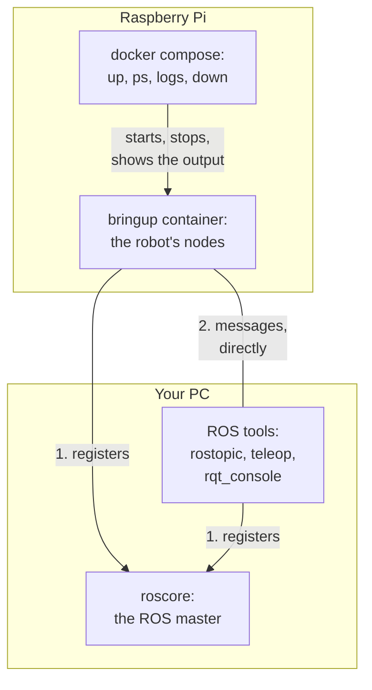

# Start, Check and Stop

Once the Raspberry Pi is [set up](setup.md), the commands on this page start the robot, check it, drive it and stop it. The page then explains the versions of the robot's Docker image, your own build of it, and where the robot's logs are.

!!! note "Where the example outputs come from"
    The outputs on this page were recorded on a PC, with the robot's Docker image and without a Teensy or a lidar. They show what to look for. Names, addresses and numbers differ on your robot. What only a connected Teensy prints is described in words. Outputs from the real robot follow with the robot test ([diffbot#109](https://github.com/ros-mobile-robots/diffbot/issues/109)).

## Where the commands run

The commands run in two places: in an SSH session on the Raspberry Pi, and in the [dev container](../../development/dev-container.md) on your PC.



| Where | Which commands | Whose commands they are |
|:--|:--|:--|
| On the Raspberry Pi, over SSH | `docker compose` with `up`, `ps`, `logs`, `down`, `pull` and `exec` | Docker Compose's own. They work the same in every project that has a `compose.yaml` ([Compose's command reference](https://docs.docker.com/reference/cli/docker/compose/)) |
| On your PC, in the dev container | `roscore`, `rostopic`, `rosrun` and `rqt_console` | ROS's own tools |

Only the names inside these commands belong to this project:

- **The services `bringup` and `lidar`:** defined in the repository's `compose.yaml`.
- **The settings:** in your `.env`.
- **The script `/entrypoint.sh`:** part of the robot's Docker image.

Compose reads `compose.yaml` and `.env` from the folder it's started in. So run the `docker compose` commands in the folder `~/diffbot/.docker/robot`.

The ROS tools run on the PC because the PC has the screen. The robot's Docker image has ROS's command-line tools but no rqt, and the Raspberry Pi runs without a screen. The tools on the PC see the robot's topics because the PC and the robot use the same ROS master. [On the robot alone](#on-the-robot-alone) shows how to run the command-line tools on the Raspberry Pi instead.

### The ROS master

The ROS master is the program that every ROS node registers with when it starts ([the ROS wiki's page on the Master](https://wiki.ros.org/Master)). The ROS master tells the nodes where the other nodes are. After that, the nodes send their messages to each other directly, as the figure above shows. The command `roscore` starts the ROS master.

The robot and the PC have to use the same ROS master. One setting decides where it runs: `ROS_MASTER_URI` in the robot's `.env` ([Settings](setup.md#9-settings)).

| `ROS_MASTER_URI` in `.env` | Where the ROS master runs | Who starts it |
|:--|:--|:--|
| The PC's address, for example `http://192.168.1.10:11311` | On your PC, in the dev container | You, with `roscore`, before you start the robot |
| Not set | On the Raspberry Pi, in the bringup container | roslaunch, when the bringup starts |

This page uses the first row, the ROS master on the PC. The second row is for [the robot alone](#on-the-robot-alone).

## Start

Before the first start, flash the Teensy's firmware from your PC ([Microcontroller](../teensy-mcu.md)), and connect the Teensy and the lidar to the Raspberry Pi's USB ports.

First start the ROS master. On your PC, in the dev container:

```console
roscore
```

Leave it running in its terminal. Without a ROS master at the address in `ROS_MASTER_URI`, the robot's containers stop with *unable to contact ROS master*.

Then start the robot's containers. On the Raspberry Pi:

```console
cd ~/diffbot/.docker/robot
docker compose up -d --no-build
```

The parts of the command:

- **`up`:** creates and starts the containers that `compose.yaml` describes. That's the bringup, and the lidar if `COMPOSE_PROFILES=lidar` is set.
- **`-d`:** short for `--detach`. The containers run in the background, and you get the prompt back.
- **`--no-build`:** Compose only downloads the Docker image. It never builds it.

The first start downloads the robot's Docker image, [`ghcr.io/ros-mobile-robots/diffbot-robot`](https://github.com/orgs/ros-mobile-robots/packages/container/package/diffbot-robot). CI built and tested it, with the robot's packages already compiled ([Image and Tests](image.md)). The download is about 0.7 GB. That number is measured for the amd64 image, the one for PCs. The arm64 image, which the Raspberry Pi downloads, isn't measured yet. Later starts use the downloaded image.

Why the command has `--no-build`, and how long a build would take:

- **Without `--no-build`:** Compose would answer a failed download by building the Docker image on the Raspberry Pi, from your clone. With it, a failed download is an error that you see at once.
- **No build is needed to use the robot:** CI builds the published image for arm64, the Raspberry Pi's processor architecture, on an arm64 computer of GitHub.
- **How long the build takes in CI:** about two minutes. In seven runs, it took between 1 min 42 s and 1 min 55 s.
- **How long it takes on a Raspberry Pi 4:** not measured yet. The Raspberry Pi 4's processor and SD card are slower than that computer's, so expect a longer build.
- **When you do need a build:** [Your own build](#your-own-build) explains it, and how to build on the Raspberry Pi or on your PC.

## Check

Check three things, in this order: the containers run, their output shows no error, and the robot's topics carry data.

### 1. The containers run

On the Raspberry Pi, list the containers of the project:

```console
docker compose ps -a
```

On a robot without a lidar, the list has one container, the bringup, with the status `Up`:

```text
NAME                      IMAGE                  COMMAND                  SERVICE   CREATED          STATUS          PORTS
diffbot-robot-bringup-1   diffbot-robot:noetic   "/entrypoint.sh rosl…"   bringup   26 seconds ago   Up 26 seconds
```

- **`IMAGE`:** on your robot, this column shows the published Docker image's full name, `ghcr.io/ros-mobile-robots/diffbot-robot:noetic`.
- **`-a`:** short for `--all`. The list then also has containers that stopped. A stopped container shows `Exited` and a number, its exit code. Its output tells why it stopped.
- **With the lidar:** a second line follows, for the service `lidar`.

### 2. The containers' output shows no error

`docker compose logs` is Docker Compose's own command for the output of a project's containers ([`docker compose logs`](https://docs.docker.com/reference/cli/docker/compose/logs/)). `-f` is short for `--follow`: the command keeps running and prints new lines as they come. On the Raspberry Pi:

```console
docker compose logs -f
```

Each line starts with the name of the container it comes from. `Ctrl+C` ends the command, and the robot keeps running. The bringup's output starts like the following lines. Each `...` stands for lines that are left out here:

```text
bringup-1  | started roslaunch server http://192.168.1.20:43309/
...
bringup-1  | NODES
bringup-1  |   /diffbot/
bringup-1  |     controller_spawner (controller_manager/spawner)
bringup-1  |     diffbot_base (diffbot_base/diffbot_base)
bringup-1  |     robot_state_publisher (robot_state_publisher/robot_state_publisher)
bringup-1  |     rosserial_base_controller (rosserial_python/serial_node.py)
bringup-1  |
bringup-1  | ROS_MASTER_URI=http://192.168.1.10:11311
bringup-1  |
bringup-1  | process[diffbot/rosserial_base_controller-1]: started with pid [52]
bringup-1  | process[diffbot/diffbot_base-2]: started with pid [53]
bringup-1  | process[diffbot/controller_spawner-3]: started with pid [54]
bringup-1  | process[diffbot/robot_state_publisher-4]: started with pid [55]
...
bringup-1  | [INFO] [1793227440.919570252]: ... Done Initializing DiffBot Hardware Interface
...
bringup-1  | [INFO] [1793227441.364928]: Connecting to /dev/ttyACM0 at 115200 baud
```

What to look for in it:

- **`started roslaunch server`** with the Raspberry Pi's address: the bringup got `ROS_IP`.
- **`ROS_MASTER_URI`** with the PC's address: the bringup uses the ROS master on the PC.
- **`NODES` and the `started` lines:** the four nodes of `bringup.launch` run. They are rosserial, the hardware interface `diffbot_base`, the controller spawner and the robot state publisher.
- **`Connecting to /dev/ttyACM0`:** rosserial opens the Teensy's serial port.

With a Teensy connected, rosserial then prints *Requesting topics...*, and a line *Setup publisher on …* or *Setup subscriber on …* for each topic of the firmware. The controller spawner ends with *Started controllers: joint_state_controller, mobile_base_controller*.

### 3. The topics carry data

A topic that's listed but has no messages isn't enough. So check that messages arrive. On your PC, in the dev container:

```console
rostopic hz /diffbot/measured_joint_states
rostopic echo -n 1 /diffbot/mobile_base_controller/odom
rostopic hz /diffbot/scan
```

- **`rostopic hz`:** prints how many messages per second arrive on a topic. `Ctrl+C` ends it.
- **`rostopic echo -n 1`:** prints one message and ends.
- **`/diffbot/measured_joint_states`:** comes from the Teensy. Messages at a steady rate mean that rosserial talks with the firmware and the encoders are read.
- **`/diffbot/mobile_base_controller/odom`:** the controller's odometry.
- **`/diffbot/scan`:** comes from the lidar, if it runs.

## Drive

!!! warning "Wheels off the ground first"
    Before the first drive command, put the robot on a block, so that both wheels turn freely. Check that the wheels turn in the commanded direction, and that they stop when the command stops. Only then put the robot on the floor, with free space around it. Stay next to the robot. If it doesn't stop, lift it off its wheels.

The robot drives when a node publishes velocity commands on the topic `/diffbot/mobile_base_controller/cmd_vel`. A command is a message of the type [`geometry_msgs/Twist`](https://docs.ros.org/en/noetic/api/geometry_msgs/html/msg/Twist.html). The robot's controller, `mobile_base_controller`, uses two of its fields:

- **`linear.x`:** the speed forward, $v$, in m/s. A negative value drives backward. The controller limits it to 0.3 m/s.
- **`angular.z`:** the turning speed, $\omega$, in rad/s. A positive value turns to the left, seen from above, and a negative value to the right. That's ROS's convention for rotations ([REP 103](https://www.ros.org/reps/rep-0103.html)).

??? info "The controller's limits in `diffbot_control.yaml`"
    These lines of [`diffbot_control.yaml`]({{ robot_container_src_url }}/diffbot_control/config/diffbot_control.yaml#L42-L54) limit the speeds and the accelerations that the controller passes on to the wheels:

    ```yaml title="diffbot_control.yaml" linenums="42"
    --8<-- "{{ robot_container_src_raw }}/diffbot_control/config/diffbot_control.yaml:42:54"
    ```

When no command arrives for 0.5 s, the controller sets the speed it aims for to zero. That's the default of its parameter `cmd_vel_timeout` ([the parameters of diff_drive_controller](https://wiki.ros.org/diff_drive_controller#Parameters)). The robot then slows down within the controller's acceleration limit and stops. So a command has to be repeated, more than twice per second, for as long as the robot should move. The commands below repeat it 10 times per second. They run on your PC, in the dev container.

### With the keyboard

`teleop_twist_keyboard` turns key presses into velocity commands ([its repository, with all keys and parameters](https://github.com/ros-teleop/teleop_twist_keyboard)). This command starts it for a slow first drive:

```console
rosrun teleop_twist_keyboard teleop_twist_keyboard.py \
  _speed:=0.1 _turn:=0.5 _repeat_rate:=10.0 _key_timeout:=0.6 \
  cmd_vel:=/diffbot/mobile_base_controller/cmd_vel
```

The parts of the command:

- **`_speed:=0.1`:** drives with $v$ = 0.1 m/s. The tool's default is 0.5 m/s, more than the controller's limit.
- **`_turn:=0.5`:** turns with $\omega$ = 0.5 rad/s. The tool's default is 1.0 rad/s.
- **`_repeat_rate:=10.0`:** repeats the current command 10 times per second. Without it, the tool sends one command per key press.
- **`_key_timeout:=0.6`:** sends a stop command when no key press arrives for 0.6 s. A terminal reports a held key as repeated key presses, and it doesn't report the release. So the stop command follows about 0.6 s after you release the key.
- **`cmd_vel:=…`:** sends the commands to the controller's topic instead of the tool's default topic `cmd_vel`.

Hold a key to drive. After you release it, the robot slows down and stops. In the simulation, Remo stood still 0.74 s after the release. The keys are:

| Key | The robot |
|:--|:--|
| `i` | drives forward |
| `,` | drives backward |
| `j` | turns left on the spot |
| `l` | turns right on the spot |
| `k` | stops |

`Ctrl+C` ends the tool.

### With a command for a straight drive, and one for a turn

`rostopic pub` publishes a message that you write on the command line ([the ROS wiki's page on rostopic pub](https://wiki.ros.org/rostopic#rostopic_pub)). `-r 10` repeats it 10 times per second, until `Ctrl+C` ends the command.

This command drives straight and slowly, forward with $v$ = 0.1 m/s:

```console
rostopic pub -r 10 /diffbot/mobile_base_controller/cmd_vel geometry_msgs/Twist '{linear: {x: 0.1}}'
```

This command turns on the spot, to the left with $\omega$ = 0.5 rad/s:

```console
rostopic pub -r 10 /diffbot/mobile_base_controller/cmd_vel geometry_msgs/Twist '{angular: {z: 0.5}}'
```

The fields that a command leaves out are zero. So the first command doesn't turn, and the second one doesn't drive forward.

To stop, press `Ctrl+C`. `rostopic pub` ends, and no more commands arrive. After its 0.5 s, the controller slows the robot down to a stop. In the simulation, with these two commands, DiffBot and Remo drove with 0.10 m/s and turned with 0.50 rad/s. They stood still 0.65 s to 0.70 s after the last command. On the real robot, these times aren't measured yet.

## Stop

On the Raspberry Pi, stop and remove the containers:

```console
docker compose down
```

`down` stops and removes the containers.

- **What stays:** the Docker image, for the next start, and ROS's log files in `~/robot-data` ([Logs](#logs)).
- **What goes:** the containers' output, which `docker compose logs` showed.

Before you switch the Raspberry Pi off, shut it down with `sudo poweroff`. Otherwise the power may go while the SD card is written to.

## All commands

On the Raspberry Pi, in `~/diffbot/.docker/robot`:

| Task | Command |
|:--|:--|
| Start, or restart after a change of `.env` | `docker compose up -d --no-build` |
| Is it running? | `docker compose ps -a` |
| Follow the output | `docker compose logs -f` |
| Stop | `docker compose down` |
| Update | `git pull`, `docker compose pull --policy always`, then `docker compose up -d --no-build` |
| Switch off | `docker compose down`, then `sudo poweroff` |

!!! warning "After the Teensy was reset, reflashed or unplugged"
    Stop the containers and start them again: `docker compose down`, then `docker compose up -d --no-build`. A container gets its devices when it starts, and a reconnected Teensy is a new device for the kernel, which the running container doesn't see. A new start also starts a new odometry, so a measurement run ends there.

## On the robot alone

ROS's command-line tools also run on the Raspberry Pi, inside the bringup container. That helps when no PC is at hand, or to rule out the network between the PC and the robot.

This command runs `rostopic list` in the running bringup container. On the Raspberry Pi:

```console
docker compose exec bringup /entrypoint.sh rostopic list
```

| Part | From | What it does |
|:--|:--|:--|
| `docker compose` | Docker | Works on the containers that `compose.yaml` in the current folder describes |
| `exec` | Docker | Starts one more process in a container that already runs ([`docker compose exec`](https://docs.docker.com/reference/cli/docker/compose/exec/)) |
| `bringup` | `compose.yaml` | The name of the service, which says in which container |
| `/entrypoint.sh` | The diffbot repository | [The entrypoint script]({{ robot_container_src_url }}/.docker/robot/entrypoint.sh). It loads ROS and the workspace, then runs the rest of the line |
| `rostopic list` | ROS | The command itself |

The command has to name `/entrypoint.sh`. Docker runs this script by itself only for the container's main process, each time the container starts. For a process that `exec` adds later, Docker doesn't run it. Without the script, ROS isn't loaded, and the command isn't found:

```text
exec: "rostopic": executable file not found in $PATH
```

What works on the robot this way, and what doesn't:

- **Works:** `rostopic`, `rosnode`, `rosparam`, `rosservice` and `rosbag`, and both ways to [drive](#drive), each after `docker compose exec bringup /entrypoint.sh`.
- **Doesn't work:** rqt_console and the other rqt tools. They aren't in the robot's Docker image, and the Raspberry Pi has no screen.
- **A shell:** `docker compose exec bringup /entrypoint.sh bash` opens a shell in the container, with ROS loaded.

### Without any PC

The robot also runs without a PC and its `roscore`:

1. Leave `ROS_MASTER_URI` out of `.env`. roslaunch then starts a ROS master in the bringup container when the bringup starts ([The ROS master](#the-ros-master)).
2. Leave `COMPOSE_PROFILES=lidar` out too, for now. Started together, the bringup and the lidar container can each start a ROS master, and one of the two containers can then stop. It did in each of three starts of our test without hardware.
3. Start the robot's containers as in [Start](#start).

## Versions

A version is one build of the robot's Docker image. The setting `ROBOT_IMAGE` in `.env` chooses the version that runs ([All settings](setup.md#all-settings)).

### The newest version

Without `ROBOT_IMAGE`, the robot runs `noetic`. That's the newest Docker image that CI published from the `noetic-devel` branch. To update, on the Raspberry Pi:

```console
git pull
docker compose pull --policy always
docker compose up -d --no-build
```

1. `git pull` updates your clone of the repository, with `compose.yaml` and the udev rules.
2. `docker compose pull --policy always` asks the registry for `noetic` again, and downloads the image if there's a newer one.
3. `docker compose up -d --no-build` recreates the containers with it.

### One fixed version

Each published Docker image also has a name with the full commit it was built from: `noetic-<commit>`. This name never moves to another image. The [package's page](https://github.com/orgs/ros-mobile-robots/packages/container/package/diffbot-robot) lists the names. To stay on one version, or to go back to an earlier one, set it in `.env`:

```bash title=".docker/robot/.env"
ROBOT_IMAGE=ghcr.io/ros-mobile-robots/diffbot-robot:noetic-<commit>
```

Then download it and restart. On the Raspberry Pi:

```console
docker compose pull --policy always
docker compose up -d --no-build
```

To go back to the newest version, remove the line from `.env` and run both commands again. Removing the line alone changes nothing that runs.

??? info "Even more exact: the digest"
    A digest is a checksum of a Docker image's content: `sha256:` followed by 64 characters. If one byte of the image changes, the digest changes. So a digest names exactly one content, whatever names point to it ([Docker's reference on pulling by digest](https://docs.docker.com/reference/cli/docker/image/pull/#pull-an-image-by-digest-immutable-identifier)).

    `noetic-<commit>` is enough to stay on one version, because a published version is never replaced ([How it's tested](image.md#how-its-tested)). The digest is for a record that has to be exact. The package's page shows the digest of each version. In `.env`, `@` and the digest replace `:` and the name:

    ```bash title=".docker/robot/.env"
    ROBOT_IMAGE=ghcr.io/ros-mobile-robots/diffbot-robot@sha256:<digest>
    ```

    Use the digest that the package's page shows for `noetic-<commit>` itself, not the digest of one architecture's image. On the Raspberry Pi, `docker images --digests ghcr.io/ros-mobile-robots/diffbot-robot` lists the downloaded versions with their digests, in the column `DIGEST`.

### What a version covers

A version covers the Docker image, and nothing else. Three more parts decide what the robot does, and each has a state of its own:

| Part | Where it comes from | How to see its state |
|:--|:--|:--|
| **The Docker image:** ROS Noetic, the robot's compiled packages and the entrypoint script | The registry, in the version that `ROBOT_IMAGE` names | The first command of [the test report](#what-a-test-report-needs) prints its commit |
| **Your clone, `~/diffbot`:** `compose.yaml` and the udev rules | `git clone`, updated by `git pull` | `git -C ~/diffbot log -1` |
| **`.env`:** your settings | You. Nothing else changes it | `cat ~/diffbot/.docker/robot/.env` |
| **The Teensy's firmware:** the program that drives the motors and reads the encoders | Your last flash, from the PC | The Teensy doesn't report it. Note the commit when you flash |

udev uses the copy of the rules that [step 7](setup.md#7-stable-device-names) of the setup installed, not the file in your clone. After a `git pull` that changed the rules, install them again.

### What a test report needs

A test report, for example for the robot test in [diffbot#109](https://github.com/ros-mobile-robots/diffbot/issues/109), says what ran, so that someone else can repeat the test. That takes four notes, one for each part in the table above. The first three commands run on the Raspberry Pi, in `~/diffbot/.docker/robot`, while the robot runs.

1. **The Docker image's commit:** it says which code the containers run. CI writes the commit into each published image, as a label. This command prints the label of the running bringup container's image:

    ```console
    docker inspect --format '{{ '{{' }}index .Config.Labels "org.opencontainers.image.revision"{{ '}}' }}' $(docker compose ps -q bringup)
    ```

    For your own build, the command prints an empty line, because only CI writes this label. [What to note about your own build](#what-to-note-about-your-own-build) says what identifies it instead.

2. **The clone's commit:** it says which `compose.yaml` was used. It says the same for the udev rules, if the installed rules are the clone's ([What a version covers](#what-a-version-covers)). This command prints the commit:

    ```console
    git -C ~/diffbot rev-parse HEAD
    ```

3. **The settings:** what Compose made of them. `docker compose config` prints `compose.yaml` with every setting filled in, from `.env`, from variables in the shell and from the defaults. Run it right after the start, in the same shell, so that it shows what the containers were started with. This command saves its output for the report:

    ```console
    docker compose config > ~/robot-settings.yaml
    ```

4. **The firmware's commit:** it says which firmware the Teensy runs. Note it when you flash. On your PC, in the clone that you flash from:

    ```console
    git rev-parse HEAD
    ```

## Your own build

You need a build of your own only to run packages that you changed. For everything else, the published Docker image is enough.

The image has to be built for arm64, the Raspberry Pi's processor architecture. There are two places to build it:

| Where | How it builds for arm64 | What is known |
|:--|:--|:--|
| [On the Raspberry Pi](#on-the-raspberry-pi) | Natively. The Raspberry Pi is an arm64 computer | Not run on a Raspberry Pi yet, so the build time on it isn't measured. CI runs the same Dockerfile on its arm64 computer |
| [On your PC](#on-your-pc-for-the-raspberry-pi) | Under emulation, on a PC with an amd64 processor. The emulator QEMU runs the arm64 programs of the build on it | Not tested yet |

For comparison: CI builds the published image natively, on an arm64 computer of GitHub, in about two minutes ([How it's tested](image.md#how-its-tested)).

### On the Raspberry Pi

Give your build a name of its own in `.env`:

```bash title=".docker/robot/.env"
ROBOT_IMAGE=diffbot-robot:local
```

Then build the Docker image from your clone and start it. On the Raspberry Pi:

```console
docker compose up -d --build --pull never
```

- **`--build`:** builds the image before the start, with the [Dockerfile](image.md#how-the-image-is-built) and the packages in your clone.
- **`--pull never`:** keeps Compose from looking for `diffbot-robot:local` in a registry.

The first build downloads the official ROS Docker image and compiles the robot's packages. Later builds reuse the steps whose input didn't change, so they're usually much faster. The name `diffbot-robot:local` keeps your build apart from the published versions. To go back to them, remove the line from `.env` and run `docker compose pull --policy always` and `docker compose up -d --no-build`.

### On your PC, for the Raspberry Pi

!!! warning "Not tested yet"
    These steps follow Docker's documentation. They haven't been run with the robot's image yet.

A PC with an amd64 processor can build the arm64 Docker image too. Docker calls this a multi-platform build ([Docker's guide to multi-platform builds](https://docs.docker.com/build/building/multi-platform/)). It isn't cross compilation, where a compiler on the PC would produce arm64 programs. Here the compiler is an arm64 program itself, and QEMU runs it on the PC's processor. So the Dockerfile needs no change, but each build step runs slower than on an arm64 computer. A computer with an arm64 processor needs no emulation: it builds the image natively.

1. **Check for emulation:** the builder that Docker uses on the PC has to support arm64. This command lists the builders with their platforms, and marks the selected one with `*`. On your PC:

    ```console
    docker buildx ls
    ```

    The selected builder has to list `linux/arm64` among its platforms. Docker Desktop's builder does. With Docker Engine on Linux, Docker's guide names two ways to get there: a builder with the `docker-container` driver, or QEMU installed on the PC ([the guide's section on QEMU](https://docs.docker.com/build/building/multi-platform/#qemu)).

2. **Build the image for arm64:** this command builds the image from the files of your clone. Run it on your PC, in the root folder of your clone of the diffbot repository:

    ```console
    docker buildx build --platform linux/arm64 -f .docker/robot/Dockerfile -t diffbot-robot:local --load .
    ```

    `--platform linux/arm64` names the processor architecture to build for. `--load` puts the result into the PC's Docker, next to its other images.

3. **Copy the image to the Raspberry Pi:** this command sends the image over SSH. Run it on your PC, with the Raspberry Pi's user name and address:

    ```console
    docker save diffbot-robot:local | gzip | ssh <user>@<robot-ip> docker load
    ```

    `docker save` writes the image as an archive, `gzip` compresses it, `ssh` sends it to the Raspberry Pi, and `docker load` reads it into the Raspberry Pi's Docker.

4. **Start it:** set `ROBOT_IMAGE=diffbot-robot:local` in `.env`. Then start the containers with the copied image. On the Raspberry Pi, in `~/diffbot/.docker/robot`:

    ```console
    docker compose up -d --no-build --pull never
    ```

### What to note about your own build

Your own build has no commit written into it. So note where it comes from when you build it, on the computer that builds it. In the clone that you build from:

```console
git rev-parse HEAD
git status --short
```

- **`git rev-parse HEAD`:** prints the commit that the clone is at.
- **`git status --short`:** lists the files that differ from that commit. If it lists any, the commit alone doesn't describe the build. Commit your changes first, or keep the output of `git diff` with your notes.

## Logs

The robot's messages end up in three places:

| Place | What it holds | How long it stays |
|:--|:--|:--|
| [The containers' output](#what-the-containers-print) | What the bringup and the lidar driver print | Until `docker compose down` |
| [ROS's log files](#ross-log-files) | A file for roslaunch and for each node | Until you delete them |
| [The node `rosout`](#all-nodes-messages-live) | All nodes' messages, live, and in the file `rosout.log` | The file stays until you delete it |

### What the containers print

Docker keeps what each container prints on the Raspberry Pi, at most 100 MB per container, until `docker compose down` removes the containers. `docker compose logs` shows it, as in [Check](#2-the-containers-output-shows-no-error). To read only the bringup's output again, on the Raspberry Pi:

```console
docker compose logs bringup
```

### ROS's log files

roslaunch and each node also write a log file. Inside a container, ROS writes them to the folder `/home/ros/.ros/log`. The folder `/home/ros/.ros` isn't the container's own. Docker mounts the Raspberry Pi's folder `~/robot-data` there: that folder appears inside the container at the path `/home/ros/.ros` ([Docker's page on bind mounts](https://docs.docker.com/engine/storage/bind-mounts/)). So what a container writes there is written into `~/robot-data`, on the Raspberry Pi's SD card. These lines of [`compose.yaml`]({{ robot_container_src_url }}/.docker/robot/compose.yaml#L36-L43) mount the folder:

```yaml title="compose.yaml" linenums="36"
--8<-- "{{ robot_container_src_raw }}/.docker/robot/compose.yaml:36:43"
```

- **`source`** (line 40): the folder on the Raspberry Pi. It's `~/robot-data`, unless `ROBOT_DATA` in `.env` names another one.
- **`target`** (line 41): the path inside the container. It's the folder `.ros` in the home folder of the container's user `ros`. ROS writes its log files into the folder `log` below it.
- **`create_host_path: false`** (line 43): Docker doesn't create a missing folder, for the reason in the comment. [Step 8](setup.md#8-the-folder-for-logs) of the setup creates it.

So the log files are in `~/robot-data/log` on the Raspberry Pi. A container's own files are deleted with the container, at `docker compose down`. The files in the mounted folder stay.

The files of one run are in one folder. ROS names the folder after the run's ID, which is set when the ROS master starts. So all starts of the robot under one `roscore` write into the same folder. To find the newest folder, on the Raspberry Pi:

```console
ls -dt ~/robot-data/log/*/ | head -1
```

To read the files on your PC, copy that folder. On the PC, with the folder's name for `<folder>`:

```console
scp -r <user>@<robot-ip>:robot-data/log/<folder> robot-logs
```

ROS also keeps a link named `latest` to the newest folder. It only works inside the container, because it holds the path `/home/ros/.ros/log`, which the Raspberry Pi doesn't have.

### All nodes' messages, live

Each node also sends its messages to the node `rosout`. `rosout` starts together with the ROS master and collects the messages of all nodes, on the robot and on the PC. [rqt_console](https://wiki.ros.org/rqt_console) shows them live in a window, with filters by node and by severity. It runs where the screen is. On your PC, in the dev container:

```console
rqt_console
```

`rosout` also writes the messages to the file `rosout.log`, in the run's log folder on the computer where the ROS master runs. With the ROS master on your PC, that folder is below `~/.ros/log` in the dev container, not in the robot's `~/robot-data/log`.
