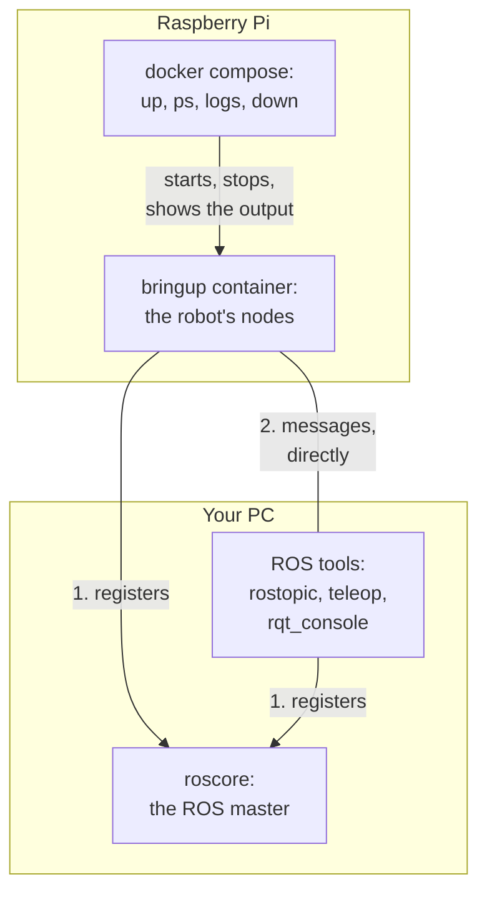

# Start, Check and Stop

Once the Raspberry Pi is [set up](setup.md), two commands start the robot: one on your PC, then one on the Raspberry Pi. The robot's nodes then run on the Raspberry Pi, and the ROS tools on your PC see the robot's topics.

## Start

Before the first start, flash the Teensy's firmware from your PC ([Microcontroller](../teensy-mcu.md)). Connect the Teensy to one of the Raspberry Pi's USB ports, and the lidar too if your robot has one.

1. **On your PC:** in the [dev container](../../development/dev-container.md), start the ROS master.

    ```console
    roscore
    ```

    Leave `roscore` running in its terminal. [The ROS master](#the-ros-master) explains what this program does. Without a running `roscore`, the robot's containers stop with *unable to contact ROS master*.

2. **On the Raspberry Pi:** in an SSH session, start the robot's containers. If this Raspberry Pi was set up before the published image, check first which image its clone starts ([A clone from before the published image](#a-clone-from-before-the-published-image)).

    ```console
    cd ~/diffbot/.docker/robot
    docker compose up -d
    ```

    The first start downloads the robot's Docker image, so the first start takes a while. Later starts use the downloaded image.

3. **On the Raspberry Pi:** list the containers.

    ```console
    docker compose ps -a
    ```

    The bringup runs when the line of the service `bringup` shows `Up` under `STATUS`. With the lidar switched on in the settings, a second line shows `Up` for the service `lidar`. [The containers run](#1-the-containers-run) shows the list and what a stopped container looks like.

Without a PC, the robot starts alone, with the ROS master on the Raspberry Pi: [Without any PC](#without-any-pc).

### What the start command does

The parts of `docker compose up -d`:

- **`docker compose`:** Docker's tool for containers that belong together. The tool reads which containers to run, with which devices and settings, from the file `compose.yaml` in the current folder. That's why the command runs in `~/diffbot/.docker/robot`.
- **`up`:** creates and starts the containers that `compose.yaml` describes. That's the bringup, and the lidar if `COMPOSE_PROFILES=lidar` is set ([Settings](setup.md#9-settings)).
- **`-d`:** short for `--detach`. The containers run in the background, and you get the prompt back.

The command never builds anything. The command downloads the robot's Docker image, [`ghcr.io/ros-mobile-robots/diffbot-robot`](https://github.com/orgs/ros-mobile-robots/packages/container/package/diffbot-robot), which CI built and tested, with the robot's packages already compiled ([Where the robot's software comes from](index.md#where-the-robots-software-comes-from)). If the download fails, the command stops with the registry's error ([Troubleshooting](troubleshooting.md#the-download-fails)).

The amd64 image, the one for PCs, is a download of about 0.7 GB. The arm64 image, which the Raspberry Pi downloads, isn't measured yet.

### A clone from before the published image

A clone of the diffbot repository from before the published image has a `compose.yaml` that starts an image built on the Raspberry Pi. This command prints which image your clone starts. On the Raspberry Pi, in `~/diffbot/.docker/robot`:

```console
docker compose config --images
```

- **`ghcr.io/ros-mobile-robots/diffbot-robot:noetic`:** the clone starts the published image. Nothing to do.
- **`diffbot-robot:noetic`:** the clone starts an image that was built on this Raspberry Pi. [Update to the newest version](versions.md#update-to-the-newest-version) gets the current `compose.yaml` and the published image.

## Where the commands run

The commands run in two places: in an SSH session on the Raspberry Pi, and in the [dev container](../../development/dev-container.md) on your PC.



| Where | Which commands | Whose commands they are |
|:--|:--|:--|
| On the Raspberry Pi, over SSH | `docker compose` with `up`, `ps`, `logs`, `down`, `pull` and `exec` | Docker Compose's own. They work the same in every project that has a `compose.yaml` ([Compose's command reference](https://docs.docker.com/reference/cli/docker/compose/)) |
| On your PC, in the dev container | `roscore`, `rostopic`, `rosrun` and `rqt_console` | ROS's own tools |

Only the names inside these commands belong to this project:

- **The services `bringup` and `lidar`:** defined in the repository's `compose.yaml`.
- **The settings:** in your `.env`.
- **The script `/entrypoint.sh`:** part of the robot's Docker image.

Compose reads `compose.yaml` and `.env` from the folder where Compose is started. So run the `docker compose` commands in the folder `~/diffbot/.docker/robot`.

The ROS tools run on the PC because the PC has the screen. The robot's Docker image has ROS's command-line tools but no rqt, and the Raspberry Pi runs without a screen. The tools on the PC see the robot's topics because the PC and the robot use the same ROS master. [On the robot alone](#on-the-robot-alone) shows how to run the command-line tools on the Raspberry Pi instead.

### The ROS master

The ROS master is the program that every ROS node registers with when the node starts ([the ROS wiki's page on the Master](https://wiki.ros.org/Master)). The ROS master tells the nodes where the other nodes are. After that, the nodes send their messages to each other directly, as the figure above shows. The command `roscore` starts the ROS master.

The robot and the PC have to use the same ROS master. One setting decides where the ROS master runs: `ROS_MASTER_URI` in the robot's `.env` ([Settings](setup.md#9-settings)).

| `ROS_MASTER_URI` in `.env` | Where the ROS master runs | Who starts the ROS master |
|:--|:--|:--|
| The PC's address, for example `http://192.168.1.10:11311` | On your PC, in the dev container | You, with `roscore`, before you start the robot |
| Not set | On the Raspberry Pi, in the bringup container | roslaunch, when the bringup starts |

This page uses the first row, the ROS master on the PC. Only this arrangement can run the lidar too, with `COMPOSE_PROFILES=lidar`. The second row is for [the robot alone](#on-the-robot-alone), with the bringup and without the lidar ([Without any PC](#without-any-pc) says why).

## Check

Check three things, in this order: the containers run, their output shows no error, and the robot's topics carry data.

!!! note "Where the example outputs come from"
    The outputs in this section were recorded on a PC, with the robot's Docker image and without a Teensy or a lidar. They show what to look for. Names, addresses and numbers differ on your robot. What only a connected Teensy prints is described in words. Outputs from the real robot follow with the robot test ([diffbot#109](https://github.com/ros-mobile-robots/diffbot/issues/109)).

### 1. The containers run

The third step of [Start](#start) lists the containers of the project. On the Raspberry Pi:

```console
docker compose ps -a
```

On a robot without a lidar, the list has one container, the bringup, with the status `Up`:

```text
NAME                      IMAGE                  COMMAND                  SERVICE   CREATED          STATUS          PORTS
diffbot-robot-bringup-1   diffbot-robot:noetic   "/entrypoint.sh rosl…"   bringup   26 seconds ago   Up 26 seconds
```

- **`IMAGE`:** on your robot, this column shows the published Docker image's full name, `ghcr.io/ros-mobile-robots/diffbot-robot:noetic`.
- **`-a`:** short for `--all`. The list then also has containers that stopped. A stopped container shows `Exited` and a number, the exit code. The output of the stopped container tells why.
- **With the lidar:** a second line follows, for the service `lidar`.

### 2. The containers' output shows no error

`docker compose logs` is Docker Compose's own command for the output of a project's containers ([`docker compose logs`](https://docs.docker.com/reference/cli/docker/compose/logs/)). `-f` is short for `--follow`: the command keeps running and prints new lines as they come. On the Raspberry Pi:

```console
docker compose logs -f
```

Each line starts with the name of the container that printed the line. `Ctrl+C` ends the command, and the robot keeps running. The bringup's output starts like the following lines. Each `...` stands for lines that are left out here:

```text
bringup-1  | started roslaunch server http://192.168.1.20:43309/
...
bringup-1  | NODES
bringup-1  |   /diffbot/
bringup-1  |     controller_spawner (controller_manager/spawner)
bringup-1  |     diffbot_base (diffbot_base/diffbot_base)
bringup-1  |     robot_state_publisher (robot_state_publisher/robot_state_publisher)
bringup-1  |     rosserial_base_controller (rosserial_python/serial_node.py)
bringup-1  |
bringup-1  | ROS_MASTER_URI=http://192.168.1.10:11311
bringup-1  |
bringup-1  | process[diffbot/rosserial_base_controller-1]: started with pid [52]
bringup-1  | process[diffbot/diffbot_base-2]: started with pid [53]
bringup-1  | process[diffbot/controller_spawner-3]: started with pid [54]
bringup-1  | process[diffbot/robot_state_publisher-4]: started with pid [55]
...
bringup-1  | [INFO] [1793227440.919570252]: ... Done Initializing DiffBot Hardware Interface
...
bringup-1  | [INFO] [1793227441.364928]: Connecting to /dev/ttyACM0 at 115200 baud
```

What to look for in this output:

- **`started roslaunch server`** with the Raspberry Pi's address: the bringup got `ROS_IP`.
- **`ROS_MASTER_URI`** with the PC's address: the bringup uses the ROS master on the PC.
- **`NODES` and the `started` lines:** the four nodes of `bringup.launch` run. They are rosserial, the hardware interface `diffbot_base`, the controller spawner and the robot state publisher.
- **`Connecting to /dev/ttyACM0`:** rosserial opens the Teensy's serial port.

With a Teensy connected, rosserial then prints *Requesting topics...*, and a line *Setup publisher on …* or *Setup subscriber on …* for each topic of the firmware. The controller spawner ends with *Started controllers: joint_state_controller, mobile_base_controller*.

### 3. The topics carry data

A topic that's listed but has no messages isn't enough. So check that messages arrive. Each of these checks is one command on your PC, in the dev container.

1. **The wheel encoders:** the topic `/diffbot/measured_joint_states` comes from the Teensy. This command prints how many messages per second arrive:

    ```console
    rostopic hz /diffbot/measured_joint_states
    ```

    - **It works when:** a line with `average rate:` appears every second, with a steady rate. On Remo's bench check, the rate was 20 Hz ([the bench record](https://github.com/ros-mobile-robots/diffbot/issues/160#issuecomment-6550353204)). Then rosserial talks with the firmware, and the encoders are read.
    - **It doesn't work when:** the command prints *does not appear to be published yet* and waits, or it prints *no new messages*. Both mean that no message arrives. [Troubleshooting](troubleshooting.md#rostopic-hz-prints-no-new-messages-or-does-not-appear-to-be-published-yet) shows how to find out whether a node publishes the topic at all.
    - **To end the command:** press `Ctrl+C`.

2. **The odometry:** the topic `/diffbot/mobile_base_controller/odom` comes from the controller. This command prints one message:

    ```console
    rostopic echo -n 1 /diffbot/mobile_base_controller/odom
    ```

    - **It works when:** the command prints one message, with the robot's `pose` and `twist`, and ends by itself.
    - **It doesn't work when:** nothing is printed. Then press `Ctrl+C`.

3. **The lidar, only if your robot runs it:** the topic `/diffbot/scan` comes from the lidar container. Skip this check on a robot without a lidar, and when the bringup runs alone, as it does with the ROS master on the Raspberry Pi. This command prints how many scans per second arrive:

    ```console
    rostopic hz /diffbot/scan
    ```

    - **It works when:** a line with `average rate:` appears every second.
    - **It doesn't work when:** the command prints *does not appear to be published yet* and waits, or it prints *no new messages*. [Troubleshooting](troubleshooting.md#no-diffbotscan) has the next steps.
    - **To end the command:** press `Ctrl+C`.

## Drive

!!! warning "Wheels off the ground first"
    Before the first drive command, put the robot on a block, so that both wheels turn freely. Check that the wheels turn in the commanded direction, and that they stop when the command stops. Only then put the robot on the floor, with free space around the robot. Stay next to the robot. If the robot doesn't stop, lift the robot off its wheels.

    The wheels don't follow a command at once: they start late, and they run on after a stop. Two measurements on Remo show how much, both with the wheels off the ground ([diffbot#168](https://github.com/ros-mobile-robots/diffbot/issues/168), with [the second measurement](https://github.com/ros-mobile-robots/diffbot/issues/168#issuecomment-6658892348) in a comment):

    - **A Teensy 3.2 with the firmware at commit `1a3b547`, a command of 0.3 m/s:** the wheels started 1 s to 1.5 s after the command. After the command went back to zero, the wheels kept turning for about 2 s.
    - **Remo's own Teensy 4.0 with the firmware at commit `58cf789`, a command of 0.2 m/s or a turn with 2.5 rad/s:** 3 s after the command went back to zero, the wheels still turned with about 1.4 rad/s. The motor output, the power that the firmware gives the motors, reached zero after 4.6 s to 4.8 s, in three runs.

    The commands on this page ask for 0.1 m/s, which neither measurement covers. So hold a key for a few seconds to see the wheels turn. After each stop, watch the wheels until they stand still, and note how long that takes. How far the robot rolls on the floor after a stop isn't measured yet.

The robot drives when a node publishes velocity commands on the topic `/diffbot/mobile_base_controller/cmd_vel`. A command is a message of the type [`geometry_msgs/Twist`](https://docs.ros.org/en/noetic/api/geometry_msgs/html/msg/Twist.html). The robot's controller, `mobile_base_controller`, uses two fields of this message:

- **`linear.x`:** the speed forward, $v$, in m/s. A negative value drives backward. The controller limits this speed to 0.3 m/s.
- **`angular.z`:** the turning speed, $\omega$, in rad/s. A positive value turns to the left, seen from above, and a negative value to the right. That's ROS's convention for rotations ([REP 103](https://www.ros.org/reps/rep-0103.html)).

??? info "The controller's limits in `diffbot_control.yaml`"
    These lines of [`diffbot_control.yaml`]({{ robot_container_src_url }}/diffbot_control/config/diffbot_control.yaml#L42-L54) limit the speeds and the accelerations that the controller passes on to the wheels:

    ```yaml title="diffbot_control.yaml" linenums="42"
    --8<-- "{{ robot_container_src_raw }}/diffbot_control/config/diffbot_control.yaml:42:54"
    ```

When no command arrives for 0.5 s, the controller sets the speed it aims for to zero. That's the default of the controller's parameter `cmd_vel_timeout` ([the parameters of diff_drive_controller](https://wiki.ros.org/diff_drive_controller#Parameters)). The controller then lowers the wheel speeds that it commands, within its acceleration limit, down to zero. So a command has to be repeated, more than twice per second, for as long as the robot should move. Both ways below send the command 10 times per second. Both run on your PC, in the dev container.

The controller only commands wheel speeds. The Teensy's firmware turns them into motor power, and that takes time: [the box at the top of this section](#drive) has the times measured on Remo.

### With the keyboard

`teleop_twist_keyboard` turns key presses into velocity commands ([the tool's repository, with all keys and parameters](https://github.com/ros-teleop/teleop_twist_keyboard)). This command starts the tool for a slow first drive:

```console
rosrun teleop_twist_keyboard teleop_twist_keyboard.py \
  _speed:=0.1 _turn:=0.5 _repeat_rate:=10.0 _key_timeout:=0.6 \
  cmd_vel:=/diffbot/mobile_base_controller/cmd_vel
```

The parts of the command:

- **`_speed:=0.1`:** drives with $v$ = 0.1 m/s. The tool's default is 0.5 m/s, more than the controller's limit.
- **`_turn:=0.5`:** turns with $\omega$ = 0.5 rad/s. The tool's default is 1.0 rad/s.
- **`_repeat_rate:=10.0`:** repeats the current command 10 times per second. Without this parameter, the tool sends one command per key press.
- **`_key_timeout:=0.6`:** sends a stop command when no key press arrives for 0.6 s. A terminal reports a held key as repeated key presses, and doesn't report the release. So the stop command follows about 0.6 s after you release the key.
- **`cmd_vel:=…`:** sends the commands to the controller's topic instead of the tool's default topic `cmd_vel`.

What a key press does with these parameters:

- **One tap sends the command for about 0.6 s:** the tool repeats the command until no key press has arrived for 0.6 s, the key timeout. Then the tool sends the stop command. What the wheels do in that time depends on where the robot runs:
    - **In the simulation:** one tap of `i` moved Remo 6 cm, and Remo came to a stop about 0.85 s after the tap.
    - **On the real Remo, with the wheels off the ground:** a short tap can leave the wheels still, because the wheels start late ([the measurements at the top of this section](#drive)).
- **A held key sends the command until you release the key:** the repeated key presses come from the keyboard's key repeat. So the key repeat has to be on, and the delay before the first repeat has to be shorter than the key timeout. The tool's README recommends a key timeout that is longer than this delay, and names 0.5 s as the delay's default on Ubuntu ([the README's section on the key timeout](https://github.com/ros-teleop/teleop_twist_keyboard#key-timeout)).
- **After you release the key:** the tool sends the stop command about 0.6 s later, and the wheels slow down and stop. In the simulation, Remo stood still 0.74 s after the release. The real Remo's wheels ran on for several seconds in [the measurements at the top of this section](#drive). Watch the wheels until they stand still.

The keys are:

| Key | The robot |
|:--|:--|
| `i` | drives forward |
| `,` | drives backward |
| `j` | turns left on the spot |
| `l` | turns right on the spot |
| `k` | stops |

`Ctrl+C` ends the tool.

### With a command for a straight drive, and one for a turn

`rostopic pub` publishes a message that you write on the command line ([the ROS wiki's page on rostopic pub](https://wiki.ros.org/rostopic#rostopic_pub)). `-r 10` repeats the message 10 times per second, until `Ctrl+C` ends the command.

This command drives straight and slowly, forward with $v$ = 0.1 m/s:

```console
rostopic pub -r 10 /diffbot/mobile_base_controller/cmd_vel \
  geometry_msgs/Twist '{linear: {x: 0.1}}'
```

This command turns on the spot, to the left with $\omega$ = 0.5 rad/s:

```console
rostopic pub -r 10 /diffbot/mobile_base_controller/cmd_vel \
  geometry_msgs/Twist '{angular: {z: 0.5}}'
```

The fields that a command leaves out are zero. So the first command doesn't turn, and the second one doesn't drive forward.

To stop, press `Ctrl+C`. `rostopic pub` ends, and no more commands arrive. After 0.5 s without a command, the controller lowers the commanded wheel speeds to zero. In the simulation, with these two commands, DiffBot and Remo drove with 0.10 m/s and turned with 0.50 rad/s. They stood still 0.65 s to 0.70 s after the last command. The real Remo's wheels ran on for several seconds in [the measurements at the top of this section](#drive). Watch the wheels until they stand still. How far the real robot rolls on the floor after the last command isn't measured yet.

## Stop

On the Raspberry Pi, stop and remove the containers:

```console
docker compose down
```

`down` stops and removes the containers.

- **What stays:** the Docker image, for the next start, and ROS's log files in `~/robot-data` ([Logs](#logs)).
- **What goes:** the containers' output, which `docker compose logs` showed.

Before you switch the Raspberry Pi off, shut it down with `sudo poweroff`. Otherwise the power may go while the SD card is written to.

## All commands

On the Raspberry Pi, in `~/diffbot/.docker/robot`:

| Task | Command |
|:--|:--|
| Start, or restart after a change of `.env` | `docker compose up -d` |
| Do the containers run? | `docker compose ps -a` |
| Follow the output | `docker compose logs -f` |
| Stop | `docker compose down` |
| Update | `git pull && docker compose pull --policy always && docker compose up -d` |
| Switch off | `docker compose down`, then `sudo poweroff` |

[Update to the newest version](versions.md#update-to-the-newest-version) explains the three parts of the update, and why `&&` joins them.

!!! warning "After the Teensy was reset, reflashed or unplugged"
    Stop the containers and start them again: `docker compose down`, then `docker compose up -d`. A container gets its devices when it starts, and a reconnected Teensy is a new device for the kernel, which the running container doesn't see. A new start also starts a new odometry, so a measurement run ends there.

## On the robot alone

ROS's command-line tools also run on the Raspberry Pi, inside the bringup container. That helps when no PC is at hand, or to rule out the network between the PC and the robot.

This command runs `rostopic list` in the running bringup container. On the Raspberry Pi:

```console
docker compose exec bringup /entrypoint.sh rostopic list
```

| Part | From | What the part does |
|:--|:--|:--|
| `docker compose` | Docker | Works on the containers that `compose.yaml` in the current folder describes |
| `exec` | Docker | Starts one more process in a container that already runs ([`docker compose exec`](https://docs.docker.com/reference/cli/docker/compose/exec/)) |
| `bringup` | `compose.yaml` | The name of the service, which says in which container |
| `/entrypoint.sh` | The diffbot repository | [The entrypoint script]({{ robot_container_src_url }}/.docker/robot/entrypoint.sh). The script loads ROS and the workspace, then runs the rest of the line |
| `rostopic list` | ROS | The command itself |

The command has to name `/entrypoint.sh`. Docker runs this script by itself only for the container's main process, each time the container starts. For a process that `exec` adds later, Docker doesn't run the script. Without the script, ROS isn't loaded, and the command isn't found:

```text
exec: "rostopic": executable file not found in $PATH
```

What works on the robot this way, and what doesn't:

- **Works:** `rostopic`, `rosnode`, `rosparam`, `rosservice` and `rosbag`, and both ways to [drive](#drive), each after `docker compose exec bringup /entrypoint.sh`.
- **Doesn't work:** rqt_console and the other rqt tools. They aren't in the robot's Docker image, and the Raspberry Pi has no screen.
- **A shell:** `docker compose exec bringup /entrypoint.sh bash` opens a shell in the container, with ROS loaded.

### Without any PC

The robot also runs without a PC and without `roscore`. All three steps run on the Raspberry Pi, in `~/diffbot/.docker/robot`:

1. Stop the robot's containers, the lidar included, before you change the settings:

    ```console
    docker compose --profile lidar down
    ```

    Without this step, a lidar container from an earlier start stays. Compose doesn't stop that container once the lidar profile is gone from the settings.

2. Remove two lines from `.env`: `ROS_MASTER_URI` and `COMPOSE_PROFILES=lidar`.

    - **Without `ROS_MASTER_URI`:** roslaunch starts a ROS master in the bringup container when the bringup starts ([The ROS master](#the-ros-master)).
    - **Without the lidar, for now:** started together, the bringup and the lidar container can each start a ROS master, and one of the two containers can then stop. In our test without hardware, one container stopped in each of three starts.
    - **Variables of the shell:** a variable with one of these two names in the Raspberry Pi's shell still wins over `.env` ([When Compose reads `.env`](setup.md#when-compose-reads-env)). Remove such a variable too.
    - **Without a network:** if the Raspberry Pi isn't connected to your network, remove `ROS_IP` as well. The Raspberry Pi doesn't have that address then, and roslaunch stops with *Unable to contact my own server*. Download the robot's Docker image while the Raspberry Pi still has its internet connection: `docker compose pull`. Without the image, the start stops, because it can't reach the registry.

3. Start the bringup:

    ```console
    docker compose up -d
    ```

    `docker compose ps -a` then lists the bringup as `Up`. The bringup's output shows `ROS_MASTER_URI=http://localhost:11311`: the ROS master runs in the bringup container.

## Logs

The robot's messages end up in three places:

| Place | What the place holds | How long that stays |
|:--|:--|:--|
| [The containers' output](#what-the-containers-print) | What the bringup and the lidar driver print | Until `docker compose down` |
| [ROS's log files](#ross-log-files) | A file for roslaunch and for each node | Until you delete them |
| [The node `rosout`](#all-nodes-messages-live) | All nodes' messages, live, and in the file `rosout.log` | The file stays until you delete it |

### What the containers print

Docker keeps what each container prints on the Raspberry Pi, at most 100 MB per container, until `docker compose down` removes the containers. `docker compose logs` shows this output, as in [Check](#2-the-containers-output-shows-no-error). To read only the bringup's output again, on the Raspberry Pi:

```console
docker compose logs bringup
```

### ROS's log files

roslaunch and each node also write a log file. Inside a container, ROS writes them to the folder `/home/ros/.ros/log`. The folder `/home/ros/.ros` isn't the container's own. Docker mounts the Raspberry Pi's folder `~/robot-data` there: that folder appears inside the container at the path `/home/ros/.ros` ([Docker's page on bind mounts](https://docs.docker.com/engine/storage/bind-mounts/)). So what a container writes there is written into `~/robot-data`, on the Raspberry Pi's SD card. These lines of [`compose.yaml`]({{ robot_container_src_url }}/.docker/robot/compose.yaml#L39-L46) mount the folder:

```yaml title="compose.yaml" linenums="39"
--8<-- "{{ robot_container_src_raw }}/.docker/robot/compose.yaml:39:46"
```

- **`source`** (line 43): the folder on the Raspberry Pi. The folder is `~/robot-data`, unless `ROBOT_DATA` in `.env` names another one.
- **`target`** (line 44): the path inside the container. The path is the folder `.ros` in the home folder of the container's user `ros`. ROS writes its log files into the folder `log` below `.ros`.
- **`create_host_path: false`** (line 46): Docker doesn't create a missing folder, for the reason in the comment. [Step 8](setup.md#8-the-folder-for-logs) of the setup creates the folder.

So the log files are in `~/robot-data/log` on the Raspberry Pi. A container's own files are deleted with the container, at `docker compose down`. The files in the mounted folder stay.

The files of one run are in one folder. ROS names the folder after the run's ID, which is set when the ROS master starts. So all starts of the robot under one `roscore` write into the same folder. To find the newest folder, on the Raspberry Pi:

```console
ls -dt ~/robot-data/log/*/ | head -1
```

To read the files on your PC, copy that folder. On the PC, with the folder's name for `<folder>`:

```console
scp -r <user>@<robot-ip>:robot-data/log/<folder> robot-logs
```

ROS also keeps a link named `latest` to the newest folder. The link only works inside the container, because the link holds the path `/home/ros/.ros/log`, which the Raspberry Pi doesn't have.

### All nodes' messages, live

Each node also sends its messages to the node `rosout`. `rosout` starts together with the ROS master and collects the messages of all nodes, on the robot and on the PC. [rqt_console](https://wiki.ros.org/rqt_console) shows them live in a window, with filters by node and by severity. rqt_console runs where the screen is. On your PC, in the dev container:

```console
rqt_console
```

`rosout` also writes the messages to the file `rosout.log`, in the run's log folder on the computer where the ROS master runs. With the ROS master on your PC, that folder is below `~/.ros/log` in the dev container, not in the robot's `~/robot-data/log`.
