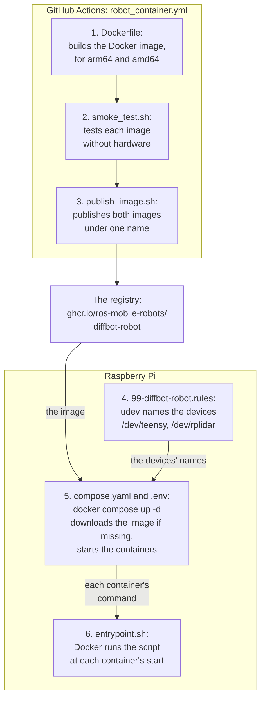
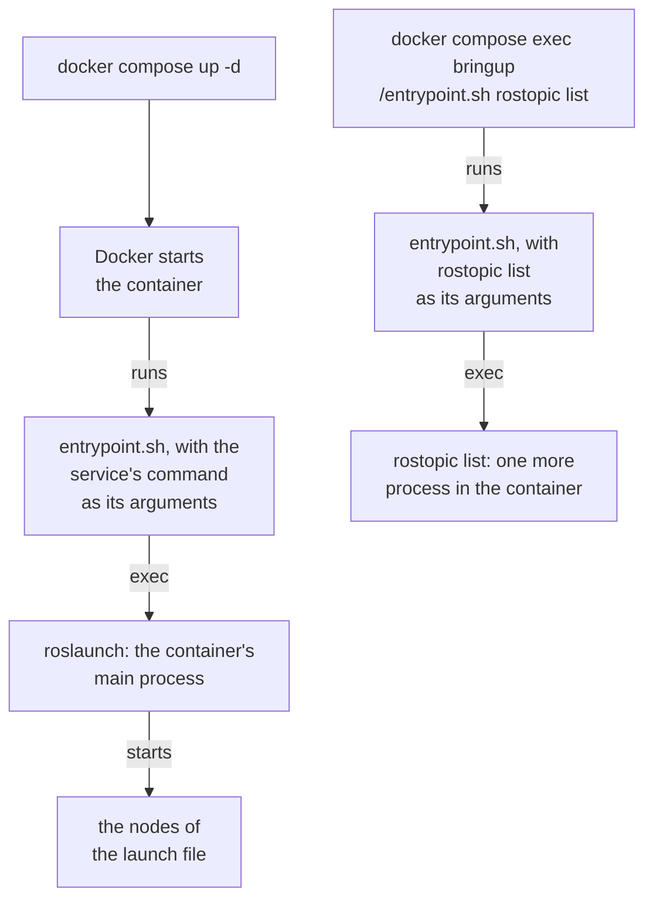
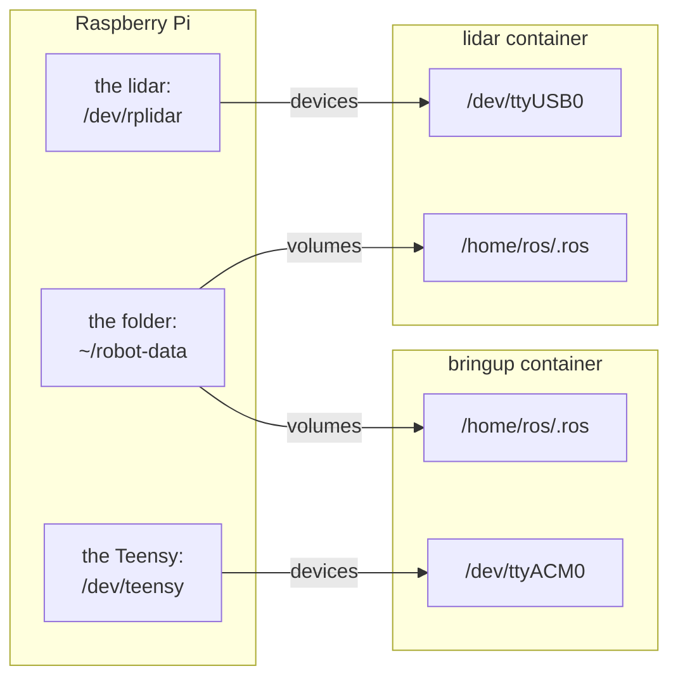
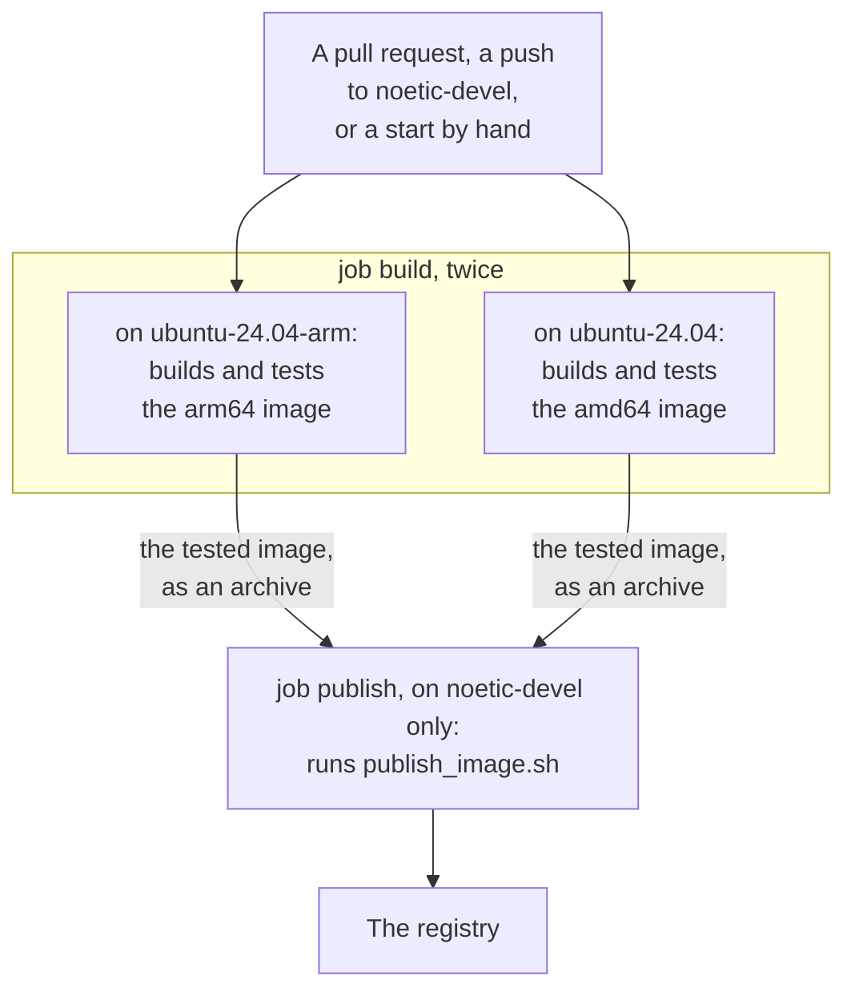

# Code Walkthrough

This page walks through the code of the [robot container](index.md), file by file. You don't need the page to use the robot. The page is for reading the code, and for changing the code.

The sections follow a reading order. The Dockerfile comes first, because the Dockerfile defines what the robot's Docker image contains. Then come the entrypoint script, `compose.yaml` and the udev rules, and last the workflow that builds, tests and publishes the image. The files act in another order, which the figure below shows.

All files are in the diffbot repository. Most of them are in the folder [`.docker/robot`]({{ robot_container_src_url }}/.docker/robot). The workflow is in `.github/workflows`, and `remo_robot.repos` and `.dockerignore` are in the repository's root folder. The excerpts on this page show these files at one commit of the repository.

## From a change to the running robot

The figure shows the order in which the files act, from top to bottom. The steps in the upper box run on GitHub's computers. The build and the test run for every change of the image or its packages. The publication runs on `noetic-devel` only, after such a change is merged or after a start by hand, when both architectures passed. The steps in the lower box happen on the robot's Raspberry Pi. The udev rules act when a device is plugged in. Compose reads `compose.yaml` and `.env` when you run `docker compose`. Docker runs the entrypoint script when a container starts.



The start downloads the image only if the Raspberry Pi has none yet. An update to a newer image takes one more command ([Update to the newest version](versions.md#update-to-the-newest-version)).

The same steps as a table, with the section that explains each file:

| File | When and where the file acts | What the file does |
|:--|:--|:--|
| [`Dockerfile`](#the-dockerfile) | For every change of the image or its packages, on GitHub's runners. For your own build, on the Raspberry Pi | Builds the Docker image: ROS Noetic, the robot's packages, the user `ros` |
| [`smoke_test.sh`](image.md#how-its-tested) | After each build, in a container of the new image | Tests the image without hardware |
| [`publish_image.sh`](#the-script-that-publishes) | On `noetic-devel`, after a merge or a start by hand, if both tests passed, on GitHub's runner | Publishes the arm64 and the amd64 image under one name |
| [`99-diffbot-robot.rules`](#the-udev-rules) | When a device is plugged in, on the Raspberry Pi, outside the containers | Gives the Teensy and the lidar fixed names |
| [`compose.yaml`](#composeyaml) | At each `docker compose` command, on the Raspberry Pi | Describes the two containers: image, devices, mounted folder, settings |
| [`entrypoint.sh`](#the-entrypoint-script) | When a container starts, inside the container | Loads ROS and the workspace, then runs the container's command |

Three more files take part. Each one is explained where the code uses the file:

| File | When and where the file acts | Where the file is explained |
|:--|:--|:--|
| `remo_robot.repos` | During each build of the image, when vcstool fetches the other repositories | [Fetch the other repositories](#fetch-the-other-repositories) |
| `test_publish_image.sh` | Before each build, on GitHub's runners | [The script's tests](image.md#the-scripts-tests) on Image and Tests |
| `compose.build.yaml` | For your own build, on the Raspberry Pi | [On the Raspberry Pi](versions.md#on-the-raspberry-pi) on Versions and Your Own Build |

## The Dockerfile

Docker builds an image by running the instructions of a [Dockerfile](https://docs.docker.com/reference/dockerfile/) from top to bottom. The instructions that change files, such as `RUN` and `COPY`, each add a layer of files to the image. Others, such as `ENV`, `LABEL` and `CMD`, set values that the image carries along. Docker keeps each step's result in its build cache. A later build reuses a step's result when the step's instruction, the instruction's input files and all earlier steps are unchanged. The order of the instructions in [`Dockerfile`]({{ robot_container_src_url }}/.docker/robot/Dockerfile) follows from that: what changes seldom comes first, and the repository's code comes last.

### Stage 1: only the `package.xml` files

The Dockerfile has two stages. A stage starts with `FROM`, and a later stage can copy files out of an earlier one. The first stage, named `manifests`, copies the repository into a throwaway image and keeps only the `package.xml` files, each in its package's folder.

```dockerfile title="Dockerfile" linenums="21"
--8<-- "{{ robot_container_src_raw }}/.docker/robot/Dockerfile:21:28"
```

- **`FROM ubuntu:20.04@sha256:…`** (line 24): the stage starts from Ubuntu 20.04. The part after the `@` is a digest, a checksum of the image's content ([The same inputs for both builds](image.md#the-same-inputs-for-both-builds)).
- **`COPY . /src`** (line 25): copies the build context into the stage. The build context is the repository's root folder, without what [`.dockerignore`]({{ robot_container_src_url }}/.dockerignore) excludes.
- **`find … -exec cp --parents`** (line 28): copies each `package.xml` to `/manifests`, with its folders. So `diffbot_base/package.xml` becomes `/manifests/diffbot_base/package.xml`.

A `package.xml` lists the dependencies of a ROS package, and ROS calls this file the package's manifest. The second stage installs the dependencies from these files alone. So a change of the code alone doesn't rerun that slow step: Docker reuses the step's result from the build cache. The step runs again when a `package.xml` changed, or something before the step, such as the list of packages or the base image.

### Stage 2: the base image, its labels and the build tools

The second stage is the image that the robot runs. The stage starts from the official ROS image [`ros:noetic-ros-base`](https://hub.docker.com/_/ros), which exists for arm64 and amd64.

```dockerfile title="Dockerfile" linenums="30"
--8<-- "{{ robot_container_src_raw }}/.docker/robot/Dockerfile:30:47"
```

- **`FROM ros:noetic-ros-base@sha256:…`** (line 31): the ROS image, named by its tag and its digest as in stage 1.
- **`LABEL`** (lines 35–36): notes inside the image. `org.opencontainers.image.source` links the published package to the repository on GitHub. CI adds one more label when it builds, `org.opencontainers.image.revision` with the commit ([What a test report needs](versions.md#what-a-test-report-needs)).
- **`ENV DEBIAN_FRONTEND=noninteractive`** (line 39): keeps apt from asking questions during the build, where nobody could answer.
- **`RUN apt-get …`** (lines 42–47): installs the tools that build the workspace. `python3-catkin-tools` provides the `catkin` command, and `python3-vcstool` the `vcs` command. The last line deletes apt's package lists, which the finished image doesn't need.

### The user `ros`

The robot's processes don't run as root. The Dockerfile creates a user for these processes, with a user ID that the Dockerfile takes as a build argument.

```dockerfile title="Dockerfile" linenums="49"
--8<-- "{{ robot_container_src_raw }}/.docker/robot/Dockerfile:49:56"
```

- **`ARG USERNAME`, `USER_UID`, `USER_GID`** (lines 52–54): the user's name and IDs. `ARG` defines a value that exists only during the build. The defaults are `ros` and 1000.
- **`groupadd` and `useradd`** (lines 55–56): create the group and the user with these IDs, and the home folder `/home/ros`.

The ID 1000 matters for the logs. The containers write ROS's log files into a folder of the Raspberry Pi ([ROS's log files](usage.md#ross-log-files)). Linux decides by the ID, not by the name, who may write there. The first user on Ubuntu usually has the ID 1000 too, so the files belong to that user.

### The list of packages

One build argument names the packages to build. Three later steps use this argument.

```dockerfile title="Dockerfile" linenums="58"
--8<-- "{{ robot_container_src_raw }}/.docker/robot/Dockerfile:58:61"
```

- **`ARG PACKAGES`** (line 60): the packages that the bringup and the lidar need, for both robots. The steps below pass the list to rosdep and to catkin. Gazebo, navigation and SLAM aren't in the list: they run on the PC.
- **`ENV DIFFBOT_PACKAGES`** (line 61): the same list as an environment variable in the finished image. `ARG` values are gone after the build, and the smoke test, [`smoke_test.sh`]({{ robot_container_src_url }}/.docker/robot/smoke_test.sh#L13), reads this variable to check that each package is found.

### Fetch the other repositories

Two packages of the list aren't in the diffbot repository: Remo's model `remo_description` and the lidar driver `rplidar_ros`. vcstool fetches their repositories into the workspace. A [catkin workspace](https://wiki.ros.org/catkin/workspaces) is a folder whose `src` folder holds the source code of ROS packages, which catkin builds together. The image's workspace is `/home/ros/catkin_ws` ([the folders in the container](setup.md#6-the-diffbot-repository)).

```dockerfile title="Dockerfile" linenums="63"
--8<-- "{{ robot_container_src_raw }}/.docker/robot/Dockerfile:63:70"
```

- **`USER` and `WORKDIR`** (lines 67–68): the following steps run as the user `ros`, in the workspace folder `/home/ros/catkin_ws`.
- **`COPY … remo_robot.repos`** (line 69): copies only the list of repositories, [`remo_robot.repos`]({{ robot_container_src_url }}/remo_robot.repos), into the image. So a change of the code doesn't rebuild this layer. The layer is rebuilt when the list changes, or when a step before this one changes. The list names the lidar driver by one commit and Remo's model by a release tag ([The same inputs for both builds](image.md#the-same-inputs-for-both-builds)).
- **`vcs import`** (line 70): clones each repository of the list. The paths in the list start with `src/`, so the repositories land in `src`.

### Install the dependencies

rosdep reads `package.xml` files and installs the Ubuntu and ROS packages that they declare.

```dockerfile title="Dockerfile" linenums="72"
--8<-- "{{ robot_container_src_raw }}/.docker/robot/Dockerfile:72:81"
```

- **`COPY --from=manifests`** (line 76): takes the `package.xml` files out of stage 1.
- **`paths`** (lines 77–78): the folders that rosdep reads. The variable starts with `src`, where the fetched repositories are. The loop adds the folder of each package in `PACKAGES` that stage 1 has a `package.xml` for.
- **`rosdep install`** (line 80): installs the dependencies. `--ignore-src` skips the packages that are in the folders themselves, because catkin builds those.
- **`rm -rf`** (line 81): deletes apt's package lists and the copied files.

rosdep gets the folder of each package, and not only the bringup's, because rosdep reads only the `package.xml` files that rosdep is given. In its `package.xml`, a package declares each other package that the package needs at run time with an [`<exec_depend>`](https://www.ros.org/reps/rep-0140.html#exec-depend-multiple) line, for example:

```xml title="diffbot_bringup/package.xml"
<exec_depend>diffbot_base</exec_depend>
```

With this line, rosdep would recognize [`diffbot_base`](../../packages/diffbot_base/index.md) as a package of the workspace. But rosdep wouldn't read the `package.xml` of `diffbot_base`, and so wouldn't install what `diffbot_base` needs, such as [rosserial](../teensy-mcu.md#other-boards-such-as-an-arduino). That's the result of our test with rosdep 0.25.1 in the ROS image.

### Build the workspace

Only now the repository's code comes into the image. A change of the code reruns the build from here, and reuses all layers above.

```dockerfile title="Dockerfile" linenums="83"
--8<-- "{{ robot_container_src_raw }}/.docker/robot/Dockerfile:83:89"
```

- **`COPY --chown=$USERNAME . src/diffbot`** (line 86): copies the repository into the workspace's `src` folder, owned by the user `ros`.
- **`. /opt/ros/noetic/setup.sh`** (line 87): loads ROS into the shell of this step.
- **`catkin config --extend`** (line 88): tells catkin that the workspace builds on top of the ROS installation.
- **`catkin build … $PACKAGES`** (line 89): builds the packages of the list, and the workspace packages that these packages declare as dependencies. catkin does follow the `<exec_depend>` lines. But [`diffbot_bringup`]({{ robot_container_src_url }}/diffbot_bringup/package.xml#L52) declares only [`teleop_twist_keyboard`](usage.md#with-the-keyboard) today, not the packages that its launch files start, so the list names each package. Adding the missing lines is the first step of [diffbot#131](https://github.com/ros-mobile-robots/diffbot/issues/131).

The built packages stay in the workspace's `devel` folder. The containers load them from there ([The entrypoint script](#the-entrypoint-script)).

### What a container runs

The last lines set what a container of the image does when the container starts.

```dockerfile title="Dockerfile" linenums="91"
--8<-- "{{ robot_container_src_raw }}/.docker/robot/Dockerfile:91:100"
```

- **`ENV PYTHONUNBUFFERED` and `ROSCONSOLE_STDOUT_LINE_BUFFERED`** (lines 93–94): make Python and ROS write each line of output at once. Without a terminal, Python and ROS would collect the output first, and `docker compose logs` would show the output late.
- **`ENTRYPOINT`** (lines 97–98): the program that Docker starts in every container of the image. Here the program is the script `/entrypoint.sh`.
- **`CMD`** (line 100): the default command. Docker passes this command to the entrypoint script as the script's arguments. [`compose.yaml`](#the-two-services) replaces the default with a command of its own for each container.

## The entrypoint script

[`entrypoint.sh`]({{ robot_container_src_url }}/.docker/robot/entrypoint.sh) is the program that Docker starts in every container of the image, as the Dockerfile's `ENTRYPOINT` line says ([What a container runs](#what-a-container-runs)). The script loads ROS, and then hands over to the command that the script got as its arguments.

### Who starts the script

The figure shows the two ways in which the script gets started. On the left, Docker starts the script with a new container. On the right, a person names the script in a command.



- **When a container starts:** Docker runs the script and passes the container's command as the script's arguments. The command is the service's `command` line in [`compose.yaml`](#the-two-services), for example `roslaunch diffbot_bringup bringup.launch model:=remo`.
- **When a command names the script:** `docker compose exec` adds one more process to a running container. Docker doesn't run the [`ENTRYPOINT`](#what-a-container-runs) for such a process. So the command line names the script itself, in front of the ROS command ([On the robot alone](usage.md#on-the-robot-alone)).

### The script, line by line

The whole script has 17 lines. The script changes the environment, loads ROS in two steps and then runs the command.

```bash title="entrypoint.sh" linenums="1"
--8<-- "{{ robot_container_src_raw }}/.docker/robot/entrypoint.sh:1:17"
```

- **`set -e`** (line 4): the script stops at the first command that fails, for example when a file to load is missing.
- **`[ -n "$ROS_IP" ] || unset ROS_IP`** (lines 8–9): the two lines check `ROS_IP` and `ROS_HOSTNAME` separately. Each line unsets its variable if the value is empty. That happens with a line such as `ROS_IP=` in [`.env`](setup.md#when-compose-reads-env). The comment above the two lines gives the reason: ROS reads these variables also when they are empty, and ROS's C++ nodes reject an empty one.
- **`source /opt/ros/noetic/setup.bash`** (line 11): loads the ROS installation. Afterwards the shell finds ROS's programs, such as `roslaunch` and `rostopic`, and `ROS_MASTER_URI` has its default, `http://localhost:11311`, if nothing has set the variable.
- **`source "$HOME/catkin_ws/devel/setup.bash"`** (line 12): adds the workspace on top, so that ROS finds the robot's packages that the Dockerfile built ([Build the workspace](#build-the-workspace)).
- **`exec "$@"`** (line 17): `"$@"` stands for all arguments of the script, which are the command to run. `exec` runs that command in place of the script, in the same process. So the script leaves no shell behind: roslaunch becomes the container's main process. When Docker stops the container, roslaunch gets the stop signal itself and can shut its nodes down.

## `compose.yaml`

[`compose.yaml`]({{ robot_container_src_url }}/.docker/robot/compose.yaml) tells Docker Compose which containers to run, from which image and with which devices, folders and settings. The settings themselves, and when Compose reads them, are on the setup page ([Settings](setup.md#9-settings)). This section walks through the file.

### Which device and folder goes into which container

The figure shows what the file passes from the Raspberry Pi into the two containers. Each arrow is one entry under `devices` or `volumes`, with the name on the Raspberry Pi at its start and the name inside the container at its end.



### The project's name

The file starts with the name of the Compose project.

```yaml title="compose.yaml" linenums="21"
--8<-- "{{ robot_container_src_raw }}/.docker/robot/compose.yaml:21:21"
```

- **`name`** (line 21): Compose puts this name in front of each container's name. That gives `diffbot-robot-bringup-1` and `diffbot-robot-lidar-1`, the names in the output of `docker compose ps`.

### What both containers share

The file describes two services, `bringup` and `lidar`. A service is a container that Compose starts, with its image, devices and settings. What both services share is written once, in the block `x-robot`. The name `&robot` in line 24 marks the block, and each service takes the block over with `<<: *robot`.

```yaml title="compose.yaml" linenums="23"
--8<-- "{{ robot_container_src_raw }}/.docker/robot/compose.yaml:23:51"
```

- **`image`** (line 28): the Docker image from the setting [`ROBOT_IMAGE`](setup.md#all-settings), or the published one. Compose writes `${NAME:-default}` for a setting with a default.
- **`network_mode: host`** (line 30): the containers use the Raspberry Pi's network directly, so their ROS nodes are reachable at the Raspberry Pi's IP address, like native ones. ROS 1 needs this: besides the ROS master's port 11311, every node opens a random port of its own, and the other nodes connect to that port directly ([ROS Network Setup](../ros-network-setup.md)).
- **`group_add`** (lines 33–34): adds the group with the number from `DIALOUT_GID` to the container's user, so that the user `ros` may open the serial devices ([Why `DIALOUT_GID` is a number](setup.md#why-dialout_gid-is-a-number)).
- **`environment`** (lines 35–38): the environment variables inside the containers. `ROS_MASTER_URI`, `ROS_IP` and `ROS_HOSTNAME` are listed without a value: Compose takes their values from [`.env`](setup.md#when-compose-reads-env), or from the shell, when Compose creates the containers. A variable that's set in neither isn't set in the containers either ([`environment` in Compose's reference](https://docs.docker.com/reference/compose-file/services/#environment)).
- **`volumes`** (lines 41–46): mounts the Raspberry Pi's folder for logs at `/home/ros/.ros` inside the containers, where ROS writes its log files ([ROS's log files](usage.md#ross-log-files)). `create_host_path: false` keeps Docker from creating a missing folder: Docker would create the folder for root, and the user `ros` couldn't write into such a folder.
- **`logging`** (lines 50–51): Docker's [local log format](https://docs.docker.com/engine/logging/drivers/local/). By default, this format keeps at most five files of 20 MB per container and deletes the oldest, so the containers' output can't fill the SD card. Docker's default format, json-file, keeps everything unless rotation is configured.

### The two services

Each service then adds what is its own: the device, the command and, for the lidar, a profile.

```yaml title="compose.yaml" linenums="53"
--8<-- "{{ robot_container_src_raw }}/.docker/robot/compose.yaml:53:70"
```

- **`bringup`** (lines 56–60): the container with the hardware interface, the controllers and rosserial.
    - **`devices`** (lines 58–59): passes the Teensy into the container as `/dev/ttyACM0`, the name that the bringup's launch file expects.
    - **`command`** (line 60): starts [`bringup.launch`](../../packages/imu/robot_localization.md#on-the-real-robot) with the robot from [`ROBOT_MODEL`](setup.md#all-settings). Docker passes this command to the entrypoint script ([Who starts the script](#who-starts-the-script)).
- **`lidar`** (lines 64–70): the container with the lidar driver.
    - **`profiles`** (line 66): the service runs only with the profile `lidar`, which `COMPOSE_PROFILES=lidar` selects.
    - **`depends_on`** (line 67): Compose starts the lidar's container after the bringup's container. Compose doesn't wait for a ROS master in the bringup's container to be ready ([Without any PC](usage.md#without-any-pc)).
    - **`devices`** (lines 68–69): passes the lidar into the container as `/dev/ttyUSB0`.
    - **`command`** (line 70): starts [`lidar.launch`]({{ robot_container_src_url }}/diffbot_bringup/launch/lidar.launch), the lidar driver alone.

Neither service has a [`build`](versions.md#on-the-raspberry-pi) section. So `compose.yaml` only runs an image, and a failed download is an error. The build of your own image is in a second file ([Your own build](versions.md#your-own-build)).

### From a setting to its line

Each setting of `.env` appears in one place of the file. The table says where, and what the setting changes there. [All settings](setup.md#all-settings) lists the defaults.

| Setting | Line | What the setting changes there |
|:--|:--|:--|
| `ROBOT_IMAGE` | 28 | The Docker image of both containers |
| `DIALOUT_GID` | 34 | The group that the user `ros` gets in addition |
| `ROS_MASTER_URI`, `ROS_IP`, `ROS_HOSTNAME` | 36–38 | The variables of the same names inside both containers |
| `ROBOT_DATA` | 43 | The folder of the Raspberry Pi that is mounted at `/home/ros/.ros` |
| `TEENSY_DEVICE` | 59 | The device that the bringup gets as `/dev/ttyACM0` |
| `ROBOT_MODEL` | 60 | The argument `model` of `bringup.launch` |
| `COMPOSE_PROFILES` | 66 | Compose's own variable. The value `lidar` switches on the service with `profiles: [lidar]` |
| `LIDAR_DEVICE` | 69 | The device that the lidar gets as `/dev/ttyUSB0` |

## The udev rules

[`99-diffbot-robot.rules`]({{ robot_container_src_url }}/.docker/robot/99-diffbot-robot.rules) is installed in the Raspberry Pi's own operating system. udev is the service of the Raspberry Pi's Linux that creates the device files in `/dev` ([udev's manual page](https://manpages.ubuntu.com/manpages/noble/en/man7/udev.7.html)). udev reads these rules outside the robot's containers. The rules make udev give the Teensy and the lidar a name that stays the same. [Stable device names](setup.md#7-stable-device-names) on the setup page installs the file.

The file has a comment at its top and two rules, one line each.

```text title="99-diffbot-robot.rules" linenums="1"
--8<-- "{{ robot_container_src_raw }}/.docker/robot/99-diffbot-robot.rules:1:14"
```

A rule is a list of parts with commas between them. A part with `==` is a condition. A part with `+=` says what udev does for a device that meets all conditions of the rule. The parts of the two rules:

- **`SUBSYSTEM=="tty"`** (lines 11 and 14): the device is a serial device. The kernel names such devices `ttyACM0`, `ttyUSB0` and so on, in the order in which the devices appear.
- **`ATTRS{idVendor}`** (lines 11 and 14): the USB vendor ID. `ATTRS` looks at the device and at the devices above it, and the IDs belong to the USB device, which is above the serial device. Both `ATTRS` conditions of a rule have to hold for the same device. `16c0` is the vendor ID of the Teensy, `10c4` the vendor ID of the lidar's USB adapter.
- **`ATTRS{idProduct}`** (lines 11 and 14): the USB product ID. `0483` is the Teensy in USB serial mode, `ea60` the lidar's USB adapter.
- **`SYMLINK+=`** (lines 11 and 14): udev adds a link with this name in `/dev`, next to the kernel's name. That gives `/dev/teensy` in the first rule and `/dev/rplidar` in the second.

What follows from the rules:

- **The result:** a serial device with the IDs of line 11 is reachable as `/dev/teensy`, whatever number the kernel gave the device. `compose.yaml` names the device by this link and passes the device into the bringup container ([The two services](#the-two-services)).
- **Two devices with the same IDs:** both would match the same rule. The comment in lines 7–8 names the way out: one more condition, `ATTRS{serial}`, with the device's serial number.

## The workflow

[`robot_container.yml`]({{ robot_container_src_url }}/.github/workflows/robot_container.yml) is the GitHub Actions workflow of the robot's Docker image. The workflow builds the image, tests the image and, on `noetic-devel`, publishes the image. GitHub provides the computers that run a workflow's jobs, called runners. [Testing and CI](../../development/ci.md) describes all workflows of the diffbot repository. What the tests check is on [Image and Tests](image.md#how-its-tested).

### The jobs

The figure shows the workflow's jobs. The job [`build`](#the-job-build) runs twice at the same time, once for each processor architecture. The job [`publish`](#the-job-publish) runs after both, and only on `noetic-devel`.



### When the workflow runs

The block `on` names the events that start the workflow.

```yaml title="robot_container.yml" linenums="14"
--8<-- "{{ robot_container_src_raw }}/.github/workflows/robot_container.yml:14:45"
```

- **`push`** (lines 15–26): a push to `noetic-devel` starts the workflow, but only if the push changed a file under `paths`.
- **`paths`** (lines 17–26): the files that the image is built from. These are the image's folder, `.dockerignore`, the workflow's own file, the five diffbot packages that the image builds, and the list of the other repositories. `**` matches every file in a folder and its subfolders.
- **`pull_request`** (lines 27–37): a pull request starts the workflow under the same condition, with the same list.
- **`workflow_dispatch`** (lines 38–45): adds a button that starts the workflow by hand, in the repository's Actions tab. The input `first_publication` is for the image's first publication ([The script that publishes](#the-script-that-publishes)).

### What the jobs may do

Two short blocks set the rights and the shell for all jobs. A comment between the two blocks says how the workflow names its actions.

```yaml title="robot_container.yml" linenums="47"
--8<-- "{{ robot_container_src_raw }}/.github/workflows/robot_container.yml:47:59"
```

- **`permissions`** (lines 48–49): the jobs may only read the repository. The job [`publish`](#the-job-publish) asks for one more right of its own.
- **The comment in lines 51–54:** each action is named by the full commit of one of its releases. The list of the job `publish` explains why, at `uses`.
- **`defaults`** (lines 56–59): each `run` step uses bash. The comment in line 58 gives the reason: with bash, GitHub also fails a step when a command in the middle of a pipe fails.

### The job `build`

The job's first lines say on which runners the job runs.

```yaml title="robot_container.yml" linenums="62"
--8<-- "{{ robot_container_src_raw }}/.github/workflows/robot_container.yml:62:72"
```

- **`matrix`** (lines 65–71): two entries, each with a `runner` and an `arch`. GitHub runs the job once per entry.
- **`fail-fast: false`** (line 64): a failure for one architecture doesn't cancel the run for the other.
- **`runs-on`** (line 72): the entry's runner. `ubuntu-24.04-arm` is an arm64 computer, so each run builds the image natively, for its own architecture, without emulation.

The job's steps come next: three checks, the build and two tests. The three checks come first.

```yaml title="robot_container.yml" linenums="73"
--8<-- "{{ robot_container_src_raw }}/.github/workflows/robot_container.yml:73:99"
```

- **`actions/checkout`** (line 74): fetches the repository's files onto the runner.
- **`Check the settings template`** (lines 76–77): `docker compose … config --quiet` reads [`compose.yaml`](#composeyaml) with the settings of [`env.example`](setup.md#9-settings). The step fails if the template doesn't give a valid configuration.
- **`Check the name of a local build`** (lines 83–95): sets `ROBOT_IMAGE` to the published image's name. The function `built_images` asks Compose for the configuration as JSON, with every service switched on (`--profile '*'`), and lists the names that a build could give an image: the `image` of each service with a `build` section, and the `tags` of that section. The four `test` lines require that `compose.yaml` alone builds nothing, and that `compose.build.yaml`, alone or combined with `compose.yaml` in either order, builds only `diffbot-robot:local`. So a build of your own can't get the published image's name ([On the Raspberry Pi](versions.md#on-the-raspberry-pi)).
- **`Test the publish script`** (lines 98–99): runs `test_publish_image.sh`, which tests the script [`publish_image.sh`](#the-script-that-publishes) without a registry ([The script's tests](image.md#the-scripts-tests)).

Then the job builds the image and tests the image twice.

```yaml title="robot_container.yml" linenums="100"
--8<-- "{{ robot_container_src_raw }}/.github/workflows/robot_container.yml:100:124"
```

- **`Build the robot image`** (lines 101–104): `docker build` with the [Dockerfile](#the-dockerfile). `--label` writes the commit, `github.sha`, into the image as the label `org.opencontainers.image.revision`.
- **`Smoke test, without hardware`** (lines 105–109): starts a container of the new image and runs [`smoke_test.sh`](image.md#how-its-tested) in the container. `-v` mounts the script into the container, read-only.
- **`Smoke test through Docker Compose`** (lines 114–124): runs the same script through `compose.yaml`, so with the mounted folder and the group of the real setup. `TEENSY_DEVICE: /dev/null` stands in for the Teensy. `ROBOT_IMAGE` and `--pull never` make Compose use the image that was just built. The last line, `ls "$ROBOT_DATA/log"`, lists the log folder inside the mounted folder. The step fails if that folder is missing or can't be listed.

The job's last two steps hand the tested image to the job [`publish`](#the-job-publish), which runs on another runner.

```yaml title="robot_container.yml" linenums="125"
--8<-- "{{ robot_container_src_raw }}/.github/workflows/robot_container.yml:125:145"
```

- **`if`** (lines 127–130 and 133–136): both steps run only in the `ros-mobile-robots/diffbot` repository, not in a fork, on `noetic-devel`, after a push or a start by hand. For a pull request, the image is deleted with the runner.
- **`Save the tested image`** (line 131): `docker save` writes the image as an archive, and `gzip -1` compresses the archive.
- **`Upload the tested image`** (lines 132–145): stores the archive with the workflow's run, under the name `robot-image-arm64` or `robot-image-amd64`, for one day (`retention-days`).

### The job `publish`

The job `publish` brings both tested images into the registry.

```yaml title="robot_container.yml" linenums="147"
--8<-- "{{ robot_container_src_raw }}/.github/workflows/robot_container.yml:147:184"
```

- **`needs: build`** (line 151): the job starts after both runs of [`build`](#the-job-build) succeeded.
- **`if`** (lines 152–155): the same condition as for saving the images. So nothing is published for a pull request.
- **`permissions`** (lines 157–159): `packages: write` lets this job, and only this job, write to the registry.
- **`concurrency`** (lines 162–164): one publication runs at a time, and later ones wait for their turn.
- **`uses`** (lines 167, 170 and 174): each action is named by the full commit of one of its releases, with the release in the comment. A commit can't be moved to other code later, as a tag such as `v7` can. That matters here, because these actions run in the job that may write packages.
- **`actions/checkout` with `fetch-depth: 0`** (lines 167–169): fetches the whole history. The script needs the history to tell whether one commit comes after another.
- **`actions/download-artifact`** (lines 170–173): fetches both archives of the job `build`.
- **`docker/login-action`** (lines 174–178): logs in to the registry `ghcr.io` with the job's own token.
- **`Publish the tested images`** (lines 179–184): runs [`publish_image.sh`](#the-script-that-publishes) with the image's name, the commit and the folder of the archives. `FIRST_PUBLICATION` carries the input of the start by hand.

### The script that publishes

[`publish_image.sh`]({{ robot_container_src_url }}/.docker/robot/publish_image.sh) copies both images to the registry and combines them under one name. The script doesn't run the images. The comment at the script's top lists the names that the script writes.

```bash title="publish_image.sh" linenums="1"
--8<-- "{{ robot_container_src_raw }}/.docker/robot/publish_image.sh:1:13"
```

- **`noetic-<commit>-amd64` and `-arm64`** (line 6): the image of each architecture.
- **`noetic-<commit>`** (line 7): both images under one name, the version. Docker on a Raspberry Pi takes the arm64 image from this name, and Docker on a PC the amd64 image. A version is published once and never replaced.
- **`noetic`** (line 8): the newest version. This name only moves forward, to a later commit.

The first lines after the comment set the names that the rest of the script uses.

```bash title="publish_image.sh" linenums="14"
--8<-- "{{ robot_container_src_raw }}/.docker/robot/publish_image.sh:14:34"
```

- **`set -euo pipefail`** (line 14): the script stops at the first command that fails, also inside a pipe, and at a variable that isn't set.
- **`image`, `commit`, `archives`** (line 16): the script's three arguments, as the job [`publish`](#the-job-publish) passes them: the image's name in the registry, the commit, and the folder with the two archives.
- **`version`** (line 17): the version's full name, the image's name followed by `:noetic-` and the commit.
- **`revision` and `description`** (lines 18–19): the name of the label that holds the commit, and the image's description. The script writes both into the published version as annotations.
- **`copy_options` and `read_options`** (lines 24–29): the options for [skopeo](https://github.com/containers/skopeo), the tool that copies an image from an archive into the registry and asks the registry whether a name exists. `copy_options` are for `skopeo copy`, `read_options` for the reads. `--format oci` makes skopeo write the image in the OCI format. The comment in lines 21–23 gives the reason: only then can the combined version carry annotations. If `INSECURE_REGISTRY` is `true`, lines 26–29 add an option to each list that switches off the check of the registry's TLS certificate. That setting is for a local test registry.
- **`auth_file`** (lines 30–34): the file with the login for the registry, which the workflow's step `docker/login-action` wrote. The script passes the file to skopeo, for the copies and for the reads, if the file exists.

Before the script writes the version or `noetic`, the script asks the registry about both names. For each name, the function `state` gives one of three answers:

| Answer of `state` for one name | What the registry said about that name |
|:--|:--|
| `present` | It returned the name's manifest, the description of an image. The name exists |
| `missing` | *manifest unknown*, the registry's own error code for a name that it doesn't have. The name is free |
| `unreadable` | The registry itself refuses: it denies the request for the name, it doesn't know the repository at all, or its token service answers 403 |
| No answer | Anything else, after three tries: a failed login, a login file that can't be read, another error of the token service, no connection. The script stops and prints the error |

Only *manifest unknown* counts as "the name is free", because other failures read alike. A login helper that isn't installed and a token service that answers 404 both print *not found*, and neither says anything about the name. If the script took them for a free name, the script could write a version that exists already. The same holds for `unreadable`: a login file that the job can't read prints *permission denied*, which is no answer of the registry.

These lines are the function `state` and its comment.

```bash title="publish_image.sh" linenums="36"
--8<-- "{{ robot_container_src_raw }}/.docker/robot/publish_image.sh:36:84"
```

The function recognizes each answer by the text that skopeo prints for the answer, with the name's tag and repository in the text.

- **`manifest_request`** (line 56): the start of these texts.
- **`refusals`** (lines 57–62): the registry's refusals, which give `unreadable`.
- **The loop** (lines 63–75): reads the name's manifest up to three times, 15 s apart. A read that succeeds gives `present`, and *manifest unknown* gives `missing`.

Then the script asks about the two names and decides from the two answers together.

```bash title="publish_image.sh" linenums="137"
--8<-- "{{ robot_container_src_raw }}/.docker/robot/publish_image.sh:137:156"
```

- **`version_state` and `noetic_state`** (lines 137–138): the answers of `state` for the version and for `noetic`.

The script follows three rules:

1. **Both names are `present` or `missing`:** the script publishes. The script writes a name that is missing. A version that is present is checked and reused, never written again. A `noetic` that is present moves only to a later commit.
2. **One of the two names is `unreadable`:** the script stops and writes nothing ([`fail`]({{ robot_container_src_url }}/.docker/robot/publish_image.sh#L86-L89), lines 153–155).
3. **Both names are `unreadable`, in a run for the first publication:** the script copies one image under a name of its own and asks about both names again (lines 144–152). The version and `noetic` are still written only by rule 1.

The first publication is the one exception to "stops". The package doesn't exist yet then, and the registry may deny the read or say that the registry doesn't know the repository. A run for this case is one that a maintainer starts by hand, in the repository's Actions tab, with the box **First publication** ticked (`FIRST_PUBLICATION=true`). If both names are `unreadable` in such a run, the script creates the package: the script checks the amd64 archive, copies the archive's image under the name `first-publication`, which nothing else uses, and asks about both names again. If the two answers still aren't `present` or `missing`, the script stops. So an image can be in the registry under `first-publication` although the run failed later, for example at the check of the arm64 archive. The version and `noetic` are not written in that case.

Then the script publishes the version, unless the version exists already.

```bash title="publish_image.sh" linenums="158"
--8<-- "{{ robot_container_src_raw }}/.docker/robot/publish_image.sh:158:177"
```

- **`version_state`** (lines 158–159): a version that exists is reused, unchanged.
- **[`check_archive`]({{ robot_container_src_url }}/.docker/robot/publish_image.sh#L128-L135)** (lines 162–163): each archive has to hold the image for its architecture, built from this commit. The script checks both archives before it copies either.
- **`skopeo copy`** (lines 166–170): copies each archive's image to the registry, under the name of its architecture, and notes the image's digest, `sha256:` followed by 64 characters. The next command names each image by this digest ([Run one fixed version](versions.md#run-one-fixed-version) explains digests).
- **`docker buildx imagetools create`** (lines 171–174): combines the two images under the version's name, with the description and the commit as annotations.
- **[`check_version`]({{ robot_container_src_url }}/.docker/robot/publish_image.sh#L104-L125)** (line 176): reads the version back from the registry. The version has to be for this commit and hold exactly one image for each architecture, each built from this commit.
- **`index`** (line 177): the digest of the version, for the next step.

Last, the script moves `noetic` to the version, but only forward.

```bash title="publish_image.sh" linenums="179"
--8<-- "{{ robot_container_src_raw }}/.docker/robot/publish_image.sh:179:206"
```

- **`promote`** (lines 180–186): points `noetic` to the version and checks that `noetic` then has the version's digest.
- **`noetic` doesn't exist yet** (lines 204–205): `promote`.
- **`noetic` is at this commit already** (lines 192–196): nothing to write. The digests have to be equal.
- **`noetic` is at an earlier commit** (lines 197–198): `promote`. `git merge-base --is-ancestor` tells whether one commit comes before another in the history.
- **`noetic` is at a later commit** (lines 199–200): `noetic` stays where it is.
- **Neither before nor after, or no commit noted at `noetic`** (lines 190–191 and 201–202): the script stops.

At its end, the script prints what the script published.

```bash title="publish_image.sh" linenums="208"
--8<-- "{{ robot_container_src_raw }}/.docker/robot/publish_image.sh:208:220"
```

- **The table** (lines 210–216): the version's name, the version's digest in the row `Index`, the digest of each architecture's image, and the commit.
- **`GITHUB_RUN_ID`** (lines 217–219): in a run of the workflow, one more row links the run.
- **`tee -a`** (line 220): prints the table and also appends the table to the job's summary on GitHub, the file that `GITHUB_STEP_SUMMARY` names. Outside a workflow the variable isn't set, and the copy goes to `/dev/null`.
